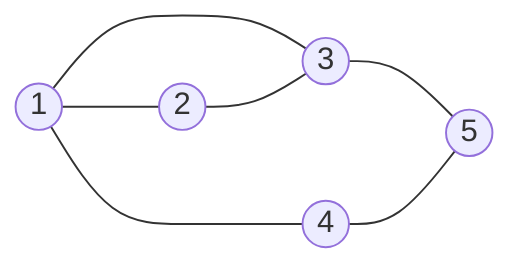
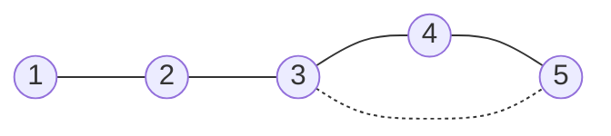
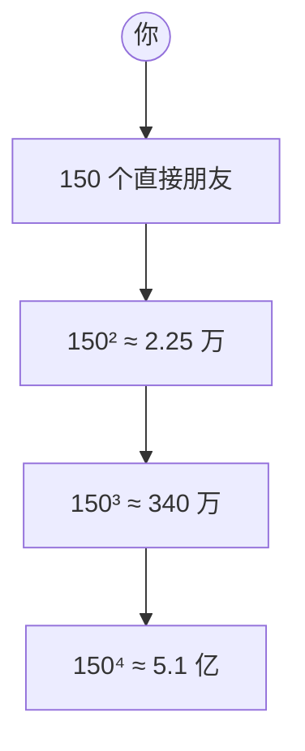
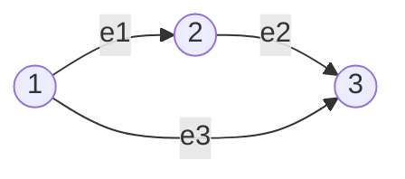

向量不必是箭头：只要集合上能定义加法、数乘且封闭，基与维数的整套语言就适用。矩阵可以当向量，函数也可以当向量；秩还有另一张脸——任何秩 $r$ 矩阵都是 $r$ 块秩 1 积木之和。最后用图把连接关系写成矩阵，为下一讲铺路。

## 矩阵空间 $M$

取 $M$ = 全体 $3\times3$ 实矩阵。

- 允许的运算只有矩阵相加、数乘，**不关心矩阵乘法**。
- 自然基 $E_{ij}$（第 $(i,j)$ 格为 1，其余为 0），共 9 个：

$$
M=\operatorname{span}\{E_{11},\dots,E_{33}\},\qquad \dim M=9.
$$

- 与 $\mathbb R^9$ 同构：按行摊平即可。区别只在摆法；矩阵空间自带「行 / 列 / 对称」结构，$\mathbb R^9$ 没有。
- 求坐标就是逐个格子读数：

$$
M=\begin{bmatrix}1&2&3\\4&5&6\\7&8&9\end{bmatrix}
=\sum_{i,j} m_{ij}E_{ij}.
$$

## 三个子空间、交与和

| 子空间 | 定义 | 维数 | 一组基 |
| ---- | ---- | :--: | ---- |
| 对称 $S$ | $A^{\mathsf T}=A$ | 6 | $E_{ii}$ + $E_{ij}+E_{ji}$ |
| 上三角 $U$ | $i>j$ 处为 0 | 6 | $E_{ij},\ i\le j$ |
| 对角 $D$ | 非对角为 0 | 3 | $E_{ii}$ |

- $S\cap U=D$：既对称又上三角只能是对角，$\dim=3$。
- $S\cup U$ 不是子空间：对称矩阵加上三角矩阵一般两者都不是；并集不封闭。
- $S+U=M$：任意矩阵可写成对称 + 上三角。构造：

$$
U_0=\operatorname{diag}(M)+\operatorname{strict\text{-}upper}(M-M^{\mathsf T}),\qquad S_0=M-U_0,
$$

则 $U_0$ 上三角、$S_0$ 对称。

- 维数公式：

$$
\dim(S+U)=\dim S+\dim U-\dim(S\cap U)
\qquad\Longleftrightarrow\qquad 9=6+6-3.
$$

## 微分方程：函数也是向量

$y''+y=0$ 的解：

$$
y=c_1\cos x+c_2\sin x.
$$

- 解集对加法、数乘封闭，是向量空间；$\{\cos x,\sin x\}$ 是一组基，$\dim=2$。
- 另一组基 $\{e^{ix},e^{-ix}\}$；基不唯一，维数唯一。
- 换基就是换坐标：$y=3\cos x-2\sin x$ 在 $\{\cos x,\sin x\}$ 下坐标 $(3,-2)$，在 $\{e^{ix},e^{-ix}\}$ 下是 $(3/2+i,\ 3/2-i)$。
- 二阶方程有两个独立解，和 $Ax=0$ 有 $n-r$ 个特解是同一回事；令 $L=\frac{d^2}{dx^2}+I$，解空间就是 $L$ 的零空间。

## 秩 1 矩阵

$\operatorname{rank}A=1$ ⇔ 所有行是同一行的倍数 ⇔ 所有列是同一列的倍数。秩 1 矩阵一定能写成一列 × 一行：

$$
A=uv^{\mathsf T},\qquad u\in\mathbb R^m,\ v\in\mathbb R^n.
$$

例：

$$
\begin{bmatrix}1&4&5\\2&8&10\end{bmatrix}
=\begin{bmatrix}1\\2\end{bmatrix}\begin{bmatrix}1&4&5\end{bmatrix}.
$$

行空间 $=\operatorname{span}\{v^{\mathsf T}\}$，列空间 $=\operatorname{span}\{u\}$。

**秩 $r$ 的矩阵 = $r$ 个秩 1 矩阵之和**。把 $A$ 化成 $A=CR$（$C$ 是主元列，$R$ 是行最简形的非零行）：

$$
A=\sum_{k=1}^{r} c_k r_k^{\mathsf T}.
$$

SVD 只是把这 $r$ 块选成正交的并按重要性排序。

**秩 1 集合不是子空间**：两个秩 1 矩阵相加一般秩 2，且零矩阵不在其中；「秩 $\le r$」含零但加法仍不封闭。常用不等式 $\operatorname{rank}(A+B)\le\operatorname{rank}A+\operatorname{rank}B$。

## $R^4$ 的一个子空间

$$
S=\{v\in\mathbb R^4:v_1+v_2+v_3+v_4=0\}.
$$

取 $A=[1\ 1\ 1\ 1]$，则 $S=N(A)$，$r=1$，$\dim S=4-1=3$。一组基（自由变量各取 1）：

$$
\{(-1,1,0,0)^{\mathsf T},(-1,0,1,0)^{\mathsf T},(-1,0,0,1)^{\mathsf T}\}.
$$

四个基本子空间：

| 空间 | 所在空间 | 维数 | 基 |
| ---- | ---- | :--: | ---- |
| $N(A)$ | $\mathbb R^4$ | 3 | 上面三个特解 |
| $C(A^{\mathsf T})$ | $\mathbb R^4$ | 1 | $(1,1,1,1)^{\mathsf T}$ |
| $C(A)$ | $\mathbb R^1$ | 1 | $(1)^{\mathsf T}$ |
| $N(A^{\mathsf T})$ | $\mathbb R^1$ | 0 | 空集 |

$3+1=4=n$，$1+0=1=m$。**零维空间的基是空集。**

## 图与小世界

图 = 节点 + 边，边只表示连接（无向图）。

5 个节点、6 条边。关联矩阵记录「哪条边连着哪两个节点」，与邻接矩阵不同：

| 矩阵 | 尺寸 | 元素 | 记录 |
| ---- | :--: | ---- | ---- |
| 邻接矩阵 | $n\times n$ | $A_{ij}=1$ 当且仅当 $i,j$ 相连 | 谁和谁相连 |
| 关联矩阵 | $n\times m$ | 每列一条边，两端为 $+1/-1$ | 每条边连接哪两个节点 |

**距离**是最少经过几条边。上面的图距离矩阵

$$
D=\begin{bmatrix}
0&1&1&1&2\\
1&0&1&2&2\\
1&1&0&2&1\\
1&2&2&0&1\\
2&2&1&1&0
\end{bmatrix}.
$$

所有元素和 $28$，除以 2 得 $14$；平均距离 $14/10=1.4$，直径（最大非对角元）$2$。这两个数度量图有多紧凑。

**小世界**：少量捷径让平均距离骤降。5 个节点排成链 $1-2-3-4-5$ 时平均距离 $2.0$、直径 $4$；只加一条 $(3,5)$，平均降到 $1.7$、直径降到 $3$。

只有链时：

只加一条捷径 $(3,5)$：

六度分隔的数量级：若每人认识 150 人，忽略重叠，$150^2\approx2.25$ 万、$150^3\approx340$ 万、$150^4\approx5.1$ 亿；四步超过美国人口。真实网络重叠多，实际约 6 步。

**关联矩阵预告**：三角形（3 节点 3 边）取方向 $e_1:1\to2,e_2:2\to3,e_3:1\to3$，

$$
B=\begin{bmatrix}
 1&0&1\\
-1&1&0\\
 0&-1&-1
\end{bmatrix}.
$$

每列只有两个非零元，列和为 0 ⇒ 三行相加为零 ⇒ 秩最多 2，连通图秩 $n-1=2$；全 1 向量在左零空间；回路 $1\to2\to3\to1$ 对应 $(1,1,-1)^{\mathsf T}$ 且 $B(1,1,-1)^{\mathsf T}=0$。**秩 = $n-$ 连通分量数，零空间维数 = 独立回路数**——下一讲展开。

## 直观理解

- 矩阵空间 = 9 个格子的积木盒：$E_{ij}$ 是「只在第 $(i,j)$ 格放 1」的模板；对称矩阵只能动 6 个格子。
- 交 = 共同方向，和 = 拼起来的方向；维数公式就是「尺寸相加再减重叠」。
- 秩 1 = 一张外积纸：$uv^{\mathsf T}$ 只需存 $m+n$ 个数，却铺满 $m\times n$ 个格子；低秩近似就是用几百个数概括一万个数。
- ODE 解空间 = 算子的零空间；二阶 ⇒ 2 维，因为积两次分多两个任意常数。
- 图 = 把关系变成矩阵：节点是坐标，边是非零元。
- 关联矩阵 = 每条边投一张 $+1/-1$ 票；所有列一起看，连通性和回路就浮出来。

## 拓展延伸

- 低秩近似与 SVD：$A=\sum\sigma_i u_i v_i^{\mathsf T}$，截断到前 $k$ 项是最优秩 $k$ 近似（Eckart–Young），用于图像压缩、推荐系统、降噪。LoRA 给权重加秩 $r$ 修正 $\Delta W=BA$，参数量从 $mn$ 降到 $r(m+n)$。
- Frobenius 内积让矩阵空间成为欧氏空间，投影、正交、最小二乘照搬。
- 线性 ODE 的解空间维数 = 方程阶数；边界条件把解空间切小；Sturm–Liouville 给正交基。
- 图与线性代数：$B^{\mathsf T}B$ 是拉普拉斯矩阵；$\dim N(B)$ = 连通分量数；Fiedler 向量用于谱聚类；PageRank 是转移矩阵的主特征向量；GNN 一层消息传递本质是邻接矩阵乘法。
- 小世界网络：Watts–Strogatz 模型说明少量随机捷径把平均路径长度从 $O(n)$ 压到 $O(\log n)$，同时保持高聚类系数。

## 习题课：矩阵空间的判定与基

**题目**：

$$
S=\{A\in M_{2\times3}(\mathbb R):[2,1,1]^{\mathsf T}\in N(A)\}.
$$

1. 证明 $S$ 是子空间。
2. 求 $S$ 的一组基与维数。
3. 附加：$W=\{A\in M_{2\times3}:[2,1]^{\mathsf T}\in C(A)\}$ 是子空间吗？

**核心翻译**：记 $x_0=(2,1,1)^{\mathsf T}$，「$x_0\in N(A)$」就是 $Ax_0=0$。把 $A$ 按行写成 $\begin{bmatrix}r_1\\r_2\end{bmatrix}$，条件等价于

$$
r_1x_0=0,\qquad r_2x_0=0.
$$

设 $r=(a,b,c)$，则 $2a+b+c=0\Rightarrow c=-2a-b$，每行都落在

$$
\operatorname{span}\{(1,0,-2),(0,1,-1)\}.
$$

**通用四步**：写点积 → 选系数非零的分量作主变量 → 解出主变量 → 自由变量取单位值。本题选 $c$ 当主变量得 $c=-2a-b$；若改选 $a$，则 $a=-(b+c)/2$，基变成 $(-1/2,1,0),(-1/2,0,1)$，张成同一空间。四步的作用分别是：让约束可数、让自由度可见、让解变成基、保证不多不少。

**求基**：每行 2 个自由参数，两行独立，共 $2\times2=4$ 个。四个模板矩阵：

$$
B_1=\begin{bmatrix}1&0&-2\\0&0&0\end{bmatrix},\quad
B_2=\begin{bmatrix}0&1&-1\\0&0&0\end{bmatrix},\quad
B_3=\begin{bmatrix}0&0&0\\1&0&-2\end{bmatrix},\quad
B_4=\begin{bmatrix}0&0&0\\0&1&-1\end{bmatrix}.
$$

任意 $A=\begin{bmatrix}a&b&-2a-b\\c&d&-2c-d\end{bmatrix}=aB_1+bB_2+cB_3+dB_4$，且四个模板无关，所以

$$
\boxed{\dim S=4.}
$$

数字自查：$A=\begin{bmatrix}1&0&-2\\3&4&-10\end{bmatrix}$ 两行都满足 $2a+b+c=0$，且 $A=B_1+3B_3+4B_4$。

**子空间验证**：$0\in S$；$(A+B)x_0=Ax_0+Bx_0=0$；$(cA)x_0=c(Ax_0)=0$。

**更快的算法**：$M_{2\times3}$ 共 6 维，$Ax_0=0$ 是 2 个独立线性方程（一行一个，互不牵连），每个降一维，故 $\dim S=6-2=4$。一般地，对任意固定 $x_0\ne0$，

$$
\dim\{A\in M_{m\times n}:Ax_0=0\}=mn-m.
$$

**线性映射视角**：$\varphi(A)=Ax_0$ 是 $M_{2\times3}\to\mathbb R^2$ 的线性映射，$S=\ker\varphi$。$x_0\ne0$ 时 $\varphi$ 满射、秩 2，秩-零化度给 $\dim S=6-2=4$。若 $x_0=0$，条件恒成立，$S=M_{2\times3}$，$\dim=6$。

**附加问题**：$W=\{A:\exists x,\ Ax=[2,1]^{\mathsf T}\}$。零矩阵的列空间是 $\{0\}$，不含 $[2,1]^{\mathsf T}$，所以 $0\notin W$，$W$ 不是子空间。数乘也不封闭：取 $A=\begin{bmatrix}2&0&0\\1&0&0\end{bmatrix}\in W$，$0\cdot A=0\notin W$。加法也不封闭：$C(-A)=C(A)$，$A+(-A)=0\notin W$。

**差在哪一个词**：

| 条件 | 翻译 | 类型 | 子空间 |
| ---- | ---- | ---- | ---- |
| $x_0\in N(A)$ | $Ax_0=0$ | 齐次线性方程（对 $A$ 线性） | 是（线性映射的核） |
| $b\in C(A)$ | $\exists x,\ Ax=b$ | 非齐次 + 存在量词 | 一般不是（不含 0、不封闭） |

前者是对 $A$ 的一个线性等式，满足它的 $A$ 构成过原点的超平面；后者是「$Ax=b$ 有解」，在 $A$ 空间里不是线性等式。它在 $x$ 空间里对应仿射集（不过原点），在 $A$ 空间里是去掉零矩阵的锥。

## 术语

| 英文 | 中文 | 含义 |
| ---- | ---- | ---- |
| matrix space | 矩阵空间 | 以矩阵为向量的空间，只认加法与数乘 |
| isomorphic | 同构 | 一一对应且保持两种运算，$M_{3\times3}\cong\mathbb R^9$ |
| intersection / sum | 交 / 和 | 同属两者 / 两者之和的全体 |
| dimension formula | 维数公式 | $\dim(S+U)=\dim S+\dim U-\dim(S\cap U)$ |
| solution space | 解空间 | 线性方程/算子的零空间 |
| rank one matrix | 秩 1 矩阵 | $A=uv^{\mathsf T}$ |
| outer product | 外积 | 列 × 行 |
| incidence matrix | 关联矩阵 | 节点-边关系表 |
| small world | 小世界 | 少量捷径让平均距离骤降 |
| codimension | 余维 | 母空间维数减子空间维数 |
| kernel of a linear map | 线性映射的核 | $\ker\varphi=\{x:\varphi(x)=0\}$，自动是子空间 |
| affine set | 仿射集 | 子空间平移，一般不过原点 |

## 总结

向量空间只要求能加、能数乘、封闭，所以矩阵（$M_{3\times3}$ 是 9 维）与函数（$y''+y=0$ 解空间 2 维）都成为向量。矩阵空间里对称 6、上三角 6、交 = 对角 3、和 = 全体 9。秩 1 矩阵是列 × 行的外积，任何秩 $r$ 矩阵是 $r$ 块积木之和——SVD 与低秩近似的源头。$R^4$ 中「分量和为零」是 $[1\ 1\ 1\ 1]$ 的零空间，四个空间维数 $3/1/1/0$。图可以用关联矩阵装进线性代数。习题课的核心：把「$x_0\in N(A)$」翻译成 $Ax_0=0$，每行一个齐次方程，得 4 个模板基；「$b\in C(A)$」含存在量词，零矩阵不在集合里，所以不是子空间。