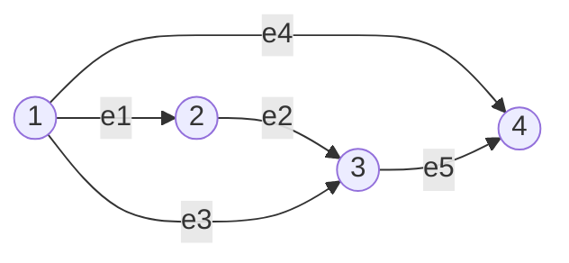
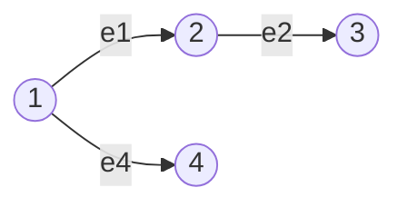
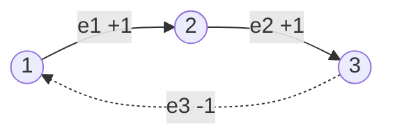
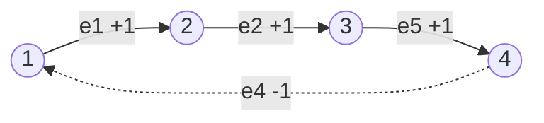
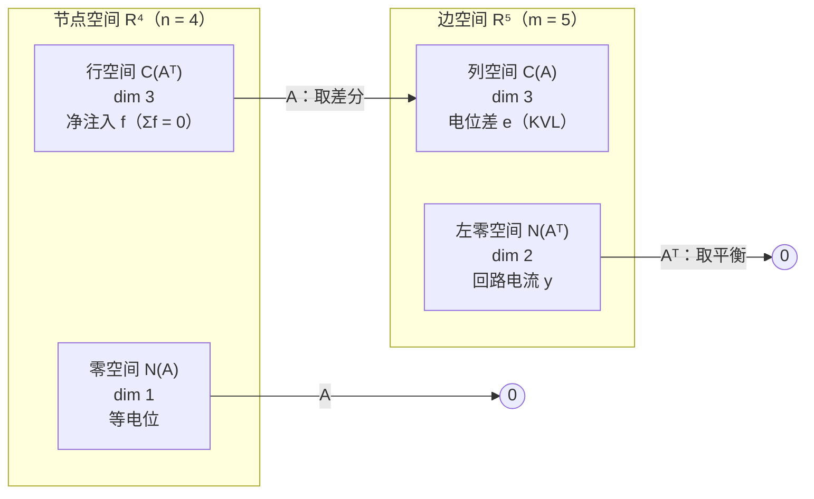
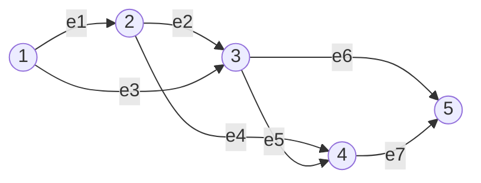
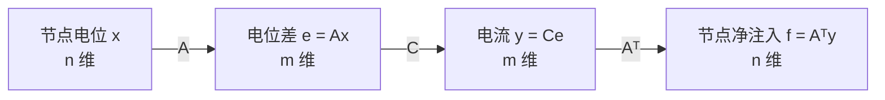
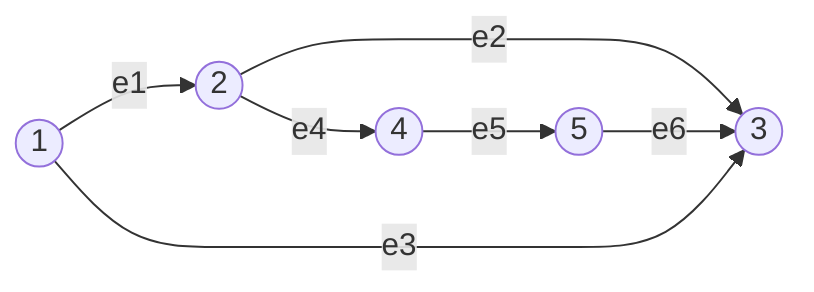

真实矩阵从问题里长出来，带着结构，结构决定答案。图（节点 + 边）是最重要的离散模型；一张关联矩阵把图翻译成线性代数，四个基本子空间立刻有了物理含义。

| 线性代数 | 电路里的名字 |
| ---- | ---- |
| $Ax$ | 各边电位差（电压降） |
| $N(A)$ | 等电位分布（差一个常数） |
| $A^{\mathsf T}y=0$ | 基尔霍夫电流定律（流入 = 流出） |
| $N(A^{\mathsf T})$ | 回路电流 |
| $\operatorname{rank}A$ | 节点数 $-$ 1，即生成树边数 |
| $m-r$ | 独立回路个数 |

三条方程串起来就是应用数学的基本结构：

$$
Ax=e,\qquad y=Ce\ (\text{欧姆定律}),\qquad A^{\mathsf T}y=f\ (\text{电流平衡}).
$$

## 图与关联矩阵

Strang 的例题：$n=4$ 个节点、$m=5$ 条边。

关联矩阵行对应边、列对应节点；边 $i\to j$ 在 $i$ 列为 $-1$、$j$ 列为 $+1$（尾 $-1$、头 $+1$）：

$$
A=\begin{bmatrix}
-1&1&0&0\\
0&-1&1&0\\
-1&0&1&0\\
-1&0&0&1\\
0&0&-1&1
\end{bmatrix}
\quad
\begin{array}{l}
e_1:1\to2\\ e_2:2\to3\\ e_3:1\to3\\ e_4:1\to4\\ e_5:3\to4
\end{array}
$$

三个结构：

1. 每行两个非零元 $+1,-1$，**行和为 0**（零空间含常数向量）。
2. 每列非零元个数 = 该节点度数。
3. 非零元总数 $=2m$，图越大越稀疏。

$Ax$ 是每条边上的电位差：

$$
Ax=\begin{bmatrix}x_2-x_1\\x_3-x_2\\x_3-x_1\\x_4-x_1\\x_4-x_3\end{bmatrix}.
$$

所有电位同时抬高 $c$，$Ax$ 不变——共同偏移被 $+1$ 和 $-1$ 抵消。

## 零空间：等电位

$$
Ax=0\iff\text{每条边两端电位相等}.
$$

连通图把所有节点串在一起，所以

$$
N(A)=\operatorname{span}\{(1,1,1,1)^{\mathsf T}\},\qquad \dim N(A)=1.
$$

电位只能确定到一个常数；真正驱动电流的是电位差。**接地**把某个节点电位固定为 0，未知数从 4 个变 3 个，去掉一列后三列线性无关。

一般情形：图有 $c$ 个连通分量，

$$
\dim N(A)=c,\qquad \operatorname{rank}A=n-c.
$$

## 秩与树

由 $\dim N(A)=1$：

$$
r=n-\dim N(A)=4-1=3.
$$

$4$ 个节点里只有 $3$ 个电位的差独立。主元行 $e_1,e_2,e_4$ 恰好构成一棵**树**：

树 = 连通且无回路：

| 图的性质 | 代数含义 |
| ---- | ---- |
| $n$ 个节点的树恰有 $n-1$ 条边 | $\operatorname{rank}A=n-1$ |
| 任意两点只有一条路径 | 行（边）之间没有线性关系 |
| 加一条边必产生一个回路 | 新行落入已有行的张成，秩不变 |
| 删一条边必分成两块 | 去掉一个独立约束，秩减 1 |

**秩 = 生成树所需的边数**；其余的边每多一条就多一个回路。

## 左零空间：基尔霍夫电流定律

$A^{\mathsf T}y=0$，$y$ 是每条边上的电流（顺箭头为正）：

$$
A^{\mathsf T}y=\begin{bmatrix}
-y_1-y_3-y_4\\
y_1-y_2\\
y_2+y_3-y_5\\
y_4+y_5
\end{bmatrix}=0.
$$

每一行对应一个节点：**流入 = 流出**，电荷不在节点堆积，即 **KCL**。

$$
\dim N(A^{\mathsf T})=m-r=5-3=2,
$$

正好是独立回路个数。基向量是两股绕圈流：

- 三角形 $1\to2\to3\to1$：$y^{(1)}=(1,1,-1,0,0)^{\mathsf T}$。

- 三角形 $1\to3\to4\to1$：$y^{(2)}=(0,0,1,-1,1)^{\mathsf T}$。

大回路 $1\to2\to3\to4\to1$ 的电流是两者之和：

$$
y^{(1)}+y^{(2)}=(1,1,0,-1,1)^{\mathsf T}.
$$

中间 $e_3$ 上两股反向电流抵消。**大回路不是新的独立回路，而是两个小回路的叠加。**

> 独立回路数 $=m-r=m-(n-1)=m-n+1$。

## 四个基本子空间在电路里的位置

| 子空间 | 所在空间 | 维数 | 物理含义 |
| ---- | :--: | :--: | ---- |
| $C(A)$ | $\mathbb R^5$（边） | 3 | 能由电位产生的电位差（KVL） |
| $N(A)$ | $\mathbb R^4$（节点） | 1 | 等电位：所有节点同加常数 |
| $C(A^{\mathsf T})$ | $\mathbb R^4$（节点） | 3 | 可作为外部注入电流 $f$ 的分布（$\sum f=0$） |
| $N(A^{\mathsf T})$ | $\mathbb R^5$（边） | 2 | 回路电流 |

两组正交关系有了名字：

- $C(A)\perp N(A^{\mathsf T})$ ⇔ 绕任意回路一圈，电位差之和为零——**KVL**。
- $C(A^{\mathsf T})\perp N(A)$ ⇔ $f^{\mathsf T}\mathbf 1=0$ ⇔ 外部注入总电流为零。

## 欧拉公式

对连通图：

$$
\#\text{回路}=m-r=m-(n-1)=m-n+1,
$$

移项：

$$
\boxed{n-m+\#\text{回路}=1.}
$$

这就是图论版**欧拉公式**。第二例：5 个节点、7 条边、3 个独立回路，$5-7+3=1$。

| 类型 | 维数直觉 | 例 |
| ---- | ---- | :--: |
| 节点 | 0 维（点） | 5 |
| 边 | 1 维（线段） | 7 |
| 回路 | 2 维（有面积） | 3 |

交替相加减得 1，是拓扑不变量（连通图的欧拉示性数）。树是最极端情形：$m=n-1$、回路 0。

> 平面图满足 $V-E+F=2$，而 $F=\text{回路数}+1$，代入得 $V-E+\text{回路数}=1$，两套公式是同一件事。多个连通分量时 $n-m+\text{回路数}=c$。

## 应用数学的三条方程

1. $e=Ax$：电位 → 电位差。
2. $y=Ce$：电位差 → 电流；$C$ 是对角矩阵，对角元是各边电导（电阻的倒数），即欧姆定律。
3. $A^{\mathsf T}y=f$：电流平衡，$f$ 是外部注入。

串起来：

$$
A^{\mathsf T}CA\,x=f.
$$

$C=I$ 时就是 $A^{\mathsf T}A\,x=f$。**有限元、电路仿真、弹簧网络、热传导共用这个方程。**

$A^{\mathsf T}A$ 是**图拉普拉斯矩阵**：

$$
A^{\mathsf T}A=\begin{bmatrix}
3&-1&-1&-1\\
-1&2&-1&0\\
-1&-1&3&-1\\
-1&0&-1&2
\end{bmatrix}.
$$

对角元 = 节点度数 $(3,2,3,2)$；非对角元 = 相邻为 $-1$，否则 0；对称、行和为 0、半正定，零空间是 $(1,1,1,1)$。

**完整算例**：所有电阻为 1，节点 4 接地（$x_4=0$），节点 1 注入 1 A、节点 3 抽出 1 A：

$$
f=(1,0,-1,0)^{\mathsf T},\qquad \sum f_i=0.
$$

解 $Lx=f$（删去第 4 行第 4 列）：

$$
\begin{bmatrix}3&-1&-1\\-1&2&-1\\-1&-1&3\end{bmatrix}
\begin{bmatrix}x_1\\x_2\\x_3\end{bmatrix}
=\begin{bmatrix}1\\0\\-1\end{bmatrix}
\Longrightarrow
x=\begin{bmatrix}1/4\\0\\-1/4\end{bmatrix}.
$$

回代 $y=Ax$：

$$
y=\left(-\tfrac14,-\tfrac14,-\tfrac12,-\tfrac14,\tfrac14\right)^{\mathsf T}.
$$

逐节点 KCL：节点 1 净流入 1 A；节点 2 为 0；节点 3 净流出 1 A；节点 4 为 0。全部吻合。**原来的 $4\times4$ 拉普拉斯矩阵奇异，接地删掉一行一列后才可逆**——这是所有电路仿真软件的第一步。

## 直观理解

- 电位 = 海拔：整体抬高不改变水流；零空间的 $(1,1,1,1)$ 就是整体抬高。
- 接地 = 选海平面：参考点任意，电位差与选择无关。
- KCL = 水龙头分叉处水量守恒；回路电流 = 水里的漩涡，每个节点进多少出多少。
- 树 = 脚手架：$n$ 个节点只要 $n-1$ 根杆；回路数就是「多买了几根杆」。
- 秩 = 脚手架根数；欧拉公式 = 按维数数点、线、面。
- 拉普拉斯矩阵 = 每个节点的「不适感」：$(Lx)_i=\sum_{j\sim i}(x_i-x_j)$，邻居都一样高就没感觉。
- $C(A)\perp N(A^{\mathsf T})$ 就是 KVL；$C(A^{\mathsf T})\perp N(A)$ 就是总电荷守恒。
- $A^{\mathsf T}A$ 对称，且第 $i$ 行第 $j$ 列只由节点 $i,j$ 是否相邻决定——矩阵就是图的另一张画像。

## 拓展延伸

- 谱图理论：$L=A^{\mathsf T}A$ 的 $0$ 特征值重数 = 连通分量数；$\lambda_2$（Fiedler 值）衡量多好切，Fiedler 向量给谱聚类方向。
- GNN 一层消息传递 $H'=\hat A H W$；GCN 的传播算子是拉普拉斯矩阵的多项式；PageRank 是转移矩阵的主特征向量。
- 有限元与结构力学：刚度矩阵就是 $A^{\mathsf T}CA$，$C$ 是材料刚度；桥梁、飞机应力分析归结为解巨大稀疏系统。
- 电路仿真（SPICE）的节点分析就是 $A^{\mathsf T}CA\,x=f$；接地、电压源、电流源分别对应删列、加约束、加右端项。
- 稀疏计算：消元产生填充，行列重排（图划分）能大幅减少计算量。
- 拓扑与同调：$b_0=c$、$b_1=$ 独立回路数，正是 Betti 数；欧拉示性数是同一套语言。
- 编码理论：把关联矩阵放到 $\mathbb F_2$ 上，零空间就是环空间，LDPC 码、量子纠错码的校验矩阵正是这种稀疏 0/1 矩阵。

## 习题课：直接读图

**题目**：5 个节点、6 条边，边已编号并定向。

求关联矩阵、$\ker A$、$\ker A^{\mathsf T}$、$\operatorname{tr}(A^{\mathsf T}A)$。**不做行变换，只看图。**

关联矩阵：

$$
A=\begin{bmatrix}
-1&1&0&0&0\\
0&-1&1&0&0\\
-1&0&1&0&0\\
0&-1&0&1&0\\
0&0&0&-1&1\\
0&0&1&0&-1
\end{bmatrix}
\quad
\begin{array}{l}
e_1:1\to2\\ e_2:2\to3\\ e_3:1\to3\\ e_4:2\to4\\ e_5:4\to5\\ e_6:5\to3
\end{array}
$$

- 每行一个 $+1$、一个 $-1$ ⇒ 行和为 0。
- 每列非零元个数 = 节点度数。
- 非零元共 $2m=12$。

**$\ker A$：等电位**。图连通 ⇒ 所有节点电位相等：

$$
\boxed{\ker A=\operatorname{span}\{(1,1,1,1,1)^{\mathsf T}\},\quad \dim\ker A=1.}
$$

于是 $\operatorname{rank}A=5-1=4$，正好是 5 个节点的生成树边数。例如 $e_1,e_2,e_4,e_5$ 连成树。

**$\ker A^{\mathsf T}$：平衡回路电流**。

$$
\dim\ker A^{\mathsf T}=m-\operatorname{rank}A=6-4=2.
$$

两个基本回路：

- 三角形 $1\to2\to3\to1$：$y^{(1)}=(1,1,-1,0,0,0)^{\mathsf T}$。
- 四边形 $2\to4\to5\to3\to2$：$y^{(2)}=(0,-1,0,1,1,1)^{\mathsf T}$。

外圈 $1\to2\to4\to5\to3\to1$ 是两者之和：

$$
y^{(1)}+y^{(2)}=(1,0,-1,1,1,1)^{\mathsf T},
$$

共用的 $e_2$ 上一正一负抵消。外圈不是新的独立回路。

**$\operatorname{tr}(A^{\mathsf T}A)$：数度数**。

$$
(A^{\mathsf T}A)_{ii}=\text{节点 }i\text{ 的度数},\qquad
\operatorname{tr}(A^{\mathsf T}A)=2+3+3+2+2=12.
$$

另一条路：$\operatorname{tr}(A^{\mathsf T}A)=\sum a_{ij}^2=2m=12$，因为每条边贡献两个端点（握手引理）。

**顺手写出拉普拉斯矩阵**：

$$
A^{\mathsf T}A=\begin{bmatrix}
2&-1&-1&0&0\\
-1&3&-1&-1&0\\
-1&-1&3&0&-1\\
0&-1&0&2&-1\\
0&0&-1&-1&2
\end{bmatrix}.
$$

对角元是度数 $(2,3,3,2,2)$，迹 12；非对角相邻为 $-1$；行和为 0，所以 $(1,1,1,1,1)^{\mathsf T}$ 在零空间，与 $\ker A$ 相同。欧拉公式交叉验证：$5-6+2=1$。

**结论**：$\ker A$ 用连通性读，$\ker A^{\mathsf T}$ 用回路读，秩用生成树读，迹用度数读——**图的结构就是答案**。

## 术语

| 英文 | 中文 | 含义 |
| ---- | ---- | ---- |
| graph / node / edge | 图 / 节点 / 边 | 离散模型基本对象 |
| incidence matrix | 关联矩阵 | 行 = 边、列 = 节点，元素 $-1,0,+1$ |
| orientation | 定向 | 人为指定边方向，用来定正负 |
| potential / potential difference | 电位 / 电位差 | 节点标量 / $Ax$ 的分量 |
| grounding | 接地 | 固定某节点电位为 0 |
| conductance | 电导 | 电阻的倒数，$C$ 的对角元 |
| KCL / KVL | 基尔霍夫电流 / 电压定律 | $A^{\mathsf T}y=0$ / 回路电位差和为 0 |
| loop / independent loops | 回路 / 独立回路 | 闭合路径 / 维数 $m-n+1$ |
| tree / spanning tree | 树 / 生成树 | 连通无回路，$n-1$ 条边 |
| graph Laplacian | 图拉普拉斯矩阵 | $L=A^{\mathsf T}A$，对角为度数 |
| Euler's formula | 欧拉公式 | $n-m+\text{回路数}=c$ |
| degree / handshaking lemma | 度数 / 握手引理 | 节点连边数 / $\sum\deg=2m$ |

## 总结

关联矩阵 $A$（行 = 边、列 = 节点、尾 $-1$ 头 $+1$）把图翻译成线性代数。$Ax$ 是电位差，$N(A)$ 是等电位（维数 = 连通分量数），$\operatorname{rank}A=n-c$（连通时 $n-1$，对应生成树边数），$N(A^{\mathsf T})$ 是回路电流（维数 $m-n+1$）。四个基本子空间分别对应电位差、等电位、可注入电流、回路电流；两组正交关系就是 KVL 与总电荷守恒。独立回路数代入秩公式得到欧拉公式 $n-m+\text{回路}=1$。$e=Ax$、$y=Ce$、$A^{\mathsf T}y=f$ 串成 $A^{\mathsf T}CA\,x=f$，$A^{\mathsf T}A$ 就是图拉普拉斯矩阵。