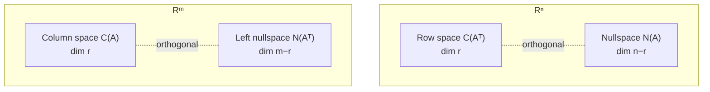

正交性给四个基本子空间补上了「方向」。上一章只知道它们的维数是 $r,r,n-r,m-r$；这一章证明：行空间 $\perp$ 零空间，列空间 $\perp$ 左零空间，而且它们互为**正交补**。正交性还顺手解释了 $A^{\mathsf T}A$ 为什么与 $A$ 同秩、什么时候可逆。

| 子空间 | 所在空间 | 维数 | 正交于 |
| ---- | :--: | :--: | ---- |
| 行空间 $C(A^{\mathsf T})$ | $\mathbb R^n$ | $r$ | 零空间 $N(A)$ |
| 零空间 $N(A)$ | $\mathbb R^n$ | $n-r$ | 行空间 $C(A^{\mathsf T})$ |
| 列空间 $C(A)$ | $\mathbb R^m$ | $r$ | 左零空间 $N(A^{\mathsf T})$ |
| 左零空间 $N(A^{\mathsf T})$ | $\mathbb R^m$ | $m-r$ | 列空间 $C(A)$ |

## 向量正交：点积为零

两个向量正交就是夹角 $90^\circ$。判断只需一个数：

$$
x\perp y\iff x^{\mathsf T}y=0.
$$

长度平方也是点积：

$$
\|x\|^2=x^{\mathsf T}x.
$$

例：$x=(1,2,3)$，$\|x\|^2=1+4+9=14$；取 $y=(2,-1,0)$，

$$
x^{\mathsf T}y=2-2+0=0,
$$

所以 $x\perp y$。此时

$$
\|x+y\|^2=\|(3,1,3)\|^2=9+1+9=19=14+5=\|x\|^2+\|y\|^2.
$$

这就是勾股定理。反过来也能推出正交：

$$
\|x+y\|^2=(x+y)^{\mathsf T}(x+y)
=\|x\|^2+2x^{\mathsf T}y+\|y\|^2.
$$

所以 $\|x+y\|^2=\|x\|^2+\|y\|^2$ 当且仅当 $x^{\mathsf T}y=0$。**勾股定理成立 $\iff$ 两向量正交**；非直角三角形多出来的交叉项 $2x^{\mathsf T}y$ 就是「斜边平方」比勾股定理多出的部分。

> 零向量与所有向量都正交：$0^{\mathsf T}y=0$ 恒成立。

## 子空间正交：每个都垂直于每个

定义：$S\perp T$ 指 $S$ 中**每一个**向量都垂直于 $T$ 中**每一个**向量。

注意不是「各取一个代表垂直」。$\mathbb R^3$ 里黑板面（$xz$ 平面）和地面（$xy$ 平面）看起来成直角，但它们的交线是 $x$ 轴：$(1,0,0)$ 同时属于两个平面，而 $x^{\mathsf T}x=1\ne0$。所以它们**不**正交。

由此得到两个判据：

- $S\perp T\Rightarrow S\cap T=\{0\}$：公共非零向量不可能垂直于自己。
- 反过来不成立：只交于 $0$ 还不够，方向也必须成 $90^\circ$。$\mathbb R^2$ 里两条过原点的直线只交于 $0$，但只有互相垂直时才正交。

$\mathbb R^2$ 的全部情形：

| $S$ | $T$ | 是否正交 |
| ---- | ---- | :--: |
| 过原点的直线 | 另一条过原点的直线 | 仅当两线垂直 |
| 过原点的直线 | $\{0\}$ | 总是 |
| 过原点的直线 | 整个平面 | 从不 |

零子空间 $\{0\}$ 与任何子空间都正交——零向量与所有向量点积为零。这和「零向量垂直于所有向量」是同一条规则。

## 四个基本子空间互相垂直

### 行空间 ⟂ 零空间

设 $x\in N(A)$，即 $Ax=0$。把 $A$ 按行写开：

$$
Ax=
\begin{bmatrix}
\text{row}_1\\
\text{row}_2\\
\vdots\\
\text{row}_m
\end{bmatrix}x
=
\begin{bmatrix}
\text{row}_1^{\mathsf T}x\\
\text{row}_2^{\mathsf T}x\\
\vdots\\
\text{row}_m^{\mathsf T}x
\end{bmatrix}
=
\begin{bmatrix}0\\0\\\vdots\\0\end{bmatrix}.
$$

所以 $x$ 与 $A$ 的每一行都正交。行空间里还有行的线性组合 $c_1\text{row}_1+\cdots+c_m\text{row}_m$，它与 $x$ 的点积是这些零的同样组合，仍然是零。因此

$$
C(A^{\mathsf T})\perp N(A).
$$

**$Ax=0$ 这个式子本身就在说这件事**：每个方程是一个行向量与 $x$ 的点积等于零。

### 列空间 ⟂ 左零空间

把同样的论证用在 $A^{\mathsf T}$ 上：

$$
C(A)\perp N(A^{\mathsf T}).
$$

### 正交补

不只是「垂直」，而是「垂直且刚好填满」：

$$
N(A)=C(A^{\mathsf T})^{\perp},\qquad C(A)=N(A^{\mathsf T})^{\perp}.
$$

「正交补」$S^{\perp}$ 指**所有**垂直于 $S$ 的向量，不只是某几个。维数正好相加：

$$
\dim C(A^{\mathsf T})+\dim N(A)=r+(n-r)=n,
$$

$$
\dim C(A)+\dim N(A^{\mathsf T})=r+(m-r)=m.
$$

这就是**线性代数基本定理的第二部分**：第一部分是维数，第二部分是正交性，第三部分是正交基（下一章）。

反例：$\mathbb R^3$ 中两条互相垂直的直线，维数 $1+1=2<3$，它们互相正交，但彼此不是正交补——还差一整个方向的向量。

### 一个算例

$$
A=\begin{bmatrix}1&2&5\\2&4&10\end{bmatrix}.
$$

第二行是第一行的 $2$ 倍，所以 $r=1$。

- 行空间：$\operatorname{span}\{(1,2,5)^{\mathsf T}\}$，一条直线。
- 零空间：$x_1+2x_2+5x_3=0$，一个平面。
- 这个平面的法向量正是 $(1,2,5)$——行空间的向量。

维数 $1+2=3$，行空间与零空间把 $\mathbb R^3$ 切成两个互相垂直的部分。第二行对行空间和零空间没有任何新贡献。

## $A^{\mathsf T}A$：下一章的主角

$A$ 是 $m\times n$，$A^{\mathsf T}A$ 是 $n\times n$：方阵、对称。

关键事实：

$$
N(A^{\mathsf T}A)=N(A),\qquad
\operatorname{rank}(A^{\mathsf T}A)=\operatorname{rank}(A).
$$

证明只用一行：

$$
A^{\mathsf T}Ax=0
\Longrightarrow x^{\mathsf T}A^{\mathsf T}Ax=0
\Longrightarrow (Ax)^{\mathsf T}(Ax)=\|Ax\|^2=0
\Longrightarrow Ax=0.
$$

反向 $Ax=0\Rightarrow A^{\mathsf T}Ax=0$ 显然。所以两个零空间相同；秩 $=$ 列数 $-$ 零空间维数，也相同。

于是

$$
A^{\mathsf T}A\text{ 可逆}\iff N(A)=\{0\}\iff A\text{ 的列线性无关}.
$$

### 两个数例

列无关：

$$
A=\begin{bmatrix}1&1\\1&2\\1&5\end{bmatrix},
\qquad
A^{\mathsf T}A=
\begin{bmatrix}3&8\\8&30\end{bmatrix},
\qquad
\det=90-64=26\ne0.
$$

列相关：

$$
A=\begin{bmatrix}1&1\\2&2\\3&3\end{bmatrix},
\qquad
A^{\mathsf T}A=
\begin{bmatrix}14&14\\14&14\end{bmatrix}.
$$

两列相同，秩只有 $1$，$A^{\mathsf T}A$ 奇异。

$A^{\mathsf T}A$ 的元素就是列与列的点积：

$$
(A^{\mathsf T}A)_{ij}=(\text{column }i)^{\mathsf T}(\text{column }j).
$$

对角元是各列长度的平方，非对角元是两列的点积。**$A^{\mathsf T}A$ 是「列向量两两关系」的汇总表。**

## 识别信号

- 题面出现“垂直 / 正交” → 先算点积，不要先画图。
- 问“两个子空间是否正交” → 只可能是行空间与零空间、列空间与左零空间这两对，其余组合一般不正交。
- 给了一组列向量，问是否两两正交 → 看 $A^{\mathsf T}A$ 是不是对角矩阵。
- 要判断某向量是否在零空间 → 看它与每一行是否都正交，比解方程快。
- 见到 $A^{\mathsf T}Ax=0$ → 直接写 $Ax=0$（两者零空间相同），这是后面所有推导的钥匙。

## 直观理解

- 点积 $x^{\mathsf T}y=\|x\|\|y\|\cos\theta$：它量的是「$x$ 在 $y$ 方向上有多少分量」。等于零，就是完全没有分量，即 $90^\circ$。
- 勾股定理：正交时交叉项 $2x^{\mathsf T}y$ 消失，长度平方才能直接相加。
- 行空间与零空间：把每个方程看成一个平面（或超平面）的法向量；零空间是所有平面的公共交线/交点。法向量张成行空间，交线就是零空间，两者天然垂直。
- 正交补：不只是「找几条垂直的向量」，而是「把剩下的维度全部占满」。维数相加等于整个空间，才叫补。
- $A^{\mathsf T}A$：把 $A$ 的每一列当成一个向量，两两点积排成表。对角元是长度平方；列正交时非对角元全为零，表就变成对角矩阵——这是下一章「正交基」的起点。
- 例：$A$ 的两列是 $(1,1,1)$ 和 $(1,2,5)$，则 $A^{\mathsf T}A=\begin{bmatrix}3&8\\8&30\end{bmatrix}$；$3=\|(1,1,1)\|^2$，$30=\|(1,2,5)\|^2$，$8=(1,1,1)\cdot(1,2,5)$。

## 拓展延伸

- **正交基与 QR**：若 $A$ 的列两两正交且长度为 $1$，则 $A^{\mathsf T}A=I$，投影矩阵简化为 $AA^{\mathsf T}$，求逆消失。Gram-Schmidt 就是把普通基变成这种基。
- **最小二乘**：$Ax=b$ 无解时，投影到列空间得到 $A^{\mathsf T}A\hat x=A^{\mathsf T}b$；正交性保证误差最小。
- **傅里叶级数**：$\sin nx$、$\cos nx$ 在函数内积下两两正交，系数就是投影——和这里的公式同构。
- **PCA / SVD**：协方差矩阵的特征向量给出正交主方向；SVD 把任意矩阵分解成「正交 → 对角 → 正交」。
- **图拉普拉斯**：上一章的 $L=A^{\mathsf T}A$ 对称半正定，零空间是常数向量；$L$ 的特征向量给出图上互相正交的振动模式。
- **统计**：$A^{\mathsf T}A$ 出现在 Fisher 信息矩阵、协方差矩阵中；列无关对应参数可辨识。

## 术语

| 英文 | 中文 | 含义 |
| ---- | ---- | ---- |
| orthogonal vectors | 正交向量 | 点积为零，夹角 $90^\circ$ |
| dot product / inner product | 点积 / 内积 | $x^{\mathsf T}y$ |
| orthogonal subspaces | 正交子空间 | 每个向量都垂直于另一个子空间的每个向量 |
| orthogonal complement | 正交补 | 所有垂直向量的集合，维数相加填满整个空间 |
| row space / column space | 行空间 / 列空间 | $C(A^{\mathsf T})$ / $C(A)$ |
| nullspace / left nullspace | 零空间 / 左零空间 | $N(A)$ / $N(A^{\mathsf T})$ |
| rank | 秩 | 列空间维数 |
| symmetric matrix | 对称矩阵 | $A^{\mathsf T}=A$ |
| independent columns | 列线性无关 | $N(A)=\{0\}$ |
| Pythagoras | 勾股定理 | 正交时 $\|x+y\|^2=\|x\|^2+\|y\|^2$ |

## 总结

正交 $=$ 点积为零。向量正交推出勾股定理；子空间正交要求逐对垂直，且只有交于零还不够。行空间 $\perp$ 零空间、列空间 $\perp$ 左零空间，并且互为正交补，维数相加为 $n$ 或 $m$。$A^{\mathsf T}A$ 与 $A$ 同秩、同零空间，列线性无关时可逆；它的元素就是列与列的点积。下一章用这套几何处理 $Ax=b$ 无解的情形——投影与最小二乘。
