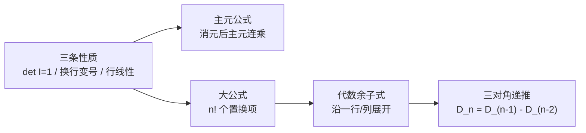

上一讲只用三条性质就推出了行列式的十条规则，但始终没说清"这个数到底怎么算出来"。这一讲把行列式真正写成公式：**大公式**用 $n!$ 个置换项"摊开"它，**代数余子式**把它递归拆成 $n-1$ 阶，**主元公式**则让消元把复杂性提前消化掉。三种写法是同一个数的三种压缩方式。

## 从拆行推出大公式

思路和 3B 一样：把每一行拆成标准基向量的线性组合。

$$
\begin{bmatrix}a&b\\c&d\end{bmatrix}
=\begin{bmatrix}a&0\\c&d\end{bmatrix}+\begin{bmatrix}0&b\\c&d\end{bmatrix}
$$

对两行都拆，得到 $2\times2=4$ 个行列式，每个矩阵每行恰好一个非零元。其中两个带零列，行列式为零；剩下两个是

$$
\det\begin{bmatrix}a&0\\0&d\end{bmatrix}+\det\begin{bmatrix}0&b\\c&0\end{bmatrix}
=ad-bc.
$$

第二项先换一次行变成对角矩阵，所以带负号。

对 $n$ 阶做同样的事，一共拆出 $n^n$ 个矩阵，但**只有"每行取一个、每列恰好用一次"的项能活下来**——缺了某一列就会出现零列，行列式为零。于是每一项对应列号的一个排列 $\sigma$：

$$
a_{1\sigma(1)}\,a_{2\sigma(2)}\cdots a_{n\sigma(n)},
$$

把每行因子提到外面，剩下的是一个置换矩阵，它的行列式是 $(-1)^{\text{交换次数}}$。这就是**大公式**：

$$
\boxed{\det A=\sum_{\sigma\in S_n}\operatorname{sgn}(\sigma)\,
a_{1\sigma(1)}a_{2\sigma(2)}\cdots a_{n\sigma(n)}}
$$

- 共 $n!$ 项：$2\times2$ 有 2 项，$3\times3$ 有 6 项，$4\times4$ 有 24 项。
- 正负各占一半。$\operatorname{sgn}(\sigma)$ 由"换几次行能排回 $1,2,\dots,n$"的奇偶决定，也等于排列的逆序数奇偶。
- 它和上一讲的三条性质等价：既能由性质推出公式，也能从公式倒推性质（比如 $A=I$ 时只有恒等排列一项非零）。

## 3×3 的六项与 Sarrus 规则

$$
\begin{aligned}
\det\begin{bmatrix}a_{11}&a_{12}&a_{13}\\a_{21}&a_{22}&a_{23}\\a_{31}&a_{32}&a_{33}\end{bmatrix}
={}&a_{11}a_{22}a_{33}+a_{12}a_{23}a_{31}+a_{13}a_{21}a_{32}\\
&-a_{11}a_{23}a_{32}-a_{12}a_{21}a_{33}-a_{13}a_{22}a_{31}.
\end{aligned}
$$

正项是"从左上往右下"的三条对角线，负项是反方向的三条——这就是中学的 **Sarrus 规则（对角线法则）**。但它**只对 2、3 阶成立**：4 阶起对角线只有 8 条，而大公式有 24 项，继续套用必错。

数例：

$$
A=\begin{bmatrix}1&2&3\\4&5&6\\7&8&10\end{bmatrix},\qquad
\det A=50+84+96-48-80-105=-3.
$$

## 数例：4×4 大公式只剩两项

$$
A_4=\begin{bmatrix}1&1&0&0\\0&1&1&0\\0&0&1&1\\1&0&0&1\end{bmatrix}
$$

24 项里绝大多数含零。非零项只有两个：

- 恒等排列：$1\cdot1\cdot1\cdot1=1$，符号 $+$；
- $\sigma=(2,3,4,1)$：$a_{12}a_{23}a_{34}a_{41}=1$，逆序三次，符号 $-$。

$$
\det A_4=1-1=0.
$$

零多到能肉眼数完的情况毕竟少。更快的确认方式：$R_1-R_2+R_3-R_4=(1,1,1,1)-(1,1,1,1)=0$，行相关，行列式必为零。

## 代数余子式

大公式按"第一行选了哪一列"重新分组，就得到余子式。

**余子式（minor）** $M_{ij}$：删掉第 $i$ 行、第 $j$ 列后剩下的 $(n-1)$ 阶行列式。

**代数余子式（cofactor）**：把符号也塞进去，

$$
C_{ij}=(-1)^{i+j}M_{ij}.
$$

符号呈**棋盘格**：

$$
\begin{matrix}
+&-&+&\cdots\\
-&+&-&\\
+&-&+&\\
\vdots&&&\ddots
\end{matrix}
$$

**余子式展开**：沿任意一行或一列展开都成立，

$$
\det A=\sum_{j=1}^{n}a_{ij}C_{ij}
=\sum_{i=1}^{n}a_{ij}C_{ij}.
$$

为什么？以第一行为例：含 $a_{11}$ 的所有项恰好是 $a_{11}$ 乘以"删掉第一行第一列后剩下的所有挑法"，也就是 $a_{11}M_{11}$；含 $a_{12}$ 的项比它多一次行交换，所以带负号，正好是 $a_{12}C_{12}$。后面同理。

$2\times2$ 验证：

$$
\det\begin{bmatrix}a&b\\c&d\end{bmatrix}
=a\cdot d+b\cdot(-c)=ad-bc.
$$

$3\times3$ 沿第一行：

$$
\det A=a_{11}(a_{22}a_{33}-a_{23}a_{32})
-a_{12}(a_{21}a_{33}-a_{23}a_{31})
+a_{13}(a_{21}a_{32}-a_{22}a_{31}),
$$

展开后就是上面六项。

> 计算时只沿**零最多的行或列**展开。每展开一次，规模降一阶；对一般矩阵递归下去仍是 $O(n!)$，所以实际数值计算还是消元。

## 数例：5×5 循环结构

### A：对角 $x$，上一斜线 $y$，左下角再补一个 $y$

$$
A=\begin{bmatrix}
x&y&0&0&0\\
0&x&y&0&0\\
0&0&x&y&0\\
0&0&0&x&y\\
y&0&0&0&x
\end{bmatrix}
$$

第一列只有 $(1,1)$ 的 $x$ 和 $(5,1)$ 的 $y$。沿第一列展开：

- $x\cdot C_{11}=x\cdot x^4$，余下的是上三角；
- $y\cdot C_{51}=y\cdot(+1)^{5+1}\cdot y^4$，余下的是下三角，符号 $+$。

$$
\det A=x^5+y^5.
$$

取 $x=2,y=1$ 得 $33$。这个矩阵每行都是上一行循环右移，属于**循环矩阵**，它的特征值之积 $\prod_{k=0}^{4}(2+\omega^k)=2^5-(-1)^5=33$，与展开一致（见拓展）。

### B：对角 $x$，其余全是 $y$

$$
B=\begin{bmatrix}
x&y&y&y&y\\
y&x&y&y&y\\
y&y&x&y&y\\
y&y&y&x&y\\
y&y&y&y&x
\end{bmatrix}
$$

它没有零，直接展开是灾难。先做**行差**（行列式不变）：从下往上，每一行减去原上一行，得到

$$
\begin{bmatrix}
x&y&y&y&y\\
y-x&x-y&0&0&0\\
0&y-x&x-y&0&0\\
0&0&y-x&x-y&0\\
0&0&0&y-x&x-y
\end{bmatrix}
$$

再做**列和**（行列式也不变）：把第 2、3、4、5 列都加到第 1 列。除了第一行，其余各行都满足 $(y-x)+(x-y)=0$，于是

$$
B\sim\begin{bmatrix}
x+4y&y&y&y&y\\
0&x-y&0&0&0\\
0&y-x&x-y&0&0\\
0&0&y-x&x-y&0\\
0&0&0&y-x&x-y
\end{bmatrix}
$$

沿第一列展开，剩下的是对角为 $x-y$ 的下三角：

$$
\boxed{\det B=(x+4y)(x-y)^4.}
$$

取 $x=2,y=1$ 得 $6$。B 还能写成 $B=(x-y)I+y\,\mathbf 1\mathbf 1^{\mathsf T}$，特征值立刻给出 $x-y$（四重）与 $x+4y$，乘积同为 $(x+4y)(x-y)^4$。

## 数例：三对角递推

$$
A_n=\begin{bmatrix}
1&1&&\\
1&1&1&\\
&1&1&\ddots\\
&&\ddots&1
\end{bmatrix}_{n\times n},
\qquad D_n=\det A_n.
$$

沿第一行展开：$D_n=D_{n-1}-D_{n-2}$。初值

$$
D_1=1,\qquad D_2=\det\begin{bmatrix}1&1\\1&1\end{bmatrix}=0.
$$

于是

$$
1,\ 0,\ -1,\ -1,\ 0,\ 1,\ 1,\ 0,\ -1,\dots
$$

**周期为 6**，所以 $D_{61}=D_1=1$。这是余子式最漂亮的用法：不求具体值，只求关系式，把 $n$ 阶问题变成二阶递推。

## 三种公式对照

| 公式 | 形式 | 成本 | 适用场景 |
| --- | --- | --- | --- |
| 主元公式 | $\det A=(-1)^{\text{换行}}\prod d_i$ | $\sim n^3/3$ | 一般数值计算，默认用它 |
| 大公式 | $n!$ 个置换项之和 | $O(n!)$ | 证明性质、分析结构 |
| 代数余子式 | 递归降到 $n-1$ 阶 | 最坏 $O(n!)$ | 零多、有规律、能出递推 |

三者算的是同一个数。消元把复杂性**提前藏进主元**，大公式把它**摊开**，余子式在两者之间折中：一个好算的数乘一个"难算但小一阶"的行列式。

## 识别信号

- 大量零元素，且每行非零很少 → 直接数大公式的非零项，或沿零最多的行/列展开。
- 某行/列只有一个非零元 → 立刻沿它展开，降一阶。
- 相邻两行只差少数几个位置 → 先做行差、列和，把公共部分消掉。
- 矩阵是"对角 + 全 1"或"$\alpha I+\beta\mathbf 1\mathbf 1^{\mathsf T}$" → 用特征值，别展开。
- 要求 $D_n$ 的通式 → 沿边行展开，得到 $D_n=aD_{n-1}+bD_{n-2}$ 这类递推。
- 一般矩阵、$n$ 稍大、没有结构 → 消元，别碰 $n!$。
- 矩阵有循环/三对角/带状结构 → 余子式或递推，通常有闭式或周期。

## 直观理解

- **大公式就是"每行每列各挑一个"的所有搭配**：$n$ 行依次挑，第一行 $n$ 种、第二行 $n-1$ 种……共 $n!$ 种。零越多，越多搭配自动出局。
- **符号来自"排回原位的交换次数"**：$2\times2$ 反对角要换一次，带负号；$4\times4$ 反对角要换两次（$1\leftrightarrow4$、$2\leftrightarrow3$），带正号——所以"对角线符号规律"不能跨阶数硬套。
- **余子式 = 先钉死一个格子，剩下的世界自动缩小一阶**：选中 $a_{ij}$ 后，第 $i$ 行和第 $j$ 列都不能再用，剩下的正是 $M_{ij}$。棋盘符号可以理解成"这个格子自带的朝向"。
- **行列式 = 有向体积**：大公式把这个体积拆成 $n!$ 个小平行体的有向体积之和；余子式则是沿一个方向切片，先算底面积再乘高。
- **B 的两步操作很有画面感**：行差把"上下行几乎一样"的部分抵消，列和把"反对称的 $\pm(x-y)$"抵消，最后只剩一条干净的上三角。

## 拓展延伸

- **Leibniz 公式与逆序数**：$\operatorname{sgn}(\sigma)=(-1)^{\operatorname{inv}(\sigma)}$，其中 $\operatorname{inv}$ 是逆序对数；这是大公式的严格写法，也是"行列式是斜对称多重线性函数"的来源。
- **伴随矩阵与 Cramer 法则**：把余子式排成矩阵再转置得 $\operatorname{adj}A$，满足 $A^{-1}=\operatorname{adj}A/\det A$；解 $Ax=b$ 时 $x_i=\det A_i/\det A$。理论漂亮，计算仍用消元。
- **行列式与特征值**：$\det A=\prod\lambda_i$，$\operatorname{tr}A=\sum\lambda_i$；循环矩阵的特征值是 $\sum_k c_k\omega^{jk}$，B 这种"$\alpha I+\beta\mathbf 1\mathbf 1^{\mathsf T}$"则直接读出特征值。
- **积和式（permanent）**：把大公式里的 $\operatorname{sgn}(\sigma)$ 删掉，得到积和式，它数的是二分图的完美匹配数，属于 $\#P$-完全问题；行列式之所以能在多项式时间算出来，全靠这个符号结构。
- **矩阵树定理**：图的拉普拉斯矩阵任意一个余子式等于生成树个数——[[L12 图·网络·关联矩阵]] 里的图论在这里接上了行列式。
- **计算复杂度**：大公式 $n!$、余子式递归同样是指数级，高斯消元 $n^3$；$n=20$ 时 $20!\approx2.4\times10^{18}$，而消元只要八千次运算。
- **Pfaffian**：偶数阶斜对称矩阵的 $\det A=(\operatorname{Pf}A)^2$，Pfaffian 本身也是余子式式的组合和，见 [[L16 行列式的性质]]。
- **几何与数值**：$|\det A|$ 是平行体体积，等于奇异值之积；条件数大时行列式对舍入误差极其敏感，这也是实践中更常用 LU/QR 而非展开的原因。

## 术语

| 英文 | 中文 | 含义 |
| ---- | ---- | ---- |
| big formula | 大公式 | $\sum_\sigma\operatorname{sgn}(\sigma)\prod_i a_{i\sigma(i)}$，共 $n!$ 项 |
| permutation | 排列 / 置换 | $1,\dots,n$ 的一种顺序 |
| sign of permutation | 排列符号 | 交换次数的奇偶，$(-1)^{\operatorname{inv}(\sigma)}$ |
| inversion | 逆序 | 排列中前大后小的数对 |
| minor | 余子式 | 删去一行一列后的 $(n-1)$ 阶行列式，不带符号 |
| cofactor | 代数余子式 | $C_{ij}=(-1)^{i+j}M_{ij}$ |
| cofactor expansion | 余子式展开 | 沿一行/列把 $n$ 阶降到 $n-1$ 阶 |
| tridiagonal | 三对角 | 只有主对角及相邻两条斜线非零 |
| recurrence | 递推 | $D_n$ 由前几项决定，如 $D_n=D_{n-1}-D_{n-2}$ |
| circulant matrix | 循环矩阵 | 每行是上一行循环移位 |
| permanent | 积和式 | 大公式去掉符号，数完美匹配 |
| adjugate | 伴随矩阵 | 代数余子式矩阵的转置 |
| Cramer's rule | 克拉默法则 | 用行列式比值解线性方程组 |

## 总结

大公式把行列式写成 $n!$ 个"每行每列各取一个"的乘积之和，符号由排列的奇偶决定；它能从三条性质拆行推出，也反过来解释了所有性质。按第一行分组就得到代数余子式 $C_{ij}=(-1)^{i+j}M_{ij}$，沿任意行/列展开可把 $n$ 阶降到 $n-1$ 阶。实际计算的分工是：一般矩阵用消元主元连乘，零多或有规律时用余子式，理论证明与结构分析用大公式。两个典型例子——循环矩阵 $x^5+y^5$、对角加全 $y$ 的 $(x+4y)(x-y)^4$——展示了"先做行差列和，再展开"的威力；三对角矩阵则给出周期为 6 的递推序列 $1,0,-1,-1,0,1$。
