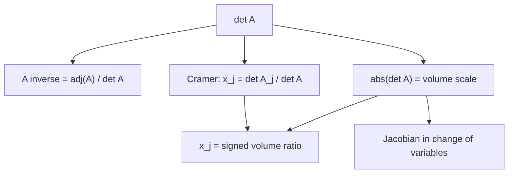

行列式的前两讲解决了「怎么算」；这一讲回答「算出来有什么用」。答案有三层：它是逆矩阵公式的分母，是 Cramer 法则的分子与分母，也是线性变换对体积的缩放因子。三件事其实共享同一个结构——行列式对每一列是线性的，而「两列相同则为零」让所有不对应的项自动消失。

## 逆矩阵：伴随矩阵

把代数余子式 $C_{ij}=(-1)^{i+j}M_{ij}$ 按位置排成矩阵 $C$，再转置，得到**伴随矩阵**：

$$
\operatorname{adj}A=C^{\mathsf T},\qquad
\boxed{A^{-1}=\frac{1}{\det A}\operatorname{adj}A}.
$$

$2\times2$ 就是熟悉的公式：

$$
A=\begin{bmatrix}a&b\\c&d\end{bmatrix},\quad
C=\begin{bmatrix}d&-c\\-b&a\end{bmatrix},\quad
A^{-1}=\frac{1}{ad-bc}\begin{bmatrix}d&-b\\-c&a\end{bmatrix}.
$$

**为什么成立**：计算 $A C^{\mathsf T}$ 的第 $(i,j)$ 项，是 $A$ 的第 $i$ 行点乘 $C$ 的第 $j$ 行：

$$
(A C^{\mathsf T})_{ij}=\sum_k a_{ik}C_{jk}.
$$

- $i=j$：这正是沿第 $i$ 行的余子式展开，等于 $\det A$。
- $i\ne j$：它等于「把第 $j$ 行换成第 $i$ 行」后矩阵的行列式。此时有两行相同，行列式为零。

所以 $A C^{\mathsf T}=(\det A)I$，两边除以 $\det A$ 即得。这个证明同时说明了：$\det A\ne0$ 时逆存在，$\det A=0$ 时公式失效。

$3\times3$ 数例：

$$
A=\begin{bmatrix}2&1&0\\1&2&1\\0&1&2\end{bmatrix},\qquad \det A=4.
$$

它的余子式矩阵为

$$
C=\begin{bmatrix}3&-2&1\\-2&4&-2\\1&-2&3\end{bmatrix},
$$

恰好对称，所以

$$
A^{-1}=\frac14\begin{bmatrix}3&-2&1\\-2&4&-2\\1&-2&3\end{bmatrix}.
$$

验证第一行第一列：$(2\cdot3+1\cdot(-2)+0\cdot1)/4=1$。

## Cramer 法则

把 $x=A^{-1}b=\frac{1}{\det A}C^{\mathsf T}b$ 的分量写出来：

$$
x_j=\frac{1}{\det A}\sum_i C_{ij}b_i.
$$

右边分子正是「把 $A$ 的第 $j$ 列换成 $b$」后沿第 $j$ 列展开的行列式。记这个矩阵为 $A_j$：

$$
\boxed{x_j=\frac{\det A_j}{\det A}},\qquad
A_j=\big[a_1,\dots,a_{j-1},b,a_{j+1},\dots,a_n\big].
$$

$2\times2$ 数例：解

$$
\begin{bmatrix}2&1\\1&3\end{bmatrix}\begin{bmatrix}x_1\\x_2\end{bmatrix}
=\begin{bmatrix}3\\5\end{bmatrix}.
$$

$\det A=5$，

$$
x_1=\frac{\det\begin{bmatrix}3&1\\5&3\end{bmatrix}}{5}=\frac{4}{5},\qquad
x_2=\frac{\det\begin{bmatrix}2&3\\1&5\end{bmatrix}}{5}=\frac{7}{5}.
$$

回代：$2\cdot\frac45+\frac75=3$，$\frac45+3\cdot\frac75=5$。

## 克莱姆法则到底有什么用

Cramer 法则在计算上名声很差，但它的价值本来就不在「快速解方程」。把它当成一个**结构公式**，用途反而很多。

### 1. 显式依赖：解对数据如何敏感

由 $x=A^{-1}b$ 立刻读出

$$
\frac{\partial x_j}{\partial b_i}=(A^{-1})_{ji}.
$$

也就是说，**逆矩阵的第 $(j,i)$ 项就是第 $j$ 个解对第 $i$ 个右端项的敏感度**。对矩阵元素求导也有闭式：

$$
\frac{\partial x_j}{\partial a_{kl}}=-(A^{-1})_{jk}\,x_l.
$$

推导：$x=A^{-1}b$，扰动 $A$ 得 $x+dx=(A+dA)^{-1}b$，一阶展开 $dx=-A^{-1}(dA)x$；取 $dA=da\,E_{kl}$ 即得。这类公式在灵敏度分析、参数辨识、控制与经济学比较静态里直接可用——它们要的是「谁对谁有多大影响」，不是数值解本身。

### 2. 几何：解就是体积比

设 $A$ 的列为 $a_1,\dots,a_n$，$b=\sum_i x_i a_i$。把 $b$ 放进第 $j$ 个列槽，利用行列式对每列的线性：

$$
\det(b,a_2,\dots,a_n)
=\sum_i x_i\det(a_i,a_2,\dots,a_n)
=x_1\det A,
$$

因为 $i\ne1$ 时有两列相同，行列式为零。于是

$$
x_1=\frac{\det(b,a_2,\dots,a_n)}{\det A}.
$$

这就是 Cramer 法则的几何版本：**$x_j$ 是「用 $b$ 替换第 $j$ 列后的有向体积」与「原平行体有向体积」之比**。在二维，它是平行四边形面积比；在三维，是平行六面体体积比。

换个说法：$A$ 的列是一组（一般不正交的）基，$x$ 是 $b$ 在这组基下的坐标。Cramer 法则不用求逆，直接用体积比读出坐标。这个视角在几何、重心坐标、有限元里都出现。

### 3. 计算上为什么不用

- 直接按余子式算：每个 $\det A_j$ 最坏 $O(n!)$，完全不可行。
- 即使用高斯消元算行列式：$n+1$ 个行列式，每个 $O(n^3)$，总共 $O(n^4)$；而一次 LU 分解解 $Ax=b$ 只要 $O(n^3)$。
- 行列式本身容易上溢/下溢，且相减时抵消严重；$\det A$ 很小并不意味着问题病态，但 Cramer 会把它放大成数值灾难。
- 误差仍受条件数 $\kappa(A)=\|A\|\|A^{-1}\|$ 控制：相对误差大致不超过 $\kappa(A)$ 乘以数据相对误差。Cramer 并不能绕开病态性。

所以工程上只用两种场合：$n=2,3$ 的小问题，或需要**符号表达式/精确有理数**的场合。数值线性代数里，求解永远是消元/LU/QR 的天下。

### 4. 理论与现代用途

- **证明工具**：Cramer 给出解的显式表达式，可用来证明 $\det A\ne0\iff A$ 可逆、解的唯一性、解对参数的连续性/可微性。
- **伴随矩阵恒等式**：$A\operatorname{adj}A=(\det A)I$、$\operatorname{adj}(AB)=\operatorname{adj}B\operatorname{adj}A$、$\det(\operatorname{adj}A)=(\det A)^{n-1}$，都从这条线长出来。
- **预解式与控制**：$(A-\lambda I)^{-1}=\operatorname{adj}(A-\lambda I)/\det(A-\lambda I)$，分母的零点就是特征值；传递函数、极点、稳定性分析都建立在这个式子上。
- **精确计算/计算机代数**：整数矩阵、符号参数、竞赛题里，Cramer 保留精确结构，不会引入浮点误差。
- **只求一个分量**：偶尔只需要 $x_j$ 或它的符号，公式直接给出，不必解整个系统。

一句话：**Cramer 是公式，不是算法**。它把「解」写成数据的显式函数，适合分析与推导；真正的数值求解交给消元。

## 行列式就是体积

把 $A$ 的行（或列）看成从原点出发的 $n$ 条边，它们张成一个**平行体**。结论：

$$
\boxed{|\det A|=\text{平行体的体积}},\qquad
\det A\text{ 的符号}=\text{定向（右手/左手）}.
$$

**证明思路**：体积作为「边的函数」满足与行列式完全相同的三条性质，而这三条性质唯一确定行列式。

- 单位矩阵的三条边是标准基，张成单位立方体，体积为 $1$，与 $\det I=1$ 一致。
- 交换两条边不改变体积，只改变定向，对应行列式变号。
- 把一条边拉长 $c$ 倍，体积乘 $c$，对应行列式对该行线性。
- 把一条边拆成两条边之和，平行体可以切成两个同高平行体，体积相加；对应行列式的行线性（性质 3b）。

因此体积函数 $=$ 行列式。正交矩阵 $Q$ 是特例：它的列是单位正交向量，张成的仍是单位立方体，只是旋转过，所以体积为 $1$；由 $Q^{\mathsf T}Q=I$ 取行列式得 $(\det Q)^2=1$，即 $\det Q=\pm1$。

**二维**：平行四边形面积 $=|ad-bc|$；三角形面积是它的一半：

$$
\text{Area}=\frac12|\det\begin{bmatrix}a&b\\c&d\end{bmatrix}|.
$$

**三维数例**（习题课）：四面体顶点为原点、$A_1=(2,2,-1)$、$A_2=(1,3,0)$、$A_3=(-1,1,4)$。它由三个向量张成的平行六面体的 $1/6$：

$$
V_P=\left|\det\begin{bmatrix}2&2&-1\\1&3&0\\-1&1&4\end{bmatrix}\right|=|12|=12,
\qquad V_T=\frac{12}{6}=2.
$$

现在把顶点移到 $A_3'=A_3-100A_1=(-201,-199,104)$。这相当于把第三行减去第一行的 $100$ 倍，**行操作不改变行列式**，所以体积仍是 $2$。几何上看：$A_1,A_2$ 张成底面，$A_3$ 沿底面内方向平移，高度不变，体积自然不变。

## 直观理解

- **逆矩阵公式 = 余子式按列重新组装**：$C^{\mathsf T}$ 的第 $j$ 列是「删掉第 $j$ 列后剩下世界」的余子式。$A$ 的一行点乘它，对应的项凑成 $\det A$，不对应的项凑成「两行相同」的零。
- **Cramer = 体积比**：二维里画两个平行四边形——原平行四边形和「把 $b$ 换进一列」的平行四边形；面积比就是坐标。$b$ 越接近某一列方向，对应坐标越大。
- **行列式 = 缩放因子**：线性变换 $A$ 把任意区域 $\Omega$ 变成 $A\Omega$，体积放大 $|\det A|$ 倍：

$$
\operatorname{vol}(A\Omega)=|\det A|\,\operatorname{vol}(\Omega).
$$

  这是换元积分里 Jacobian 的来源，也是 Cramer 体积比的底层原因：$A$ 把单位立方体变成列向量张成的平行体，$b$ 的坐标就是它在像空间里的「体积占比」。

## 拓展延伸

- **Jacobian 与换元**：多元积分换元 $y=Ax$ 时 $dy=|\det A|\,dx$；一般非线性变换 $y=F(x)$ 用 Jacobian $\det J_F$ 做局部体积缩放。这是「行列式 = 体积」最广泛的应用。
- **条件数与数值稳定性**：$\kappa(A)$ 衡量相对误差放大倍数；$\det A$ 的大小本身不能判断条件数（对角矩阵 $\operatorname{diag}(10^{-10},10^{10})$ 行列式为 $1$，却极度病态）。
- **外代数视角**：$v_1\wedge\cdots\wedge v_n=\det(v_1,\dots,v_n)\,e_1\wedge\cdots\wedge e_n$；行列式是 $n$ 维有向体积的坐标表示，Cramer 则是「替换一个楔因子」的系数。
- **伴随矩阵恒等式**：$A\operatorname{adj}A=(\det A)I$；$\operatorname{adj}(AB)=\operatorname{adj}B\operatorname{adj}A$；$\det(\operatorname{adj}A)=(\det A)^{n-1}$；$\operatorname{rank}(\operatorname{adj}A)=n,1,0$ 分别对应 $\operatorname{rank}A=n,n-1,<n-1$。
- **预解式与特征值**：$(A-\lambda I)^{-1}$ 的分母 $\det(A-\lambda I)$ 的零点就是特征值；分子伴随矩阵给出特征向量的闭式，是控制理论中传递函数极点/零点的来源。
- **单纯形体积**：$n+1$ 个顶点的单纯形体积 $=\frac{1}{n!}|\det[\text{边向量}]|$；四面体是 $n=3$ 的特例。
- **计算复杂度对照**：Cramer（消元算行列式）$O(n^4)$；LU 求解 $O(n^3)$；余子式递归 $O(n!)$。$n=20$ 时差距已是天文数字。

## 术语

| 英文 | 中文 | 含义 |
| ---- | ---- | ---- |
| cofactor matrix | 代数余子式矩阵 | $C_{ij}=(-1)^{i+j}M_{ij}$ 排成的矩阵 |
| adjugate / adjoint | 伴随矩阵 | $C^{\mathsf T}$，满足 $A\operatorname{adj}A=(\det A)I$ |
| Cramer's rule | 克莱姆法则 | $x_j=\det A_j/\det A$，$A_j$ 为第 $j$ 列换成 $b$ |
| signed volume | 有向体积 | 带正负号的体积，符号表示定向 |
| parallelepiped | 平行体 | 由 $n$ 个边向量张成的 $n$ 维盒子 |
| tetrahedron | 四面体 | 三维单纯形，体积为平行六面体的 $1/6$ |
| orientation | 定向 | 右手系/左手系，对应行列式符号 |
| row operation | 行操作 | 换行、倍乘、行相加；前两者改变行列式，行相加不改变 |
| condition number | 条件数 | $\kappa(A)=\|A\|\|A^{-1}\|$，误差放大上界 |
| Jacobian | 雅可比行列式 | 非线性变换的局部体积缩放因子 |
| resolvent | 预解式 | $(A-\lambda I)^{-1}$，分母零点为特征值 |
| sensitivity | 灵敏度 | 解对参数/右端项的偏导 |

## 总结

逆矩阵的显式公式是 $A^{-1}=\operatorname{adj}A/\det A$；它的第 $(i,j)$ 项由「删掉一行一列」的余子式给出，$A C^{\mathsf T}=(\det A)I$ 的证明只用「余子式展开」和「两行相同则为零」。Cramer 法则 $x_j=\det A_j/\det A$ 是它的分量版本，几何上是**有向体积比**：$x_j$ 是用 $b$ 替换第 $j$ 列后的体积与原体积之比。它的真正价值在显式依赖、灵敏度公式、几何解释和理论证明，而不在数值计算——$n+1$ 个行列式的代价是 $O(n^4)$，且逃不掉条件数。最后，$|\det A|$ 是平行体体积，等价地，线性变换 $A$ 把所有体积放大 $|\det A|$ 倍；Cramer 的体积比、换元积分的 Jacobian、以及「行操作不改变体积」的习题，都是这一句话的不同侧面。
