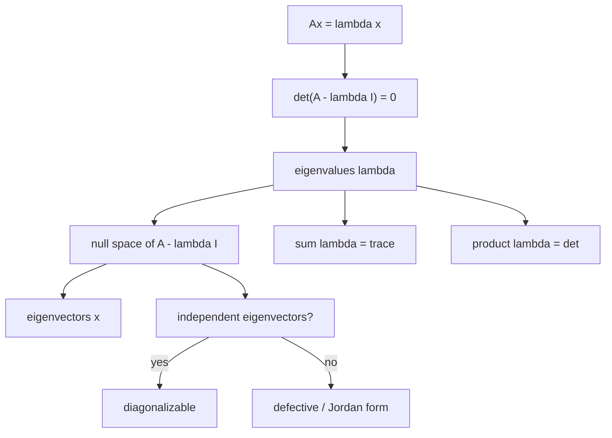

矩阵首先是一个**变换**：进去一个向量 $x$，出来一个向量 $Ax$。大多数向量被 $A$ 一推就转向了；但总有一些特殊方向，$A$ 只把它们拉长、缩短或反向，方向不变。这些方向就是**特征向量（eigenvector）**，缩放倍数就是**特征值（eigenvalue）**。

$$
\boxed{Ax=\lambda x,\qquad x\ne0.}
$$

$\lambda$ 可以是正、负、零，甚至复数。零特征值不特殊：$Ax=0$ 的非零解就是零空间，所以「$A$ 奇异 $\iff$ $0$ 是特征值」。

## 先看几个矩阵，再上公式

在写行列式之前，先用「$A$ 对向量做了什么」读出特征对。

**投影矩阵 $P$**：把向量投到一个平面。

- 平面内的 $x$：$Px=x$，所以 $\lambda=1$，整个平面都是特征向量。
- 平面法向的 $x$：$Px=0$，所以 $\lambda=0$，法线是零空间。
- 其余向量：投影后方向改变，不是特征向量。

**置换矩阵** $A=\begin{bmatrix}0&1\\1&0\end{bmatrix}$：交换两个分量。

- $x=(1,1)$：交换后不变，$\lambda=1$。
- $x=(-1,1)$：交换后变号，$\lambda=-1$。
- 两个特征向量互相垂直。

**旋转矩阵** $Q=\begin{bmatrix}0&-1\\1&0\end{bmatrix}$：把每个向量逆时针转 $90^\circ$。

- 没有任何实向量转完还保持方向，所以**没有实特征向量**。
- 代数上会得到 $\lambda=\pm i$，一对共轭复数。

**三角矩阵** $A=\begin{bmatrix}3&1\\0&3\end{bmatrix}$：

- 特征值直接读对角线：$3,3$（重根）。
- 但 $A-3I=\begin{bmatrix}0&1\\0&0\end{bmatrix}$ 的零空间只有一维，只有一个独立特征向量 $(1,0)$。
- 这是「特征值重复但特征向量不够」的典型，下一讲会看到它不能对角化。

## 怎么求：先 $\lambda$，后 $x$

把 $Ax=\lambda x$ 移项：

$$
(A-\lambda I)x=0.
$$

要的不是零向量，所以 $A-\lambda I$ 必须**奇异**：

$$
\boxed{\det(A-\lambda I)=0.}
$$

这叫**特征方程（characteristic equation）**，左边是 $\lambda$ 的 $n$ 次多项式，叫**特征多项式**。$n$ 阶矩阵在复数范围内有 $n$ 个特征值（计重数）。

**第一步：解特征多项式，得到 $\lambda$。**

**第二步：把每个 $\lambda$ 代回，求 $A-\lambda I$ 的零空间，得到特征向量。**

$2\times2$ 数例：

$$
A=\begin{bmatrix}3&1\\1&3\end{bmatrix}.
$$

$$
\det(A-\lambda I)
=\det\begin{bmatrix}3-\lambda&1\\1&3-\lambda\end{bmatrix}
=(3-\lambda)^2-1
=\lambda^2-6\lambda+8
=(\lambda-4)(\lambda-2).
$$

所以 $\lambda_1=4,\lambda_2=2$。

- $\lambda=4$：$A-4I=\begin{bmatrix}-1&1\\1&-1\end{bmatrix}$，零空间由 $(1,1)$ 张成。
- $\lambda=2$：$A-2I=\begin{bmatrix}1&1\\1&1\end{bmatrix}$，零空间由 $(-1,1)$ 张成。

验证：$A(1,1)^{\mathsf T}=(4,4)^{\mathsf T}=4(1,1)^{\mathsf T}$；$A(-1,1)^{\mathsf T}=(-2,2)^{\mathsf T}=2(-1,1)^{\mathsf T}$。两个特征向量点积为 $0$，正交。

$3\times3$ 数例（习题课）：

$$
A=\begin{bmatrix}1&2&3\\0&1&-2\\0&1&4\end{bmatrix}.
$$

沿第一列展开：

$$
\det(A-\lambda I)
=(1-\lambda)\det\begin{bmatrix}1-\lambda&-2\\1&4-\lambda\end{bmatrix}
=(1-\lambda)(\lambda^2-5\lambda+6)
=(1-\lambda)(\lambda-2)(\lambda-3).
$$

特征值 $1,2,3$。对应特征向量可算出：

| $\lambda$ | $A-\lambda I$ 的零空间 | 特征向量 |
| --- | --- | --- |
| $1$ | $x_2=x_3=0$ | $(1,0,0)$ |
| $2$ | $x_2=-2x_3,\ x_1=-x_3$ | $(1,2,-1)$ |
| $3$ | $x_2=-x_3,\ x_1=x_3/2$ | $(1,-2,2)$ |

三个特征值互不相同，三个特征向量自动线性无关——下一讲就能用它们对角化。

## 两个不变量：迹与行列式

把特征多项式展开，比较系数可得

$$
\boxed{\sum_{i=1}^n\lambda_i=\operatorname{tr}A=\sum_i a_{ii}},
\qquad
\boxed{\prod_{i=1}^n\lambda_i=\det A.}
$$

$2\times2$ 时就是

$$
\lambda^2-(\operatorname{tr}A)\lambda+\det A=0.
$$

上面的例子：$\operatorname{tr}A=6=4+2$，$\det A=8=4\cdot2$；$3\times3$ 例子：$\operatorname{tr}A=6=1+2+3$，$\det A=6=1\cdot2\cdot3$。

这两个不变量非常实用：知道一个特征值，就能用迹/行列式推出另一个；也能快速检查计算结果。

## 运算如何改变特征对

设 $Ax=\lambda x$。

- **$A+cI$**：$(A+cI)x=(\lambda+c)x$。特征值整体平移，**特征向量不变**。
- **$cA$**：$(cA)x=(c\lambda)x$。特征值乘 $c$，特征向量不变。
- **$A^2$**：$A^2x=A(\lambda x)=\lambda Ax=\lambda^2x$。特征值平方，特征向量不变。
- **$A^{-1}$**（若可逆）：$A^{-1}x=\lambda^{-1}x$。特征值取倒数，特征向量不变。
- **$A^{\mathsf T}$**：$\det(A^{\mathsf T}-\lambda I)=\det((A-\lambda I)^{\mathsf T})=\det(A-\lambda I)$，所以特征值相同；特征向量一般不同。
- **相似矩阵** $S^{-1}AS$：特征值相同（见下一讲），特征向量被 $S^{-1}$ 变换。

**但 $A+B$ 没有简单规律**。特征值不是线性的：

$$
A=\begin{bmatrix}0&1\\0&0\end{bmatrix},\quad
B=\begin{bmatrix}0&0\\1&0\end{bmatrix}
\quad\Rightarrow\quad
A+B=\begin{bmatrix}0&1\\1&0\end{bmatrix}.
$$

$A,B$ 的特征值都是 $0,0$，$A+B$ 的特征值却是 $1,-1$。原因很简单：$A$ 和 $B$ 的特征向量不同，$Bx=\alpha x$ 对 $A$ 的特征向量 $x$ 一般不成立，所以不能相加。

同理，$AB$ 的特征值一般也不是 $\lambda_i(A)\lambda_j(B)$。只有当 $A,B$ 共享同一组特征向量时才成立。唯一安全的特例是 $B=cI$。

## 复数特征值

实矩阵也可能有复特征值。旋转 $90^\circ$ 的 $Q=\begin{bmatrix}0&-1\\1&0\end{bmatrix}$：

$$
\det(Q-\lambda I)=\lambda^2+1=0
\quad\Rightarrow\quad
\lambda=\pm i.
$$

特征值成**共轭对**出现：实矩阵的特征多项式系数是实数，复根必须成对共轭。对应的特征向量也是共轭的。

什么时候保证全是实数？**实对称矩阵**。它的特征值全实，且特征向量可以选成互相正交——这是谱定理（spectral theorem），下一讲会反复用到。旋转矩阵是最「反对称」的情形，特征值纯虚；一般矩阵介于两者之间。

## 重数与「特征向量够不够」

- **代数重数（algebraic multiplicity）**：$\lambda$ 作为特征多项式根的重数。
- **几何重数（geometric multiplicity）**：$\dim N(A-\lambda I)$，即该特征值对应的独立特征向量个数。

永远有

$$
1\le\text{几何重数}\le\text{代数重数}.
$$

- 单位矩阵 $I$：特征值 $1$ 的代数重数是 $n$，几何重数也是 $n$（每个向量都是特征向量），够用。
- $\begin{bmatrix}3&1\\0&3\end{bmatrix}$：代数重数 $2$，几何重数 $1$，不够用。
- 特征值互不相同时，每个代数重数都是 $1$，几何重数也只能是 $1$，一定够用。

「够不够」决定能不能对角化：**每个特征值的几何重数都等于代数重数** $\iff$ 有 $n$ 个线性无关的特征向量 $\iff$ $A$ 可对角化。几何重数不足的矩阵叫**缺陷矩阵（defective matrix）**，只能用 Jordan 标准形处理。

## 直观理解

- **特征向量是变换的「骨架方向」**：在二维里，$A$ 把大多数向量推离原方向；特征向量是那几条「推完还在同一条直线上」的方向。$\lambda>1$ 拉长，$0<\lambda<1$ 缩短，$\lambda<0$ 反向，$\lambda=0$ 压扁到原点。
- **投影**：平面内的方向不动（$\lambda=1$），法线方向被压成零（$\lambda=0$）。这就是「投影把三维压成二维」的代数描述。
- **旋转**：没有实的不动方向，所以没有实特征向量；复数特征值描述的是「旋转」这种没有实缩放方向的动作。
- **缺陷矩阵**：$\begin{bmatrix}3&1\\0&3\end{bmatrix}$ 只有一个特征方向 $(1,0)$，另一个方向被剪切到它上面；特征向量不够，无法张成整个平面。
- **对称矩阵**：特征向量正交，相当于把坐标轴旋转到「主方向」上；变换在这组轴上只是独立缩放。这是下一讲对角化的几何核心。

## 拓展延伸

- **主成分分析 PCA**：协方差矩阵 $C$ 是对称的，特征向量是主方向，特征值是该方向上的方差；把数据投到最大的几个特征向量上就是降维。
- **PageRank / 马尔可夫链**：转移矩阵的最大特征值 $1$，对应特征向量是平稳分布；收敛速度由第二大特征值决定。
- **振动模态**：结构的刚度/质量矩阵的特征值对应固有频率的平方，特征向量是振型。
- **量子力学**：可观测量是 Hermitian 矩阵，特征值是测量结果，特征向量是本征态。
- **谱定理**：实对称矩阵 $A=Q\Lambda Q^{\mathsf T}$，$Q$ 正交；更一般地，正规矩阵（$AA^{\mathsf T}=A^{\mathsf T}A$）有正交特征基。
- **SVD**：非方阵/不可对角化的矩阵没有特征基，但总有 $A=U\Sigma V^{\mathsf T}$；奇异值是 $A^{\mathsf T}A$ 特征值的平方根。
- **数值注意**：特征值对扰动敏感（尤其非正规矩阵），特征向量可能病态；实际计算用 QR 迭代、Schur 分解，而不是直接解特征多项式。
- **特征多项式不是好算法**：$n$ 大时展开系数误差巨大；$n\ge5$ 还没有根式解。求特征值靠迭代，不靠公式。

## 术语

| 英文 | 中文 | 含义 |
| ---- | ---- | ---- |
| eigenvalue | 特征值 | 满足 $Ax=\lambda x$ 的缩放倍数 $\lambda$ |
| eigenvector | 特征向量 | 被 $A$ 作用后方向不变的向量 $x\ne0$ |
| characteristic polynomial | 特征多项式 | $\det(A-\lambda I)$，根为特征值 |
| characteristic equation | 特征方程 | $\det(A-\lambda I)=0$ |
| trace | 迹 | 对角线元素之和，等于特征值之和 |
| algebraic multiplicity | 代数重数 | 特征值作为特征多项式根的重数 |
| geometric multiplicity | 几何重数 | $\dim N(A-\lambda I)$，独立特征向量个数 |
| defective matrix | 缺陷矩阵 | 几何重数小于代数重数，特征向量不够 |
| complex conjugate | 共轭复数 | 实矩阵的复特征值成对出现 |
| projection matrix | 投影矩阵 | 幂等 $P^2=P$，特征值 $1,0$ |
| permutation matrix | 置换矩阵 | 每行每列恰有一个 $1$ |
| rotation matrix | 旋转矩阵 | 正交、行列式 $1$，可无实特征值 |
| symmetric matrix | 对称矩阵 | $A=A^{\mathsf T}$，特征值实、特征向量正交 |
| spectral theorem | 谱定理 | 实对称矩阵可正交对角化 |

## 总结

特征向量是变换 $A$ 的「不动方向」，特征值是该方向上的缩放倍数；定义就是 $Ax=\lambda x$。求法分两步：先解特征方程 $\det(A-\lambda I)=0$ 得到 $n$ 个特征值（计重数），再对每个 $\lambda$ 求 $A-\lambda I$ 的零空间得到特征向量。两个不变量 $\sum\lambda_i=\operatorname{tr}A$、$\prod\lambda_i=\det A$ 可以快速检查和补算。投影矩阵的特征值是 $1,0$，置换矩阵是 $\pm1$，旋转矩阵可以是 $\pm i$，三角矩阵的特征值就在对角线上。重根不一定坏（单位矩阵），但几何重数小于代数重数时特征向量不够，矩阵不可对角化。对称矩阵是最好的情形：实特征值、正交特征向量，下一讲的对角化就是把这个结构用到极致。
