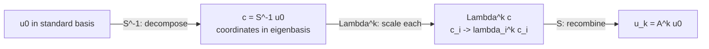
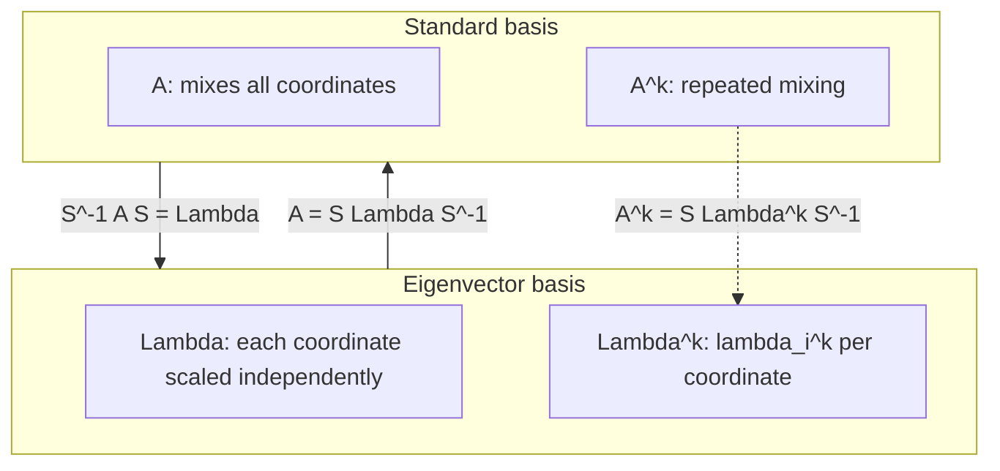

上一讲找到了特征对；这一讲用它们做一件线性代数里最划算的事：**换坐标，把矩阵变成对角矩阵**。一旦对角化，矩阵的幂、差分方程、矩阵函数都变成逐个特征值的一维运算。核心公式只有一条：

$$
\boxed{A=S\Lambda S^{-1}.}
$$

其中 $S$ 的列是 $A$ 的特征向量，$\Lambda$ 的对角线是特征值。它不是新的矩阵分解技巧，而是「选一组让变换最简单的新基」——这就是理解一切计算的入口。

## 对角化

设 $x_1,\dots,x_n$ 是 $A$ 的 $n$ 个线性无关特征向量，$Ax_i=\lambda_i x_i$。把它们按列排成

$$
S=\big[x_1\ x_2\ \cdots\ x_n\big],\qquad
\Lambda=\operatorname{diag}(\lambda_1,\dots,\lambda_n).
$$

逐列看 $AS$：

$$
AS=\big[Ax_1\ Ax_2\ \cdots\ Ax_n\big]
=\big[\lambda_1x_1\ \lambda_2x_2\ \cdots\ \lambda_nx_n\big]
=S\Lambda.
$$

右边是把每个 $\lambda_i$ 放到对角线上、再右乘 $S$ 的结果。于是

$$
AS=S\Lambda.
$$

只要 $n$ 个特征向量线性无关，$S$ 可逆，两边左乘 $S^{-1}$：

$$
\boxed{A=S\Lambda S^{-1}}\qquad\Longleftrightarrow\qquad
\boxed{S^{-1}AS=\Lambda.}
$$

$2\times2$ 数例：

$$
A=\begin{bmatrix}3&1\\1&3\end{bmatrix},\qquad
x_1=\begin{bmatrix}1\\1\end{bmatrix}\ (\lambda=4),\quad
x_2=\begin{bmatrix}-1\\1\end{bmatrix}\ (\lambda=2).
$$

$$
S=\begin{bmatrix}1&-1\\1&1\end{bmatrix},\qquad
\Lambda=\begin{bmatrix}4&0\\0&2\end{bmatrix},\qquad
S^{-1}=\frac12\begin{bmatrix}1&1\\-1&1\end{bmatrix}.
$$

验证：

$$
S\Lambda S^{-1}
=\frac12\begin{bmatrix}4&-2\\4&2\end{bmatrix}
\begin{bmatrix}1&1\\-1&1\end{bmatrix}
=\frac12\begin{bmatrix}6&2\\2&6\end{bmatrix}
=\begin{bmatrix}3&1\\1&3\end{bmatrix}.
$$

## 幂：对角化最直接的回报

$$
A^2=(S\Lambda S^{-1})(S\Lambda S^{-1})
=S\Lambda(S^{-1}S)\Lambda S^{-1}
=S\Lambda^2S^{-1}.
$$

中间 $S^{-1}S=I$ 全部抵消。归纳到 $k$ 次：

$$
\boxed{A^k=S\Lambda^kS^{-1}
=S\begin{bmatrix}\lambda_1^k&&\\&\ddots&\\&&\lambda_n^k\end{bmatrix}S^{-1}.}
$$

所以：

- $A^k$ 的特征值是 $\lambda_i^k$；
- $A^k$ 的特征向量与 $A$ 相同；
- 求 $A^{100}$ 只需算 $n$ 个标量的 $100$ 次方，再做两次矩阵乘法。

上例：

$$
A^2=S\Lambda^2S^{-1}
=S\begin{bmatrix}16&0\\0&4\end{bmatrix}S^{-1}
=\begin{bmatrix}10&6\\6&10\end{bmatrix}.
$$

直接乘 $A\cdot A$ 也是这个结果。特征值 $16,4$ 正好是 $4^2,2^2$。

**为什么不能对 $LU$ 这么做**：$(LU)(LU)(LU)$ 中间的 $U L$ 不抵消，越乘越乱；而 $S^{-1}S=I$ 是设计好的。对角化把「矩阵乘法」变成了「标量乘法」，这是它全部威力的来源。

## 变换角度：为什么用特征向量基计算

这是本讲最值得想清楚的一点。

### 坐标是选择，变换本身不变

矩阵 $A$ 是线性变换在**某一组基**下的表示。换一组基，矩阵会变成另一个矩阵，但变换本身没变。设新基的列向量组成 $S$，同一个向量在新基下的坐标是 $c$，则它在标准基下的坐标是 $u=Sc$。变换在新基下的矩阵是

$$
S^{-1}AS.
$$

对角化就是问：**能不能选一组基，让这个矩阵变成对角阵？** 能，当且仅当这组基是特征向量基。此时

$$
S^{-1}AS=\Lambda.
$$

### 特征基下，变换没有「混合」

在标准基下，$A$ 的一个输出分量通常依赖所有输入分量：

$$
(Ax)_i=\sum_j a_{ij}x_j.
$$

这是**耦合**。在特征基下，第 $i$ 个坐标只被第 $i$ 个坐标影响：

$$
(\Lambda c)_i=\lambda_i c_i.
$$

没有求和、没有交叉项。每个特征方向各自演化，互不干扰。这就是「对角」的真正含义：**不是矩阵长得好看，而是变量解耦了**。

几何上，$A$ 在特征向量 $x_i$ 张成的那条直线上只做一件事——乘以 $\lambda_i$。这条直线是变换的**不变直线**；特征基就是把整个空间拆成 $n$ 条不变直线的直和。

### 计算流程：三次换坐标

求 $A^k u_0$ 时，实际发生的是：

三步：

1. **分解**：$c=S^{-1}u_0$，把初始向量写成特征向量的线性组合 $u_0=\sum_i c_i x_i$。
2. **各自演化**：$c_i\mapsto\lambda_i^k c_i$。$k$ 步之后，每个特征方向只乘了自己的 $\lambda_i^k$。
3. **重组**：$u_k=Sc=\sum_i c_i\lambda_i^k x_i$。

在标准基下直接算 $A^k$，矩阵会不断混合所有方向；在特征基下，$k$ 步只是 $n$ 个独立的标量乘法。**计算量的差距不是重点，结构上的解耦才是重点**：它让你能一眼看出哪一项主导、哪一项衰减。

### 为什么这是「最好」的坐标

线性变换在所有方向上的作用并不平等。特征向量是那些「作用最简单」的方向——只有缩放，没有转向。用它们做基，等于把变换的骨架直接拿来当坐标轴。能对角化时，这已经是**最简表示**：不可能比对角矩阵更简单。

- 对称矩阵：特征向量可以选成标准正交，$S=Q$ 是旋转/反射，$Q^{-1}=Q^{\mathsf T}$。这是最理想的情形，换基不扭曲长度和角度。
- 非对称但可对角化：特征向量一般不正交，$S$ 是一个「斜」的坐标系；矩阵仍对角，但坐标轴被剪切过。
- 不可对角化：连特征向量都不够，最简只能做到 Jordan 形（块对角，块内还有 $1$）。这说明「没有足够的简单方向」，而不是方法失败。

### 矩阵函数：不止是幂

对角化对**任何**多项式/解析函数都成立：

$$
f(A)=S\,f(\Lambda)\,S^{-1}
=S\begin{bmatrix}f(\lambda_1)&&\\&\ddots&\\&&f(\lambda_n)\end{bmatrix}S^{-1}.
$$

于是 $A^{-1}$、$A^2$、$e^{At}$、$\sqrt A$、$\log A$ 都变成对特征值做同样的标量函数。这是「用特征基计算」的完整理由：**矩阵函数在特征基下就是逐元素的标量函数**。

### 代价与例外

- 需要 $S^{-1}$，即 $n$ 个线性无关特征向量；缺陷矩阵不行。
- $S$ 可能病态：非正规矩阵的特征向量可能几乎平行，数值上求逆会放大误差。此时用 Schur 分解 $A=QTQ^{\mathsf T}$（$Q$ 正交、$T$ 上三角）更稳，特征值仍在 $T$ 的对角线上。
- 复特征值需要用复数基；实矩阵可以改用 $2\times2$ 实块。

## 差分方程：$u_{k+1}=Au_k$

这是对角化最典型的应用。给定 $u_0$，每一步乘 $A$：

$$
u_1=Au_0,\quad u_2=A^2u_0,\quad\dots,\quad u_k=A^ku_0.
$$

把 $u_0$ 展开成特征向量：

$$
u_0=c_1x_1+\cdots+c_nx_n=Sc.
$$

则

$$
\boxed{u_k=A^ku_0
=c_1\lambda_1^kx_1+\cdots+c_n\lambda_n^kx_n.}
$$

每个特征分量独立地按自己的 $\lambda_i^k$ 增长或衰减。**长期行为由绝对值最大的特征值（dominant eigenvalue）决定**；如果它对应的系数 $c_i=0$，才轮到下一个。

### 稳定性

若 $A$ 可对角化：

$$
A^k\to0\quad\Longleftrightarrow\quad |\lambda_i|<1\ \text{对所有 }i.
$$

- $|\lambda|<1$：该模式衰减到 $0$。
- $|\lambda|>1$：该模式指数增长。
- $|\lambda|=1$：不增不减；复数情形是持续振荡。
- 谱半径 $\rho(A)=\max_i|\lambda_i|$ 控制渐近增长速度。

（对不可对角化的矩阵，$\rho(A)<1$ 仍然保证 $A^k\to0$，只是证明要用 Jordan 形；见拓展。）

### Fibonacci：用特征值读出增长率

斐波那契 $F_{k+2}=F_{k+1}+F_k$ 是二阶标量递推。引入向量

$$
u_k=\begin{bmatrix}F_{k+1}\\F_k\end{bmatrix}
\quad\Rightarrow\quad
u_{k+1}=\begin{bmatrix}1&1\\1&0\end{bmatrix}u_k.
$$

矩阵 $A=\begin{bmatrix}1&1\\1&0\end{bmatrix}$ 的特征多项式：

$$
\det(A-\lambda I)=\lambda^2-\lambda-1=0
\quad\Rightarrow\quad
\lambda_{1,2}=\frac{1\pm\sqrt5}{2}.
$$

即 $\varphi=\frac{1+\sqrt5}{2}\approx1.618$，$\psi=\frac{1-\sqrt5}{2}\approx-0.618$。对应特征向量为 $(\lambda,1)$。

初始 $u_0=(F_1,F_0)=(1,0)$，解出系数 $c_1=\frac1{\sqrt5}$，$c_2=-\frac1{\sqrt5}$：

$$
\boxed{F_k=\frac{\varphi^k-\psi^k}{\sqrt5}.}
$$

验证：$F_0=0$，$F_1=1$，$F_2=1$，$F_{10}=55$。

因为 $|\psi|<1$，第二项迅速衰减，所以

$$
F_k\approx\frac{\varphi^k}{\sqrt5},
\qquad
\frac{F_{k+1}}{F_k}\to\varphi.
$$

**增长率就是主导特征值**。这就是「用特征向量基计算」的最直观回报：不用逐项递推，直接读出长期行为。

## 可对角化的条件

- **特征值互不相同** $\Rightarrow$ 有 $n$ 个线性无关特征向量 $\Rightarrow$ 可对角化。这是最常见的情形。
- **有重根** 时不一定：要检查每个特征值的几何重数是否等于代数重数。
- $A$ 可对角化 $\iff$ 所有特征值的几何重数之和为 $n$ $\iff$ 每个特征值的几何重数 $=$ 代数重数。
- 单位矩阵：特征值全是 $1$（代数重数 $n$），但每个向量都是特征向量（几何重数 $n$），可对角化。
- $\begin{bmatrix}2&1\\0&2\end{bmatrix}$：代数重数 $2$，几何重数 $1$，不可对角化。
- 旋转矩阵在实数域不可对角化（无实特征向量），在复数域可对角化（$\pm i$）。

不可对角化时，最接近的替代是 **Jordan 标准形**：

$$
A=SJS^{-1},\qquad
J=\begin{bmatrix}J_1&&\\&\ddots&\\&&J_m\end{bmatrix},
\quad
J_i=\begin{bmatrix}\lambda_i&1&&\\&\ddots&\ddots&\\&&\ddots&1\\&&&\lambda_i\end{bmatrix}.
$$

幂会出现多项式因子，例如

$$
\begin{bmatrix}2&1\\0&2\end{bmatrix}^k
=\begin{bmatrix}2^k&k2^{k-1}\\0&2^k\end{bmatrix}.
$$

指数增长仍然由 $2^k$ 主导，但多了一个 $k$ 的因子。

## 直观理解

- **对角化 = 换一副「顺着变换」的坐标轴**。标准基是人为选的；特征基是变换自己「认」的方向。换上它，矩阵就从「满屏交叉项」变成「一条对角线」。
- **$S$ 和 $S^{-1}$ 是翻译官**：$S^{-1}$ 把标准坐标翻译成特征坐标，$\Lambda$ 在特征坐标里干活，$S$ 再翻译回来。$A=S\Lambda S^{-1}$ 读作「翻译过去 → 各自缩放 → 翻译回来」。
- **幂的几何图像**：每一步，每个特征方向分别乘 $\lambda_i$。$\lambda_i>1$ 的方向越来越长，$|\lambda_i|<1$ 的方向越来越短；$k$ 很大时，最长的那个方向主导一切。Fibonacci 的 $\varphi\approx1.618$ 就是这样冒出来的。
- **矩阵混合 vs 解耦**：在标准基下，$A$ 的一个分量会影响所有分量；在特征基下，每个分量只跟自己有关。就像一组耦合的弹簧振子，换成「简正模式」后变成一组独立振子。
- **非对称的斜坐标**：特征向量不一定正交，$S$ 会把正方形拉成平行四边形；但对角化仍然成立，只是坐标轴不垂直。对称矩阵是特例，特征基可以选成正交的，换基就是纯旋转。

## 拓展延伸

- **微分方程**：$\dot u=Au$ 的解是 $u(t)=e^{At}u_0=S e^{\Lambda t}S^{-1}u_0$，每个模式按 $e^{\lambda_i t}$ 演化；实部决定增长/衰减，虚部决定振荡。这是 L20 的连续版本，也是控制理论、电路、振动的核心。
- **马尔可夫链 / PageRank**：转移矩阵的最大特征值为 $1$，对应特征向量是平稳分布；第二大特征值决定收敛速度。
- **PCA**：协方差矩阵对称，特征向量是主方向，特征值是该方向方差；对角化就是旋转到主成分坐标。
- **矩阵函数与数值计算**：$f(A)=Sf(\Lambda)S^{-1}$ 是矩阵平方根、矩阵指数、矩阵对数的理论基础；实际计算用 Schur 分解而非特征分解，避免 $S$ 病态。
- **Schur 分解**：任意方阵 $A=QTQ^{\mathsf T}$，$Q$ 正交、$T$ 上三角；特征值在 $T$ 对角线上。它总存在，数值稳定，是 eig 算法的实际输出形式。
- **SVD**：任意矩阵 $A=U\Sigma V^{\mathsf T}$，两组正交基 + 奇异值；对非方阵、缺陷矩阵，SVD 是比特征分解更普遍的「对角化」。
- **Jordan 形与缺陷矩阵**：不可对角化时 $A=SJS^{-1}$，$J$ 块对角；$A^k$ 出现 $k^m\lambda^k$ 项，长期仍由 $|\lambda|$ 决定。
- **瞬态增长**：非正规矩阵即使所有 $|\lambda_i|<1$，$A^k$ 也可能先增大再衰减；特征值只控制渐近行为，不控制短期。稳定性分析要用 pseudospectra 或数值实验。
- **高阶层递推**：$F_{k+2}=F_{k+1}+F_k$ 这类二阶递推可写成 companion 矩阵的一阶系统；对角化后得到 Binet 公式。这是差分方程的一般套路。

## 术语

| 英文 | 中文 | 含义 |
| ---- | ---- | ---- |
| diagonalization | 对角化 | $A=S\Lambda S^{-1}$，$\Lambda$ 对角 |
| eigenvector matrix | 特征向量矩阵 | 以特征向量为列的 $S$ |
| diagonal matrix | 对角矩阵 | 非对角线元素全为零 |
| change of basis | 换基 | $S^{-1}AS$，同一变换在新基下的矩阵 |
| difference equation | 差分方程 | $u_{k+1}=Au_k$ 型递推 |
| dominant eigenvalue | 主导特征值 | 绝对值最大的特征值，控制长期增长 |
| spectral radius | 谱半径 | $\rho(A)=\max|\lambda_i|$ |
| algebraic multiplicity | 代数重数 | 特征值作为特征多项式根的重数 |
| geometric multiplicity | 几何重数 | 对应特征空间的维数 |
| defective matrix | 缺陷矩阵 | 特征向量不足，不可对角化 |
| Jordan form | 约当标准形 | 不可对角化时的最简块对角形式 |
| matrix exponential | 矩阵指数 | $e^{At}=Se^{\Lambda t}S^{-1}$ |
| Markov chain | 马尔可夫链 | 转移矩阵幂的长期行为 |
| stationary distribution | 平稳分布 | 特征值 $1$ 对应的特征向量 |

## 总结

把 $n$ 个线性无关特征向量按列排成 $S$，就有 $AS=S\Lambda$；$S$ 可逆时 $A=S\Lambda S^{-1}$，$\Lambda$ 的对角线是特征值。对角化把矩阵幂变成标量幂：$A^k=S\Lambda^kS^{-1}$，特征值取 $k$ 次方，特征向量不变。差分方程 $u_{k+1}=Au_k$ 的解是 $u_k=\sum_i c_i\lambda_i^kx_i$，每个特征模式独立演化，长期行为由主导特征值决定；Fibonacci 的增长率 $\varphi=(1+\sqrt5)/2$ 就是这样读出来的。从变换角度看，特征向量基是「让变换没有混合」的坐标：标准基下 $A$ 的一个分量依赖所有分量，特征基下只剩 $y_i=\lambda_ix_i$，矩阵函数也变成逐元素的 $f(\lambda_i)$。代价是需要 $n$ 个独立特征向量；特征值互不相同一定够用，重根时看几何重数，不够就只能退到 Jordan 形。对称矩阵是最理想的情形：特征基正交，换基就是旋转。
