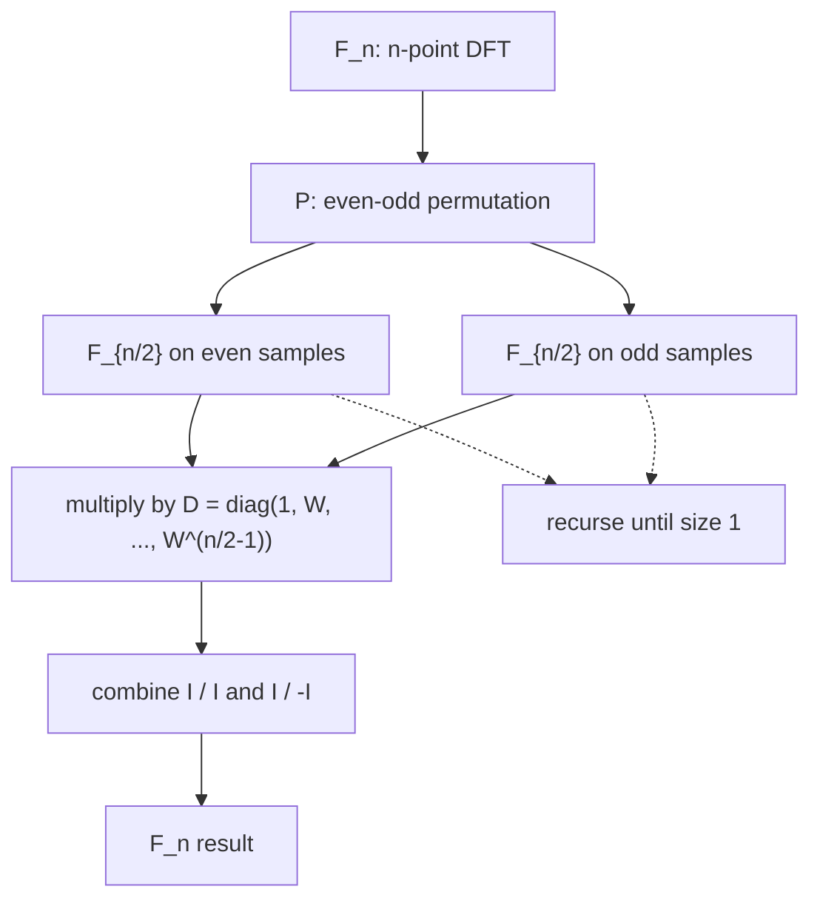

实矩阵也会有复特征值，所以复数不是额外话题。把「转置」升级成「共轭转置」，对称升级成 Hermitian，正交升级成 unitary，线性代数的主线原样搬到 $\mathbb C^n$。本讲最后落到最著名的复矩阵——傅里叶矩阵 $F_n$：它的列互相正交，归一化后是酉矩阵；更关键的是它能递归拆成两个一半大小的傅里叶矩阵，把 $n^2$ 次乘法降到 $\frac n2\log_2 n$。

材料：lecture 26 字幕 [[26. Complex Matrices; Fast Fourier Transform]]；18.06SC 习题课 [[Complex Matrices]]。

## 共轭转置：复向量的长度

对 $z\in\mathbb C^n$，不能再只用 $z^{\mathsf T}z$。取 $z=[1,i]^{\mathsf T}$：

$$
z^{\mathsf T}z=1^2+i^2=0,
$$

但这不是零向量。正确的长度来自「转置的同时取共轭」：

$$
z^{\mathsf H}z=\bar z^{\mathsf T}z
=(\bar z_1,\ldots,\bar z_n)
\begin{bmatrix}z_1\\ \vdots\\ z_n\end{bmatrix}
=\sum_i|z_i|^2 .
$$

同一个例子：

$$
z^{\mathsf H}z=\bar 1\cdot1+\overline{i}\cdot i=1+(-i)i=2,
\qquad \|z\|=\sqrt2 .
$$

所以复向量空间里有一条统一规则：**看到转置，就同时取共轭**。内积也随之内积升级：

$$
\langle y,x\rangle=y^{\mathsf H}x=\bar y^{\mathsf T}x .
$$

它满足 $\langle y,x\rangle=\overline{\langle x,y\rangle}$，且 $\langle z,z\rangle=\|z\|^2>0$（$z\ne0$）。

## Hermitian：复数版的「对称」

实对称是 $A^{\mathsf T}=A$。复矩阵的对应物是**共轭转置等于自己**：

$$
A^{\mathsf H}=\bar A^{\mathsf T}=A .
$$

这样的矩阵叫 **Hermitian**。它的对角线必须是实数（转置不动对角线，取共轭后还得等于自己），非对角元成共轭对：

$$
A=\begin{bmatrix}
2 & 3+i\\
3-i & 5
\end{bmatrix},
\qquad A^{\mathsf H}=A .
$$

Hermitian 矩阵继承实对称矩阵的两条主事实：

1. **特征值全是实数**；
2. **不同特征值的特征向量在复内积下正交**。

证明第一条。设 $Ax=\lambda x$，两边左乘 $x^{\mathsf H}$：

$$
x^{\mathsf H}Ax=\lambda\,x^{\mathsf H}x .
$$

因为 $A^{\mathsf H}=A$，左边是一个「自伴」的数，等于自己的共轭；右边 $x^{\mathsf H}x>0$ 是实数，所以 $\lambda=\bar\lambda$。

证明第二条。设 $Ax=\lambda x$，$Ay=\mu y$，且 $\lambda\ne\mu$。则

$$
x^{\mathsf H}Ay=\mu\,x^{\mathsf H}y,
\qquad
(Ax)^{\mathsf H}y=\bar\lambda\,x^{\mathsf H}y=\lambda\,x^{\mathsf H}y .
$$

两式左边相同（$A^{\mathsf H}=A$），相减得

$$
(\mu-\lambda)x^{\mathsf H}y=0,
$$

所以 $x^{\mathsf H}y=0$。

> 实对称矩阵只是 Hermitian 在实矩阵上的特例。[[L23 对称矩阵与正定矩阵]] 里的谱定理，在复数情形写成 $A=Q\Lambda Q^{\mathsf H}$，其中 $Q$ 是酉矩阵。

## 酉矩阵：复数版的「正交」

实正交矩阵满足 $Q^{\mathsf T}Q=I$。复矩阵把转置换成共轭转置：

$$
Q^{\mathsf H}Q=I
\qquad\Longleftrightarrow\qquad
Q^{-1}=Q^{\mathsf H}.
$$

这样的 $Q$ 叫**酉矩阵**（unitary）。它的列在复内积下标准正交，作用在向量上保持长度与夹角：

$$
\|Qx\|^2=(Qx)^{\mathsf H}(Qx)=x^{\mathsf H}Q^{\mathsf H}Qx=x^{\mathsf H}x .
$$

实正交矩阵是它在实矩阵上的特例。下一节的傅里叶矩阵，归一化之后就是酉矩阵。

## 傅里叶矩阵

令

$$
W=e^{2\pi i/n}.
$$

$W$ 是 $n$ 次单位根：$W^n=1$，落在复平面单位圆上，辐角为 $2\pi/n$。$n\times n$ 的**傅里叶矩阵**定义为

$$
(F_n)_{jk}=W^{jk},\qquad j,k=0,1,\ldots,n-1 .
$$

也就是第 $k$ 列是 $W$ 的 $0,1,\ldots,n-1$ 次幂，第 $j$ 行同理。$n=4$ 时 $W=i$，直接写出：

$$
F_4=
\begin{bmatrix}
1&1&1&1\\
1&i&-1&-i\\
1&-1&1&-1\\
1&-i&-1&i
\end{bmatrix}.
$$

它关于主对角线对称（$F_n^{\mathsf T}=F_n$），但**不是 Hermitian**，因为元素是复数。

### 列为什么正交

看第 $j$ 列和第 $k$ 列的内积。复内积要共轭第一列：

$$
c_j^{\mathsf H}c_k
=\sum_{m=0}^{n-1}\overline{W^{mj}}\,W^{mk}
=\sum_{m=0}^{n-1}W^{m(k-j)} .
$$

若 $j=k$，每一项都是 $1$，和为 $n$。若 $j\ne k$，这是等比数列：

$$
\sum_{m=0}^{n-1}r^m=\frac{1-r^n}{1-r},\qquad r=W^{k-j}.
$$

因为 $r^n=W^{n(k-j)}=(W^n)^{k-j}=1$，而 $r\ne1$，所以和为零。于是

$$
c_j^{\mathsf H}c_k=
\begin{cases}
n,&j=k,\\
0,&j\ne k.
\end{cases}
$$

列两两正交，长度都是 $\sqrt n$。归一化

$$
U=\frac1{\sqrt n}F_n
$$

就得到酉矩阵：$U^{\mathsf H}U=I$。因此傅里叶矩阵的逆几乎不用算：

$$
F_n^{-1}=\frac1nF_n^{\mathsf H}
=\frac1n\bar F_n .
$$

**数字例子。** 用 $F_4$ 作用在两个基向量上：

$$
F_4\begin{bmatrix}1\\0\\0\\0\end{bmatrix}
=\begin{bmatrix}1\\1\\1\\1\end{bmatrix},
\qquad
F_4\begin{bmatrix}0\\1\\0\\0\end{bmatrix}
=\begin{bmatrix}1\\i\\-1\\-i\end{bmatrix}.
$$

后者正是第二列。$F_4^2$ 不是 $4I$，但 $F_4^{\mathsf H}F_4=4I$：共轭转置才是它的逆。

### 多项式视角

给定 $x=[x_0,\ldots,x_{n-1}]^{\mathsf T}$，造多项式

$$
p(z)=x_0+x_1z+\cdots+x_{n-1}z^{n-1}.
$$

那么 $F_nx$ 的每个分量就是 $p$ 在 $n$ 个单位根上的取值：

$$
F_nx=
\begin{bmatrix}
p(1)\\ p(W)\\ \vdots\\ p(W^{n-1})
\end{bmatrix}.
$$

所以「做一次傅里叶变换」=「把一个多项式在 $n$ 个等分点上同时求值」。这句话是理解 FFT 的钥匙。

## 习题课：Hermitian 矩阵的对角化

取

$$
A=\begin{bmatrix}
2&1-i\\
1+i&3
\end{bmatrix},
\qquad A^{\mathsf H}=A .
$$

**特征值。** 解 $\det(A-\lambda I)=0$：

$$
(2-\lambda)(3-\lambda)-(1-i)(1+i)
=\lambda^2-5\lambda+4=(\lambda-1)(\lambda-4)=0,
$$

所以 $\lambda=1,4$，确实都是实数。

**特征向量。** 对 $\lambda=1$：

$$
A-I=\begin{bmatrix}1&1-i\\1+i&2\end{bmatrix},
\qquad
v=\begin{bmatrix}1-i\\-1\end{bmatrix}.
$$

对 $\lambda=4$：

$$
A-4I=\begin{bmatrix}-2&1-i\\1+i&-1\end{bmatrix},
\qquad
u=\begin{bmatrix}1\\1+i\end{bmatrix}.
$$

验证正交（共轭第一个向量）：

$$
v^{\mathsf H}u=
(1+i,\,-1)\begin{bmatrix}1\\1+i\end{bmatrix}
=(1+i)-(1+i)=0 .
$$

两者长度都是 $\sqrt3$，归一化后

$$
S=\frac1{\sqrt3}
\begin{bmatrix}
1-i&1\\
-1&1+i
\end{bmatrix},
\qquad S^{\mathsf H}S=I .
$$

于是

$$
A=S\begin{bmatrix}1&0\\0&4\end{bmatrix}S^{\mathsf H}.
$$

过程与实对称矩阵完全一样，只是把 $S^{-1}$ 换成了 $S^{\mathsf H}$。

## FFT：把一个大 DFT 拆成两个小的

设 $n=2m$。把多项式按次数奇偶拆开：

$$
p(z)=\underbrace{x_0+x_2z^2+\cdots+x_{n-2}z^{n-2}}_{p_e(z^2)}
+z\underbrace{(x_1+x_3z^2+\cdots+x_{n-1}z^{n-2})}_{p_o(z^2)} .
$$

在 $z=W_n^j$ 处求值：

$$
p(W_n^j)=p_e(W_n^{2j})+W_n^j\,p_o(W_n^{2j})
=p_e(W_m^j)+W_n^j\,p_o(W_m^j).
$$

因为 $W_n^2=W_{n/2}=W_m$，两个子问题都是**规模减半的 DFT**。算出 $p_e$ 和 $p_o$ 在 $W_m^j$（$j=0,\ldots,m-1$）上的值后，一次组合就得到前一半的输出；后一半利用

$$
W_n^{j+m}=-W_n^j
$$

由同一批数加减得到。矩阵形式是

$$
F_n=
\begin{bmatrix}
I&D\\
I&-D
\end{bmatrix}
\begin{bmatrix}
F_m&0\\
0&F_m
\end{bmatrix}
P_n,
\qquad
D=\operatorname{diag}(1,W_n,\ldots,W_n^{m-1}),
$$

其中 $P_n$ 把偶数下标的分量排到前面、奇数下标排到后面。$D$ 里的 $W_n^j$ 叫**旋转因子**（twiddle factor）。

### 代价：$n^2\to\frac n2\log_2 n$

设 $T(n)$ 为复数乘法次数。上面的分解给出

$$
T(n)=2T\!\left(\frac n2\right)+\frac n2,
\qquad T(1)=0.
$$

展开递归 $\log_2 n$ 层：

$$
T(n)=\frac n2\log_2 n .
$$

对比直接乘 $F_n$ 的 $n^2$ 次：

| $n$ | 直接 $n^2$ | FFT $\frac n2\log_2 n$ | 加速 |
| --- | --- | --- | --- |
| $64$ | $4096$ | $192$ | $21\times$ |
| $1024$ | $1{,}048{,}576$ | $5{,}120$ | $205\times$ |

$n=1024$ 时少算约 $200$ 倍。这就是 FFT 让大规模频谱计算变得可行的原因。实际实现还会计入加法，复杂度仍是 $O(n\log n)$；要求 $n$ 是 $2$ 的幂，或者用混合基 / Bluestein 处理任意长度。

![[L24_roots_fft.png]]
*左：$n=8$ 的单位根 $W^0,\ldots,W^7$ 均匀分布在单位圆上，傅里叶矩阵的列就是这些幂次；$W^{j+4}=-W^j$ 让后半段输出可由前半段直接加减得到。右：直接矩阵乘法与 FFT 的乘法次数对比（对数坐标），$n=1024$ 时相差约 $200$ 倍。*

## 直观理解

- **傅里叶矩阵 = 在单位根上采样。** 一个向量代表多项式的系数，$F_nx$ 是多项式在 $n$ 个等分点上的值。正变换是「从系数到采样」，逆变换是「从采样回到系数」。
- **FFT = 分治。** 偶次项和奇次项各自是一个规模减半的多项式；在 $n/2$ 个单位根上求值后，用 $W_n^j$ 把两半拼起来。拼的时候只用加减和一次复数乘法，所以省掉了大量重复计算。
- **对称性来自单位根。** $W_n^{j+n/2}=-W_n^j$ 是「后半段免费」的根本原因；$W_n^{n}=1$ 则让等比数列求和为零，保证列正交。

## 拓展延伸

**循环矩阵与卷积。** 若 $C$ 的每一行都是上一行的循环右移，例如

$$
C=\begin{bmatrix}
c_0&c_{n-1}&\cdots&c_1\\
c_1&c_0&\cdots&c_2\\
\vdots&&\ddots&\vdots\\
c_{n-1}&c_{n-2}&\cdots&c_0
\end{bmatrix},
$$

那么 $F_n$ 的列就是 $C$ 的特征向量，特征值是 $c=[c_0,\ldots,c_{n-1}]^{\mathsf T}$ 的 DFT：

$$
C=F_n\operatorname{diag}(F_nc)F_n^{-1}.
$$

于是「循环卷积」在傅里叶基下变成逐点相乘——这就是卷积定理，也是 FFT 能加速卷积、多项式乘法和图像滤波的原因。

**应用。** 音频/图像压缩、雷达与通信、数值求解偏微分方程、大整数乘法都靠 FFT。机器学习里，卷积、长序列注意力的近似、正弦位置编码也都与这组正交基有关。Strang 说它「改变了世界」，指的就是 $O(n\log n)$ 把原本不可算的规模变成了日常。

## 小结

- 复向量：长度是 $z^{\mathsf H}z$，内积是 $y^{\mathsf H}x$；转置与共轭必须同时出现。
- Hermitian：$A^{\mathsf H}=A$，特征值全实，不同特征值的特征向量正交；实对称是其特例。
- 酉矩阵：$Q^{\mathsf H}Q=I$，$Q^{-1}=Q^{\mathsf H}$，保持长度与内积。
- 傅里叶矩阵：$(F_n)_{jk}=W^{jk}$，$W=e^{2\pi i/n}$；列正交、长度 $\sqrt n$，$F_n^{-1}=\frac1nF_n^{\mathsf H}$。
- $F_nx$ = 多项式在 $n$ 个单位根上求值。
- FFT：偶奇拆分 + 旋转因子，$T(n)=2T(n/2)+n/2$，代价从 $n^2$ 降到 $\frac n2\log_2 n$。
- 循环矩阵被傅里叶矩阵对角化，卷积变成逐点乘法。

## 术语

| 英文 | 中文 | 含义 |
| --- | --- | --- |
| conjugate transpose / Hermitian transpose | 共轭转置 | $A^{\mathsf H}=\bar A^{\mathsf T}$，转置后再取共轭 |
| Hermitian matrix | Hermitian 矩阵 / 自伴矩阵 | $A^{\mathsf H}=A$，复矩阵版的对称 |
| unitary matrix | 酉矩阵 | $Q^{\mathsf H}Q=I$，复矩阵版的正交矩阵 |
| Fourier matrix | 傅里叶矩阵 | $(F_n)_{jk}=W^{jk}$，$W=e^{2\pi i/n}$ |
| root of unity | 单位根 | 满足 $z^n=1$ 的复数，均匀分布在单位圆上 |
| twiddle factor | 旋转因子 | FFT 组合两半时乘的 $W_n^j$ |
| fast Fourier transform (FFT) | 快速傅里叶变换 | 用偶奇分治把 DFT 从 $O(n^2)$ 降到 $O(n\log n)$ |
| circulant matrix | 循环矩阵 | 每行是上一行的循环移位，被傅里叶矩阵对角化 |
