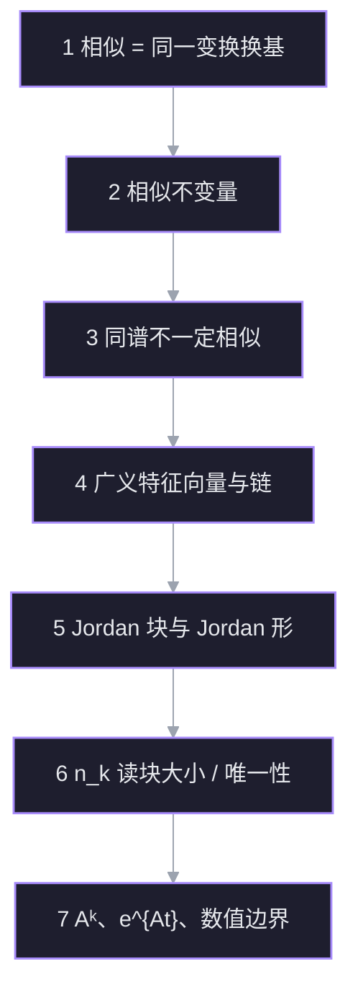
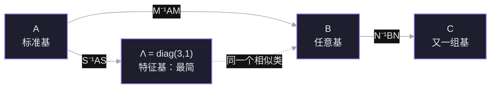
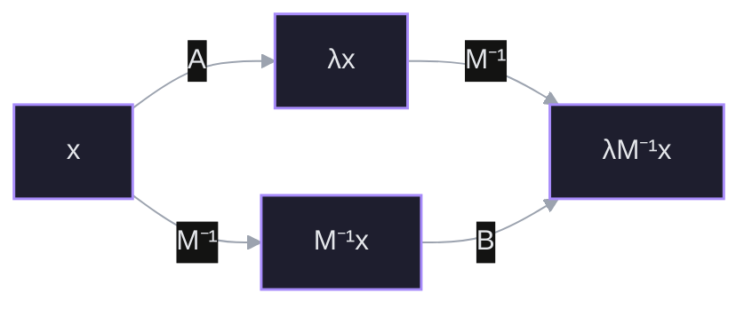
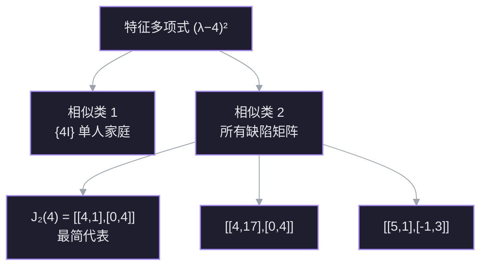
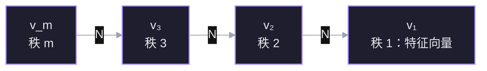
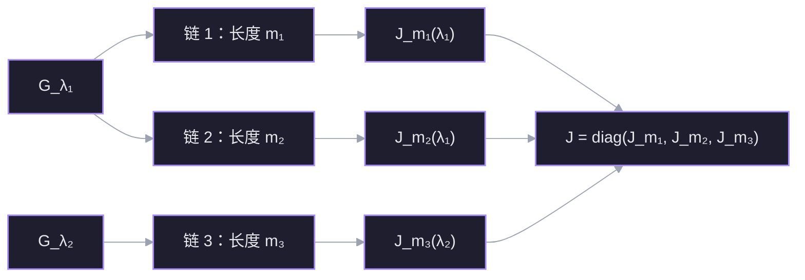
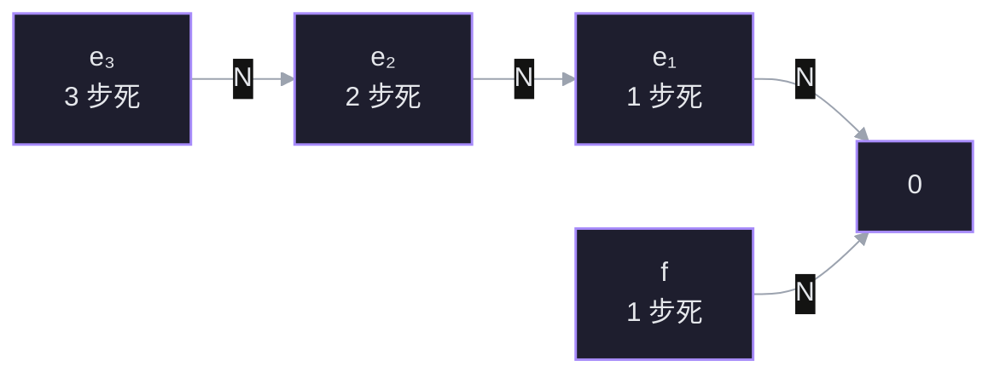
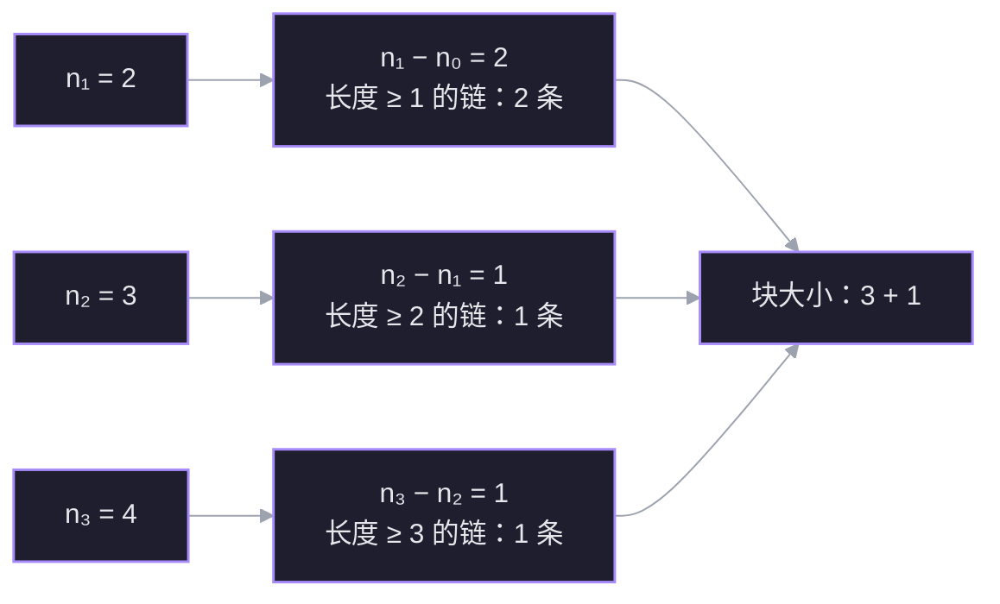
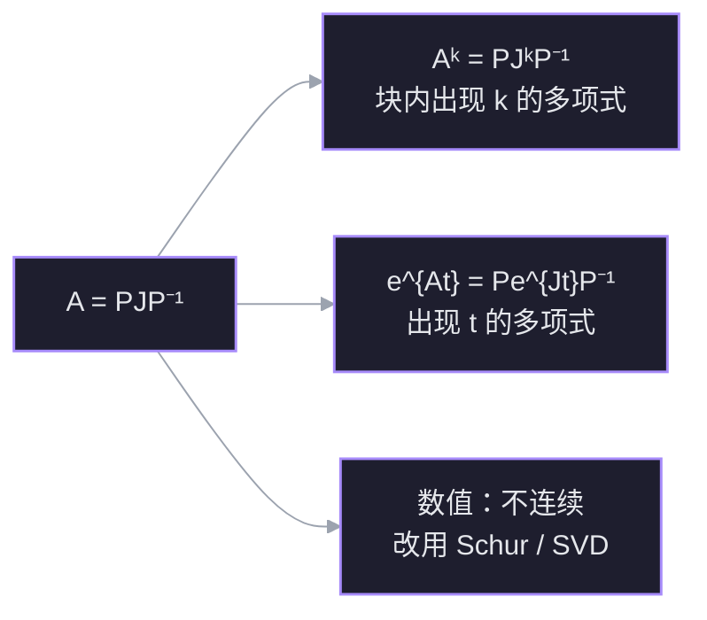

上一讲把正定矩阵讲成了「能量处处为正」；这一讲换一个方向：不再问一个矩阵好不好，而是问**哪些矩阵其实是同一个东西**。答案是把矩阵按相似关系分成家族，每个家族里挑一个最简代表。对角矩阵是「特征值互异」家族的王者；当特征向量不够时，王者退位，Jordan 形接班。

核心问题只有一句：

$$
\boxed{\text{两个矩阵什么时候只差一次换基？}
\quad\Longleftrightarrow\quad
B=M^{-1}AM.}
$$

## 本讲地图

## 节点 1 · 相似：同一个变换的不同坐标

### 动机

上一讲的对角化写成

$$
A=S\Lambda S^{-1}.
$$

如果只把它当成「算 $A^k$ 的技巧」，故事到那里就结束了。但换个读法：$A$ 和 $\Lambda$ 是**同一个线性变换**在两组不同基下的矩阵。$S$ 不是随便找的矩阵，它是「特征基」这套坐标的翻译官。

那么自然要问：如果换的不是特征基，而是任意一组基，会得到什么？得到的矩阵不再对角，但它和 $A$ 仍然描述同一个变换。把所有这样的矩阵收集起来，就是一个**家族**。这一讲的主线，就是给这些家族分类，并在每个家族里找出最简的代表。

### 定义

设 $A,B$ 都是 $n\times n$ 矩阵。若存在可逆矩阵 $M$，使得

$$
\boxed{B=M^{-1}AM,}
$$

则称 $A$ 与 $B$ **相似**（similar），记作 $A\sim B$。$M$ 叫**相似变换矩阵**。

这个定义不要求 $A$ 对称、不要求 $A$ 可对角化，也不要求 $M$ 正交。它只要求 $M$ 可逆——因为换基必须是一一对应的坐标翻译。

### 为什么偏偏是 $M^{-1}AM$

这不是天上掉下来的公式，而是换基的必然结果。设同一个线性变换 $T$ 在旧基下的矩阵是 $A$。若 $M$ 的列是新基在旧基下的坐标，那么：

- 一个向量在新坐标下的坐标 $x_{\text{new}}$，先要翻译成旧坐标：$x_{\text{old}}=Mx_{\text{new}}$；
- 在旧坐标里做变换：$Ax_{\text{old}}$；
- 再把结果翻译回新坐标：$M^{-1}(Ax_{\text{old}})$。

三步串起来：

$$
x_{\text{new}}\ \longmapsto\ M^{-1}AM\,x_{\text{new}}.
$$

所以新基下的矩阵只能是 $M^{-1}AM$。这就是 [[L20 对角化与矩阵的幂#变换角度：为什么用特征向量基计算|L20 的换基公式]]，只是那一讲只用了 $M=S$ 这一种特殊选择。

### 相似是一个等价关系

相似把全体 $n\times n$ 矩阵分成互不相交的**相似类**（similarity class）。三条性质逐一验证：

- **自反**：取 $M=I$，得 $A=I^{-1}AI$。
- **对称**：若 $B=M^{-1}AM$，则 $A=MBM^{-1}=(M^{-1})^{-1}BM^{-1}$，所以 $B\sim A$。
- **传递**：若 $B=M^{-1}AM$、$C=N^{-1}BN$，则

$$
C=N^{-1}(M^{-1}AM)N=(MN)^{-1}A(MN),
$$

所以 $A\sim C$。

传递性尤其重要：它允许我们「借道」最简代表。要证明两个矩阵相似，不必直接找 $M$，只要证明它们都相似于同一个 $\Lambda$ 或同一个 $J$。

### Strang 的例子：一个家族里的三副面孔

取

$$
A=\begin{bmatrix}2&1\\1&2\end{bmatrix}.
$$

它的特征值是 $3$ 和 $1$，特征向量可取 $(1,1)^{\mathsf T}$ 与 $(1,-1)^{\mathsf T}$。于是

$$
S=\begin{bmatrix}1&1\\1&-1\end{bmatrix},
\qquad
\Lambda=\begin{bmatrix}3&0\\0&1\end{bmatrix},
\qquad
S^{-1}AS=\Lambda.
$$

现在故意换一个「不好看」的 $M$：

$$
M=\begin{bmatrix}1&4\\0&1\end{bmatrix},
\qquad
M^{-1}=\begin{bmatrix}1&-4\\0&1\end{bmatrix}.
$$

直接乘：

$$
M^{-1}A
=\begin{bmatrix}1&-4\\0&1\end{bmatrix}
\begin{bmatrix}2&1\\1&2\end{bmatrix}
=\begin{bmatrix}-2&-7\\1&2\end{bmatrix},
$$

$$
B=M^{-1}AM
=\begin{bmatrix}-2&-7\\1&2\end{bmatrix}
\begin{bmatrix}1&4\\0&1\end{bmatrix}
=\begin{bmatrix}-2&-15\\1&6\end{bmatrix}.
$$

$B$ 看起来和 $A$ 毫无关系，但

$$
\operatorname{tr}B=-2+6=4=\operatorname{tr}A,
\qquad
\det B=(-2)(6)-(-15)(1)=3=\det A.
$$

特征多项式是 $\lambda^2-4\lambda+3=(\lambda-3)(\lambda-1)$，特征值仍是 $3,1$。所以 $A$、$B$、$\Lambda$ 三者同属一个家族：

$$
A\ \sim\ B\ \sim\ \Lambda=\operatorname{diag}(3,1).
$$

其中 $\Lambda$ 是这个家族里最简的代表——它是唯一一个对角成员。$B$ 只是同一个变换换了一组「歪」坐标后的样子。

### 连接

- 往上接 [[L20 对角化与矩阵的幂]]：对角化就是相似变换的一个特例，$M=S$。
- 往下接节点 2：既然同一个家族共享特征值，特征值就是第一个**相似不变量**。但特征值够不够把家族分干净？节点 3 会用 $2I$ 和 $J_2(2)$ 给出反例。
- 一个容易混淆的点先埋在这里：相似 $B=M^{-1}AM$ 与合同 $B=M^{\mathsf T}AM$ 是两种不同的变换。前者保持特征值，后者保持二次型的惯性；只有正交相似 $M=Q$ 时两者重合。这一讲只谈相似。

> [!question] 节点 1 确认
> 设 $B=M^{-1}AM$，$M$ 可逆。下面哪句话抓住了「相似」的本质？
> - A. $A$ 与 $B$ 的特征向量完全相同
> - B. $A$ 与 $B$ 是同一个线性变换在两组基下的矩阵
> - C. $A$ 与 $B$ 相似当且仅当 $\det A=\det B$
> - D. 我不知道

> [!success] ✓ 正确
> 选 B。相似的定义 $B=M^{-1}AM$ 正是换基公式：$M$ 把新坐标翻译成旧坐标，$A$ 在旧坐标里做变换，$M^{-1}$ 再翻译回来。所以 $A$ 和 $B$ 不是两个不同的变换，而是同一个变换的两套坐标记录。
>
> A 错在特征向量会跟着换基一起变：$Ax=\lambda x$ 对应 $B(M^{-1}x)=\lambda(M^{-1}x)$，特征向量从 $x$ 变成 $M^{-1}x$，不是原封不动。C 错在行列式只是相似的必要条件，不是充分条件：$2I$ 与 $\begin{bmatrix}2&1\\0&2\end{bmatrix}$ 行列式都为 $4$，却并不相似——这正是节点 3 要展开的裂缝。

## 节点 2 · 相似不变量：一个家族共享什么

### 动机

节点 1 里 $A$、$B$、$\Lambda$ 长得完全不同，却有相同的特征值。要判断两个矩阵是不是一家人，最省力的办法不是去找 $M$，而是找一些**换基不会改变的量**。找到的不变量越多，能排除的「假亲戚」就越多。

但也要小心：不变量给出的是**必要条件**。两个矩阵所有已知不变量都相同，仍然可能不相似。节点 3 会专门处理这个缺口。

### 特征值为什么不变

设 $Ax=\lambda x$，$x\ne0$。在 $A$ 和 $x$ 中间塞进 $MM^{-1}$：

$$
A x=A(MM^{-1})x=\lambda x.
$$

两边左乘 $M^{-1}$：

$$
(M^{-1}AM)(M^{-1}x)=\lambda(M^{-1}x).
$$

令 $B=M^{-1}AM$、$y=M^{-1}x$，就得到

$$
\boxed{By=\lambda y.}
$$

因为 $M^{-1}$ 可逆，$x\ne0$ 当且仅当 $y\ne0$。所以 $\lambda$ 也是 $B$ 的特征值。反过来把 $A$ 和 $B$ 的角色对调，同理。于是

$$
A\sim B\ \Longrightarrow\ \sigma(A)=\sigma(B).
$$

注意特征向量**没有**保持不变：它从 $x$ 变成了 $M^{-1}x$。相似保持的是「谱」，不是「谱的方向」。特征空间的维数也不变，因为 $M^{-1}$ 把 $\ker(A-\lambda I)$ 一一映到 $\ker(B-\lambda I)$。

下面的交换图就是这段证明的全部内容：两条路从 $x$ 走到 $\lambda M^{-1}x$，结果一样。

### 特征多项式、迹、行列式

特征值不变，最干净的证明是直接算特征多项式：

$$
\begin{aligned}
p_B(\lambda)
&=\det(\lambda I-B)\\
&=\det\bigl(\lambda I-M^{-1}AM\bigr)\\
&=\det\bigl(M^{-1}(\lambda I-A)M\bigr)\\
&=\det(M^{-1})\det(\lambda I-A)\det(M)\\
&=\det(\lambda I-A)=p_A(\lambda).
\end{aligned}
$$

所以特征多项式逐项相同，代数重数也相同。而 $\operatorname{tr}A$ 是 $p_A$ 中 $\lambda^{n-1}$ 系数的相反数，$\det A$ 是常数项，因此

$$
\operatorname{tr}(M^{-1}AM)=\operatorname{tr}A,
\qquad
\det(M^{-1}AM)=\det A.
$$

秩也保持不变：$M$ 和 $M^{-1}$ 都可逆，左乘、右乘可逆矩阵不改变秩，也不改变零空间维数。更一般地，

$$
B^k=(M^{-1}AM)^k=M^{-1}A^kM,
$$

所以 $A^k\sim B^k$；对任意多项式 $p$，同样有

$$
p(B)=M^{-1}p(A)M.
$$

这条性质在 18.06SC 的习题里直接用到：若 $A\sim B$，则 $2A^3+A-3I\sim 2B^3+B-3I$。

### 一张清单

| 量 | 相似下是否不变 | 原因 |
| --- | --- | --- |
| 特征值、代数重数 | 不变 | 特征多项式相同 |
| 特征多项式 | 不变 | $\det(\lambda I-M^{-1}AM)=\det(\lambda I-A)$ |
| 迹、行列式 | 不变 | 特征多项式的系数 |
| 秩、零空间维数 | 不变 | 左右乘可逆矩阵 |
| 几何重数 $\dim\ker(A-\lambda I)$ | 不变 | $M^{-1}$ 给出特征空间同构 |
| 幂与多项式 $p(A)$ | 保持相似 | $p(B)=M^{-1}p(A)M$ |
| 特征向量 | **变** | $x\mapsto M^{-1}x$ |
| 对称性、正定性 | **不一定保持** | 换基一般不正交 |
| 奇异值、范数 | **不一定保持** | 它们依赖内积，不只看线性结构 |

### 不变量不够：先看一眼裂缝

取

$$
A=\begin{bmatrix}2&1\\0&2\end{bmatrix},
\qquad
B=2I=\begin{bmatrix}2&0\\0&2\end{bmatrix}.
$$

两者的特征多项式都是 $(\lambda-2)^2$，迹都是 $4$，行列式都是 $4$，秩都是 $2$。按上面的清单，它们没有任何一项能被区分开。

但它们并不相似。原因很简单：若 $B=M^{-1}AM$，则 $A=MBM^{-1}=M(2I)M^{-1}=2I$，与 $A\ne2I$ 矛盾。等价地，$B$ 的特征空间是二维的，$A$ 的特征空间只有一维——几何重数其实已经把它们分开了。这说明清单上还缺一项更细的东西：**特征向量不够时，缺失的那部分是怎么组织的**。这就是广义特征向量和 Jordan 块要回答的问题。

### 连接

- 往上接节点 1：相似类就是同一个变换的所有坐标矩阵。
- 往下接节点 3：同谱、同迹、同行列式都不足以判定相似；需要看 $(A-\lambda I)^k$ 的零空间怎么长大。
- 一个先记住的结论：**相似 $\Rightarrow$ 所有多项式不变量相同；反过来不成立。** Jordan 形就是把这些不变量补全，直到它成为完全不变量。

> [!question] 节点 2 确认
> 下面哪个量在相似变换 $B=M^{-1}AM$ 下不保证保持不变？
> - A. 特征值的代数重数
> - B. 特征向量本身
> - C. 矩阵的秩
> - D. 我不知道

> [!failure] ✗ 不对
> 正确答案是 **B：特征向量本身**。
>
> 相似变换把 $A$ 的特征向量 $x$ 换成 $B$ 的特征向量 $M^{-1}x$。方向被 $M^{-1}$ 搬走了，所以特征向量不是不变量；保持不变的是特征值、特征多项式、代数重数、迹、行列式、秩和几何重数。
>
> 你选的 C（矩阵的秩）恰好是**不变量**。$B=M^{-1}AM$ 中 $M$ 与 $M^{-1}$ 都可逆，左右乘可逆矩阵不改变像空间维数，也不改变零空间维数。秩描述的是线性变换的「像有多大」，这是变换本身的性质，不随坐标改变。
>
> 一句话区分：**特征向量带坐标，换基就变；秩和谱是变换的内禀性质，换基不变。**

> [!question] 补确认：秩为什么不变
> 为什么相似矩阵 $A$ 与 $B=M^{-1}AM$ 的秩一定相同？
> - A. 因为左右乘可逆矩阵不改变秩
> - B. 因为它们的行列式相同
> - C. 因为它们的特征值相同
> - D. 我不知道

> [!success] ✓ 正确
> 选 A。$M$ 与 $M^{-1}$ 都可逆，左乘、右乘可逆矩阵都不改变秩。B 的推理不成立：行列式相同只能说明「是否满秩」相同，不能说明秩的具体值相同。C 也不普遍：特征值相同推不出秩相同，例如 $\operatorname{diag}(1,0,0)$ 与 $\begin{bmatrix}1&0&0\\0&0&1\\0&0&0\end{bmatrix}=\operatorname{diag}(1,J_2(0))$ 都有特征值 $1,0,0$，秩分别是 $1$ 和 $2$。

## 节点 3 · 同谱不等于相似：家族会分裂

### 动机

节点 2 的清单在 $4I$ 与 $J_2(4)$ 面前失效了：特征多项式、迹、行列式、秩、代数重数全都一样。如果相似类真是「同一个变换的所有坐标」，那么这两个矩阵描述的变换应该不同——不同在哪里？这一节把这个裂缝撕开。

### 一个只有一名成员的家族

取

$$
B=4I=\begin{bmatrix}4&0\\0&4\end{bmatrix},
\qquad
C=J_2(4)=\begin{bmatrix}4&1\\0&4\end{bmatrix}.
$$

先看 $B$。对任意可逆 $M$，

$$
M^{-1}(4I)M=4\,M^{-1}IM=4I.
$$

所以 $4I$ 只与自身相似。它的相似类是一个**单人家庭**：$\{4I\}$。

再看 $C$。它的特征多项式是

$$
\det(\lambda I-C)
=\det\begin{bmatrix}\lambda-4&-1\\0&\lambda-4\end{bmatrix}
=(\lambda-4)^2,
$$

与 $B$ 完全相同。但它只有一个线性无关的特征向量：

$$
C-4I=\begin{bmatrix}0&1\\0&0\end{bmatrix},
\qquad
\ker(C-4I)=\operatorname{span}\left\{\begin{bmatrix}1\\0\end{bmatrix}\right\}.
$$

几何重数 $1$，代数重数 $2$。如果 $C$ 与 $B$ 相似，就存在可逆 $M$ 使 $C=M^{-1}BM$；但右边无论怎么算都是 $4I$，于是 $C=4I$，矛盾。因此

$$
\boxed{4I\ \not\sim\ J_2(4).}
$$

同谱、同迹、同行列式、同秩，仍然不相似。

### 家族分裂成两支

特征值 $4,4$ 的 $2\times2$ 矩阵不是**一个**相似类，而是**两类**：

- **单人家庭** $\{4I\}$：唯一的对角成员，也是最简代表。
- **缺陷家庭**：所有形如 $4I+N$、其中 $N\ne0$ 且 $N^2=0$ 的矩阵。成员包括

$$
J_2(4)=\begin{bmatrix}4&1\\0&4\end{bmatrix},
\qquad
\begin{bmatrix}4&17\\0&4\end{bmatrix},
\qquad
\begin{bmatrix}5&1\\-1&3\end{bmatrix}.
$$

后两个的迹都是 $8$、行列式都是 $16$，特征多项式都是 $(\lambda-4)^2$；它们都只有一个特征向量，所以都与 $J_2(4)$ 相似。$J_2(4)$ 是这个家庭里最简的代表——它不能对角化，但已经把非对角元压到只剩一个 $1$。

这就是 Strang 说的「Jordan 在每个家族里挑出最接近对角的那个矩阵」：能挑到对角就挑 $\Lambda$；挑不到，就退而求其次挑 $J$。

![[viz-l28-similarity-families-1794072800825.svg|650]]
*图：特征多项式 $(\lambda-4)^2$ 不是一整个相似类。左边 $\{4I\}$ 是单人家庭，几何重数 $2$；右边所有缺陷矩阵构成另一个家庭，$J_2(4)$ 是最简代表，几何重数都是 $1$。同谱只说明它们落在同一张「特征多项式」标签下，不说明它们相似。*

### 但数特征向量还不够：Strang 的 $4\times4$ 预告

在 $2\times2$ 里，几何重数恰好把两个家族分开了。到了 $4\times4$，连「数特征向量」也不够。取两个幂零矩阵：

$$
J=\begin{bmatrix}
0&1&0&0\\
0&0&0&0\\
0&0&0&1\\
0&0&0&0
\end{bmatrix}
\quad(2+2\text{ 块}),
\qquad
K=\begin{bmatrix}
0&1&0&0\\
0&0&1&0\\
0&0&0&0\\
0&0&0&0
\end{bmatrix}
\quad(3+1\text{ 块}).
$$

两者都有特征多项式 $\lambda^4$，秩都是 $2$，零空间维数都是 $2$——都有两个独立特征向量。但

$$
J^2=0,
\qquad
K^2=\begin{bmatrix}0&0&1&0\\0&0&0&0\\0&0&0&0\\0&0&0&0\end{bmatrix}\ne0.
$$

所以 $\dim\ker J^2=4$，而 $\dim\ker K^2=3$。它们不相似。

这说明：只看 $A-\lambda I$ 这一层不够，还要看 $(A-\lambda I)^2,(A-\lambda I)^3,\dots$ 的零空间怎么一层层长大。**长出来的速度，就是链的长度；链的长度，就是 Jordan 块的大小。** 这正是节点 4 要构造的东西。

### 连接

- 往上接节点 2：不变量是必要条件，不是充分条件；$4I$ 与 $J_2(4)$ 把所有常见不变量都撞平了。
- 往下接节点 4：缺的特征向量不能凭空补，要沿 $(A-\lambda I)$ 的方向往回找链。
- 往下接节点 6：$4\times4$ 的 $2+2$ 与 $3+1$ 说明，最终的不变量不是「特征向量个数」，而是每个 $k$ 的 $\dim\ker(A-\lambda I)^k$。

> [!question] 节点 3 确认
> 设 $B=4I=\begin{bmatrix}4&0\\0&4\end{bmatrix}$，$C=\begin{bmatrix}4&1\\0&4\end{bmatrix}$。两者特征多项式都是 $(\lambda-4)^2$。它们相似吗？
> - A. 不相似：$4I$ 只与自身相似
> - B. 相似：特征多项式相同
> - C. 相似：迹和行列式都相同
> - D. 我不知道

> [!success] ✓ 正确
> 选 A。对任意可逆 $M$，$M^{-1}(4I)M=4I$，所以 $4I$ 的相似类只有它自己。$C$ 不是 $4I$，因此不可能与 $4I$ 相似。
>
> B 和 C 都把「必要条件」当成了「充分条件」。特征多项式、迹、行列式相同只能说明它们**可能**相似；$4I$ 与 $J_2(4)$ 就是最干净的反例。真正的分水岭是 $C-4I$ 的零空间只有一维，而 $4I-4I=0$ 的零空间是二维。
>
> 记住这个最小反例：**同谱 $\not\Rightarrow$ 相似。** 后面所有 Jordan 形的构造，都是为了补上「同谱之外还差什么」。

## 节点 4 · 广义特征向量：把缺失的方向补回来

### 动机

节点 3 的 $C=J_2(4)$ 只有一个特征向量 $e_1$，但空间是二维的。想把它写成「最简矩阵」，还差一个基向量。这个向量不能是特征向量（否则就有两个独立特征向量，$C$ 就可对角化了），但它必须满足某种比「被 $C$ 缩放」更弱的关系。

看 $C$ 对 $e_2$ 做了什么：

$$
Ce_2=\begin{bmatrix}4\\1\end{bmatrix}=4e_2+e_1.
$$

它不是 $e_2$ 的倍数，但「偏离倍数」的部分正好是已有的特征向量 $e_1$。把 $4e_2$ 移到左边：

$$
(C-4I)e_2=e_1.
$$

这就是缺失的那条关系。$e_2$ 本身不是特征向量，但被 $C-4I$ 作用一次就落进了特征空间。它就是**广义特征向量**。

### 定义

设 $\lambda$ 是 $A$ 的特征值，$N=A-\lambda I$。若存在正整数 $k$ 使

$$
N^k v=0,\qquad v\ne0,
$$

则称 $v$ 是 $A$ 对应于 $\lambda$ 的**广义特征向量**（generalized eigenvector）。满足此式的最小 $k$ 叫它的**秩**（rank）。秩为 $1$ 的广义特征向量就是普通特征向量，因为 $Nv=0$ 即 $Av=\lambda v$。

固定 $\lambda$，所有广义特征向量加上零向量构成**广义特征空间**

$$
G_\lambda=\ker N^m=\ker(A-\lambda I)^m,
$$

其中 $m$ 取得足够大（$m\le n$ 即可；再大零空间不再增长）。一个标准事实是

$$
\boxed{\dim G_\lambda=\text{$\lambda$ 的代数重数}.}
$$

直观账是这样记的：一条长度为 $m$ 的链贡献 $m$ 个基向量，同时贡献 $m$ 重特征值；把所有链加起来，维数正好等于代数重数。普通特征空间只装得下几何重数那么多条链的「起点」，$G_\lambda$ 则把整条链都装进来。

不同特征值的广义特征空间互相独立，并且张满整个空间：

$$
V=\bigoplus_{\lambda}G_\lambda.
$$

这就是 Jordan 分解的存在性部分。Strang 这一讲只陈述、不证明；我们下面把单个特征值的链构造讲透，多特征值情形就是分别在每个 $G_\lambda$ 里做同样的事，最后拼成块对角。

### 澄清：$V=\bigoplus_\lambda G_\lambda$ 怎么读

$\oplus$ 是**直和**，不是普通加法。它包含三件事：

1. **覆盖**：每个 $v\in V$ 都能写成 $v=\sum_\lambda v_\lambda$，其中 $v_\lambda\in G_\lambda$；
2. **唯一**：这个分解是唯一的；
3. **不重叠**：不同 $G_\lambda$ 只交于零向量，且 $\sum_\lambda\dim G_\lambda=\dim V=n$。

等价说法：把每个 $G_\lambda$ 的一组基拼在一起，就得到 $V$ 的一组基。

例子：若

$$
A=\operatorname{diag}\bigl(J_2(2),J_1(5)\bigr),
$$

则

$$
G_2=\operatorname{span}\{e_1,e_2\},\qquad
G_5=\operatorname{span}\{e_3\},\qquad
V=G_2\oplus G_5.
$$

任意 $(x,y,z)^{\mathsf T}$ 有唯一分解

$$
\begin{bmatrix}x\\y\\z\end{bmatrix}
=\begin{bmatrix}x\\y\\0\end{bmatrix}
+\begin{bmatrix}0\\0\\z\end{bmatrix},
$$

前一项在 $G_2$，后一项在 $G_5$。

关键对比：普通特征空间不够大。$J_2(4)$ 的普通特征空间只有 $\operatorname{span}\{e_1\}$，一维；但

$$
G_4=\ker(J_2(4)-4I)^2=\mathbb R^2,
$$

多出来的正是广义特征向量 $e_2$。所以直和里写的是广义特征空间 $G_\lambda$，不是普通特征空间。

为什么这个分解成立：不同特征值的广义特征空间互相独立；它们的维数分别是代数重数，而代数重数之和为 $n$。独立 + 维数和为 $n$，就得到直和等于 $V$。

### 链：从特征向量往回找

设 $N=A-\lambda I$。一条长度为 $m$ 的**链**（chain）是向量组

$$
v_1,v_2,\dots,v_m
$$

满足

$$
Nv_1=0,\qquad Nv_j=v_{j-1}\quad(j=2,\dots,m).
$$

也就是说：

$$
v_1\ \xleftarrow{\,N\,}\ v_2\ \xleftarrow{\,N\,}\ v_3\ \xleftarrow{\,N\,}\ \cdots\ \xleftarrow{\,N\,}\ v_m.
$$

最左边的 $v_1$ 是普通特征向量；越往右，秩越高。$v_m$ 满足 $N^m v_m=0$，但 $N^{m-1}v_m=v_1\ne0$，所以它的秩恰好是 $m$。

### 链为什么正好给出一个 Jordan 块

把链按 $v_1,v_2,\dots,v_m$ 的顺序放进基。逐列看 $A$ 的作用：

- $Av_1=\lambda v_1$，所以第 $1$ 列是 $(\lambda,0,\dots,0)^{\mathsf T}$；
- 对 $j\ge2$，$Av_j=\lambda v_j+v_{j-1}$，所以第 $j$ 列在对角线放 $\lambda$，在上一行放 $1$。

拼起来就是

$$
A\big[v_1\ v_2\ \cdots\ v_m\big]
=\big[v_1\ v_2\ \cdots\ v_m\big]
\begin{bmatrix}
\lambda&1&&\\
&\lambda&\ddots&\\
&&\ddots&1\\
&&&\lambda
\end{bmatrix}.
$$

右边那个矩阵就是 **$m\times m$ 的 Jordan 块** $J_m(\lambda)$。链的长度 $m$ 直接变成块的大小；超对角线上的 $1$ 记录的是「$v_j$ 被 $N$ 推回 $v_{j-1}$」这条关系。

![[viz-l28-chain-jordan-block-1794072690277.svg|650]]
*图：一条长度 $3$ 的链换到链基下就是一个 $3\times3$ Jordan 块。$N$ 每作用一次往左推一格，走到 $0$ 的步数就是链长；右边矩阵超对角线上的两个 $1$，正是这两次「往左推」。*

### 一个不是现成 Jordan 形的例子

取

$$
A=\begin{bmatrix}5&1\\-1&3\end{bmatrix}.
$$

先算特征值：$\operatorname{tr}A=8$，$\det A=16$，特征多项式

$$
\lambda^2-8\lambda+16=(\lambda-4)^2.
$$

所以 $\lambda=4$，并且

$$
N=A-4I=\begin{bmatrix}1&1\\-1&-1\end{bmatrix}.
$$

求特征向量：解 $Nv_1=0$，即 $x+y=0$，取

$$
v_1=\begin{bmatrix}1\\-1\end{bmatrix}.
$$

再解 $Nv_2=v_1$：

$$
\begin{bmatrix}1&1\\-1&-1\end{bmatrix}
\begin{bmatrix}x\\y\end{bmatrix}
=\begin{bmatrix}1\\-1\end{bmatrix}
\iff x+y=1.
$$

取 $v_2=(1,0)^{\mathsf T}$。验证：

$$
Nv_2=\begin{bmatrix}1\\-1\end{bmatrix}=v_1.
$$

于是 $v_1,v_2$ 构成一条长度 $2$ 的链。令

$$
P=\big[v_1\ v_2\big]
=\begin{bmatrix}1&1\\-1&0\end{bmatrix},
\qquad
P^{-1}=\begin{bmatrix}0&-1\\1&1\end{bmatrix}.
$$

直接算：

$$
P^{-1}AP
=\begin{bmatrix}0&-1\\1&1\end{bmatrix}
\begin{bmatrix}5&1\\-1&3\end{bmatrix}
\begin{bmatrix}1&1\\-1&0\end{bmatrix}
=\begin{bmatrix}4&1\\0&4\end{bmatrix}
=J_2(4).
$$

$A$ 本身不是 Jordan 形，但换到链基以后就变成了 $J_2(4)$。这就是「找广义特征向量」的实际操作：**先找普通特征向量，再逐层解 $Nv_j=v_{j-1}$。**

### 连接

- 往上接节点 3：$4I$ 与 $J_2(4)$ 的差别，不在于特征值，而在于后者需要一条长度为 $2$ 的链。
- 往下接节点 5：一条链 $\to$ 一个 Jordan 块；多条链 $\to$ 多个块。把所有特征值的链拼起来，就是 Jordan 形。
- 往下接节点 6：链的条数等于几何重数，链的长度之和等于代数重数；每个 $k$ 的 $\dim\ker N^k$ 记录「长度至少为 $k$ 的链有多少条」。这套账就是 Jordan 形唯一的根源。

> [!question] 节点 4 确认
> 设 $N=A-\lambda I$，链 $v_1,v_2$ 满足 $Nv_1=0$，$Nv_2=v_1$。在基 $(v_1,v_2)$ 下，$A$ 的矩阵是？
> - A. $\begin{bmatrix}\lambda&0\\0&\lambda\end{bmatrix}$
> - B. $\begin{bmatrix}\lambda&0\\1&\lambda\end{bmatrix}$
> - C. $\begin{bmatrix}\lambda&1\\0&\lambda\end{bmatrix}$
> - D. 我不知道

> [!success] ✓ 正确
> 选 C。逐列看：$Av_1=\lambda v_1$，所以第 $1$ 列是 $(\lambda,0)^{\mathsf T}$；$Av_2=\lambda v_2+v_1$，所以第 $2$ 列在对角线放 $\lambda$、在上一行放 $1$，即 $(1,\lambda)^{\mathsf T}$。拼起来就是 $J_2(\lambda)$。
>
> B 是同一个块的转置，对应把链的反向当成基；它和 C 相似（转置相似于原矩阵），但不是我们这条链按 $(v_1,v_2)$ 排列时得到的矩阵。Jordan 块的 $1$ 永远在超对角线上，因为 $Nv_j=v_{j-1}$ 是「往左推」。A 是 $N=0$ 的退化情形，链长只有 $1$。

## 节点 5 · Jordan 形：把链拼成标准形

### 动机

节点 4 已经证明：一条长度为 $m$ 的链，换到链基下就是一个 $m\times m$ 的 Jordan 块。现在把这件事推广到整个矩阵：对每个特征值，把它的广义特征空间拆成若干条链；每条链产出一个块；所有块按对角线拼起来，就是 Jordan 形。

这就是 Jordan 的答案：**在每个相似类里，挑出「块对角 + 超对角线为 $1$」的那个代表。**

### Jordan 块与 Jordan 矩阵

**Jordan 块**是

$$
J_m(\lambda)=
\begin{bmatrix}
\lambda&1&&\\
&\lambda&\ddots&\\
&&\ddots&1\\
&&&\lambda
\end{bmatrix}_{m\times m}
=\lambda I_m+N_m,
$$

其中 $N_m$ 只有超对角线上的 $1$，满足 $N_m^m=0$、$N_m^{m-1}\ne0$。$m=1$ 时 $J_1(\lambda)=[\lambda]$，就是一个普通的对角元。

**Jordan 矩阵**是若干个 Jordan 块的块对角拼接：

$$
J=\operatorname{diag}\bigl(J_{m_1}(\lambda_1),\dots,J_{m_s}(\lambda_s)\bigr)
=\begin{bmatrix}
J_{m_1}(\lambda_1)&&\\
&\ddots&\\
&&J_{m_s}(\lambda_s)
\end{bmatrix}.
$$

不同块可以有相同的 $\lambda$，也可以有不同的 $\lambda$；块与块之间没有耦合。

### Jordan 定理

在复数域上，每个 $n\times n$ 矩阵 $A$ 都相似于一个 Jordan 矩阵：

$$
\boxed{A=PJP^{-1}.}
$$

并且 $J$ 在「重排块的顺序」的意义下唯一。

存在性的构造路径就是节点 4 的重复：

1. 把 $V$ 分解成广义特征空间 $V=\bigoplus_\lambda G_\lambda$；
2. 在每个 $G_\lambda$ 里取一组由链组成的基；
3. 每条长度为 $m$ 的链贡献一个 $J_m(\lambda)$；
4. 把所有链向量按顺序排成 $P$ 的列，就得到 $A=PJP^{-1}$。

唯一性等到节点 6：块的大小将由 $\dim\ker(A-\lambda I)^k$ 这组数唯一决定，换基不能改变它们。

### 三个账本

对固定的特征值 $\lambda$，记

- 代数重数 $a_\lambda=\dim G_\lambda$；
- 几何重数 $g_\lambda=\dim\ker(A-\lambda I)$。

那么：

| 量 | 等于什么 |
| --- | --- |
| $\lambda$-块的**个数** | $g_\lambda$（每条链贡献一个特征向量） |
| $\lambda$-块的**大小之和** | $a_\lambda$（每条链的长度加起来） |
| 可对角化 | 所有块都是 $1\times1$，即对所有 $\lambda$ 有 $g_\lambda=a_\lambda$ |

这也解释了节点 3 的 $4I$ 与 $J_2(4)$：

- $4I$：$a_4=2$，$g_4=2$，两个 $1\times1$ 块，$J=\operatorname{diag}(4,4)$；
- $J_2(4)$：$a_4=2$，$g_4=1$，一个 $2\times2$ 块，$J=J_2(4)$。

两者代数重数相同，块数不同，所以不相似。

### 例子：从链到块

**(a) 二维缺陷矩阵。** 节点 4 的

$$
A=\begin{bmatrix}5&1\\-1&3\end{bmatrix}
$$

有一条长度 $2$ 的链，所以

$$
A\sim J_2(4)=\begin{bmatrix}4&1\\0&4\end{bmatrix}.
$$

**(b) 三维混合。** 取

$$
J=\operatorname{diag}\bigl(J_2(2),J_1(5)\bigr)
=\begin{bmatrix}
2&1&0\\
0&2&0\\
0&0&5
\end{bmatrix}.
$$

它的特征值是 $2,2,5$；$\lambda=2$ 有一个 $2\times2$ 块，$\lambda=5$ 有一个 $1\times1$ 块。任何与 $J$ 相似的矩阵都有同样的块结构。比如

$$
A=\begin{bmatrix}
2&1&0\\
0&2&1\\
0&0&5
\end{bmatrix}
$$

不是块对角，但它相似于上面的 $J$：取 $v_1=e_1$、$v_2=e_2$ 作为 $\lambda=2$ 的链，再取 $v_3=(1,3,9)^{\mathsf T}$ 作为 $\lambda=5$ 的特征向量，则 $P=[v_1\ v_2\ v_3]$ 给出 $P^{-1}AP=J$。

**(c) 四维的两种块结构。** 节点 3 的两个幂零矩阵：

$$
J=\operatorname{diag}\bigl(J_2(0),J_2(0)\bigr)
\quad(2+2),
\qquad
K=\operatorname{diag}\bigl(J_3(0),J_1(0)\bigr)
\quad(3+1).
$$

两者都有 $a_0=4$、$g_0=2$、秩 $2$，但块的大小不同：$J$ 是 $2,2$，$K$ 是 $3,1$。所以不相似。**块的大小是比「特征向量个数」更细的不变量。**

### 实矩阵的域问题

Jordan 定理的标准形式在 $\mathbb C$ 上成立。若 $A$ 是实矩阵但特征多项式不分裂（例如旋转矩阵），复 Jordan 形需要复基；实的替代是**实 Jordan 形**，用 $2\times2$ 的旋转缩放块

$$
\begin{bmatrix}a&-b\\b&a\end{bmatrix}
$$

代替复特征值 $a\pm bi$。本讲的主线例子都是实特征值，所以直接使用普通 Jordan 形；遇到复特征值时再回到这个 caveat。

### 连接

- 往上接节点 4：链是原材料，Jordan 块是成品。
- 往下接节点 6：块数由 $g_\lambda$ 给出，块的大小由 $\dim\ker N^k$ 逐层读出；这套账证明 Jordan 形唯一。
- 往下接节点 7：有了 $J$，$A^k=PJ^kP^{-1}$、$e^{At}=Pe^{Jt}P^{-1}$ 都变成对块的计算。

> [!question] 节点 5 确认
> 设 $5\times5$ 矩阵 $A$ 的某个特征值 $\lambda$ 满足：代数重数 $3$，几何重数 $2$。关于 $\lambda$ 的 Jordan 块，哪句话一定正确？
> - A. 有 $3$ 个 $\lambda$-块，每个大小 $1$
> - B. 有 $2$ 个 $\lambda$-块，大小之和为 $3$
> - C. 有 $2$ 个 $\lambda$-块，每个大小都是 $2$
> - D. 我不知道

> [!success] ✓ 正确
> 选 B。两个账本各管一件事：
>
> - **块数** $=$ 几何重数 $g_\lambda=2$，因为每条链只贡献一个特征向量；
> - **块的大小之和** $=$ 代数重数 $a_\lambda=3$，因为每条链的长度加起来等于广义特征空间的维数。
>
> 所以两个块的大小只能是 $2$ 和 $1$（顺序不计）。A 错在把块数当成了代数重数；若真有 $3$ 个 $1\times1$ 块，几何重数就会是 $3$，与题设矛盾。C 错在两个 $2\times2$ 块的总大小是 $4$，超过了代数重数 $3$。
>
> 一句话：**代数重数管总长度，几何重数管链的条数。**

## 节点 6 · 读出块的大小：$n_k$ 与唯一性

### 动机

节点 5 的 $4\times4$ 例子留下一个缺口：$2+2$ 与 $3+1$ 都有 $a_0=4$、$g_0=2$、秩 $2$，光靠「代数重数 + 几何重数」分不开。要分开它们，必须看**链有多长**。这一节给出读取链长的精确工具，并顺便证明 Jordan 形为什么唯一。

### 先形象地看：每个基向量的「死亡时间」

把 $N=A-\lambda I$ 想成一条向左的传送带：每作用一次，向量往左走一格；走到最左端就变成 $0$。一个向量在 $N^k$ 下变成 $0$，就是说它**最多 $k$ 步就走到头**。$\ker N^k$ 就是「$k$ 步内已经死掉的所有向量」。

以 $K=\operatorname{diag}(J_3(0),J_1(0))$ 为例，基向量 $e_1,e_2,e_3$ 属于 $3\times3$ 块，$f$ 属于 $1\times1$ 块：

| 向量 | 作用链 | 死亡时间 |
| --- | --- | --- |
| $e_1$ | $e_1\mapsto0$ | $1$ |
| $e_2$ | $e_2\mapsto e_1\mapsto0$ | $2$ |
| $e_3$ | $e_3\mapsto e_2\mapsto e_1\mapsto0$ | $3$ |
| $f$ | $f\mapsto0$ | $1$ |

逐层收集「已经死掉的向量」：

| $k$ | $\ker N^k$ 的基 | 维数 $n_k$ |
| --- | --- | --- |
| $1$ | $e_1,f$ | $2$ |
| $2$ | $e_1,e_2,f$ | $3$ |
| $3$ | $e_1,e_2,e_3,f$ | $4$ |

$n_2=3$ 就是这么来的：$e_2$ 要两步才死，第二步把它收了进来。

对比 $J=\operatorname{diag}(J_2(0),J_2(0))$：两条链都只有两级，所有向量两步内全死，所以 $n_2=4$。这就是 $2+2$ 与 $3+1$ 的分水岭。

一句话：**链的长度 = 死亡时间；$\ker N^k$ 收集死亡时间不超过 $k$ 的所有向量。** 块越大，链上越靠右的向量死得越晚，$n_k$ 就涨得越慢。

### 关键数列 $n_k$

固定特征值 $\lambda$，令

$$
N=A-\lambda I,\qquad
n_k=\dim\ker N^k\quad(k=0,1,2,\dots),
$$

其中 $n_0=0$。

先看一个单独的 Jordan 块 $J_m(\lambda)=\lambda I+N_m$。$N_m$ 只有超对角线上的 $1$，它作用一次就把每个基向量往左推一格，作用 $k$ 次就推 $k$ 格。因此

$$
\dim\ker N_m^k=\min(k,m).
$$

也就是说：

- $k=1$：只留下最左边的特征向量，贡献 $1$ 维；
- $k=2$：多放出第二格，贡献 $2$ 维；
- …
- $k\ge m$：整条链都进核，稳定在 $m$ 维。

把同一个 $\lambda$ 的所有块加起来。若块的大小是 $m_1,\dots,m_s$，则

$$
\boxed{n_k=\sum_{j=1}^{s}\min(k,m_j).}
$$

于是相邻两项的差

$$
\boxed{n_k-n_{k-1}=\#\{j:m_j\ge k\}}
$$

正好是**长度至少为 $k$ 的链的条数**。再差一次：

$$
\boxed{\#\{j:m_j=k\}=(n_k-n_{k-1})-(n_{k+1}-n_k).}
$$

这就是读块大小的完整公式。

### 用 $n_k$ 拆开 $2+2$ 与 $3+1$

**(a) $J=\operatorname{diag}(J_2(0),J_2(0))$，块大小 $2,2$。**

$$
n_1=2,\qquad n_2=4,\qquad n_3=4,\qquad n_4=4.
$$

差值：

$$
n_1-n_0=2,\qquad n_2-n_1=2,\qquad n_3-n_2=0.
$$

读法：有 $2$ 条长度至少 $1$ 的链，$2$ 条长度至少 $2$ 的链，$0$ 条长度至少 $3$ 的链。所以块大小是 $2,2$。

**(b) $K=\operatorname{diag}(J_3(0),J_1(0))$，块大小 $3,1$。**

$$
n_1=2,\qquad n_2=3,\qquad n_3=4,\qquad n_4=4.
$$

差值：

$$
n_1-n_0=2,\qquad n_2-n_1=1,\qquad n_3-n_2=1.
$$

读法：$2$ 条长度至少 $1$ 的链，其中只有 $1$ 条长度至少 $2$，其中又只有 $1$ 条长度至少 $3$。所以块大小是 $3,1$。

两者的 $n_1$ 都是 $2$（块数相同），但从 $n_2$ 开始分开：$4$ 对 $3$。**$n_2$ 就是那个更细的不变量。**

![[viz-l28-nk-staircase-1794072775557.svg|650]]
*图：两条阶梯画的是「到第 $k$ 步为止，一共有多少维已经死掉」。$2+2$ 在 $k=2$ 就收满 $4$ 维；$3+1$ 要到 $k=3$ 才收满。两条线在 $k=2$ 处的 $4$ 对 $3$，就是块大小的分水岭。*

### $n_k$ 为什么是相似不变量

若 $B=M^{-1}AM$，则

$$
B-\lambda I=M^{-1}(A-\lambda I)M,
$$

从而

$$
(B-\lambda I)^k=M^{-1}(A-\lambda I)^kM.
$$

$M^{-1}$ 是可逆的坐标翻译，不改变零空间维数，所以

$$
\dim\ker(B-\lambda I)^k=\dim\ker(A-\lambda I)^k.
$$

每个 $n_k$ 都被相似保持。反过来，上面的公式说明：知道所有 $n_k$，就能唯一确定每个大小的块有多少个。于是：

$$
\boxed{A\sim B\iff
\text{特征值相同，且对所有 }\lambda,k\text{ 有 }
\dim\ker(A-\lambda I)^k=\dim\ker(B-\lambda I)^k.}
$$

这就是 Jordan 形「唯一到块的重排」的证明：块的大小由相似不变量 $n_k$ 完全决定，换基改不了它们；而同样块结构的两个 Jordan 矩阵只差块的排列，排列本身可以用置换矩阵实现相似。

### 算 Jordan 形的流程

1. 求特征多项式，得到特征值与代数重数 $a_\lambda$。
2. 对每个 $\lambda$，令 $N=A-\lambda I$，计算
   $$
   n_k=n-\operatorname{rank}(N^k),\qquad k=1,2,\dots
   $$
   直到 $n_k=a_\lambda$（再往后不变）。
3. 用差值 $n_k-n_{k-1}$ 读出「长度至少 $k$ 的块数」，再差一次得到每个具体大小的块数。
4. 按块大小写出 $J$。若要换基矩阵 $P$，再按节点 4 的方法逐条解链。

$3\times3$、特征值 $\lambda$ 的代数重数为 $3$ 时，三种可能的块结构一目了然：

| 块结构 | $n_1$ | $n_2$ | $n_3$ | 差值读法 |
| --- | --- | --- | --- | --- |
| $J_3(\lambda)$ | $1$ | $2$ | $3$ | $1,1,1$ |
| $J_2(\lambda)\oplus J_1(\lambda)$ | $2$ | $3$ | $3$ | $2,1,0$ |
| $J_1\oplus J_1\oplus J_1$ | $3$ | $3$ | $3$ | $3,0,0$ |

最后一行就是可对角化的情形：$n_1=3$，一开始三条链就全是长度 $1$，没有更长的链。

### 拓展：最小多项式

若只想快速判断「最大块有多长」，可以看**最小多项式** $m_A(t)$：它是使 $m_A(A)=0$ 的次数最低的首一多项式。对每个特征值 $\lambda$，$(t-\lambda)$ 在 $m_A$ 中的指数恰好是**最大的 $\lambda$-块大小**。于是

$$
A\text{ 可对角化}\iff m_A(t)\text{ 无重根}\iff\text{所有块都是 }1\times1.
$$

特征多项式 $p_A$ 给出每个 $\lambda$ 的**总大小** $a_\lambda$，最小多项式给出**最大块**，几何重数给出**块数**。但三者合起来仍不一定能确定完整分块；要完全确定，还是得知道所有 $n_k$。这也说明为什么 Jordan 形比「特征多项式 + 最小多项式」更细。

### 连接

- 往上接节点 5：$n_k$ 是把「块的大小」翻译成可计算的秩。
- 往下接节点 7：有了完整块结构，$A^k$ 和 $e^{At}$ 的多项式因子就有了统一解释；同时要记住 Jordan 形在数值上不稳定。
- 这一节完成了分类：Jordan 形是相似关系的**完全不变量**。两个矩阵相似，当且仅当它们的 Jordan 形只差块的排列。

> [!question] 节点 6 确认
> $J=\operatorname{diag}(J_2(0),J_2(0))$，$K=\operatorname{diag}(J_3(0),J_1(0))$。它们的秩和特征向量个数都相同。下面哪个量能区分它们？
> - A. 迹
> - B. 特征多项式
> - C. $\dim\ker(N^2)$，$N$ 为幂零部分
> - D. 我不知道

> [!question] 不知道
> 直接讲清楚，不打 ✗。
>
> 迹都是 $0$，特征多项式都是 $\lambda^4$，秩都是 $2$，特征向量个数都是 $2$——这些都分不开。能分开的是 $n_2=\dim\ker N^2$：
>
> - $J=\operatorname{diag}(J_2(0),J_2(0))$：$J^2=0$，所以 $\ker J^2=\mathbb R^4$，$n_2=4$；
> - $K=\operatorname{diag}(J_3(0),J_1(0))$：$K^2$ 的秩为 $1$，所以 $\ker K^2$ 的维数是 $3$，$n_2=3$。
>
> 用死亡时间读：$n_2-n_1$ 数的是「长度至少 $2$ 的链」有几条。$J$ 有两条长度 $2$ 的链，$n_2=2+2=4$；$K$ 只有一条长度 $\ge2$ 的链，$n_2=2+1=3$。

> [!question] 死亡时间确认
> $K=\operatorname{diag}(J_3(0),J_1(0))$，基向量为 $e_1,e_2,e_3,f$。$\ker N^2$ 由哪些基向量张成？
> - A. $\{e_1,f\}$
> - B. $\{e_1,e_2,f\}$
> - C. $\{e_1,e_2,e_3,f\}$
> - D. 我不知道

> [!failure] ✗ 不对
> 正确答案是 **B：$\{e_1,e_2,f\}$**。
>
> 逐个看死亡时间：$e_1\mapsto0$（$1$ 步）、$e_2\mapsto e_1\mapsto0$（$2$ 步）、$f\mapsto0$（$1$ 步）、$e_3\mapsto e_2\mapsto e_1\mapsto0$（$3$ 步）。
>
> $\ker N^2$ 只收「两步内死掉」的向量，所以收 $e_1,e_2,f$，**不收 $e_3$**。因为
> $$
> N^2e_3=N(N e_3)=N e_2=e_1\ne0.
> $$
> 你选的 C 是整个 $\ker N^3$：$e_3$ 第三步才死，要到 $N^3$ 才被收进来。三层的区别是
> $$
> \ker N=\{e_1,f\},\qquad
> \ker N^2=\{e_1,e_2,f\},\qquad
> \ker N^3=\{e_1,e_2,e_3,f\}.
> $$
> 一句话：**$\ker N^k$ 是「死亡时间 $\le k$」的集合，不是「死亡时间 $=k$」的集合。**

> [!question] 第几步死
> $K=\operatorname{diag}(J_3(0),J_1(0))$，其中 $Ne_3=e_2$，$Ne_2=e_1$，$Ne_1=0$。$N^2e_3$ 等于什么？
> - A. $0$
> - B. $e_1$
> - C. $e_2$
> - D. 我不知道

> [!success] ✓ 正确
> 选 B：$N^2e_3=e_1$。
>
> 走两步：$e_3\xrightarrow{N}e_2\xrightarrow{N}e_1$。此时还没到 $0$，所以 $e_3\notin\ker N^2$。再走一步：$e_1\xrightarrow{N}0$，所以 $e_3\in\ker N^3$。这就是「$e_3$ 的死亡时间是 $3$」的准确含义。
>
> 把这一步和上面的表对上：$\ker N^2$ 只收死亡时间 $\le2$ 的向量 $e_1,e_2,f$；$e_3$ 要等到 $\ker N^3$ 才被收进来。$n_1=2$、$n_2=3$、$n_3=4$，块的账本就是 $3+1$。

## 节点 7 · 用途与边界：$A^k$、$e^{At}$ 和数值 caveat

### 动机

Jordan 形不是为了考试里写一个漂亮矩阵。它的价值在于：把 $A$ 换成 $J$ 以后，矩阵的幂、矩阵指数、微分方程的解，全都变成对每个 Jordan 块的独立计算。同时也要知道它的边界——Jordan 形在数值上不可靠，不能拿它当算法。

### 幂：超对角线产生 $k$ 的因子

设 $J_m(\lambda)=\lambda I+N$，其中 $N^m=0$。二项式展开：

$$
J_m(\lambda)^k
=(\lambda I+N)^k
=\sum_{j=0}^{m-1}\binom{k}{j}\lambda^{k-j}N^j.
$$

因为 $N^m=0$，求和到 $j=m-1$ 就停了。对 $m=2$：

$$
J_2(\lambda)^k
=\begin{bmatrix}
\lambda^k&k\lambda^{k-1}\\
0&\lambda^k
\end{bmatrix}.
$$

右上角的 $k\lambda^{k-1}$ 就是 Jordan 块和「对角矩阵」最直接的区别。对照 $4I$：

$$
(4I)^k=\begin{bmatrix}4^k&0\\0&4^k\end{bmatrix},
\qquad
J_2(4)^k=\begin{bmatrix}4^k&k4^{k-1}\\0&4^k\end{bmatrix}.
$$

两者对角线上都是 $4^k$，但 $J_2(4)^k$ 多了一个 $k$ 因子。这就是节点 3 那个「同谱但不相似」的差别在幂里的可见形式。

对一般的 $A=PJP^{-1}$，

$$
A^k=PJ^kP^{-1}.
$$

$J^k$ 的每个块给出 $\lambda^k,k\lambda^{k-1},\dots,k^{m-1}\lambda^{k-m+1}$ 的组合，所以 $A^k$ 的元素是这些项的线性组合。**块越大，多项式因子的次数越高。**

### 指数：微分方程里的 $te^{\lambda t}$

同样地，对 $J_m(\lambda)=\lambda I+N$，

$$
e^{J_m(\lambda)t}
=e^{\lambda t}\sum_{j=0}^{m-1}\frac{t^j}{j!}N^j.
$$

对 $m=2$：

$$
e^{J_2(4)t}
=e^{4t}\begin{bmatrix}1&t\\0&1\end{bmatrix}.
$$

于是

$$
e^{At}=Pe^{Jt}P^{-1}.
$$

线性微分方程 $\dot u=Au$ 的解是 $u(t)=e^{At}u_0$。所以：

- 特征值互异、块全是 $1\times1$ 时，解是纯指数 $e^{\lambda_i t}$ 的组合；
- 有大小为 $m$ 的块时，解里出现 $t e^{\lambda t},t^2e^{\lambda t},\dots,t^{m-1}e^{\lambda t}$。

这也是「重根为什么会产生多项式因子」的最终解释：不是特征值重复本身，而是**重复特征值对应的链不够短**。

### 稳定性：谁主导长期行为

对 $A^k$ 和 $e^{At}$，长期行为由 $|\lambda|$ 或 $\operatorname{Re}\lambda$ 决定：

- $|\lambda|<1$（或 $\operatorname{Re}\lambda<0$）：最终衰减到 $0$；
- $|\lambda|>1$（或 $\operatorname{Re}\lambda>0$）：最终指数增长；
- $|\lambda|=1$（或 $\operatorname{Re}\lambda=0$）：多项式因子决定是常数、线性增长还是更高次增长。一个非平凡的 Jordan 块会带来 $k$ 或 $t$ 的因子。

但要注意「瞬态」：即使所有 $|\lambda_i|<1$，非正规矩阵也可能先增大再衰减；特征值只控制渐近行为，不控制短期。这一点在 [[L20 对角化与矩阵的幂#拓展延伸|L20 的拓展]] 里已经提过。

### 可对角化的判据回顾

把这一讲的语言接回节点 5：

$$
A\text{ 可对角化}
\iff
\text{所有 Jordan 块都是 }1\times1
\iff
\text{对所有 }\lambda,\ g_\lambda=a_\lambda
\iff
m_A(t)\text{ 无重根}.
$$

可对角化时 $J=\Lambda$，上面的公式退化成 $A^k=S\Lambda^kS^{-1}$、$e^{At}=Se^{\Lambda t}S^{-1}$，没有多项式因子。

### 数值 caveat：Jordan 形不能拿来算

Jordan 形对矩阵元素**不连续**。看

$$
A_\epsilon=\begin{bmatrix}0&1\\\epsilon&0\end{bmatrix}.
$$

它的特征多项式是 $\lambda^2-\epsilon$：

- $\epsilon\ne0$：特征值 $\pm\sqrt\epsilon$ 互异，$A_\epsilon$ 可对角化；
- $\epsilon=0$：特征值 $0,0$，$A_0=J_2(0)$，不可对角化。

任意小的扰动都会把「一个 $2\times2$ 块」变成「两个 $1\times1$ 块」。所以真实的数值计算不会去求 Jordan 形——它依赖特征值严格相等和精确的秩，浮点误差会让块结构瞬间改变。

实际使用的是：

- **Schur 分解**：$A=QTQ^*$，$Q$ 酉、$T$ 上三角，总存在且数值稳定；
- **SVD**：$A=U\Sigma V^*$，对任意矩阵都存在，是下一讲的主题。

Jordan 形是**代数分类**的工具，不是**数值计算**的工具。Strang 在课上也明确说：它「不容易算，数值上不是好东西」。

### 连接

- 往上接节点 5–6：块的大小决定多项式因子的次数，$n_k$ 决定块的大小。
- 往下接下一讲：SVD 是数值上稳定、对任意矩阵都存在的分解；Jordan 形则是代数上最细的分类。
- 整讲的链条到这里闭合：**相似（同一变换）→ 不变量（谱、迹、秩）→ 同谱不相似（$4I$ vs $J_2(4)$）→ 广义特征向量与链 → Jordan 块 → $n_k$ 读出块大小 → 幂、指数与数值边界。**

> [!question] 节点 7 确认
> $J_2(4)=\begin{bmatrix}4&1\\0&4\end{bmatrix}$。它的 $k$ 次方的右上角元素是？
> - A. $0$
> - B. $4^k$
> - C. $k\,4^{k-1}$
> - D. 我不知道

> [!success] ✓ 正确
> 选 C。把 $J_2(4)$ 写成 $4I+N$，其中 $N=\begin{bmatrix}0&1\\0&0\end{bmatrix}$，$N^2=0$。二项式展开只有两项：
> $$
> (4I+N)^k=4^kI+k\,4^{k-1}N
> =\begin{bmatrix}4^k&k\,4^{k-1}\\0&4^k\end{bmatrix}.
> $$
> 右上角的 $k\,4^{k-1}$ 就是 Jordan 块产生的多项式因子。对角矩阵 $4I$ 的 $k$ 次方只有 $4^k$，没有这个因子——这正是「同谱但不同块结构」在幂里的可见差别。

## 总结

这一讲用一条链把「矩阵分类」讲完：

$$
\underbrace{A\sim B}_{\text{同一变换}}
\ \longrightarrow\
\underbrace{\text{谱、迹、秩、}n_k}_{\text{相似不变量}}
\ \longrightarrow\
\underbrace{J=\operatorname{diag}(J_{m_i}(\lambda_i))}_{\text{每个相似类的最简代表}}.
$$

关键结论压缩成五句：

1. **相似 = 同一个线性变换在不同基下**，$B=M^{-1}AM$；相似类是等价类。
2. **相似保持**特征值、特征多项式、代数重数、几何重数、迹、行列式、秩和所有 $n_k=\dim\ker(A-\lambda I)^k$；**不保持**特征向量本身、对称性、正定性、奇异值。
3. **同谱不蕴含相似**：$4I$ 与 $J_2(4)$ 是最小反例。缺的信息是「特征向量不够时，链有多长」。
4. **广义特征向量与链**补上缺失方向；一条长度 $m$ 的链换基后就是一个 $J_m(\lambda)$。Jordan 形把每个相似类的最简代表写成块对角。
5. **块的大小由 $n_k$ 唯一决定**：$n_k-n_{k-1}$ 是长度至少 $k$ 的块数；因此 Jordan 形唯一到块的重排，是相似关系的完全不变量。

| 问题 | 答案 |
| --- | --- |
| 两个矩阵何时相似？ | Jordan 形只差块的排列 |
| 何时可对角化？ | 所有块 $1\times1$，即 $g_\lambda=a_\lambda$ |
| 块数是多少？ | $g_\lambda=\dim\ker(A-\lambda I)$ |
| 块的大小之和是多少？ | $a_\lambda$（代数重数） |
| 怎么读块大小？ | $n_k-n_{k-1}$ 与二阶差 |
| $A^k$ 为什么有多项式因子？ | Jordan 块的超对角线 $N$ 在二项式展开中贡献 $k^j$ |
| 数值上怎么算？ | 不用 Jordan 形；用 Schur 分解或 SVD |

## 术语

- **相似（similar）**：存在可逆 $M$ 使 $B=M^{-1}AM$。
- **相似类（similarity class）**：所有互相相似的矩阵；等价于同一个线性变换的所有坐标矩阵。
- **相似不变量**：在 $A\mapsto M^{-1}AM$ 下不变的量，如特征值、迹、行列式、秩、$n_k$。
- **广义特征向量（generalized eigenvector）**：满足 $(A-\lambda I)^k v=0$（某个 $k\ge1$）的非零向量。
- **链（chain）**：$v_1,\dots,v_m$，满足 $Nv_1=0$、$Nv_j=v_{j-1}$；长度 $m$ 的链对应一个 $m\times m$ Jordan 块。
- **广义特征空间（generalized eigenspace）**：$G_\lambda=\ker(A-\lambda I)^m$，维数等于代数重数。
- **Jordan 块**：$J_m(\lambda)=\lambda I_m+N_m$，$N_m$ 只有超对角线上的 $1$，$N_m^m=0$。
- **Jordan 形（Jordan form）**：Jordan 块的块对角拼接；在 $\mathbb C$ 上每个方阵都相似于某个 Jordan 形，且唯一到块的重排。
- **代数重数 / 几何重数**：$a_\lambda=\dim G_\lambda$，$g_\lambda=\dim\ker(A-\lambda I)$；$g_\lambda\le a_\lambda$。
- **$n_k$**：$n_k=\dim\ker(A-\lambda I)^k$；$n_k-n_{k-1}$ 是长度至少 $k$ 的块数。
- **最小多项式（minimal polynomial）**：使 $m_A(A)=0$ 的最低次首一多项式；$(t-\lambda)$ 的指数是最大 $\lambda$-块大小。
- **Schur 分解**：$A=QTQ^*$，$Q$ 酉、$T$ 上三角；数值稳定的替代。
- **实 Jordan 形**：实矩阵有非实特征值时，用 $2\times2$ 旋转缩放块 $\begin{bmatrix}a&-b\\b&a\end{bmatrix}$ 代替复块。
