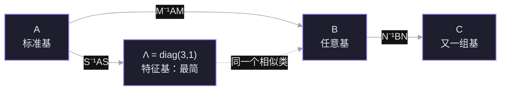
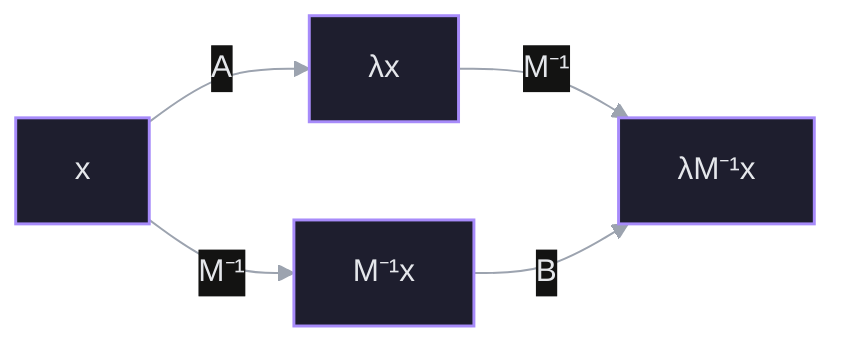
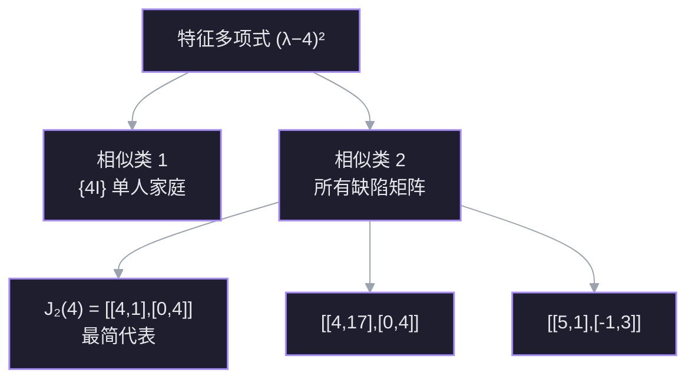
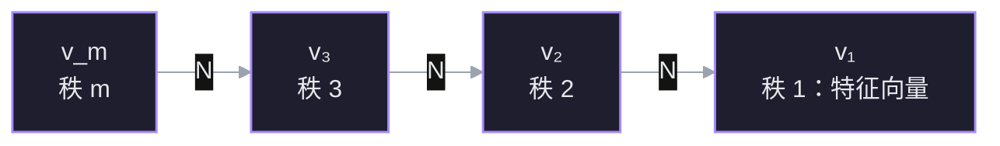

上一讲把正定矩阵讲成了「能量处处为正」；这一讲换一个方向：不再问一个矩阵好不好，而是问**哪些矩阵其实是同一个东西**。答案是把矩阵按相似关系分成家族，每个家族里挑一个最简代表。对角矩阵是「特征值互异」家族的王者；当特征向量不够时，王者退位，Jordan 形接班。

核心问题只有一句：

$$
\boxed{\text{两个矩阵什么时候只差一次换基？}
\quad\Longleftrightarrow\quad
B=M^{-1}AM.}
$$

## 节点 1 · 相似：同一个变换的不同坐标

### 动机

上一讲的对角化写成

$$
A=S\Lambda S^{-1}.
$$

如果只把它当成「算 $A^k$ 的技巧」，故事到那里就结束了。但换个读法：$A$ 和 $\Lambda$ 是**同一个线性变换**在两组不同基下的矩阵。$S$ 不是随便找的矩阵，它是「特征基」这套坐标的翻译官。

那么自然要问：如果换的不是特征基，而是任意一组基，会得到什么？得到的矩阵不再对角，但它和 $A$ 仍然描述同一个变换。把所有这样的矩阵收集起来，就是一个**家族**。这一讲的主线，就是给这些家族分类，并在每个家族里找出最简的代表。

### 定义

设 $A,B$ 都是 $n\times n$ 矩阵。若存在可逆矩阵 $M$，使得

$$
\boxed{B=M^{-1}AM,}
$$

则称 $A$ 与 $B$ **相似**（similar），记作 $A\sim B$。$M$ 叫**相似变换矩阵**。

这个定义不要求 $A$ 对称、不要求 $A$ 可对角化，也不要求 $M$ 正交。它只要求 $M$ 可逆——因为换基必须是一一对应的坐标翻译。

### 为什么偏偏是 $M^{-1}AM$

这不是天上掉下来的公式，而是换基的必然结果。设同一个线性变换 $T$ 在旧基下的矩阵是 $A$。若 $M$ 的列是新基在旧基下的坐标，那么：

- 一个向量在新坐标下的坐标 $x_{\text{new}}$，先要翻译成旧坐标：$x_{\text{old}}=Mx_{\text{new}}$；
- 在旧坐标里做变换：$Ax_{\text{old}}$；
- 再把结果翻译回新坐标：$M^{-1}(Ax_{\text{old}})$。

三步串起来：

$$
x_{\text{new}}\ \longmapsto\ M^{-1}AM\,x_{\text{new}}.
$$

所以新基下的矩阵只能是 $M^{-1}AM$。这就是 [[L20 对角化与矩阵的幂#变换角度：为什么用特征向量基计算|L20 的换基公式]]，只是那一讲只用了 $M=S$ 这一种特殊选择。

### 相似是一个等价关系

相似把全体 $n\times n$ 矩阵分成互不相交的**相似类**（similarity class）。三条性质逐一验证：

- **自反**：取 $M=I$，得 $A=I^{-1}AI$。
- **对称**：若 $B=M^{-1}AM$，则 $A=MBM^{-1}=(M^{-1})^{-1}BM^{-1}$，所以 $B\sim A$。
- **传递**：若 $B=M^{-1}AM$、$C=N^{-1}BN$，则

$$
C=N^{-1}(M^{-1}AM)N=(MN)^{-1}A(MN),
$$

所以 $A\sim C$。

传递性尤其重要：它允许我们「借道」最简代表。要证明两个矩阵相似，不必直接找 $M$，只要证明它们都相似于同一个 $\Lambda$ 或同一个 $J$。

### Strang 的例子：一个家族里的三副面孔

取

$$
A=\begin{bmatrix}2&1\\1&2\end{bmatrix}.
$$

它的特征值是 $3$ 和 $1$，特征向量可取 $(1,1)^{\mathsf T}$ 与 $(1,-1)^{\mathsf T}$。于是

$$
S=\begin{bmatrix}1&1\\1&-1\end{bmatrix},
\qquad
\Lambda=\begin{bmatrix}3&0\\0&1\end{bmatrix},
\qquad
S^{-1}AS=\Lambda.
$$

现在故意换一个「不好看」的 $M$：

$$
M=\begin{bmatrix}1&4\\0&1\end{bmatrix},
\qquad
M^{-1}=\begin{bmatrix}1&-4\\0&1\end{bmatrix}.
$$

直接乘：

$$
M^{-1}A
=\begin{bmatrix}1&-4\\0&1\end{bmatrix}
\begin{bmatrix}2&1\\1&2\end{bmatrix}
=\begin{bmatrix}-2&-7\\1&2\end{bmatrix},
$$

$$
B=M^{-1}AM
=\begin{bmatrix}-2&-7\\1&2\end{bmatrix}
\begin{bmatrix}1&4\\0&1\end{bmatrix}
=\begin{bmatrix}-2&-15\\1&6\end{bmatrix}.
$$

$B$ 看起来和 $A$ 毫无关系，但

$$
\operatorname{tr}B=-2+6=4=\operatorname{tr}A,
\qquad
\det B=(-2)(6)-(-15)(1)=3=\det A.
$$

特征多项式是 $\lambda^2-4\lambda+3=(\lambda-3)(\lambda-1)$，特征值仍是 $3,1$。所以 $A$、$B$、$\Lambda$ 三者同属一个家族：

$$
A\ \sim\ B\ \sim\ \Lambda=\operatorname{diag}(3,1).
$$

其中 $\Lambda$ 是这个家族里最简的代表——它是唯一一个对角成员。$B$ 只是同一个变换换了一组「歪」坐标后的样子。

### 连接

- 往上接 [[L20 对角化与矩阵的幂]]：对角化就是相似变换的一个特例，$M=S$。
- 往下接节点 2：既然同一个家族共享特征值，特征值就是第一个**相似不变量**。但特征值够不够把家族分干净？节点 3 会用 $2I$ 和 $J_2(2)$ 给出反例。
- 一个容易混淆的点先埋在这里：相似 $B=M^{-1}AM$ 与合同 $B=M^{\mathsf T}AM$ 是两种不同的变换。前者保持特征值，后者保持二次型的惯性；只有正交相似 $M=Q$ 时两者重合。这一讲只谈相似。

> [!question] 节点 1 确认
> 设 $B=M^{-1}AM$，$M$ 可逆。下面哪句话抓住了「相似」的本质？
> - A. $A$ 与 $B$ 的特征向量完全相同
> - B. $A$ 与 $B$ 是同一个线性变换在两组基下的矩阵
> - C. $A$ 与 $B$ 相似当且仅当 $\det A=\det B$
> - D. 我不知道

> [!success] ✓ 正确
> 选 B。相似的定义 $B=M^{-1}AM$ 正是换基公式：$M$ 把新坐标翻译成旧坐标，$A$ 在旧坐标里做变换，$M^{-1}$ 再翻译回来。所以 $A$ 和 $B$ 不是两个不同的变换，而是同一个变换的两套坐标记录。
>
> A 错在特征向量会跟着换基一起变：$Ax=\lambda x$ 对应 $B(M^{-1}x)=\lambda(M^{-1}x)$，特征向量从 $x$ 变成 $M^{-1}x$，不是原封不动。C 错在行列式只是相似的必要条件，不是充分条件：$2I$ 与 $\begin{bmatrix}2&1\\0&2\end{bmatrix}$ 行列式都为 $4$，却并不相似——这正是节点 3 要展开的裂缝。

## 节点 2 · 相似不变量：一个家族共享什么

### 动机

节点 1 里 $A$、$B$、$\Lambda$ 长得完全不同，却有相同的特征值。要判断两个矩阵是不是一家人，最省力的办法不是去找 $M$，而是找一些**换基不会改变的量**。找到的不变量越多，能排除的「假亲戚」就越多。

但也要小心：不变量给出的是**必要条件**。两个矩阵所有已知不变量都相同，仍然可能不相似。节点 3 会专门处理这个缺口。

### 特征值为什么不变

设 $Ax=\lambda x$，$x\ne0$。在 $A$ 和 $x$ 中间塞进 $MM^{-1}$：

$$
A x=A(MM^{-1})x=\lambda x.
$$

两边左乘 $M^{-1}$：

$$
(M^{-1}AM)(M^{-1}x)=\lambda(M^{-1}x).
$$

令 $B=M^{-1}AM$、$y=M^{-1}x$，就得到

$$
\boxed{By=\lambda y.}
$$

因为 $M^{-1}$ 可逆，$x\ne0$ 当且仅当 $y\ne0$。所以 $\lambda$ 也是 $B$ 的特征值。反过来把 $A$ 和 $B$ 的角色对调，同理。于是

$$
A\sim B\ \Longrightarrow\ \sigma(A)=\sigma(B).
$$

注意特征向量**没有**保持不变：它从 $x$ 变成了 $M^{-1}x$。相似保持的是「谱」，不是「谱的方向」。特征空间的维数也不变，因为 $M^{-1}$ 把 $\ker(A-\lambda I)$ 一一映到 $\ker(B-\lambda I)$。

下面的交换图就是这段证明的全部内容：两条路从 $x$ 走到 $\lambda M^{-1}x$，结果一样。

### 特征多项式、迹、行列式

特征值不变，最干净的证明是直接算特征多项式：

$$
\begin{aligned}
p_B(\lambda)
&=\det(\lambda I-B)\\
&=\det\bigl(\lambda I-M^{-1}AM\bigr)\\
&=\det\bigl(M^{-1}(\lambda I-A)M\bigr)\\
&=\det(M^{-1})\det(\lambda I-A)\det(M)\\
&=\det(\lambda I-A)=p_A(\lambda).
\end{aligned}
$$

所以特征多项式逐项相同，代数重数也相同。而 $\operatorname{tr}A$ 是 $p_A$ 中 $\lambda^{n-1}$ 系数的相反数，$\det A$ 是常数项，因此

$$
\operatorname{tr}(M^{-1}AM)=\operatorname{tr}A,
\qquad
\det(M^{-1}AM)=\det A.
$$

秩也保持不变：$M$ 和 $M^{-1}$ 都可逆，左乘、右乘可逆矩阵不改变秩，也不改变零空间维数。更一般地，

$$
B^k=(M^{-1}AM)^k=M^{-1}A^kM,
$$

所以 $A^k\sim B^k$；对任意多项式 $p$，同样有

$$
p(B)=M^{-1}p(A)M.
$$

这条性质在 18.06SC 的习题里直接用到：若 $A\sim B$，则 $2A^3+A-3I\sim 2B^3+B-3I$。

### 一张清单

| 量 | 相似下是否不变 | 原因 |
| --- | --- | --- |
| 特征值、代数重数 | 不变 | 特征多项式相同 |
| 特征多项式 | 不变 | $\det(\lambda I-M^{-1}AM)=\det(\lambda I-A)$ |
| 迹、行列式 | 不变 | 特征多项式的系数 |
| 秩、零空间维数 | 不变 | 左右乘可逆矩阵 |
| 几何重数 $\dim\ker(A-\lambda I)$ | 不变 | $M^{-1}$ 给出特征空间同构 |
| 幂与多项式 $p(A)$ | 保持相似 | $p(B)=M^{-1}p(A)M$ |
| 特征向量 | **变** | $x\mapsto M^{-1}x$ |
| 对称性、正定性 | **不一定保持** | 换基一般不正交 |
| 奇异值、范数 | **不一定保持** | 它们依赖内积，不只看线性结构 |

### 不变量不够：先看一眼裂缝

取

$$
A=\begin{bmatrix}2&1\\0&2\end{bmatrix},
\qquad
B=2I=\begin{bmatrix}2&0\\0&2\end{bmatrix}.
$$

两者的特征多项式都是 $(\lambda-2)^2$，迹都是 $4$，行列式都是 $4$，秩都是 $2$。按上面的清单，它们没有任何一项能被区分开。

但它们并不相似。原因很简单：若 $B=M^{-1}AM$，则 $A=MBM^{-1}=M(2I)M^{-1}=2I$，与 $A\ne2I$ 矛盾。等价地，$B$ 的特征空间是二维的，$A$ 的特征空间只有一维——几何重数其实已经把它们分开了。这说明清单上还缺一项更细的东西：**特征向量不够时，缺失的那部分是怎么组织的**。这就是广义特征向量和 Jordan 块要回答的问题。

### 连接

- 往上接节点 1：相似类就是同一个变换的所有坐标矩阵。
- 往下接节点 3：同谱、同迹、同行列式都不足以判定相似；需要看 $(A-\lambda I)^k$ 的零空间怎么长大。
- 一个先记住的结论：**相似 $\Rightarrow$ 所有多项式不变量相同；反过来不成立。** Jordan 形就是把这些不变量补全，直到它成为完全不变量。

> [!question] 节点 2 确认
> 下面哪个量在相似变换 $B=M^{-1}AM$ 下不保证保持不变？
> - A. 特征值的代数重数
> - B. 特征向量本身
> - C. 矩阵的秩
> - D. 我不知道

> [!failure] ✗ 不对
> 正确答案是 **B：特征向量本身**。
>
> 相似变换把 $A$ 的特征向量 $x$ 换成 $B$ 的特征向量 $M^{-1}x$。方向被 $M^{-1}$ 搬走了，所以特征向量不是不变量；保持不变的是特征值、特征多项式、代数重数、迹、行列式、秩和几何重数。
>
> 你选的 C（矩阵的秩）恰好是**不变量**。$B=M^{-1}AM$ 中 $M$ 与 $M^{-1}$ 都可逆，左右乘可逆矩阵不改变像空间维数，也不改变零空间维数。秩描述的是线性变换的「像有多大」，这是变换本身的性质，不随坐标改变。
>
> 一句话区分：**特征向量带坐标，换基就变；秩和谱是变换的内禀性质，换基不变。**

> [!question] 补确认：秩为什么不变
> 为什么相似矩阵 $A$ 与 $B=M^{-1}AM$ 的秩一定相同？
> - A. 因为左右乘可逆矩阵不改变秩
> - B. 因为它们的行列式相同
> - C. 因为它们的特征值相同
> - D. 我不知道

> [!success] ✓ 正确
> 选 A。$M$ 与 $M^{-1}$ 都可逆，左乘、右乘可逆矩阵都不改变秩。B 的推理不成立：行列式相同只能说明「是否满秩」相同，不能说明秩的具体值相同。C 也不普遍：特征值相同推不出秩相同，例如 $\operatorname{diag}(1,0,0)$ 与 $\begin{bmatrix}1&1&0\\0&0&0\\0&0&0\end{bmatrix}$ 都有特征值 $1,0,0$，秩分别是 $1$ 和 $2$。

## 节点 3 · 同谱不等于相似：家族会分裂

### 动机

节点 2 的清单在 $4I$ 与 $J_2(4)$ 面前失效了：特征多项式、迹、行列式、秩、代数重数全都一样。如果相似类真是「同一个变换的所有坐标」，那么这两个矩阵描述的变换应该不同——不同在哪里？这一节把这个裂缝撕开。

### 一个只有一名成员的家族

取

$$
B=4I=\begin{bmatrix}4&0\\0&4\end{bmatrix},
\qquad
C=J_2(4)=\begin{bmatrix}4&1\\0&4\end{bmatrix}.
$$

先看 $B$。对任意可逆 $M$，

$$
M^{-1}(4I)M=4\,M^{-1}IM=4I.
$$

所以 $4I$ 只与自身相似。它的相似类是一个**单人家庭**：$\{4I\}$。

再看 $C$。它的特征多项式是

$$
\det(\lambda I-C)
=\det\begin{bmatrix}\lambda-4&-1\\0&\lambda-4\end{bmatrix}
=(\lambda-4)^2,
$$

与 $B$ 完全相同。但它只有一个线性无关的特征向量：

$$
C-4I=\begin{bmatrix}0&1\\0&0\end{bmatrix},
\qquad
\ker(C-4I)=\operatorname{span}\left\{\begin{bmatrix}1\\0\end{bmatrix}\right\}.
$$

几何重数 $1$，代数重数 $2$。如果 $C$ 与 $B$ 相似，就存在可逆 $M$ 使 $C=M^{-1}BM$；但右边无论怎么算都是 $4I$，于是 $C=4I$，矛盾。因此

$$
\boxed{4I\ \not\sim\ J_2(4).}
$$

同谱、同迹、同行列式、同秩，仍然不相似。

### 家族分裂成两支

特征值 $4,4$ 的 $2\times2$ 矩阵不是**一个**相似类，而是**两类**：

- **单人家庭** $\{4I\}$：唯一的对角成员，也是最简代表。
- **缺陷家庭**：所有形如 $4I+N$、其中 $N\ne0$ 且 $N^2=0$ 的矩阵。成员包括

$$
J_2(4)=\begin{bmatrix}4&1\\0&4\end{bmatrix},
\qquad
\begin{bmatrix}4&17\\0&4\end{bmatrix},
\qquad
\begin{bmatrix}5&1\\-1&3\end{bmatrix}.
$$

后两个的迹都是 $8$、行列式都是 $16$，特征多项式都是 $(\lambda-4)^2$；它们都只有一个特征向量，所以都与 $J_2(4)$ 相似。$J_2(4)$ 是这个家庭里最简的代表——它不能对角化，但已经把非对角元压到只剩一个 $1$。

这就是 Strang 说的「Jordan 在每个家族里挑出最接近对角的那个矩阵」：能挑到对角就挑 $\Lambda$；挑不到，就退而求其次挑 $J$。

### 但数特征向量还不够：Strang 的 $4\times4$ 预告

在 $2\times2$ 里，几何重数恰好把两个家族分开了。到了 $4\times4$，连「数特征向量」也不够。取两个幂零矩阵：

$$
J=\begin{bmatrix}
0&1&0&0\\
0&0&0&0\\
0&0&0&1\\
0&0&0&0
\end{bmatrix}
\quad(2+2\text{ 块}),
\qquad
K=\begin{bmatrix}
0&1&0&0\\
0&0&1&0\\
0&0&0&0\\
0&0&0&0
\end{bmatrix}
\quad(3+1\text{ 块}).
$$

两者都有特征多项式 $\lambda^4$，秩都是 $2$，零空间维数都是 $2$——都有两个独立特征向量。但

$$
J^2=0,
\qquad
K^2=\begin{bmatrix}0&0&1&0\\0&0&0&0\\0&0&0&0\\0&0&0&0\end{bmatrix}\ne0.
$$

所以 $\dim\ker J^2=4$，而 $\dim\ker K^2=3$。它们不相似。

这说明：只看 $A-\lambda I$ 这一层不够，还要看 $(A-\lambda I)^2,(A-\lambda I)^3,\dots$ 的零空间怎么一层层长大。**长出来的速度，就是链的长度；链的长度，就是 Jordan 块的大小。** 这正是节点 4 要构造的东西。

### 连接

- 往上接节点 2：不变量是必要条件，不是充分条件；$4I$ 与 $J_2(4)$ 把所有常见不变量都撞平了。
- 往下接节点 4：缺的特征向量不能凭空补，要沿 $(A-\lambda I)$ 的方向往回找链。
- 往下接节点 6：$4\times4$ 的 $2+2$ 与 $3+1$ 说明，最终的不变量不是「特征向量个数」，而是每个 $k$ 的 $\dim\ker(A-\lambda I)^k$。

> [!question] 节点 3 确认
> 设 $B=4I=\begin{bmatrix}4&0\\0&4\end{bmatrix}$，$C=\begin{bmatrix}4&1\\0&4\end{bmatrix}$。两者特征多项式都是 $(\lambda-4)^2$。它们相似吗？
> - A. 不相似：$4I$ 只与自身相似
> - B. 相似：特征多项式相同
> - C. 相似：迹和行列式都相同
> - D. 我不知道

> [!success] ✓ 正确
> 选 A。对任意可逆 $M$，$M^{-1}(4I)M=4I$，所以 $4I$ 的相似类只有它自己。$C$ 不是 $4I$，因此不可能与 $4I$ 相似。
>
> B 和 C 都把「必要条件」当成了「充分条件」。特征多项式、迹、行列式相同只能说明它们**可能**相似；$4I$ 与 $J_2(4)$ 就是最干净的反例。真正的分水岭是 $C-4I$ 的零空间只有一维，而 $4I-4I=0$ 的零空间是二维。
>
> 记住这个最小反例：**同谱 $\not\Rightarrow$ 相似。** 后面所有 Jordan 形的构造，都是为了补上「同谱之外还差什么」。

## 节点 4 · 广义特征向量：把缺失的方向补回来

### 动机

节点 3 的 $C=J_2(4)$ 只有一个特征向量 $e_1$，但空间是二维的。想把它写成「最简矩阵」，还差一个基向量。这个向量不能是特征向量（否则就有两个独立特征向量，$C$ 就可对角化了），但它必须满足某种比「被 $C$ 缩放」更弱的关系。

看 $C$ 对 $e_2$ 做了什么：

$$
Ce_2=\begin{bmatrix}4\\1\end{bmatrix}=4e_2+e_1.
$$

它不是 $e_2$ 的倍数，但「偏离倍数」的部分正好是已有的特征向量 $e_1$。把 $4e_2$ 移到左边：

$$
(C-4I)e_2=e_1.
$$

这就是缺失的那条关系。$e_2$ 本身不是特征向量，但被 $C-4I$ 作用一次就落进了特征空间。它就是**广义特征向量**。

### 定义

设 $\lambda$ 是 $A$ 的特征值，$N=A-\lambda I$。若存在正整数 $k$ 使

$$
N^k v=0,\qquad v\ne0,
$$

则称 $v$ 是 $A$ 对应于 $\lambda$ 的**广义特征向量**（generalized eigenvector）。满足此式的最小 $k$ 叫它的**秩**（rank）。秩为 $1$ 的广义特征向量就是普通特征向量，因为 $Nv=0$ 即 $Av=\lambda v$。

固定 $\lambda$，所有广义特征向量加上零向量构成**广义特征空间**

$$
G_\lambda=\ker N^m=\ker(A-\lambda I)^m,
$$

其中 $m$ 取得足够大（$m\le n$ 即可；再大零空间不再增长）。一个标准事实是

$$
\boxed{\dim G_\lambda=\text{$\lambda$ 的代数重数}.}
$$

直观账是这样记的：一条长度为 $m$ 的链贡献 $m$ 个基向量，同时贡献 $m$ 重特征值；把所有链加起来，维数正好等于代数重数。普通特征空间只装得下几何重数那么多条链的「起点」，$G_\lambda$ 则把整条链都装进来。

不同特征值的广义特征空间互相独立，并且张满整个空间：

$$
V=\bigoplus_{\lambda}G_\lambda.
$$

这就是 Jordan 分解的存在性部分。Strang 这一讲只陈述、不证明；我们下面把单个特征值的链构造讲透，多特征值情形就是分别在每个 $G_\lambda$ 里做同样的事，最后拼成块对角。

### 链：从特征向量往回找

设 $N=A-\lambda I$。一条长度为 $m$ 的**链**（chain）是向量组

$$
v_1,v_2,\dots,v_m
$$

满足

$$
Nv_1=0,\qquad Nv_j=v_{j-1}\quad(j=2,\dots,m).
$$

也就是说：

$$
v_1\ \xleftarrow{\,N\,}\ v_2\ \xleftarrow{\,N\,}\ v_3\ \xleftarrow{\,N\,}\ \cdots\ \xleftarrow{\,N\,}\ v_m.
$$

最左边的 $v_1$ 是普通特征向量；越往右，秩越高。$v_m$ 满足 $N^m v_m=0$，但 $N^{m-1}v_m=v_1\ne0$，所以它的秩恰好是 $m$。

### 链为什么正好给出一个 Jordan 块

把链按 $v_1,v_2,\dots,v_m$ 的顺序放进基。逐列看 $A$ 的作用：

- $Av_1=\lambda v_1$，所以第 $1$ 列是 $(\lambda,0,\dots,0)^{\mathsf T}$；
- 对 $j\ge2$，$Av_j=\lambda v_j+v_{j-1}$，所以第 $j$ 列在对角线放 $\lambda$，在上一行放 $1$。

拼起来就是

$$
A\big[v_1\ v_2\ \cdots\ v_m\big]
=\big[v_1\ v_2\ \cdots\ v_m\big]
\begin{bmatrix}
\lambda&1&&\\
&\lambda&\ddots&\\
&&\ddots&1\\
&&&\lambda
\end{bmatrix}.
$$

右边那个矩阵就是 **$m\times m$ 的 Jordan 块** $J_m(\lambda)$。链的长度 $m$ 直接变成块的大小；超对角线上的 $1$ 记录的是「$v_j$ 被 $N$ 推回 $v_{j-1}$」这条关系。

### 一个不是现成 Jordan 形的例子

取

$$
A=\begin{bmatrix}5&1\\-1&3\end{bmatrix}.
$$

先算特征值：$\operatorname{tr}A=8$，$\det A=16$，特征多项式

$$
\lambda^2-8\lambda+16=(\lambda-4)^2.
$$

所以 $\lambda=4$，并且

$$
N=A-4I=\begin{bmatrix}1&1\\-1&-1\end{bmatrix}.
$$

求特征向量：解 $Nv_1=0$，即 $x+y=0$，取

$$
v_1=\begin{bmatrix}1\\-1\end{bmatrix}.
$$

再解 $Nv_2=v_1$：

$$
\begin{bmatrix}1&1\\-1&-1\end{bmatrix}
\begin{bmatrix}x\\y\end{bmatrix}
=\begin{bmatrix}1\\-1\end{bmatrix}
\iff x+y=1.
$$

取 $v_2=(1,0)^{\mathsf T}$。验证：

$$
Nv_2=\begin{bmatrix}1\\-1\end{bmatrix}=v_1.
$$

于是 $v_1,v_2$ 构成一条长度 $2$ 的链。令

$$
P=\big[v_1\ v_2\big]
=\begin{bmatrix}1&1\\-1&0\end{bmatrix},
\qquad
P^{-1}=\begin{bmatrix}0&-1\\1&1\end{bmatrix}.
$$

直接算：

$$
P^{-1}AP
=\begin{bmatrix}0&-1\\1&1\end{bmatrix}
\begin{bmatrix}5&1\\-1&3\end{bmatrix}
\begin{bmatrix}1&1\\-1&0\end{bmatrix}
=\begin{bmatrix}4&1\\0&4\end{bmatrix}
=J_2(4).
$$

$A$ 本身不是 Jordan 形，但换到链基以后就变成了 $J_2(4)$。这就是「找广义特征向量」的实际操作：**先找普通特征向量，再逐层解 $Nv_j=v_{j-1}$。**

### 连接

- 往上接节点 3：$4I$ 与 $J_2(4)$ 的差别，不在于特征值，而在于后者需要一条长度为 $2$ 的链。
- 往下接节点 5：一条链 $\to$ 一个 Jordan 块；多条链 $\to$ 多个块。把所有特征值的链拼起来，就是 Jordan 形。
- 往下接节点 6：链的条数等于几何重数，链的长度之和等于代数重数；每个 $k$ 的 $\dim\ker N^k$ 记录「长度至少为 $k$ 的链有多少条」。这套账就是 Jordan 形唯一的根源。
