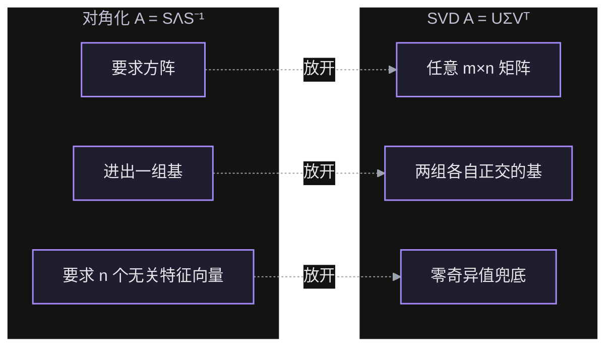
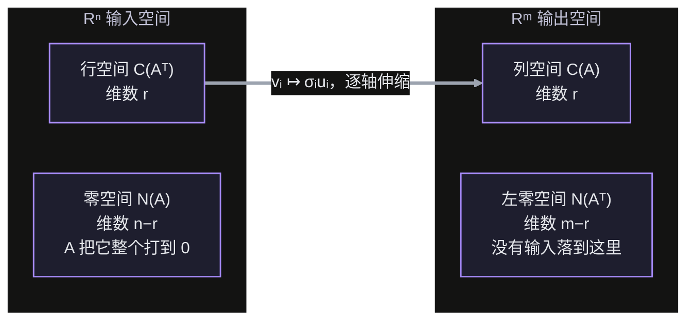
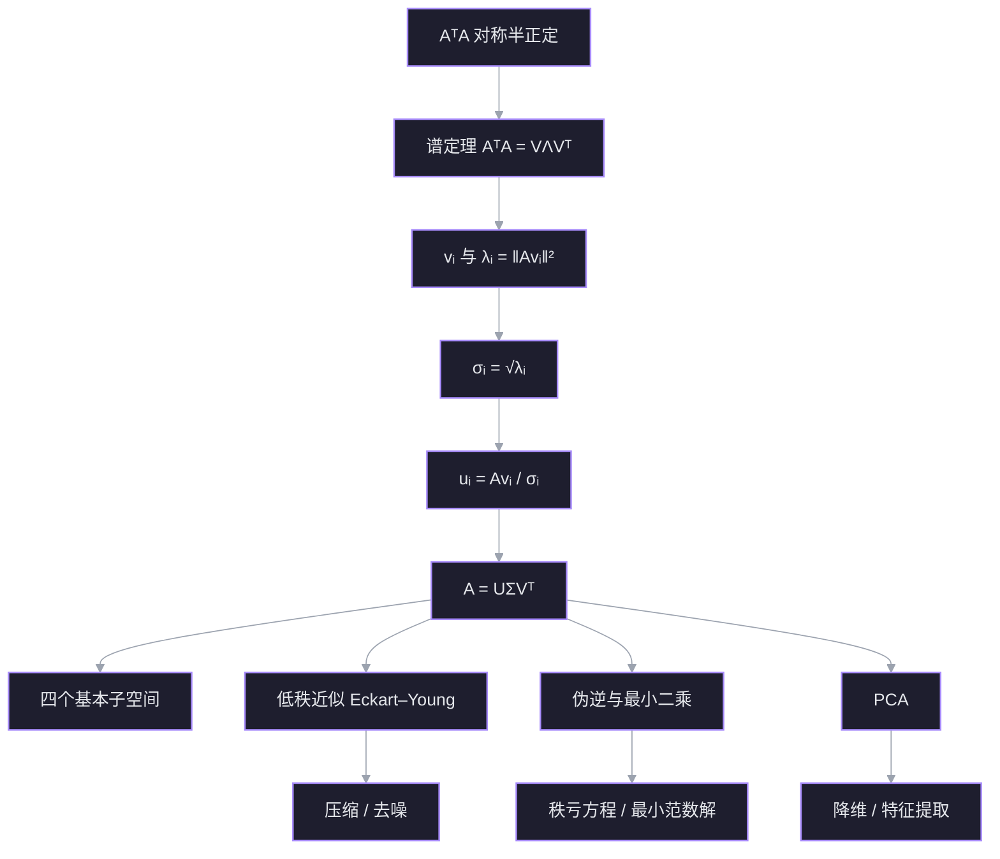

对角化 $A=S\Lambda S^{-1}$ 要求方阵、而且要有 $n$ 个线性无关的特征向量。矩形矩阵连特征值都没有；亏损矩阵只能退到 [[L28 相似矩阵与若尔当形]] 的块对角。SVD 换一个问法：不要求「进去的基」和「出来的基」是同一组，只要求各自正交。于是**任意**矩阵都能写成

$$
A=U\Sigma V^{\mathsf T},
$$

两边各有一组标准正交基，中间只有伸缩。这一讲把它从 $A^{\mathsf T}A$ 的谱定理里逼出来，再看它在四个基本子空间、低秩近似、最小二乘和 PCA 里的样子。

材料：lecture 29（Strang, SVD）；直观版参考 [[【无痛线代】彻底搞懂SVD！矩阵究竟怎么就奇异了？]]。

## 节点 1 · 动机：对角化在哪里失败

对角化想做的事是：**换一组坐标，让变换不再混合方向**。在特征基下，$A$ 只把每个基向量拉长 $\lambda_i$ 倍：

$$
A=S\Lambda S^{-1}\quad\Longleftrightarrow\quad Av_i=\lambda_i v_i .
$$

这个愿望有三道门槛：

1. **必须是方阵**。$A$ 是 $3\times2$ 时，「$Ax=\lambda x$」两边类型都对不上。
2. **特征向量要够$n$ 个**。亏损矩阵（[[L28 相似矩阵与若尔当形]]）只能做到 Jordan 块，块内仍有上三角的 $1$ 在混合方向。
3. **特征值可能是复数**。实旋转矩阵把平面转 $90^\circ$，没有任何实方向被保持。

但我们真正想要的东西，其实比对角化弱：**只要有两组各自正交的基，一组管输入、一组管输出，中间是伸缩**。输入基不必等于输出基——这正是「矩形矩阵也可以有」的那部分自由。

$$
\underbrace{x}_{\text{输入坐标}}
\;\xrightarrow{\ V^{\mathsf T}\ }\;
\underbrace{\text{换到右奇异基}}_{\text{旋转}}
\;\xrightarrow{\ \Sigma\ }\;
\underbrace{\text{逐轴伸缩}}_{\text{拉伸}}
\;\xrightarrow{\ U\ }\;
\underbrace{Ax}_{\text{输出坐标}}
$$

所以问题变成一句话：

> 给定任意 $m\times n$ 的 $A$，能不能找到输入空间的一组标准正交基 $v_1,\dots,v_n$、输出空间的一组标准正交基 $u_1,\dots,u_m$，使得 $Av_i$ 恰好沿 $u_i$ 方向、只被拉长一个非负数 $\sigma_i$？

SVD 的回答是：能，而且 $v_i,u_i,\sigma_i$ 全都能从 $A^{\mathsf T}A$ 算出来。

> [!question] 对角化对矩形矩阵失效的根本原因是？
> - 它要求输入和输出用同一组基
> - 它要求矩阵必须可逆
> - 它要求特征值必须是实数
> - I don't know

> [!failure] ✗ 不对
> 正确答案是**「它要求输入和输出用同一组基」**。
>
> 把 $A=S\Lambda S^{-1}$ 拆成三步读：$x\mapsto S^{-1}x$（换成基 $v_1,\dots,v_n$ 下的坐标）→ 乘 $\Lambda$（每个坐标乘 $\lambda_i$）→ 再乘 $S$（**用同一组基** $v_1,\dots,v_n$ 把坐标变回向量）。所以对角化说的是：输入用基 $v$，输出也用基 $v$，矩阵在这组基下是对角。
>
> 矩形 $3\times2$ 就卡在这里：$x\in\mathbb R^2$，$Ax\in\mathbb R^3$。$v_i\in\mathbb R^2$ 根本不能当 $\mathbb R^3$ 的基；$Ax=\lambda x$ 左边在 $\mathbb R^3$、右边在 $\mathbb R^2$，连等式都不成立。SVD 放开这一条：输入基 $V$ 在 $\mathbb R^n$、输出基 $U$ 在 $\mathbb R^m$，各用各的。
>
> 你选的「必须可逆」不成立：$\begin{bmatrix}1&0\\0&0\end{bmatrix}$ 奇异，却已经是对角矩阵。对角化只关心有没有足够多无关特征向量，不关心行列式是否为零。可逆性是被**特征值是否为 $0$** 影响的，不是对角化的前提。

三条门槛逐条被放宽，对应的就是 SVD 的三处新东西：$U$ 与 $V$ 分开、$\Sigma$ 允许零、矩阵可以是任意形状。

## 节点 2 · 把 $A$ 变成对称方阵：$A^{\mathsf T}A$

我们要找输入空间的基 $v_i$。可 $A$ 本身可能是矩形的、不对称的，谱定理一条都用不上。办法是造一个**携带 $A$ 的长度信息**的对称方阵：

$$
B=A^{\mathsf T}A\quad(n\times n).
$$

它有三条性质，每条都恰好补一个缺口。

**对称。** $(A^{\mathsf T}A)^{\mathsf T}=A^{\mathsf T}A$。谱定理要求的那一半到位了。

**半正定。** 对任意 $x$，

$$
x^{\mathsf T}A^{\mathsf T}Ax=(Ax)^{\mathsf T}(Ax)=\|Ax\|^2\ge 0 .
$$

所以 $A^{\mathsf T}A$ 的特征值 $\lambda_i\ge 0$。这不是推导出来的巧合，是定义式的直接读法：**$B$ 的二次型就是 $A$ 把 $x$ 拉长后的长度平方**。

**秩不变、零空间不变。**

$$
\mathcal N(A^{\mathsf T}A)=\mathcal N(A).
$$

一个方向显然：$Ax=0\Rightarrow A^{\mathsf T}Ax=0$。反过来，若 $A^{\mathsf T}Ax=0$，左乘 $x^{\mathsf T}$ 得 $\|Ax\|^2=0$，于是 $Ax=0$。两边夹住，零空间相同；秩也就相同。

于是谱定理可以直接用：存在标准正交矩阵 $V=[v_1\ \cdots\ v_n]$，使

$$
A^{\mathsf T}A=V\Lambda V^{\mathsf T},\qquad
\Lambda=\operatorname{diag}(\lambda_1,\dots,\lambda_n),\quad \lambda_i\ge 0 .
$$

$v_i$ 就是 $A^{\mathsf T}A$ 的特征向量。注意 $\lambda_i$ 的含义：

$$
\lambda_i=v_i^{\mathsf T}A^{\mathsf T}Av_i=\|Av_i\|^2 .
$$

**特征值就是 $Av_i$ 的长度的平方。** 这句话是下一节点全部构造的种子：长度开根号，方向单独提出来，$\sigma_i$ 和 $u_i$ 就同时出现了。

> [!success] ✓ 正确
> $A^{\mathsf T}A$ 把「矩形、不对称」这两个障碍一次消掉：它总是 $n\times n$ 对称，且二次型恰是 $\|Ax\|^2$，所以特征值非负。谱定理因此无条件可用。

### $A^{\mathsf T}A$ 与 $AA^{\mathsf T}$ 到底差在哪

先把两个空间钉死：

| | 是哪个空间 | 里面的向量 |
| --- | --- | --- |
| **输入空间** | $\mathbb R^n$ | $x$（被 $A$ 作用之前） |
| **输出空间** | $\mathbb R^m$ | $Ax$（被 $A$ 作用之后） |

矩阵的尺寸直接告诉你它作用在哪个空间：**$n\times n$ 的 $A^{\mathsf T}A$ 作用在输入空间**，它的特征向量 $v_i$ 是输入方向；**$m\times m$ 的 $AA^{\mathsf T}$ 作用在输出空间**，它的特征向量 $u_i$ 是输出方向。

两者是**方向相反的两次往返**：

$A^{\mathsf T}A$ 从输入空间出发又回到输入空间，问的是：哪些**输入**方向走一圈回来仍保持方向？答案是 $v_i$，而拉伸倍数是 $\|Av_i\|^2=\sigma_i^2$。$AA^{\mathsf T}$ 把同一个问题在输出侧问一遍，答案就是 $u_i$。

尺寸不同，零特征值的来源也不同：$A^{\mathsf T}A$ 的零特征值有 $n-r$ 个，特征向量落在零空间 $\mathcal N(A)$；$AA^{\mathsf T}$ 的零特征值有 $m-r$ 个，落在左零空间 $\mathcal N(A^{\mathsf T})$。但**非零特征值完全一样**，因为两次往返穿过的是同一个拉伸 $\sigma_i$。

**为什么基要放进行空间和列空间。** $A$ 把输入分成两半：行空间与零空间。零空间的方向被 $A$ 打成 $0$，无论怎么选基都变不出输出，只能拿 $\sigma=0$；真正「有去处」的输入恰好是行空间。输出侧同理：$Av$ 永远落在列空间，左零空间那 $m-r$ 个方向永远没有输入落进去，只能拿来把 $U$ 补成方阵。一句话：$A$ 限制在

$$
\mathcal C(A^{\mathsf T})\longrightarrow\mathcal C(A)
$$

上是一个可逆映射（两边维数都是 $r$），SVD 就是这个映射在两组正交基下的对角化；零空间与左零空间是两边的死角，只贡献零。

![[viz-svd-ata-aat-roundtrip-1794131852547.svg|900]]

*图：左框永远是**输入空间** $\mathbb R^n$（$x$ 所在），右框永远是**输出空间** $\mathbb R^m$（$Ax$ 所在）。上：回路从输入出发、绕回输入，$A^{\mathsf T}A$ 问的是「哪些输入方向原样回来」；下：回路从输出出发、绕回输出，$AA^{\mathsf T}$ 问的是输出方向。两条回路穿过同一个拉伸 $\sigma_i$，所以非零谱相同，尺寸和零特征值的个数不同：$n-r$ vs $m-r$。*

## 节点 3 · 构造 $\sigma_i$ 与 $u_i$：$Av_i=\sigma_i u_i$

上一节点留下一个等式：$\|Av_i\|^2=\lambda_i$。想把它写成「方向 × 长度」，只差开根号：

$$
\sigma_i=\sqrt{\lambda_i}\ \ge 0 .
$$

**情形一：$\lambda_i>0$。** $Av_i\ne 0$，可以定义

$$
u_i=\frac{Av_i}{\sigma_i}.
$$

它自动是单位向量，因为 $\|u_i\|=\|Av_i\|/\sigma_i=1$。而且不同 $i$ 的 $u_i$ 正交：

$$
u_i^{\mathsf T}u_j
=\frac{v_i^{\mathsf T}A^{\mathsf T}Av_j}{\sigma_i\sigma_j}
=\frac{\lambda_j\,v_i^{\mathsf T}v_j}{\sigma_i\sigma_j}
=\delta_{ij},
$$

最后一步用了 $v_i^{\mathsf T}v_j=\delta_{ij}$ 和 $\lambda_j=\sigma_j^2$。于是 $\{u_i\}$ 是一组标准正交向量。定义式反过来写就是本讲的核心等式：

$$
\boxed{\,Av_i=\sigma_i u_i\,}
$$

**情形二：$\lambda_i=0$。** 这时 $\|Av_i\|=0$，即 $Av_i=0$，$v_i$ 落在 $\mathcal N(A)$ 里。没有方向可以提出来，$\sigma_i=0$，$u_i$ 这一侧需要另找——留到下一节点补。

把非零部分拼成矩阵。设秩为 $r$，取

$$
V_r=[v_1\ \cdots\ v_r],\quad
U_r=[u_1\ \cdots\ u_r],\quad
\Sigma_r=\operatorname{diag}(\sigma_1,\dots,\sigma_r),
$$

则 $AV_r=U_r\Sigma_r$。两边右乘 $V_r^{\mathsf T}$ 得**精简 SVD**：

$$
A=U_r\Sigma_r V_r^{\mathsf T}.
$$

它成立的理由是两边在 $\mathbb R^n$ 的一组基上取值相同：$i\le r$ 时由 $Av_i=\sigma_i u_i$ 保证；$i>r$ 时左边 $Av_i=0$，右边 $V_r^{\mathsf T}v_i=0$ 也为零。

> [!note] 为什么 $V_rV_r^{\mathsf T}$ 可以「消失」
> $V_r$ 只有 $r$ 列。$V_rV_r^{\mathsf T}$ 是到行空间 $\mathcal C(A^{\mathsf T})$ 的正交投影，不是 $I$。但 $A$ 的零空间正好是行空间的正交补，所以 $A(I-V_rV_r^{\mathsf T})=0$，即 $A=AV_rV_r^{\mathsf T}$。乘上去不改变 $A$。

> [!success] ✓ 正确
> $\lambda_i=0$ 意味着 $Av_i=0$，这条输入方向被压没了，提不出输出方向。$u_i$ 只能从「与已经找到的 $u_1,\dots,u_r$ 正交」的补空间里另选一组标准正交基补上——它们张成的正是左零空间。

### Strang 的走法：先假设，再让 $U$ 消失

上面的顺序是「先造 $A^{\mathsf T}A$」。Strang 在课上反着走：先把目标写成矩阵，再想办法把不要的因子消掉。

假设已经有 $A=U\Sigma V^{\mathsf T}$。两边左乘 $A^{\mathsf T}$：

$$
A^{\mathsf T}A
=V\Sigma^{\mathsf T}U^{\mathsf T}U\Sigma V^{\mathsf T}
=V\Sigma^{\mathsf T}\Sigma V^{\mathsf T}
=V\operatorname{diag}(\sigma_1^2,\dots,\sigma_r^2,0,\dots)V^{\mathsf T}.
$$

$U^{\mathsf T}U=I$ 把 $U$ 整块消掉，剩下的正是 $A^{\mathsf T}A$ 的谱分解。于是直接读出：$V$ 的列是 $A^{\mathsf T}A$ 的特征向量，$\sigma_i^2$ 是对应的特征值，半正定保证可以取非负平方根。

$U$ 有两条路：换顺序乘出 $AA^{\mathsf T}=U\Sigma\Sigma^{\mathsf T}U^{\mathsf T}$；或者由 $AV=U\Sigma$ 直接得到 $u_i=Av_i/\sigma_i$。

```mermaid
%%{init: {'theme':'base','themeCSS':'.nodeLabel{color:#E5E7EB!important;fill:#E5E7EB!important}.edgeLabel p{background-color:#131312!important}.edgeLabel{color:#E5E7EB!important}svg{background:transparent!important}','themeVariables':{'primaryColor':'#1E1E2E','primaryTextColor':'#E5E7EB','primaryBorderColor':'#A78BFA','lineColor':'#9CA3AF','mainBkg':'#1E1E2E','nodeBorder':'#A78BFA','clusterBkg':'#131312','edgeLabelBackground':'#131312','actorBkg':'#1E1E2E','actorBorder':'#A78BFA','noteBkgColor':'#1E1E2E','noteBorderColor':'#A78BFA','stateBkg':'#1E1E2E','stateBorder':'#A78BFA','fontFamily':'Noto Sans CJK SC, sans-serif'}}}%%
flowchart LR
    T["目标<br/>A = UΣVᵀ"] --> L["两边左乘 Aᵀ"]
    L --> M["AᵀA = VΣᵀΣVᵀ<br/>= V diag(σᵢ²) Vᵀ"]
    M --> V["V = AᵀA 的特征向量<br/>σᵢ = √λᵢ"]
    V --> U["U 列 = AV 的归一化<br/>或 AAᵀ 的特征向量"]
    U --> E["A = UΣVᵀ"]

classDef default fill:#1E1E2E,stroke:#A78BFA,stroke-width:1.5px,color:#E5E7EB
linkStyle default stroke:#9CA3AF
```

这条路线的好处是：$A^{\mathsf T}A$ 不是「想到的」，而是「消掉 $U$」这个需求自动逼出来的。两条路终点相同。

## 节点 4 · 完整 SVD 与四个基本子空间

精简形式 $A=U_r\Sigma_rV_r^{\mathsf T}$ 只用到了非零奇异值。把两边补成方阵，就得到**完整 SVD**：

$$
A=U\Sigma V^{\mathsf T},\qquad
U^{\mathsf T}U=I_m,\quad V^{\mathsf T}V=I_n,
$$

其中 $U$ 是 $m\times m$、$V$ 是 $n\times n$、$\Sigma$ 是 $m\times n$ 且只有前 $r$ 个对角元非零。

补法来自 [[L10 四个基本子空间]] 的正交分解：

- $V$ 的前 $r$ 列 $v_1,\dots,v_r$ 是 $A^{\mathsf T}A$ 对应正特征值的特征向量，张成行空间 $\mathcal C(A^{\mathsf T})$；后 $n-r$ 列对应零特征值，张成零空间 $\mathcal N(A)$。
- $U$ 的前 $r$ 列是 $u_i=Av_i/\sigma_i$，张成列空间 $\mathcal C(A)$；后 $m-r$ 列在左零空间 $\mathcal N(A^{\mathsf T})$ 里任取一组标准正交基补齐。

于是 $A$ 在四个子空间上的动作一眼可见：

两条容易记反的事实：

1. **$A$ 在行空间与列空间之间是可逆的线性映射**（维数都是 $r$，核为零）。SVD 给出它的对角化：$v_i\mapsto\sigma_iu_i$。
2. **$u_i$ 也是 $AA^{\mathsf T}$ 的特征向量**，特征值同样是 $\sigma_i^2$。因为 $AA^{\mathsf T}u_i=A(\sigma_iv_i)=\sigma_i^2u_i$。所以 $AA^{\mathsf T}=U\Sigma\Sigma^{\mathsf T}U^{\mathsf T}$，$A^{\mathsf T}A=V\Sigma^{\mathsf T}\Sigma V^{\mathsf T}$——两个矩阵共享非零谱。

> [!success] ✓ 正确
> $\Sigma$ 的零对角元对应 $U$ 的后 $m-r$ 列。它们与列空间正交，张成左零空间 $\mathcal N(A^{\mathsf T})$——正是「没有输入落到这里」的那一半。

![[viz-svd-row-column-bases-1794131220460.svg|900]]

*图：$A$ 把行空间里的一组正交基 $v_1,v_2$ 送到列空间里的一组正交基 $\sigma_1u_1,\sigma_2u_2$——右角仍然是右角；零空间 $v_{r+1},\dots,v_n$ 整个被压成 $0$，左零空间则没有任何输入落进去。*

## 节点 5 · 几何：旋转 → 拉伸 → 旋转

把 $A=U\Sigma V^{\mathsf T}$ 从右往左读，就是对任意 $x$ 的三步动作：

1. **$V^{\mathsf T}x$**：换成右奇异基下的坐标——正交矩阵，只旋转（或反射），不改长度。
2. **$\Sigma(V^{\mathsf T}x)$**：每个坐标乘 $\sigma_i$——唯一改变长度的一步，而且各轴独立；第 $i$ 个坐标若 $\sigma_i=0$ 就被清零。
3. **$U(\cdot)$**：把结果旋转到输出空间的标准坐标——同样保长度。

所以「$A$ 对向量的全部拉伸」都集中在 $\Sigma$ 上，$U$ 和 $V$ 只是换坐标。

正交矩阵在这里扮演的是**翻译器**，不只是「旋转」：

- $V^{\mathsf T}$ 把输入空间里的**向量**翻译成右奇异基下的**坐标**；
- $V$ 做反方向，把坐标重新组合成向量；
- $U$ 在输出空间里把坐标翻译成向量。

为什么 $V^{\mathsf T}x$ 恰好给出坐标？设 $x=c_1v_1+\cdots+c_nv_n$，两边与 $v_j$ 作内积：

$$
v_j^{\mathsf T}x
=c_1\,v_j^{\mathsf T}v_1+\cdots+c_n\,v_j^{\mathsf T}v_n
=c_j .
$$

其余项因 $v_j^{\mathsf T}v_i=0$ 全部消失，只剩 $v_j^{\mathsf T}v_j=1$ 那一项。所以「与每个基向量作内积」就是在读坐标；把 $n$ 个内积摞成矩阵，正是 $V^{\mathsf T}x$。

三步可以读成一张表：

| 步 | 矩阵 | 动作 | 从 → 到 |
| --- | --- | --- | --- |
| 1 | $V^{\mathsf T}$ | 向量 → 坐标 | $x\in\mathbb R^n$ → $c$ |
| 2 | $\Sigma$ | 第 $i$ 个坐标乘 $\sigma_i$ | $c$ → $\Sigma c$ |
| 3 | $U$ | 坐标 → 向量 | $\Sigma c$ → $Ax\in\mathbb R^m$ |

一个画面：$U$ 把整个 $V$ 坐标系里的图像**拎起来，对准 $U$ 的两根坐标轴拍下去**。伸缩后的纹理被贴到输出空间的新舞台上；$\sigma_i=0$ 的那一维就在这一拍里被压没了。

**单位球变椭球。** 取所有 $\|x\|=1$。第一步后仍是单位球；第二步把第 $i$ 个方向拉到 $\sigma_i$ 倍，得到轴长为 $\sigma_1,\dots,\sigma_r$ 的椭球（零奇异值的方向被压扁）；第三步只是把这个椭球转个方向。于是

$$
\{Ax:\|x\|=1\}
$$

是输出空间中一个椭球，半轴长恰为 $\sigma_1\ge\sigma_2\ge\cdots\ge\sigma_r>0$，方向沿 $u_1,\dots,u_r$。这就是开头那句「半轴长就是奇异值」的矩阵版本。

**Strang 的例。** $A=\begin{bmatrix}4&4\\-3&3\end{bmatrix}$：

$$
A^{\mathsf T}A=\begin{bmatrix}25&7\\7&25\end{bmatrix},
\qquad \lambda=32,\,18,
\qquad \sigma_1=\sqrt{32},\ \sigma_2=\sqrt{18}.
$$

特征向量 $(1,1)$、$(1,-1)$ 归一化后是 $v_1,v_2$；单位圆上的 $v_1$ 被送到 $\sigma_1u_1$，$v_2$ 被送到 $\sigma_2u_2$。圆的像是一个半轴 $\sqrt{32}\approx5.66$、$\sqrt{18}\approx4.24$ 的椭圆，两条半轴互相垂直——这正是「正交基送到正交基」的几何内容。

![[viz-svd-circle-ellipse-1794131099816.svg|900]]

*图：左为单位圆与 $v_1=(1,1)/\sqrt2$、$v_2=(1,-1)/\sqrt2$；右为像椭圆，半轴长 $\sqrt{32}$ 与 $\sqrt{18}$，方向沿 $u_1=(1,0)$ 和 $u_2=(0,-1)$。$Av_2$ 指向下方，所以 $u_2$ 取 $(0,-1)$ 才能保持 $\sigma_2>0$。*

**秩亏时。** 若 $\sigma_r=0$，对应方向被压到 $0$，椭球退化成低维椭球（$r=2$ 时是椭圆盘，$r=1$ 时是一条线段）。维数由非零奇异值的个数决定，而不是由矩阵尺寸决定。

**「奇异」这个名字从哪来。** singular 的原义是「失去一般性、不可逆」。看第二步：某个 $\sigma_i=0$，第 $i$ 个坐标整列乘零，输入空间里那个方向的信息全部丢失。输出空间的一个点不再能唯一倒推回输入——映射退化成多对一，逆不存在，这就是「奇异」。所以奇异值就是**检验各坐标轴是否被压到零的刻度**；只要有一个 $\sigma_i=0$，矩阵必奇异。反过来，非零 $\sigma_i$ 的个数就是变换后仍能独立伸展的维数，也就是秩。

> [!success] ✓ 正确
> 秩 $2$ 意味着三个奇异值里 $\sigma_3=0$：第三个方向被压到 $0$，椭球失去一个维度，只剩下平面上的椭圆盘（$\sigma_1,\sigma_2>0$ 时是实心的）。维数只看非零奇异值的个数。

## 节点 6 · 秩、范数、条件数

SVD 把「矩阵的尺寸信息」全部摊在 $\Sigma$ 的对角线上，许多量因此变成一句话：

| 量 | 用奇异值表示 |
| --- | --- |
| 秩 | 非零 $\sigma_i$ 的个数 |
| 谱范数 $\lVert A\rVert_2$ | $\sigma_1$（最大拉伸） |
| Frobenius 范数 $\lVert A\rVert_F$ | $\sqrt{\sigma_1^2+\cdots+\sigma_r^2}$ |
| 条件数（可逆方阵） | $\kappa=\sigma_1/\sigma_r$ |
| 行列式绝对值（方阵） | $|\det A|=\prod_i\sigma_i$ |

**为什么 $\|A\|_2=\sigma_1$。** 谱范数定义为 $\max_{\|x\|=1}\|Ax\|$。任意 $x$ 写成 $V$ 坐标 $c$，$\|x\|=\|c\|$，而 $\|Ax\|=\|U\Sigma c\|=\|\Sigma c\|=\sqrt{\sum\sigma_i^2c_i^2}\le\sigma_1\|c\|=\sigma_1$。等号在 $x=v_1$ 取到。Frobenius 同理：$\|A\|_F^2=\operatorname{tr}(A^{\mathsf T}A)=\sum\lambda_i=\sum\sigma_i^2$。

**条件数为什么是 $\sigma_1/\sigma_r$。** 它衡量的不是「矩阵有多大」，而是「解方程时输入的相对误差会被放大成多大的相对误差」。

设解 $Ax=b$，$b$ 有一个小扰动 $\delta b$，解随之变成 $x+\delta x$：

$$
A(x+\delta x)=b+\delta b
\quad\Longrightarrow\quad
A\,\delta x=\delta b
\quad\Longrightarrow\quad
\delta x=A^{-1}\delta b .
$$

$A^{-1}$ 的奇异值是 $1/\sigma_i$，最大的是 $1/\sigma_r$，所以

$$
\|\delta x\|\le \|A^{-1}\|\,\|\delta b\|=\frac{1}{\sigma_r}\|\delta b\| .
$$

另一头，$\|b\|=\|Ax\|\le\sigma_1\|x\|$，即 $1/\|x\|\le\sigma_1/\|b\|$。两式相乘：

$$
\frac{\|\delta x\|}{\|x\|}
\;\le\;
\underbrace{\frac{\sigma_1}{\sigma_r}}_{\kappa}\,
\frac{\|\delta b\|}{\|b\|}.
$$

所以 $\kappa$ 就是**相对误差的最坏放大倍数**。直观上：$A$ 把最好的方向放大 $\sigma_1$ 倍、把最差的方向压到 $\sigma_r$ 倍；求逆时，这个被压得最扁的方向反过来被放大 $1/\sigma_r$ 倍，噪声就藏在那里。$\sigma_r\to0$（接近奇异）时 $\kappa\to\infty$；$A$ 是正交矩阵的倍数时 $\sigma_1=\sigma_r$，$\kappa=1$，不放大。

**为什么不能看行列式。** $A=\operatorname{diag}(1000,\,0.001)$ 的 $\det A=1$，看起来「正常」，但 $\kappa=10^6$：第一个方向放大一千倍，第二个压小一千倍。行列式把两个方向的伸缩乘在一起，正好互相抵消，掩盖了悬殊。

**秩本身也是个粗指标。** 看

$$
A=\begin{bmatrix}1&1\\1&1.001\end{bmatrix}.
$$

两列不再严格相等，$\det A=0.001\ne0$，所以它在数学上满秩、可逆。但奇异值约为 $\sigma_1\approx2.0005$、$\sigma_2\approx5\times10^{-4}$，条件数 $\kappa\approx4\times10^3$：两个几乎平行的方向会把解方程时的误差放大几千倍。把 $1.001$ 改回 $1$，$\sigma_2$ 立刻成为严格 $0$，秩从 $2$ 掉到 $1$——矩阵本身只动了一个千分位。

所以现代应用更愿意看**整个谱**：把奇异值从大到小排成一列，

$$
\sigma_1\ge\sigma_2\ge\cdots\ge\sigma_r>0,
$$

它像光谱一样告诉你每个方向被拉伸或压缩了多少。秩只数了严格非零的个数，把「几乎为零」和「完全为零」一视同仁，信息量少得多。

> [!question] 可逆方阵的条件数 $\kappa=\sigma_1/\sigma_r$ 很大，说明什么？
> - 矩阵接近奇异，小扰动会被显著放大
> - 行列式一定很大
> - 所有奇异值都接近 1
> - I don't know

> [!question] 不知道
> $\kappa$ 是相对误差的放大上界：$\dfrac{\|\delta x\|}{\|x\|}\le\kappa\dfrac{\|\delta b\|}{\|b\|}$。$\kappa$ 大说明某个方向几乎被压平，$A^{-1}$ 会把这个方向上的噪声放大很多倍——病态。行列式不能替代它：$\operatorname{diag}(1000,0.001)$ 的行列式是 $1$，条件数却是 $10^6$。

**两个常见陷阱。**

1. **奇异值不是特征值。** 对一般方阵，$A$ 的特征值可以是复数、可以为负，$\sigma_i$ 永远非负；只有在 $A$ 对称半正定时才重合。$A=\begin{bmatrix}0&1\\0&0\end{bmatrix}$ 的特征值全是 $0$，奇异值却是 $1,0$。
2. **$\sigma_i$ 与 $A$ 的列长度无关。** $A^{\mathsf T}A$ 的对角元是列长的平方，但奇异值由整个矩阵决定，不是逐列读出来的。

> [!success] ✓ 正确
> $\sigma_1=1000$、$\sigma_2=0.001$，所以 $\kappa=1000/0.001=10^6$。行列式是 $1$，完全看不出病态。

## 节点 7 · 应用一：低秩近似

把 SVD 按项展开：

$$
A=\sum_{i=1}^{r}\sigma_i\,u_iv_i^{\mathsf T}.
$$

每一项 $\sigma_i u_iv_i^{\mathsf T}$ 是一个**秩 1 矩阵**，而且这些项互相正交（在 Frobenius 内积下）：

$$
\langle u_iv_i^{\mathsf T},\,u_jv_j^{\mathsf T}\rangle_F
=\operatorname{tr}(v_iu_i^{\mathsf T}u_jv_j^{\mathsf T})
=(u_i^{\mathsf T}u_j)(v_i^{\mathsf T}v_j)=\delta_{ij}.
$$

所以 SVD 是把 $A$ 拆成 $r$ 块互不重叠的秩 1 积木，按 $\sigma_i$ 从大到小排列。截掉尾巴就是**秩 $k$ 近似**：

$$
A_k=\sum_{i=1}^{k}\sigma_i\,u_iv_i^{\mathsf T}
=U_k\Sigma_kV_k^{\mathsf T},\qquad k\le r .
$$

**Eckart–Young 定理。** 在所有秩不超过 $k$ 的矩阵 $B$ 中，$A_k$ 是让误差最小的那个：

$$
\|A-A_k\|_2=\sigma_{k+1},
\qquad
\|A-A_k\|_F=\sqrt{\sigma_{k+1}^2+\cdots+\sigma_r^2}.
$$

**为什么最优。** 秩 1 积木正交，误差的平方就是各块平方之和。想用 $k$ 块盖住最多的东西，当然留 $\sigma$ 最大的 $k$ 块——任何别的 $k$ 维子空间都得丢掉一个不比自己小的方向，误差只增不减。这就是「SVD 给出最优压缩」的完整理由。

**压缩率的读法。** 保留的能量比例是

$$
\frac{\sigma_1^2+\cdots+\sigma_k^2}{\sigma_1^2+\cdots+\sigma_r^2}.
$$

图像里通常前 $10\%$ 的奇异值就占 $90\%$ 以上的能量，所以存 $U_k,\Sigma_k,V_k$ 三个小矩阵，比存原图省得多。

**过度压缩会露出「底片」。** 每一个秩 1 项 $\sigma_i u_iv_i^{\mathsf T}$ 本身都是横平竖直的方块状纹理。保留得足够多时它们叠出光滑轮廓；砍得太狠时，低秩基底的方块结构就会从图像里浮现出来——这就是很多压缩小图上的马赛克感。真实图像压缩通常不用逐图 SVD（每张图都要额外存 $U,V$，开销太大），而改用固定基，例如 JPEG 的 DCT——本质仍是「换到一组基上，丢掉小系数」。

![[L29_singular_spectrum.png]]

*图：左：奇异值按大小排列，前 $k$ 个留下（紫），其余丢掉（灰）。右：保留前缀的累计能量；这个示意谱在 $k=4$ 时已保留 $94\%$ 的能量，而秩只需要 $4/12$。*

> [!question] $3\times3$ 矩阵 $A$ 的奇异值为 $5,3,1$。取 $k=1$ 的秩 1 近似 $A_1$，$\|A-A_1\|_F$ 是多少？

> [!success] ✓ 算对了（选项点错）
> 正确答案是 $\sqrt{10}$。Eckart–Young 给的误差公式是**剩余尾巴**的平方和：
>
> $$
> \|A-A_1\|_F=\sqrt{\sigma_2^2+\sigma_3^2}=\sqrt{3^2+1^2}=\sqrt{10}.
> $$
>
> 另一个容易混的值是 $\sqrt{5^2+3^2+1^2}=\sqrt{35}$，那是整个矩阵的 Frobenius 范数 $\|A\|_F$，答的是「$A$ 有多大」，不是「$A$ 和 $A_1$ 差多少」。判断方法：先写 $A-A_k$ 再套公式，保留部分的 $\sigma$ 永远不进误差。
>
> 两个范数的分工：$\|A-A_1\|_2=\sigma_2=3$（**谱范数**只看最大的剩余方向），$\|A-A_1\|_F=\sqrt{10}$（**Frobenius** 把尾巴全部算进去），所以永远有 $\|A-A_k\|_2\le\|A-A_k\|_F$。

## 节点 8 · 应用二：伪逆与最小二乘

SVD 的第二大用途不是压缩，而是**解方程**。

设 $A$ 是 $m\times n$。解 $Ax=b$ 只有三种结局：$A$ 可逆时唯一解；$b$ 落在列空间但 $A$ 有零空间时无穷多解；$b$ 不在列空间时无解。实际数据里第三种最常见——方程比未知数多（$m>n$），噪声让 $b$ 偏离列空间一点点。

想用一个公式同时接住三种结局，就得**只在能逆的地方逆**。节点 4 已经说过：$A$ 限制在

$$
\mathcal C(A^{\mathsf T})\longrightarrow\mathcal C(A)
$$

上是可逆的，两边维数都是 $r$。那就只在这个 $r$ 维映射上取逆，两个死角直接压成 $0$：

$$
\sigma_i\ \longmapsto\ \frac{1}{\sigma_i}\ (i\le r),\qquad 0\ \longmapsto\ 0 .
$$

于是定义**伪逆**（Moore–Penrose pseudoinverse）

$$
A^{+}=V_r\Sigma_r^{-1}U_r^{\mathsf T}
=\sum_{i=1}^{r}\frac{1}{\sigma_i}\,v_i u_i^{\mathsf T}.
$$

它和 $A$ 的 SVD 用的是**同一组基**，只是把拉伸换成压缩、把被 $A$ 压死的方向继续压死。矩阵尺寸对调：$A$ 是 $m\times n$，$A^{+}$ 是 $n\times m$。

顺带看可逆方阵：$A^{-1}=V\Sigma^{-1}U^{\mathsf T}$，而 $A^{\mathsf T}=V\Sigma U^{\mathsf T}$。**逆与转置只差中间的 $\Sigma$ 是取倒数还是原样**——转置把三步的顺序倒过来，逆则连伸缩也倒过来。$\sigma_i=0$ 时 $1/\sigma_i$ 不存在，逆就断在这一步；伪逆的做法是把这一步直接改成 $0$。

### 直观：只反「还能反」的方向

拿一个最小的病态例子：

$$
A=\begin{bmatrix}1&1\\1&1\end{bmatrix},
\qquad
Ax=(x_1+x_2)\begin{bmatrix}1\\1\end{bmatrix}.
$$

它把整个平面压到直线 $y=x$ 上：沿 $v_1=(1,1)/\sqrt2$ 的方向拉长 $2$ 倍，沿 $v_2=(1,-1)/\sqrt2$ 的方向压成 $0$。所以 $\sigma_1=2,\ \sigma_2=0$。

**普通逆为什么办不到。** 求逆的意思是「每个方向都还原」。但 $v_2$ 里的信息在 $A$ 作用下已经彻底消失——任何被压到 $0$ 的向量都和 $v_2$ 无法区分，$A^{-1}$ 根本不存在。硬要还原，只能编造。

**伪逆的选择。** 不编造，只做两件事：

1. **还能反的方向**：把拉伸除掉，$2\mapsto 1/2$；
2. **已经死掉的方向**：承认没有信息，输出 $0$。

所以 $A^{+}=\tfrac12 u_1v_1^{\mathsf T}=\tfrac14\begin{bmatrix}1&1\\1&1\end{bmatrix}$。奇异值从 $(2,0)$ 变成 $(1/2,0)$——**非零的取倒数，零保持零**。

**它怎么解一个无解的方程。** 取 $b=(2.4,0.6)$，它不在直线 $y=x$ 上，$Ax=b$ 无解。伪逆给出的答案是

$$
x^{+}=A^{+}b=\frac{2.4+0.6}{4}\begin{bmatrix}1\\1\end{bmatrix}
=\begin{bmatrix}0.75\\0.75\end{bmatrix}.
$$

代回去：$Ax^{+}=1.5\begin{bmatrix}1\\1\end{bmatrix}=(1.5,1.5)$。这正是 $b$ 到直线 $y=x$ 的垂足 $p$。残差 $b-p=(0.9,-0.9)$ 垂直于直线，长度已经是所有可能里最小的。

一句话读法：**$A^{+}=$ 先投影到列空间，再按 $1/\sigma$ 缩回去**。所以 $b$ 在线外也有答案，只是答案对应的是「投影后的 $b$」——这就是最小二乘；而 $b$ 在线内时投影不动，$A^{+}$ 给出精确解。

![[viz-pseudo-inverse-projection-1794133180495.svg|900]]

*图：左：$A$ 把单位圆压成一条线段，$v_1$ 被拉长到 $2u_1$，$v_2$ 被压成 $0$。右：$b$ 在线外时，$A^{+}$ 先把它垂直到直线（列空间）上的 $p$，再按 $1/\sigma_1=1/2$ 缩回成 $x^{+}$；零方向没有信息，输出 $0$。*

**三个结局一次接住。** 把 $b$ 按 $U$ 的基拆开：

$$
b=\underbrace{U_rU_r^{\mathsf T}b}_{\text{列空间部分}}+\underbrace{(I-U_rU_r^{\mathsf T})b}_{\text{左零空间部分}} .
$$

乘 $A^{+}$ 时，$U_r^{\mathsf T}$ 只留下列空间那部分，左零空间被直接丢掉——这就是「无解时自动退成最小二乘」：它把 $b$ 投影到列空间，再解投影后的方程。然后 $\Sigma_r^{-1}$ 把拉伸除掉，$V_r$ 把结果放回行空间——零空间分量从头到尾没出现，所以解是**最小范数**的那个。

$$
x^{+}=A^{+}b
=\arg\min_{x}\|Ax-b\|\quad\text{（无解时）},
\qquad
x^{+}=\arg\min_{\substack{Ax=b}}\|x\|\quad\text{（多解时）}.
$$

**和正规方程对得上。** 当 $A$ 列满秩（$r=n$，无零空间）时，

$$
A^{\mathsf T}A=V_r\Sigma_r^2V_r^{\mathsf T}
\ \Longrightarrow\
(A^{\mathsf T}A)^{-1}A^{\mathsf T}=V_r\Sigma_r^{-2}V_r^{\mathsf T}\cdot V_r\Sigma_rU_r^{\mathsf T}
=V_r\Sigma_r^{-1}U_r^{\mathsf T}=A^{+}.
$$

验证它确实解正规方程：

$$
A^{\mathsf T}A\,x^{+}
=V_r\Sigma_r^2V_r^{\mathsf T}\cdot V_r\Sigma_r^{-1}U_r^{\mathsf T}b
=V_r\Sigma_rU_r^{\mathsf T}b
=A^{\mathsf T}b .
$$

所以伪逆不是新东西：它是正规方程在**秩亏、矩形**情形下的正确推广。秩亏时 $A^{\mathsf T}A$ 不可逆，直接求逆会失败；SVD 把不可逆的那几个方向显式标出来（$\sigma=0$），跳过它们即可。

**四个条件。** Moore–Penrose 用四条等式刻画 $A^{+}$，可以验证上面的构造满足它们：

$$
AA^{+}A=A,\quad A^{+}AA^{+}=A^{+},\quad (AA^{+})^{\mathsf T}=AA^{+},\quad (A^{+}A)^{\mathsf T}=A^{+}A .
$$

中间两条说的正是：$AA^{+}$ 是到列空间的正交投影，$A^{+}A$ 是到行空间的正交投影。

> [!question] $A$ 的奇异值为 $5,3,0$。$A^{+}$ 的奇异值是什么？

> [!success] ✓ 正确
> $A^{+}$ 的奇异值是 $\dfrac15,\ \dfrac13,\ 0$：非零奇异值取倒数，$0$ 留在原地。这正是「只反还能反的方向」。
>
> 两条附带的读法：$A$ 的最大奇异值是 $5$，$A^{+}$ 的最大奇异值是 $1/3$——伪逆把谱**倒过来**了，所以原来最小的非零方向反而在伪逆里被放大得最厉害。这也解释了为什么秩亏或接近奇异的矩阵求伪逆时，小 $\sigma$ 的倒数会把噪声放大：条件数 $\kappa$ 在 $A^{+}$ 身上同样存在。

## 节点 9 · 应用三：PCA（主成分分析）

低秩近似作用于矩阵本身；**PCA 是同一件事作用在数据矩阵上**。

设数据矩阵 $X$ 是 $m\times n$：$m$ 个样本，$n$ 个特征。先把每一列减去均值（**中心化**），让数据云以原点为中心。于是 $X$ 的每一行是一个样本点，$n$ 维。

**问题。** 想用一个方向概括这团数据：找单位向量 $w\in\mathbb R^n$，让样本投影到 $w$ 上之后**散得最开**（方差最大）。投影后的坐标是 $Xw$，样本方差为

$$
\operatorname{Var}(w)=\frac{1}{m-1}\|Xw\|^2
=\frac{1}{m-1}w^{\mathsf T}X^{\mathsf T}X\,w .
$$

**答案直接来自 SVD。** 对中心化后的 $X$ 做 SVD：

$$
X=U\Sigma V^{\mathsf T}
\ \Longrightarrow\
X^{\mathsf T}X=V\Sigma^{\mathsf T}\Sigma V^{\mathsf T}
=V\operatorname{diag}(\sigma_1^2,\dots,\sigma_r^2,0,\dots)V^{\mathsf T}.
$$

协方差矩阵 $C=\dfrac{1}{m-1}X^{\mathsf T}X$ 的特征向量就是 $V$ 的列，特征值就是 $\dfrac{\sigma_i^2}{m-1}$。所以：

- **主成分方向**：$v_1,v_2,\dots$（右奇异向量，住在特征空间 $\mathbb R^n$）；
- **第 $i$ 个主成分上的方差**：$\dfrac{\sigma_i^2}{m-1}$；
- **样本在新坐标下的分数**（scores）：$XV=U\Sigma$，第 $i$ 列就是所有样本在第一主成分上的坐标。

「方差最大」不需要另起炉灶优化——SVD 已经按 $\sigma_1\ge\sigma_2\ge\cdots$ 排好序，$v_1$ 自动是方差最大的方向。$U$ 的列则住在样本空间 $\mathbb R^m$，可以理解为「样本的典型模式」。

**降维。** 只保留前 $k$ 个主成分，等价于对 $X$ 做秩 $k$ 近似：

$$
X_k=U_k\Sigma_kV_k^{\mathsf T},
\qquad
\text{保留方差比例}=
\frac{\sigma_1^2+\cdots+\sigma_k^2}{\sigma_1^2+\cdots+\sigma_r^2}.
$$

Eckart–Young 保证这是**在平方误差意义下最好的** $k$ 维投影。所谓「PCA 保留了多少信息」，说的就是这个比例。

![[viz-pca-2d-projection-1794136314920.svg|900]]

*图：左：中心化后的数据云，$v_1$ 是散得最开的方向，$v_2$ 与之垂直。右：只保留 $v_1$，所有点投影到这条线上；灰色虚线是每个样本被丢掉的 $v_2$ 分量，也就是降维的重建误差。*

**两个容易踩的坑。**

1. **必须中心化。** 不减均值，第一主成分会指向数据的均值方向，而不是变化最大的方向——方差算的是「围绕均值」的散布。
2. **量纲不同要先标准化。** 一个特征以「米」计、另一个以「毫米」计，后者方差天然大 $10^6$ 倍，PCA 会误以为它最重要。通常先除以各列标准差，让每个特征方差为 $1$。

> [!question] $X$ 已中心化，$m-1=50$，奇异值为 $10,2$。第一主成分方向上的样本方差是多少？

> [!success] ✓ 正确
> 第一主成分的方差是 $\dfrac{\sigma_1^2}{m-1}=\dfrac{10^2}{50}=2$。第二主成分是 $\dfrac{2^2}{50}=0.08$，所以 $v_1$ 一个方向就拿走了 $2/(2+0.08)\approx96\%$ 的方差。
>
> 分母是 $m-1$ 而不是 $m$，因为样本方差用无偏估计。奇异值本身只是「长度」，平方之后才是「能量/方差」，再除以自由度才变成统计意义上的方差。

## 节点 10 · 考试流程：五步算出一个 SVD

前九个节点讲的是「为什么」，这一节只讲「怎么算」。给定 $A$，固定五步：

1. **算 $A^{\mathsf T}A$**（或 $AA^{\mathsf T}$，挑尺寸小的那个）。
2. **求特征值** $\lambda_1\ge\cdots\ge\lambda_n\ge0$，开根号得 $\sigma_i=\sqrt{\lambda_i}$。
3. **求单位正交特征向量** $v_1,\dots,v_n$；重根时用 Gram–Schmidt 正交化。
4. **算 $u_i=\dfrac{Av_i}{\sigma_i}$**（只对 $\sigma_i>0$）；不够 $m$ 个时，用与已有 $u$ 正交的向量补齐。
5. **拼** $U\Sigma V^{\mathsf T}$，并用 $A=\sum\sigma_iu_iv_i^{\mathsf T}$ 验算。

### 算例：$A=\begin{bmatrix}3&0\\4&5\end{bmatrix}$

**第一步。**

$$
A^{\mathsf T}A=\begin{bmatrix}3&4\\0&5\end{bmatrix}\begin{bmatrix}3&0\\4&5\end{bmatrix}
=\begin{bmatrix}25&20\\20&25\end{bmatrix}.
$$

**第二步。** 特征多项式 $(25-\lambda)^2-400=0$，得 $\lambda_1=45,\ \lambda_2=5$，所以

$$
\sigma_1=\sqrt{45}=3\sqrt5,\qquad \sigma_2=\sqrt5 .
$$

**第三步。** 对 $\lambda=45$：$(A^{\mathsf T}A-45I)v=0$ 给出 $v_1=\dfrac{1}{\sqrt2}\begin{bmatrix}1\\1\end{bmatrix}$；对 $\lambda=5$：$v_2=\dfrac{1}{\sqrt2}\begin{bmatrix}1\\-1\end{bmatrix}$。两者正交，已经是正交基。

**第四步。**

$$
Av_1=\frac{1}{\sqrt2}\begin{bmatrix}3\\9\end{bmatrix},
\qquad
u_1=\frac{Av_1}{\sigma_1}
=\frac{1}{\sqrt{90}}\begin{bmatrix}3\\9\end{bmatrix}
=\frac{1}{\sqrt{10}}\begin{bmatrix}1\\3\end{bmatrix},
$$

$$
Av_2=\frac{1}{\sqrt2}\begin{bmatrix}3\\-1\end{bmatrix},
\qquad
u_2=\frac{Av_2}{\sigma_2}
=\frac{1}{\sqrt{10}}\begin{bmatrix}3\\-1\end{bmatrix}.
$$

检查：$u_1^{\mathsf T}u_2=(3-3)/10=0$，正交，且都是单位向量。

**第五步。**

$$
A=\frac{1}{\sqrt{10}}\begin{bmatrix}1&3\\3&-1\end{bmatrix}
\begin{bmatrix}3\sqrt5&0\\0&\sqrt5\end{bmatrix}
\frac{1}{\sqrt2}\begin{bmatrix}1&1\\1&-1\end{bmatrix}^{\mathsf T}.
$$

拆成两块验算：

$$
\sigma_1u_1v_1^{\mathsf T}=\frac32\begin{bmatrix}1&1\\3&3\end{bmatrix},
\qquad
\sigma_2u_2v_2^{\mathsf T}=\frac12\begin{bmatrix}3&-3\\-1&1\end{bmatrix},
$$

相加正好是 $\begin{bmatrix}3&0\\4&5\end{bmatrix}$。

**选择 $A^{\mathsf T}A$ 还是 $AA^{\mathsf T}$。** 两者非零特征值相同；挑**尺寸小**的那个，特征值算起来便宜。$m>n$ 时用 $A^{\mathsf T}A$（$n\times n$），$m<n$ 时用 $AA^{\mathsf T}$。另一个只用来补 $u$ 或 $v$ 的零方向。

> [!question] 对上面的 $A=\begin{bmatrix}3&0\\4&5\end{bmatrix}$，$v_1=(1,1)/\sqrt2$ 对应的 $u_1$ 是？

> [!success] ✓ 正确
> $u_1=\dfrac{Av_1}{\sigma_1}=\dfrac{(3,9)/\sqrt2}{3\sqrt5}=\dfrac{(3,9)}{\sqrt{90}}=\dfrac{(1,3)}{\sqrt{10}}$。分子是 $Av_1$，分母是 $\sigma_1$，两步都不能省：除以 $\sigma_1$ 保证长度为 $1$，再整体归一化只是把 $\sqrt{90}$ 化简。
>
> 验算方式：$u_1$ 必须是单位向量，且 $u_1$ 与 $u_2$ 正交。算出候选后先查这两条，比重新算一遍快。

## 全讲依赖图

## 一张表收尾

| 问题 | 用 SVD 怎么读 |
| --- | --- |
| 秩 | 非零 $\sigma_i$ 的个数 $r$ |
| 列空间 / 行空间 | $u_1,\dots,u_r$ / $v_1,\dots,v_r$ 张成 |
| 零空间 / 左零空间 | $v_{r+1},\dots,v_n$ / $u_{r+1},\dots,u_m$ 张成 |
| 谱范数 | $\lVert A\rVert_2=\sigma_1$ |
| Frobenius 范数 | $\lVert A\rVert_F=\sqrt{\sigma_1^2+\cdots+\sigma_r^2}$ |
| 条件数（可逆） | $\kappa=\sigma_1/\sigma_r$ |
| 最好的秩 $k$ 近似 | $A_k=\sum_{i\le k}\sigma_iu_iv_i^{\mathsf T}$ |
| 秩 $k$ 近似误差 | $\lVert A-A_k\rVert_2=\sigma_{k+1}$，$\lVert A-A_k\rVert_F=\sqrt{\sum_{i>k}\sigma_i^2}$ |
| 伪逆 | $A^{+}=\sum_{i\le r}\sigma_i^{-1}v_iu_i^{\mathsf T}$ |
| PCA 主方向 / 方差 | $v_i$ / $\sigma_i^2/(m-1)$ |

## 术语

- **奇异值** $\sigma_i\ge0$：$A$ 在第 $i$ 个主方向上的拉伸倍数，$\sigma_i=\sqrt{\lambda_i(A^{\mathsf T}A)}$。
- **谱** $\sigma_1\ge\cdots\ge\sigma_r>0$：奇异值从大到小排成的列表；像光谱一样读出每个方向的伸缩，比秩多保留了「接近零」的程度信息。
- **奇异（singular）**：某个 $\sigma_i=0$，该输入方向被压成 $0$，映射多对一、不可逆。
- **右奇异向量** $v_i$：输入空间 $\mathbb R^n$ 的标准正交基，住在行空间（$\sigma_i>0$）或零空间（$\sigma_i=0$）。
- **左奇异向量** $u_i$：输出空间 $\mathbb R^m$ 的标准正交基，住在列空间（$\sigma_i>0$）或左零空间（$\sigma_i=0$）。
- **约化 SVD**：只保留 $r$ 个非零奇异值，$A=U_r\Sigma_rV_r^{\mathsf T}$；**完整 SVD** 把 $U,V$ 补成方阵正交矩阵。
- **谱范数** $\|A\|_2=\sigma_1$：最大拉伸倍数。
- **Frobenius 范数** $\|A\|_F$：所有元素平方和开根，等于奇异值平方和开根。
- **条件数** $\kappa=\sigma_1/\sigma_r$：最大与最小拉伸之比，衡量解方程对噪声的敏感度。
- **Eckart–Young 定理**：秩 $k$ 近似的最优性，误差只由被丢掉的尾部奇异值决定。
- **伪逆** $A^{+}$：只对非零奇异值取倒数，零保持零；统一处理唯一解、多解、无解三种情形。
- **主成分**：中心化数据矩阵的右奇异向量；**scores** 是样本在主轴上的坐标 $XV=U\Sigma$。

## 三句话

1. **SVD 是对角化的最大让步**：允许输入、输出各用一组正交基，于是任意矩阵都能对角化，代价是两边基不同。
2. **一切从 $A^{\mathsf T}A$ 来**：它是对称半正定的，谱定理给出 $v_i$ 和 $\sigma_i^2$，再用 $u_i=Av_i/\sigma_i$ 把输出侧的基造出来。
3. **四个应用是同一个分解的不同切法**：截断得到压缩，取逆得到最小二乘，对数据矩阵做就是 PCA——都在问「哪些方向值得保留」。
