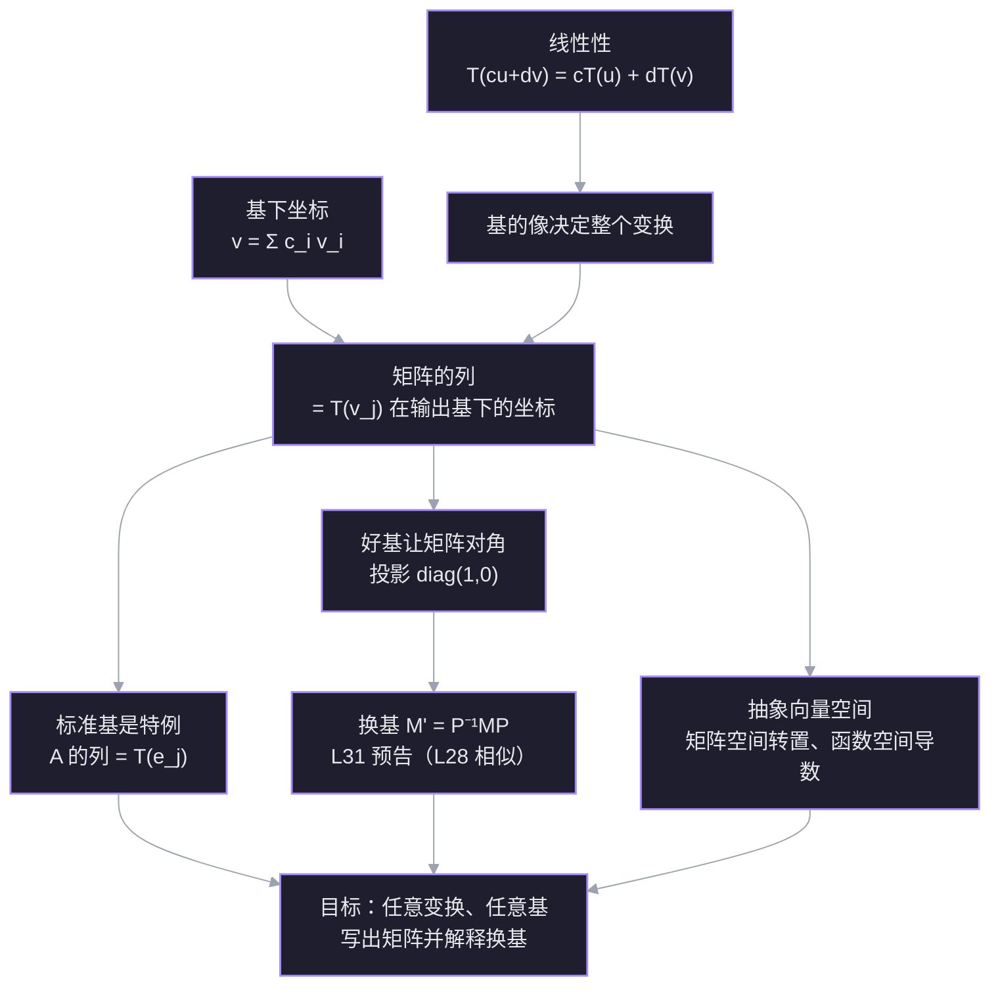

# L30 线性变换与矩阵表示

线性变换是「不弯曲原点、不弯曲网格」的映射：加法进去再变换，等于分别变换再相加；缩放进去再变换，等于变换后缩放。矩阵不是变换本身，而是**变换在一组基下的坐标记录**。这一讲把三个层次接起来：抽象变换 → 选一组基 → 写成一个矩阵；并说明为什么换一组基，矩阵就变成 $P^{-1}AP$。

材料：[[Linear Transformations]]（18.06SC 习题课，转置作为 $2\times2$ 矩阵空间上的线性变换）；几何直观参考 [[Linear transformations and matrices  Chapter 3, Essence of linear algebra]]、[[Change of basis  Chapter 13, Essence of linear algebra]]。

## 探针：起点与边缘

| 线索 | 状态 | 具体表现 |
| --- | --- | --- |
| 线性变换的定义 | ✅ 稳 | 能说出加法性与数乘性两条，不混淆「保持长度/夹角」 |
| 基的像决定整个变换 | ✅ 稳 | 由 $T(e_1),T(e_2)$ 算出 $T(4,5)=(3,19)$ |
| 向量在非标准基下的坐标 | ✅ 稳 | 解出 $(3,0)=1.5v_1+1.5v_2$ |
| 标准基下的矩阵 | ✅ 稳 | 两列分别是 $T(e_1),T(e_2)$，写出 $\begin{bmatrix}2&1\\1&-1\end{bmatrix}$ |
| 任意基下的矩阵 | ❌ 缺口 | 知道 $T(v_1)=(3,0)$，但不知道要先把它写成 $v_1,v_2$ 的系数再当列 |

**边缘**：所有零件都在——线性性、基的像、基下坐标、标准矩阵——缺的只是把它们组装起来的那一步：

> [!question] $T(x,y)=(2x+y,\ x-y)$。取基 $v_1=(1,1)$、$v_2=(1,-1)$，$T$ 在这组基下的矩阵是？
> - $\begin{bmatrix}3&1\\0&2\end{bmatrix}$
> - $\begin{bmatrix}2&1\\1&-1\end{bmatrix}$
> - $\begin{bmatrix}1.5&1.5\\1.5&-0.5\end{bmatrix}$
> - I don't know

> [!question] 不知道
> 正确答案是 $\begin{bmatrix}1.5&1.5\\1.5&-0.5\end{bmatrix}$。当时不掌握的是「矩阵的列 = 基向量的像在这组基下的坐标」这条组装规则。零件已会：$T(v_1)=(3,0)$ 会算，$(3,0)=1.5v_1+1.5v_2$ 也会算；缺失的是把后者放进第一列。

这条缺口正是 L30 的主线：**矩阵不是变换，是变换在一组基下的坐标记录**。

## 依赖图

## 正文

## 节点 1 · 三个根：线性性、基、坐标

**为什么现在需要它们。** 投影和旋转可以完全不用坐标来描述：给一个向量，输出另一个向量。但只要想**计算**，就必须把向量换成数字。把「坐标-free 的变换」翻译成「数字矩阵」的，正是下面三条已经在你手里的真理。

1. **线性性**：变换可以穿过线性组合。
$$
T\left(\sum_j c_j v_j\right)=\sum_j c_j T(v_j).
$$
2. **基给出唯一坐标**：若 $v_1,\dots,v_n$ 是一组基，则每个 $v$ 有且只有一种写法
$$
v=\sum_j c_j v_j,
$$
系数 $(c_1,\dots,c_n)$ 就是 $v$ 在这组基下的坐标。
3. **知道基的像，就知道整个变换**：任意 $v$ 先分解成基的组合，再用线性性把 $T$ 推过去。

**连接。** 这三条不是新事实，探针里你已经分别用对了：线性性的两条（题 1）、由 $T(e_1),T(e_2)$ 算出 $T(4,5)=(3,19)$（题 2）、解出 $(3,0)=1.5v_1+1.5v_2$（题 3）。所以它们可以直接当地基用。

## 节点 2 · 矩阵的列 = 基向量的像在输出基下的坐标

**动机。** 现在有一个坐标-free 的线性变换 $T$。为了计算，我们选两组基：

- 输入基 $v_1,\dots,v_n$，把输入向量变成坐标 $c$；
- 输出基 $w_1,\dots,w_m$，把输出向量变成坐标 $d$。

我们想要一个矩阵 $M$，让「输入坐标」经过它正好变成「输出坐标」：

$$
d = M c.
$$

问题是：$M$ 的每一列到底装什么？

**建立。** 取任意输入 $x=\sum_j c_j v_j$。先用线性性：

$$
T(x)=T\left(\sum_j c_j v_j\right)=\sum_j c_j T(v_j).
$$

每个 $T(v_j)$ 都在输出空间里，所以能用输出基展开：

$$
T(v_j)=\sum_i a_{ij} w_i.
$$

代回去：

$$
T(x)=\sum_j c_j\sum_i a_{ij}w_i
=\sum_i\left(\sum_j a_{ij}c_j\right)w_i.
$$

括号里就是输出的第 $i$ 个坐标。把它写成矩阵乘法，正好是

$$
d_i=\sum_j a_{ij}c_j
\quad\Longleftrightarrow\quad
d=Mc,\qquad M_{ij}=a_{ij}.
$$

所以 $M$ 的第 $j$ 列，就是 $T(v_j)$ 在**输出基**下的坐标：

$$
\boxed{\text{第 }j\text{ 列}=[T(v_j)]_W}
$$

![[viz-l30-basis-images-1794323945980.svg|650]]

> 图：左：输入平面里 $(4,5)=4e_1+5e_2$；右：输出平面由 $a_1=T(e_1)$、$a_2=T(e_2)$ 张成，$T(4,5)=(3,19)=4a_1+5a_2$。两列决定整张网格。

> [!note] 术语：像
> $T(v)$ 就是 $v$ 在变换下的**像**（image），也就是输出。函数 $f(x)$ 的像就是 $f(x)$；这里 $T(v_1),T(v_2)$ 就是两个基向量的像。矩阵的列不是像本身，而是像在输出基下的坐标。

这就是探针里缺的那条组装规则。注意它和「直接把 $T(v_j)$ 的标准坐标当列」的区别：只有当输出基就是标准基时，两者才相同。

**算例（探针里那道题）。** $T(x,y)=(2x+y,\ x-y)$，输入基与输出基都取

$$
v_1=(1,1),\qquad v_2=(1,-1).
$$

先算像：

$$
T(v_1)=(3,0),\qquad T(v_2)=(1,2).
$$

再把它们写成 $v_1,v_2$ 的组合：

$$
(3,0)=1.5v_1+1.5v_2,\qquad
(1,2)=1.5v_1-0.5v_2.
$$

于是两列分别是 $(1.5,1.5)$ 和 $(1.5,-0.5)$：

$$
M=\begin{bmatrix}1.5&1.5\\1.5&-0.5\end{bmatrix}.
$$

验算 $x=(4,5)$：它在基下的坐标是 $(4.5,-0.5)$，而

$$
M\begin{bmatrix}4.5\\-0.5\end{bmatrix}
=\begin{bmatrix}6\\7\end{bmatrix},
$$

对应 $6v_1+7v_2=(13,-1)=T(4,5)$。对上了。

> [!question] $T(x,y)=(x+y,\ x-y)$，输入基与输出基都取 $v_1=(1,1)$、$v_2=(1,-1)$。$T$ 在这组基下的矩阵是？
> - $\begin{bmatrix}2&0\\0&2\end{bmatrix}$
> - $\begin{bmatrix}1&1\\1&-1\end{bmatrix}$
> - $\begin{bmatrix}1&-1\\1&1\end{bmatrix}$
> - I don't know

> [!success] ✓ 正确
> $T(v_1)=(2,0)=1v_1+1v_2$，$T(v_2)=(0,2)=1v_1-1v_2$，所以两列分别是 $(1,1)$ 与 $(1,-1)$。关键动作是**先把像写成基的组合**，不是直接抄标准坐标。

## 节点 3 · 标准基只是特例

**动机。** 上一节要求同时选输入基和输出基。最常用的选择是标准基 $e_1,\dots,e_n$。这时输出坐标就是向量本身的数字，于是「像在输出基下的坐标」退化成「像本身」：

$$
M=\begin{bmatrix} T(e_1) & T(e_2) & \cdots & T(e_n)\end{bmatrix}.
$$

这就是为什么你以前看到「矩阵的列就是基向量的像」——它只在**输出基是标准基**时字面成立。

**三个几何例子。**

- 逆时针旋转 $90^\circ$：$e_1\mapsto(0,1)$，$e_2\mapsto(-1,0)$，所以
$$
R=\begin{bmatrix}0&-1\\1&0\end{bmatrix}.
$$
- 投影到 $x$ 轴：$e_1\mapsto e_1$，$e_2\mapsto 0$，所以
$$
P=\begin{bmatrix}1&0\\0&0\end{bmatrix}.
$$
- 沿 $x$ 轴翻折：$e_1\mapsto e_1$，$e_2\mapsto -e_2$，所以
$$
F=\begin{bmatrix}1&0\\0&-1\end{bmatrix}.
$$

**连接。** 探针 Q5 你已经用这条规则写出了 $T(x,y)=(2x+y,x-y)$ 的标准矩阵。标准基让「像」和「像的坐标」重合，所以最省事；但下一节会看到，同一个投影换一组基就完全变样。

> [!question] 逆时针旋转 $90^\circ$ 的标准矩阵是？
> - $\begin{bmatrix}0&-1\\1&0\end{bmatrix}$
> - $\begin{bmatrix}0&1\\-1&0\end{bmatrix}$
> - $\begin{bmatrix}1&0\\0&1\end{bmatrix}$
> - I don't know

