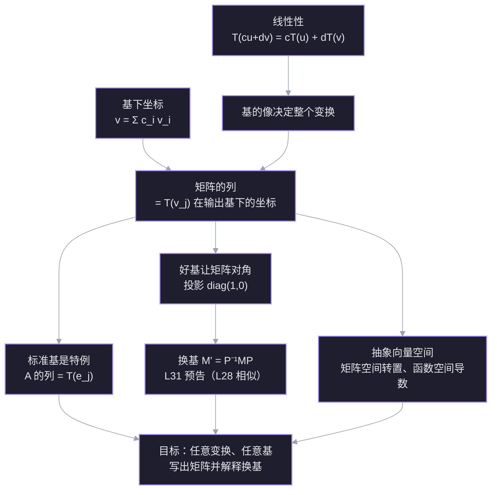

# L30 线性变换与矩阵表示

线性变换是「不弯曲原点、不弯曲网格」的映射：加法进去再变换，等于分别变换再相加；缩放进去再变换，等于变换后缩放。矩阵不是变换本身，而是**变换在一组基下的坐标记录**。这一讲把三个层次接起来：抽象变换 → 选一组基 → 写成一个矩阵；并说明为什么换一组基，矩阵就变成 $P^{-1}AP$。

材料：[[Linear Transformations]]（18.06SC 习题课，转置作为 $2\times2$ 矩阵空间上的线性变换）；几何直观参考 [[Linear transformations and matrices  Chapter 3, Essence of linear algebra]]、[[Change of basis  Chapter 13, Essence of linear algebra]]。

## 探针：起点与边缘

| 线索 | 状态 | 具体表现 |
| --- | --- | --- |
| 线性变换的定义 | ✅ 稳 | 能说出加法性与数乘性两条，不混淆「保持长度/夹角」 |
| 基的像决定整个变换 | ✅ 稳 | 由 $T(e_1),T(e_2)$ 算出 $T(4,5)=(3,19)$ |
| 向量在非标准基下的坐标 | ✅ 稳 | 解出 $(3,0)=1.5v_1+1.5v_2$ |
| 标准基下的矩阵 | ✅ 稳 | 两列分别是 $T(e_1),T(e_2)$，写出 $\begin{bmatrix}2&1\\1&-1\end{bmatrix}$ |
| 任意基下的矩阵 | ❌ 缺口 | 知道 $T(v_1)=(3,0)$，但不知道要先把它写成 $v_1,v_2$ 的系数再当列 |

**边缘**：所有零件都在——线性性、基的像、基下坐标、标准矩阵——缺的只是把它们组装起来的那一步：

> [!question] $T(x,y)=(2x+y,\ x-y)$。取基 $v_1=(1,1)$、$v_2=(1,-1)$，$T$ 在这组基下的矩阵是？
> - $\begin{bmatrix}3&1\\0&2\end{bmatrix}$
> - $\begin{bmatrix}2&1\\1&-1\end{bmatrix}$
> - $\begin{bmatrix}1.5&1.5\\1.5&-0.5\end{bmatrix}$
> - I don't know

> [!question] 不知道
> 正确答案是 $\begin{bmatrix}1.5&1.5\\1.5&-0.5\end{bmatrix}$。当时不掌握的是「矩阵的列 = 基向量的像在这组基下的坐标」这条组装规则。零件已会：$T(v_1)=(3,0)$ 会算，$(3,0)=1.5v_1+1.5v_2$ 也会算；缺失的是把后者放进第一列。

这条缺口正是 L30 的主线：**矩阵不是变换，是变换在一组基下的坐标记录**。

## 依赖图

## 正文

## 节点 1 · 三个根：线性性、基、坐标

**为什么现在需要它们。** 投影和旋转可以完全不用坐标来描述：给一个向量，输出另一个向量。但只要想**计算**，就必须把向量换成数字。把「坐标-free 的变换」翻译成「数字矩阵」的，正是下面三条已经在你手里的真理。

1. **线性性**：变换可以穿过线性组合。
$$
T\left(\sum_j c_j v_j\right)=\sum_j c_j T(v_j).
$$
2. **基给出唯一坐标**：若 $v_1,\dots,v_n$ 是一组基，则每个 $v$ 有且只有一种写法
$$
v=\sum_j c_j v_j,
$$
系数 $(c_1,\dots,c_n)$ 就是 $v$ 在这组基下的坐标。
3. **知道基的像，就知道整个变换**：任意 $v$ 先分解成基的组合，再用线性性把 $T$ 推过去。

**连接。** 这三条不是新事实，探针里你已经分别用对了：线性性的两条（题 1）、由 $T(e_1),T(e_2)$ 算出 $T(4,5)=(3,19)$（题 2）、解出 $(3,0)=1.5v_1+1.5v_2$（题 3）。所以它们可以直接当地基用。

## 节点 2 · 矩阵的列 = 基向量的像在输出基下的坐标

**动机。** 现在有一个坐标-free 的线性变换 $T$。为了计算，我们选两组基：

- 输入基 $v_1,\dots,v_n$，把输入向量变成坐标 $c$；
- 输出基 $w_1,\dots,w_m$，把输出向量变成坐标 $d$。

我们想要一个矩阵 $M$，让「输入坐标」经过它正好变成「输出坐标」：

$$
d = M c.
$$

问题是：$M$ 的每一列到底装什么？

**建立。** 取任意输入 $x=\sum_j c_j v_j$。先用线性性：

$$
T(x)=T\left(\sum_j c_j v_j\right)=\sum_j c_j T(v_j).
$$

每个 $T(v_j)$ 都在输出空间里，所以能用输出基展开：

$$
T(v_j)=\sum_i a_{ij} w_i.
$$

代回去：

$$
T(x)=\sum_j c_j\sum_i a_{ij}w_i
=\sum_i\left(\sum_j a_{ij}c_j\right)w_i.
$$

括号里就是输出的第 $i$ 个坐标。把它写成矩阵乘法，正好是

$$
d_i=\sum_j a_{ij}c_j
\quad\Longleftrightarrow\quad
d=Mc,\qquad M_{ij}=a_{ij}.
$$

所以 $M$ 的第 $j$ 列，就是 $T(v_j)$ 在**输出基**下的坐标：

$$
\boxed{\text{第 }j\text{ 列}=[T(v_j)]_W}
$$

![[viz-l30-basis-images-1794323945980.svg|650]]

> 图：左：输入平面里 $(4,5)=4e_1+5e_2$；右：输出平面由 $a_1=T(e_1)$、$a_2=T(e_2)$ 张成，$T(4,5)=(3,19)=4a_1+5a_2$。两列决定整张网格。

> [!note] 术语：像
> $T(v)$ 就是 $v$ 在变换下的**像**（image），也就是输出。函数 $f(x)$ 的像就是 $f(x)$；这里 $T(v_1),T(v_2)$ 就是两个基向量的像。矩阵的列不是像本身，而是像在输出基下的坐标。

这就是探针里缺的那条组装规则。注意它和「直接把 $T(v_j)$ 的标准坐标当列」的区别：只有当输出基就是标准基时，两者才相同。

**算例（探针里那道题）。** $T(x,y)=(2x+y,\ x-y)$，输入基与输出基都取

$$
v_1=(1,1),\qquad v_2=(1,-1).
$$

先算像：

$$
T(v_1)=(3,0),\qquad T(v_2)=(1,2).
$$

再把它们写成 $v_1,v_2$ 的组合：

$$
(3,0)=1.5v_1+1.5v_2,\qquad
(1,2)=1.5v_1-0.5v_2.
$$

于是两列分别是 $(1.5,1.5)$ 和 $(1.5,-0.5)$：

$$
M=\begin{bmatrix}1.5&1.5\\1.5&-0.5\end{bmatrix}.
$$

验算 $x=(4,5)$：它在基下的坐标是 $(4.5,-0.5)$，而

$$
M\begin{bmatrix}4.5\\-0.5\end{bmatrix}
=\begin{bmatrix}6\\7\end{bmatrix},
$$

对应 $6v_1+7v_2=(13,-1)=T(4,5)$。对上了。

> [!question] $T(x,y)=(x+y,\ x-y)$，输入基与输出基都取 $v_1=(1,1)$、$v_2=(1,-1)$。$T$ 在这组基下的矩阵是？
> - $\begin{bmatrix}2&0\\0&2\end{bmatrix}$
> - $\begin{bmatrix}1&1\\1&-1\end{bmatrix}$
> - $\begin{bmatrix}1&-1\\1&1\end{bmatrix}$
> - I don't know

> [!success] ✓ 正确
> $T(v_1)=(2,0)=1v_1+1v_2$，$T(v_2)=(0,2)=1v_1-1v_2$，所以两列分别是 $(1,1)$ 与 $(1,-1)$。关键动作是**先把像写成基的组合**，不是直接抄标准坐标。

## 节点 3 · 标准基只是特例

**动机。** 上一节要求同时选输入基和输出基。最常用的选择是标准基 $e_1,\dots,e_n$。这时输出坐标就是向量本身的数字，于是「像在输出基下的坐标」退化成「像本身」：

$$
M=\begin{bmatrix} T(e_1) & T(e_2) & \cdots & T(e_n)\end{bmatrix}.
$$

这就是为什么你以前看到「矩阵的列就是基向量的像」——它只在**输出基是标准基**时字面成立。

**三个几何例子。**

- 逆时针旋转 $90^\circ$：$e_1\mapsto(0,1)$，$e_2\mapsto(-1,0)$，所以
$$
R=\begin{bmatrix}0&-1\\1&0\end{bmatrix}.
$$
- 投影到 $x$ 轴：$e_1\mapsto e_1$，$e_2\mapsto 0$，所以
$$
P=\begin{bmatrix}1&0\\0&0\end{bmatrix}.
$$
- 沿 $x$ 轴翻折：$e_1\mapsto e_1$，$e_2\mapsto -e_2$，所以
$$
F=\begin{bmatrix}1&0\\0&-1\end{bmatrix}.
$$

![[viz-l30-grid-transforms-1794324201606.svg|900]]

> 图：同一张网格在旋转、投影、翻折下的样子。线性变换保持网格线为直线、平行、等距；投影把它压成一条线。

**连接。** 探针 Q5 你已经用这条规则写出了 $T(x,y)=(2x+y,x-y)$ 的标准矩阵。标准基让「像」和「像的坐标」重合，所以最省事；但下一节会看到，同一个投影换一组基就完全变样。

> [!question] 逆时针旋转 $90^\circ$ 的标准矩阵是？
> - $\begin{bmatrix}0&-1\\1&0\end{bmatrix}$
> - $\begin{bmatrix}0&1\\-1&0\end{bmatrix}$
> - $\begin{bmatrix}1&0\\0&1\end{bmatrix}$
> - I don't know

> [!success] ✓ 正确
> $e_1\mapsto(0,1)$、$e_2\mapsto(-1,0)$，两列是 $(0,1)$ 与 $(-1,0)$。你选的是逆时针；顺时针会得到 $\begin{bmatrix}0&1\\-1&0\end{bmatrix}$。

## 节点 4 · 好基与换基：同一个投影，两张脸

**动机。** 节点 3 里标准基最省事，但不一定最清楚。投影到一条直线，用「沿直线 / 垂直直线」这组基看，几乎是显然的：沿直线的分量原样保留，垂直分量被杀死。

**好基。** 取投影到 $45^\circ$ 直线。令

$$
v_1=\frac{1}{\sqrt2}\begin{bmatrix}1\\1\end{bmatrix},\qquad
v_2=\frac{1}{\sqrt2}\begin{bmatrix}1\\-1\end{bmatrix}.
$$

$v_1$ 在直线上，$v_2$ 垂直。于是

$$
T(v_1)=v_1,\qquad T(v_2)=0,
$$

矩阵是

$$
D=\begin{bmatrix}1&0\\0&0\end{bmatrix}.
$$

**标准基。** 同一投影，用 $e_1,e_2$。两个基向量都投影到 $(\frac12,\frac12)$：

$$
T(e_1)=\begin{bmatrix}1/2\\1/2\end{bmatrix},\qquad
T(e_2)=\begin{bmatrix}1/2\\1/2\end{bmatrix},
$$

所以

$$
P=\frac12\begin{bmatrix}1&1\\1&1\end{bmatrix}.
$$

![[viz-l30-projection-bases-1794324691351.svg|900]]

> 图：左：标准基下 $e_1,e_2$ 都投影到 $(\frac12,\frac12)$，矩阵稠密；右：特征基下 $v_1$ 不动、$v_2$ 被杀死，矩阵是对角 $\operatorname{diag}(1,0)$。同一投影，同一输入 $w$，输出 $T(w)$ 也一样。

**同一个 $T$，两张脸。** $D$ 和 $P$ 都是这个投影的矩阵，只是记录的坐标系不同。$D$ 对角，因为选的基恰好是特征向量；$P$ 稠密（大部分元素非零），因为标准基不是特征基。

**换基公式（L31 预告）。** 若 $C$ 的列是新基在旧基下的坐标，即 $x_{\text{旧}}=Cc_{\text{新}}$，那么

$$
M_{\text{新}}=C^{-1}MC.
$$

推导只一步：$T(x)=Mx=MCc_{\text{新}}$，输出也要换成新坐标，左乘 $C^{-1}$，得 $C^{-1}MC\,c_{\text{新}}$。

**连接 L28。** 这就是相似：$M_{\text{新}}\sim M_{\text{旧}}$。特征值、迹、行列式不变；选到特征向量基时，$M_{\text{新}}$ 就是对角矩阵。投影的特征值是 $1,0$，正是 $D$ 的对角线。L28 把换基矩阵叫 $P$，这里用 $C$ 是为了不和投影矩阵 $P$ 撞名。

> [!question] 若 $x_{\text{旧}}=Cc_{\text{新}}$，旧矩阵为 $M$，那么新基下的矩阵是？
> - $C^{-1}MC$
> - $CMC^{-1}$
> - $C^{T}MC$
> - I don't know

> [!success] ✓ 正确
> $x_{\text{旧}}=Cc_{\text{新}}$，所以 $T(x)=MCc_{\text{新}}$；输出也要换成新坐标，左乘 $C^{-1}$，得 $C^{-1}MC\,c_{\text{新}}$。方向记法：**进去先 C，出来先 C 逆**。

## 节点 5 · 抽象向量空间：$2\times2$ 矩阵空间上的转置

**动机。** 线性变换不只发生在 $\mathbb R^n$。任何能做加法、数乘的空间都可以。$2\times2$ 矩阵全体 $M_{2\times2}$ 就是一个 4 维向量空间；转置

$$
T(A)=A^T
$$

是它上面的线性变换。用节点 2 的规则，我们能给它写出矩阵。

**标准基。** 取

$$
v_1=\begin{bmatrix}1&0\\0&0\end{bmatrix},\quad
v_2=\begin{bmatrix}0&1\\0&0\end{bmatrix},\quad
v_3=\begin{bmatrix}0&0\\1&0\end{bmatrix},\quad
v_4=\begin{bmatrix}0&0\\0&1\end{bmatrix}.
$$

逐一看像：

$$
T(v_1)=v_1,\quad T(v_2)=v_3,\quad T(v_3)=v_2,\quad T(v_4)=v_4.
$$

所以矩阵的四列是

$$
M=\begin{bmatrix}
1&0&0&0\\
0&0&1&0\\
0&1&0&0\\
0&0&0&1
\end{bmatrix}.
$$

它是一个置换矩阵：交换第 2、3 个坐标。验证 $A=\begin{bmatrix}1&2\\3&4\end{bmatrix}$：坐标 $(1,2,3,4)\mapsto(1,3,2,4)$，正是 $A^T$。

**好基。** 换成

$$
w_1=\begin{bmatrix}1&0\\0&0\end{bmatrix},\quad
w_2=\begin{bmatrix}0&0\\0&1\end{bmatrix},\quad
w_3=\begin{bmatrix}0&1\\1&0\end{bmatrix},\quad
w_4=\begin{bmatrix}0&1\\-1&0\end{bmatrix}.
$$

前三个是对称矩阵，$T$ 不动它们；$w_4$ 是反对称矩阵，$T$ 把它变成 $-w_4$：

$$
T(w_1)=w_1,\quad T(w_2)=w_2,\quad T(w_3)=w_3,\quad T(w_4)=-w_4.
$$

矩阵变成

$$
D=\operatorname{diag}(1,1,1,-1).
$$

![[viz-l30-transpose-bases-1794324670952.svg|900]]

> 图：上排标准基下，转置把 $v_2\leftrightarrow v_3$，矩阵是交换第 2、3 坐标的置换矩阵；下排对称/反对称基下，矩阵变成 $\operatorname{diag}(1,1,1,-1)$。

**连接 L19/L28。** 对称部分特征值 $+1$，反对称部分特征值 $-1$。任何矩阵都能拆成

$$
A=\underbrace{\frac{A+A^T}{2}}_{\text{对称}}+\underbrace{\frac{A-A^T}{2}}_{\text{反对称}},
$$

转置保留对称部分、翻转反对称部分。$w_1,w_2,w_3,w_4$ 就是 $T$ 的特征向量；选特征基，矩阵对角化。这和节点 4 的投影是同一件事：好基让矩阵对角，坏基让矩阵稠密。

> [!question] 在标准基 $v_1,\dots,v_4$ 下，转置矩阵的第二列是？
> - $(0,0,1,0)^T$
> - $(0,1,0,0)^T$
> - $(0,0,0,1)^T$
> - I don't know

> [!success] ✓ 正确
> 第二列是 $T(v_2)=v_3$ 在标准基下的坐标 $(0,0,1,0)^T$。第三列才轮到 $T(v_3)=v_2$，所以是 $(0,1,0,0)^T$。

## 节点 6 · 函数空间：导数矩阵与收口

**动机。** 矩阵不只能表示几何变换。求导也是线性的：

$$
D(c_1+c_2x+c_3x^2)=c_2+2c_3x.
$$

输入空间是二次多项式，基 $\{1,x,x^2\}$；输出空间是一次多项式，基 $\{1,x\}$。

**建立。** 逐一看基向量的像：

$$
D(1)=0,\quad D(x)=1,\quad D(x^2)=2x.
$$

写成输出基的坐标：

$$
[D(1)]=(0,0),\quad [D(x)]=(1,0),\quad [D(x^2)]=(0,2).
$$

所以

$$
A=\begin{bmatrix}0&1&0\\0&0&2\end{bmatrix}.
$$

验证：

$$
A\begin{bmatrix}c_1\\c_2\\c_3\end{bmatrix}=\begin{bmatrix}c_2\\2c_3\end{bmatrix}.
$$

![[viz-l30-derivative-1794324699338.svg|900]]

> 图：左：系数向量 $(c_1,c_2,c_3)$ 经过 $2\times3$ 矩阵变成 $(c_2,2c_3)$；右：二次多项式与其导数曲线。求导把 $1\mapsto0$、$x\mapsto1$、$x^2\mapsto2x$。

如果输出基也取 $\{1,x,x^2\}$，矩阵变成 $3\times3$：

$$
\begin{bmatrix}0&1&0\\0&0&2\\0&0&0\end{bmatrix}.
$$

同一个导数，两个矩阵；区别只在输出基。

**收口。** 这一讲的所有例子其实是一条规则：

> 选输入基 → 把每个基向量喂给 $T$ → 把像写成输出基的组合 → 系数当列。

矩阵不是变换，是变换在一组基下的坐标记录。换基就是换记录方式；同一空间里的换基给出相似矩阵 $C^{-1}MC$。矩阵乘法对应变换复合，逆矩阵对应逆变换（Strang 的收尾）。求导是线性的，所以我们只需背少量基本导数，就能处理所有线性组合。

> [!question] 输入基 $\{1,x,x^2\}$、输出基 $\{1,x\}$，导数变换的矩阵是？
> - $\begin{bmatrix}0&1&0\\0&0&2\end{bmatrix}$
> - $\begin{bmatrix}0&0&0\\1&0&2\end{bmatrix}$
> - $\begin{bmatrix}0&1&0\\0&0&1\end{bmatrix}$
> - I don't know

> [!success] ✓ 正确
> 两列分别是 $[D(x)]=(1,0)$ 与 $[D(x^2)]=(0,2)$。你选的矩阵作用在 $(c_1,c_2,c_3)$ 上得到 $(c_2,2c_3)$，正是导数。

## 总结：一条规则，三种空间

| 例子 | 输入基 | 输出基 | 矩阵 |
| --- | --- | --- | --- |
| 投影到 $45^\circ$ 线 | 标准基 $e_1,e_2$ | 同左 | $\frac12\begin{bmatrix}1&1\\1&1\end{bmatrix}$ |
| 投影到 $45^\circ$ 线 | 特征基 $v_1,v_2$ | 同左 | $\operatorname{diag}(1,0)$ |
| 转置 $2\times2$ | 标准基 $v_1,\dots,v_4$ | 同左 | 交换第 2、3 坐标的置换矩阵 |
| 转置 $2\times2$ | 对称/反对称基 $w_1,\dots,w_4$ | 同左 | $\operatorname{diag}(1,1,1,-1)$ |
| 导数 | $1,x,x^2$ | $1,x$ | $\begin{bmatrix}0&1&0\\0&0&2\end{bmatrix}$ |

规则始终是同一句：

> 第 $j$ 列 $=[T(v_j)]_W$。先算像，再把像写成输出基的组合，系数当列。

## 常见坑

1. **把 $T(v_j)$ 的标准坐标直接当列**。只有输出基是标准基时才碰巧对；一般要换成输出基坐标。
2. **以为 $T(0)=0$ 就线性**。这是必要条件，不充分；有固定原点但非线性的映射。
3. **把平移当线性**。$T(v)=v+v_0$ 把数乘破坏掉；它是仿射映射，不是线性变换。
4. **以为只选输入基就够**。矩阵由输入基和输出基共同决定；只给输入基，矩阵不唯一。
5. **以为换基改变了变换**。变的是矩阵表示；特征值、迹、行列式这些相似不变量不变。
6. **以为相似适用于矩形矩阵**。矩形情形是 $A'=N^{-1}AM$（输入基换 $M$、输出基换 $N$），叫等价，不叫相似。
7. **把「保持长度/角度」当线性性的定义**。线性只要求加法与数乘；保长保角是正交变换，是特例。
8. **转置在标准基下的矩阵不是单位矩阵**。它是交换第 2、3 坐标的置换矩阵；$w$ 基下才是 $\operatorname{diag}(1,1,1,-1)$。

## 识别信号

- 看到「求 $T$ 的矩阵」→ 先问：输入基是什么？输出基是什么？没给就默认标准基。
- 看到「第 $j$ 列」→ 先算 $T(v_j)$，再写成输出基的组合。
- 看到同一个 $T$ 的两张矩阵 → 想相似 $C^{-1}MC$；对角的那张来自特征基。
- 看到「对角化 / 好基」→ 找特征向量。

## 术语

- **线性变换**：保持加法与数乘的映射。
- **像**：$T(v)$，变换后的输出。
- **坐标**：把向量写成基向量的系数。
- **输入基 / 输出基**：分别给输入空间和输出空间定坐标的两组基。
- **矩阵表示**：固定两组基后，把 $T$ 记录成的数字矩阵。
- **相似**：同一空间、换基前后的两个矩阵满足 $M'=C^{-1}MC$。
- **特征基**：由特征向量组成的基；在这组基下矩阵对角。

## 检查点

> [!question] 同一空间、同一个 $T$，两组基下的矩阵 $M$ 与 $M'$。下列哪项一定相同？
> - 特征值
> - 矩阵的元素
> - 矩阵的列
> - I don't know

> [!success] ✓ 正确
> 两组基下的矩阵满足 $M'=C^{-1}MC$，是相似矩阵；相似保持特征值、迹、行列式。矩阵的元素和列都会随基改变——只有「变换本身」和它的谱信息不变。

