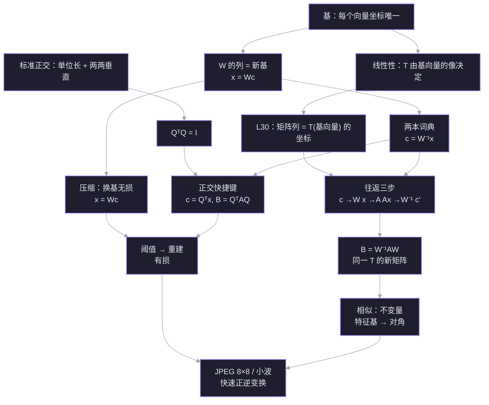

# L31 换基与图像压缩

换基就是换一套「坐标语言」：同一个向量、同一个变换没有变，变的是记录它们的数字。这一讲把 L30 的「矩阵是变换在一组基下的记录」推进到底：先用 $W$ 把新坐标翻译成旧坐标，再让 $A$ 在旧坐标里干活，最后用 $W^{-1}$ 把结果翻译回去。三步连起来就是 $B=W^{-1}AW$；当 $W$ 的列标准正交时，$W^{-1}$ 就是 $W^{\mathsf T}$，换基几乎免费。最后用这套数学看 JPEG 和小波压缩。

材料：[[31. Change of Basis; Image Compression]]（Strang 正课）；[[Change of Basis]]（18.06SC 习题课，多项式基与导数矩阵）；几何直观参考 [[Change of basis  Chapter 13, Essence of linear algebra]]。

## 探针：起点与边缘

| 线索 | 状态 | 具体表现 |
| --- | --- | --- |
| 坐标方向 $x=Vc$ | ✅ 稳 | 选对 $Vc=x$ |
| 批量换基 | ✅ 稳 | 知道求一次 $V^{-1}$，再乘每个向量 |
| $A(Vc)$ 的坐标系 | ✅ 稳 | 知道结果是标准坐标 |
| 复合顺序 | ❌ 缺口 | 选了 $Vc\to A(Vc)$，漏掉最后的 $V^{-1}$ |
| $Q^{\mathsf T}Q=I$ | ✅ 稳 | 选对单位矩阵 |
| 正交基取坐标 $c=Q^{\mathsf T}x$ | ⚠️ 不确定 | 记得「$A^{\mathsf T}$ 取坐标不好」，但不知道前提 |
| 相似公式 $B=W^{-1}AW$ | ❌ 缺口 | 今天答「不知道」；L30 曾答对 $C^{-1}MC$，说明公式是背的 |
| 压缩直觉 | ✅ 稳 | 知道标准基没有「一个数概括全图」的基 |

**边缘**：零件都在，断的是「把结果翻译回新坐标」这一步；相似公式只是背下来了，不是从往返过程推出来的。所以这一讲不从公式开始，从「两本词典 → 往返三步」开始。

## 依赖图

## 正文

## 节点 1 · 两本词典：$W$ 与 $W^{-1}$

**动机。** L30 里我们已经会「把向量写成一组基的系数」，但每次换基都解一遍方程组太慢。若有 100 个向量，或者一张 $512\times512$ 的图像（$n=262144$），必须把「换基」本身做成一个矩阵乘法：求一次逆，之后每换一个向量只乘一次。

**建立。** 设新基 $b_1,\dots,b_n$ 在我们原来的坐标里已知。把它们按列排成

$$
W=\begin{bmatrix}b_1&\cdots&b_n\end{bmatrix}.
$$

对任意系数 $c=(c_1,\dots,c_n)^{\mathsf T}$，矩阵乘法的定义就是「用系数组合列」：

$$
Wc=c_1b_1+\cdots+c_nb_n.
$$

右边正是「在旧坐标里看这个向量」的结果。所以

$$
x_{\text{旧}}=Wc_{\text{新}}.
$$

$W$ 可逆（列是基），于是

$$
c_{\text{新}}=W^{-1}x_{\text{旧}}.
$$

一句话：**$W$ 是「新→旧」的词典，$W^{-1}$ 是「旧→新」的词典。** 方向不能反。

**批量。** 若有矩阵 $X$，每一列是一个旧坐标向量，那么 $C=W^{-1}X$ 的每一列就是对应的新坐标。求逆一次，乘法一批。

**连接。** 这就是 L9「坐标唯一」的矩阵版；$W$ 的列是基，所以 $W$ 可逆。L30 投影例子里，特征基矩阵 $C$ 就是这里的 $W$：$x_{\text{旧}}=Cc_{\text{新}}$。

**一个数例。** Jennifer 的基 $b_1=(2,1)$、$b_2=(-1,1)$，$W=\begin{bmatrix}2&-1\\1&1\end{bmatrix}$。取 $x=(3,2)$。$W^{-1}=\frac13\begin{bmatrix}1&1\\-1&2\end{bmatrix}$，所以

$$
c=\frac13\begin{bmatrix}1&1\\-1&2\end{bmatrix}\begin{bmatrix}3\\2\end{bmatrix}=\begin{bmatrix}5/3\\1/3\end{bmatrix}.
$$

验算：$\frac53(2,1)+\frac13(-1,1)=(3,2)$。✓

![[viz-l31-two-grids-same-vector-1794405642177.svg|900]]

> 图：同一个向量 $x=(3,2)$ 在两个坐标系里的两种读法。左：标准基，坐标 $(3,2)$；右：Jennifer 的基 $b_1=(2,1)$、$b_2=(-1,1)$，同一向量写成 $\frac53b_1+\frac13b_2$，坐标 $(5/3,1/3)$。$W$ 的列是 $b_1,b_2$，负责新→旧；$W^{-1}$ 负责旧→新。

> [!question] $W=\begin{bmatrix}2&-1\\1&1\end{bmatrix}$，$x=(3,2)$。$x$ 在 $b$ 基下的坐标是？
> - $(3,2)$
> - $(5/3,1/3)$
> - $(1/3,5/3)$
> - I don't know

> [!success] ✓ 正确
> $W^{-1}x=\frac13\begin{bmatrix}1&1\\-1&2\end{bmatrix}\begin{bmatrix}3\\2\end{bmatrix}=(5/3,1/3)$。$W$ 是「新→旧」，$W^{-1}$ 才是「旧→新」；方向反了会得到另一个点。

## 节点 2 · 往返三步：$B=W^{-1}AW$

**动机。** 节点 1 给了两本词典，但 $T$ 的矩阵 $A$ 仍然记在旧坐标里。如果现在手里拿的是新坐标 $c$，每次应用 $T$ 都要「翻成旧坐标 → 用 $A$ → 翻回新坐标」三步。我们想要一个矩阵 $B$，让它直接作用在 $c$ 上，一步给出新坐标。

**建立。** 把三步写出来：

1. 新→旧：$x=Wc$
2. 旧坐标里应用 $A$：$y=Ax=AWc$
3. 旧→新：$c'=W^{-1}y=W^{-1}AWc$

如果 $B$ 要满足 $c'=Bc$ 对所有 $c$ 成立，那么

$$
B=W^{-1}AW.
$$

矩阵乘法从右往左执行：先 $W$，再 $A$，最后 $W^{-1}$。**最后一步不是可选的**——没有 $W^{-1}$，结果还停在旧坐标里。这就是「逆矩阵 = 坐标的返回票」。

**连接 L30。** 用 L30 的列规则检查：$B$ 的第 $j$ 列是

$$
Be_j=W^{-1}Aw_j=[T(w_j)]_W,
$$

正是「先把 $w_j$ 喂给 $T$，再把像写成 $W$ 基的坐标」。两条路得到同一个矩阵。

**数例。** 取

$$
W=\begin{bmatrix}2&-1\\1&1\end{bmatrix},\qquad
A=\begin{bmatrix}0&-1\\1&0\end{bmatrix}
$$

（逆时针 $90^\circ$）。则

$$
B=W^{-1}AW=\frac13\begin{bmatrix}1&-2\\5&-1\end{bmatrix}.
$$

验证第一列：$T(b_1)=A(2,1)=(-1,2)$；在 $b$ 基下 $W^{-1}(-1,2)=(1/3,5/3)$，正是 $B$ 的第一列。

**一句话。** 换基不是改变换，是改「记录变换的语言」；$B$ 是同一台机器在新语言里的说明书。

> [!question] $B=W^{-1}AW$ 作用在 $c$ 上。实际执行顺序是？
> - 先 $W$，再 $A$，最后 $W^{-1}$
> - 先 $W^{-1}$，再 $A$，最后 $W$
> - 先 $A$，再 $W$，最后 $W^{-1}$
> - I don't know

> [!success] ✓ 正确
> 从右往左：$W$ 把新坐标翻译成旧坐标，$A$ 在旧坐标里干活，$W^{-1}$ 把结果翻译回新坐标。漏掉 $W^{-1}$，结果就还停在旧坐标里。

## 节点 3 · 相似：同一个 $T$ 的两张矩阵

**动机。** $B=W^{-1}AW$ 不只是「换基公式」，它说明 $A$ 和 $B$ 是同一个变换的两张记录。既然变换没变，哪些数字应该不变？这决定我们换基时能保住什么、能读出什么。

**建立。** 定义：$A\sim B$，若存在可逆 $W$ 使

$$
B=W^{-1}AW.
$$

**特征值不变。** 若 $Av=\lambda v$，令 $v_B=W^{-1}v$，则

$$
Bv_B=W^{-1}AW\,W^{-1}v=W^{-1}Av=\lambda W^{-1}v=\lambda v_B.
$$

所以特征值相同，特征向量按 $W^{-1}$ 换坐标。迹、行列式、特征多项式都由特征值决定，所以也不变；秩也不变（$W$ 可逆）。**变的是矩阵的元素和列，不变的是变换的谱信息。**

**最好的基。** 若 $A$ 的特征向量组成基，取 $W$ 为特征向量矩阵，则 $B=\Lambda$ 对角。这是「最好的基」；但求特征向量通常太贵，压缩时退而求其次，用小波/Fourier 这类便宜且接近的基。

**连接。** L28 的相似不变量与 Jordan 形；L20 的对角化 $A=S\Lambda S^{-1}$；L30 投影例子里 $P$ 与 $\operatorname{diag}(1,0)$。

**数例。** 投影到 $45^\circ$：

$$
A=\frac12\begin{bmatrix}1&1\\1&1\end{bmatrix},\qquad
W=\begin{bmatrix}1&1\\1&-1\end{bmatrix}.
$$

$W$ 的列是未归一化的特征向量，$B=W^{-1}AW=\operatorname{diag}(1,0)$。两张矩阵的迹都是 $1$、行列式都是 $0$、特征值都是 $1,0$；但元素和列完全不同。

> [!question] $A$ 与 $B=W^{-1}AW$ 相似。若 $v$ 是 $A$ 的特征向量，$B$ 的对应特征向量是？
> - $v$
> - $W^{-1}v$
> - $Wv$
> - I don't know

> [!success] ✓ 正确
> 坐标换语言，特征向量也跟着换语言：$v_B=W^{-1}v$。代入 $Bv_B=W^{-1}AW\,W^{-1}v=W^{-1}Av=\lambda W^{-1}v$，确认它仍是特征向量。

## 节点 4 · 正交快捷键：$Q^{-1}=Q^{\mathsf T}$

**动机。** 换基的最大成本是求逆。$W^{-1}$ 一般要 $O(n^3)$；如果基是标准正交的，逆矩阵就是转置，几乎免费。FFT 和小波变换之所以实用，就是因为它们的基正交（或接近正交），正变换和逆变换都很快。

**建立。** 标准正交意味着

$$
q_i^{\mathsf T}q_j=\delta_{ij}.
$$

按列排成 $Q$，就是

$$
Q^{\mathsf T}Q=I,\qquad Q^{-1}=Q^{\mathsf T}.
$$

于是取坐标变成点积：

$$
c=Q^{-1}x=Q^{\mathsf T}x,\qquad c_i=q_i^{\mathsf T}x.
$$

换基矩阵也变成

$$
B=Q^{-1}AQ=Q^{\mathsf T}AQ.
$$

正交基是「自对偶」的：坐标泛函就是基向量自己。

**一般基为什么不行。** 对任意基 $V$，

$$
V^{\mathsf T}x=V^{\mathsf T}Vc.
$$

只有当 $V^{\mathsf T}V=I$ 时，$V^{\mathsf T}x=c$。若列正交但没归一化，$V^{\mathsf T}V=D$ 对角，$c=D^{-1}V^{\mathsf T}x$。若列不正交，$V^{\mathsf T}V$ 有非对角项，$V^{\mathsf T}x$ 把不同坐标混在一起。

**反例。** 取

$$
V=\begin{bmatrix}1&1\\0&1\end{bmatrix},\qquad x=\begin{bmatrix}1\\1\end{bmatrix}.
$$

真实坐标：$x=0\cdot v_1+1\cdot v_2$，所以 $c=(0,1)$。但

$$
V^{\mathsf T}x=\begin{bmatrix}1&0\\1&1\end{bmatrix}\begin{bmatrix}1\\1\end{bmatrix}=\begin{bmatrix}1\\2\end{bmatrix}\neq c.
$$

![[viz-basis-projection-coordinate-1794406307362.svg|900]]

> 图：左：正交基下，垂直投影的长度就是坐标，$c_i=q_i^{\mathsf T}x$。右：斜基 $v_1=(1,0)$、$v_2=(1,1)$，垂直投影到 $v_1$ 落在 $1$，但真实坐标是 $0$——投影不等于坐标。一般基必须用 $V^{-1}$，不能用 $V^{\mathsf T}$。

**对偶视角。** $V^{-1}$ 的行是「对偶基」$r_i^{\mathsf T}$，满足 $r_i^{\mathsf T}v_j=\delta_{ij}$，坐标 $c_i=r_i^{\mathsf T}x$。正交时 $r_i=v_i$，所以点积就够了；斜基时 $r_i\neq v_i$，必须用 $V^{-1}$。

**连接。** L15 的正交矩阵 $Q^{\mathsf T}=Q^{-1}$；L24 Fourier 矩阵的列正交；FFT 专题。也回答昨天的疑问：**「$A^{\mathsf T}$ 取坐标」不是永远错，它只在标准正交基下对。**

**数例。** $v_1=(1,1)$、$v_2=(1,-1)$ 正交但长度 $\sqrt2$。$V^{\mathsf T}V=2I$，所以 $c=\frac12V^{\mathsf T}x$；先归一化 $q_i=v_i/\sqrt2$，就回到 $c=Q^{\mathsf T}x$。

> [!question] $V=\begin{bmatrix}1&1\\0&1\end{bmatrix}$，$x=(1,1)$。$V^{\mathsf T}x$ 与真实坐标 $c$ 分别是？
> - $V^{\mathsf T}x=(1,2)$，$c=(0,1)$
> - $V^{\mathsf T}x=(0,1)$，$c=(1,2)$
> - 两者都是 $(1,1)$
> - I don't know

> [!success] ✓ 正确
> $V^{\mathsf T}x=(1,2)$，真实坐标 $c=(0,1)$。$V$ 不是正交矩阵，$V^{\mathsf T}\neq V^{-1}$；转置把两个坐标混在了一起。

## 节点 5 · 压缩流水线：换基 → 阈值 → 重建

**动机。** 图像是一个高维向量：$8\times8$ 块有 64 个像素值，$512\times512$ 图有 262144 个。标准基把每个像素单独记一个数；但相邻像素高度相关，平滑图像的大部分信息其实可以用少数「模式」概括。压缩就是选一组更好的基，让少数系数承载大部分信号。

**建立。** 设图像向量 $x\in\mathbb R^N$。

1. 选基 $W$，换基：$c=W^{-1}x$。**这一步无损。**
2. 阈值化：把 $|c_i|<\tau$ 的系数置零，得到 $\hat c$。**这一步有损。**
3. 重建：$\hat x=W\hat c$。只保留少数系数，就得到压缩。

为什么有效：平滑信号在低频/常数基向量上的系数大，在高频基向量上的系数小；丢掉小的，肉眼几乎看不出。

**好基的两条标准：**

1. **快**：$W$ 和 $W^{-1}$ 都能快速相乘（FFT、快速小波变换）。
2. **稀疏**：少数基向量就能逼近信号（能量集中）。

标准基满足 1（$W=I$），但不满足 2；Fourier/小波两者都好。特征基是「最优稀疏」（对角化），但求特征向量太贵。

**数例（1D 8 像素）。** 取

$$
p=(0,0,0,0,10,10,10,10).
$$

用未归一化的 Haar 基，前两个向量是

$$
h_1=(1,1,1,1,1,1,1,1),\qquad
h_2=(1,1,1,1,-1,-1,-1,-1).
$$

则

$$
p=5h_1-5h_2+0\cdot h_3+\cdots+0\cdot h_8.
$$

验证：$5h_1-5h_2=(0,0,0,0,10,10,10,10)$。✓ 标准基要 8 个数，Haar 基只要 2 个非零系数。

![[L31_haar_compression.png|900]]

> 图：真实数值的四联图。左上：原始 $8\times8$ 块（64 个灰度值）；右上：Haar 系数（64 个，少数很大，多数接近 0）；左下：只保留最大的 10 个系数，其余置零；右下：用这 10 个系数重建。换基这一步无损；阈值化才丢信息。本例阈值 $61.3$，RMSE $23.1$ 个灰度级。

**连接。** 节点 1/2 的换基；L24 Fourier；FFT 专题。压缩不是玄学，是「选一组让坐标稀疏的基」。

> [!question] 压缩流水线中，哪一步是有损的？
> - 换基 $x\to c$
> - 阈值化 $c\to\hat c$
> - 重建 $\hat x=W\hat c$
> - I don't know

> [!success] ✓ 正确
> 换基只是换一组坐标，$64$ 个数还是 $64$ 个数；阈值化把小的 $c_i$ 直接置零，信息在这里丢失。重建只是把保留的系数拼回去，本身不再丢信息。

## 节点 6 · JPEG 与 $8\times8$ 小波

**动机。** 节点 5 说「选一组让坐标稀疏的基」，但真实系统还要「快」和「局部」。JPEG 和小波就是两种工程折中。

**JPEG。** 把图像切成 $8\times8$ 块，每块 64 个像素，换到 DCT（离散余弦变换）基——Strang 口头称它为 Fourier 基，但 JPEG 实际用的是实数余弦基，不是复 Fourier 矩阵。变换本身无损；接着量化/阈值（有损），再做熵编码（无损）。选 $8\times8$ 是因为局部相关性更强、计算和内存都小，每块只需 64 维变换。JPEG 2000 改用离散小波变换：可逆的 5/3 路径可以无损，9/7 路径有损。

**$8\times8$ Haar 小波基。** 八个未归一化的基向量是

$$
\begin{aligned}
v_1&=(1,1,1,1,1,1,1,1),\\
v_2&=(1,1,1,1,-1,-1,-1,-1),\\
v_3&=(1,1,-1,-1,0,0,0,0),\\
v_4&=(0,0,0,0,1,1,-1,-1),\\
v_5&=(1,-1,0,0,0,0,0,0),\\
v_6&=(0,0,1,-1,0,0,0,0),\\
v_7&=(0,0,0,0,1,-1,0,0),\\
v_8&=(0,0,0,0,0,0,1,-1).
\end{aligned}
$$

![[viz-haar-basis-8-1794406733654.svg|900]]

> 图：八个 Haar 基向量。$v_1$ 是常数（DC），$v_2$ 把图分成左右两半，$v_3,v_4$ 再分成四段，$v_5$–$v_8$ 是最细的相邻差。每个向量只由 $+1,-1,0$ 组成，所以乘法和加法都极快。

它们两两正交；长度分别是 $\sqrt8,\sqrt8,2,2,\sqrt2,\sqrt2,\sqrt2,\sqrt2$。归一化后 $Q^{\mathsf T}Q=I$，逆就是转置。这就是节点 4 的快捷键在压缩里的兑现：**正变换和逆变换都只要一次快速乘法。**

**快。** Haar 快速小波变换是 $O(N)$；FFT 是 $O(N\log N)$；都比一般求逆的 $O(N^3)$ 快得多。**稀疏。** 平滑信号用少数低频/局部基向量就能逼近。特征基是「理想基」（对角化），但求特征向量太贵；小波/Fourier 是便宜且接近的折中。FBI 指纹压缩用的是更光滑的小波，不是 Haar 的 $+1/-1$ 硬跳变。

**连接。** 节点 4 的正交快捷键；节点 5 的两条标准；L24 Fourier/FFT；L28 特征基。

**一个对比。** 阶跃 $p=(0,0,0,0,10,10,10,10)$ 在 Haar 基下只要 2 个非零系数；Fourier 基要用多个频率去合成这个硬边，还会出现 Gibbs 振铃。Haar 的优点是局部化和多分辨率，代价是块状伪影。

### 用一张 MIT 大圆顶照片看 JPEG

上面的抽象流水线，落到一张真实照片上就是下面四步。照片是 MIT News 的 Great Dome（10 号楼大圆顶）天窗，裁成 $512\times344$ 的灰度图；真实 JPEG 会先把 RGB 转成 YCbCr，色度通道还可以下采样，这里只看亮度 $Y$。

1. **分块。** 把图切成 $8\times8$ 的块。每块是一个 64 维向量。
2. **DCT 换基。** 每块减 $128$，做二维 DCT：$C=DXD^{\mathsf T}$。这一步只是换基，**无损**；$D$ 的列是 64 个余弦「频率模式」。
3. **量化。** $C_q=\operatorname{round}(C/Q)$，$Q$ 是 JPEG 标准亮度量化表按质量缩放。高频系数除以大数后变成 $0$——**这是唯一有损的一步**。
4. **解码。** $C_{\text{deq}}=C_q\cdot Q$，$\hat X=D^{\mathsf T}C_{\text{deq}}D+128$，再拼回图像。量化后的系数还会做 zigzag 扫描 + 熵编码，这一步无损。

![[L31_mit_dome_jpeg.png|900]]

> 图：真实 JPEG 流水线。上排：原图、质量 50、质量 10；下排：取一个 $8\times8$ 块，显示像素值 → DCT 系数 → 量化后的系数（$12/64$ 非零）→ 重建块。质量 50 的 PSNR 是 $31.6$ dB，质量 10 是 $25.7$ dB；全图非零系数从 $35363/176128$ 降到 $12202/176128$。压缩来自量化后的稀疏性，不是 DCT 本身。
>
> 照片：MIT News, "MIT's Great Dome is reborn" (2013)，仅用于个人学习笔记。

**把三步对上。** DCT 是节点 2 的换基；量化是节点 5 的阈值；熵编码只是把稀疏系数打包。JPEG 没有改变换，它只是选了一组让系数稀疏的基，然后把小系数扔掉。

> [!question] $8\times8$ Haar 基中，向量 $(1,1,1,1,-1,-1,-1,-1)$ 的长度是多少？
> - $\sqrt8$
> - $8$
> - $2$
> - I don't know

> [!success] ✓ 正确
> 长度 $=\sqrt{1^2+1^2+1^2+1^2+(-1)^2+(-1)^2+(-1)^2+(-1)^2}=\sqrt8=2\sqrt2$。归一化要除以 $\sqrt8$；归一化后这组基才是标准正交的，逆才等于转置。

## 节点 7 · 习题课综合：多项式基下的导数

**动机。** 前六个节点都在 $\mathbb R^n$ 里。习题课换一个空间——次数不超过 2 的多项式——把「换基 → 干活 → 换回来」完整走一遍。这里没有像素，只有函数，但矩阵的形状完全一样。

**设定。** 标准基 $E=\{1,x,x^2\}$。新基 $w_1,w_2,w_3$ 不直接给多项式，只给它们在 $x=-1,0,1$ 的取值：

| | $x=-1$ | $x=0$ | $x=1$ |
| --- | --- | --- | --- |
| $w_1$ | 1 | 0 | 0 |
| $w_2$ | 0 | 1 | 0 |
| $w_3$ | 0 | 0 | 1 |

解出来是

$$
w_1=\frac{x^2}{2}-\frac{x}{2},\qquad
w_2=1-x^2,\qquad
w_3=\frac{x^2}{2}+\frac{x}{2}.
$$

**两本词典。** 把 $w_i$ 在标准基下的系数按列排成

$$
W=\begin{bmatrix}
0&1&0\\
-\frac12&0&\frac12\\
\frac12&-1&\frac12
\end{bmatrix}.
$$

它的逆是

$$
C=W^{-1}=\begin{bmatrix}
1&-1&1\\
1&0&0\\
1&1&1
\end{bmatrix}.
$$

$W$ 是「$w$→标准」，$C$ 是「标准→$w$」。注意习题课口述里的「$1,1,1;\ -1,0,1;\ 1,0,1$」是 $C$ 的**列**，不是行；把它按行抄成矩阵会得到 $C^{\mathsf T}$，而 $C^{\mathsf T}\neq W$。这是换基最常踩的记号坑。

**换一个多项式。** $y=-x+5$ 在标准基下的坐标是 $(5,-1,0)$。于是

$$
[y]_w=C\begin{bmatrix}5\\-1\\0\end{bmatrix}
=\begin{bmatrix}6\\5\\4\end{bmatrix}.
$$

验算：$6w_1+5w_2+4w_3=0\cdot x^2-x+5$。✓

**求导矩阵。** 标准基下

$$
D_{\text{std}}=\begin{bmatrix}
0&1&0\\
0&0&2\\
0&0&0
\end{bmatrix},
$$

因为 $D(1)=0$、$D(x)=1$、$D(x^2)=2x$。在 $w$ 基下，按节点 2 的往返：

$$
D_w=C\,D_{\text{std}}\,W
=\begin{bmatrix}
-\frac32&2&-\frac12\\
-\frac12&0&\frac12\\
\frac12&-2&\frac32
\end{bmatrix}.
$$

顺序仍然是「进去先 $W$，出来先 $C$」：$w$ 坐标 →（$W$）标准坐标 →（$D_{\text{std}}$）求导 →（$C$）$w$ 坐标。验证：$y$ 的 $w$ 坐标 $(6,5,4)$ 乘 $D_w$ 得 $(-1,-1,-1)$，即常数 $-1$，正是 $y'=-1$。

**连接。** 这就是节点 2 的 $B=W^{-1}AW$，只是把 $\mathbb R^3$ 换成了多项式空间；$D_{\text{std}}$ 是 $A$，$C=W^{-1}$。节点 1 的词典、节点 3 的相似、节点 5 的换基在这里合流。

> [!question] 在 $w$ 基下求导，正确的三矩阵乘积是？
> - $C\,D_{\text{std}}\,W$
> - $W\,D_{\text{std}}\,C$
> - $C\,W\,D_{\text{std}}$
> - I don't know

> [!success] ✓ 正确
> 从右往左：$W$ 把 $w$ 坐标翻译成标准坐标，$D_{\text{std}}$ 在标准坐标里求导，$C=W^{-1}$ 把结果翻译回 $w$ 坐标。顺序反了就会在错误的坐标系里求导。

## 总结：一张表记住换基

| 问题 | 公式 | 直觉 |
| --- | --- | --- |
| 新坐标 → 旧坐标 | $x=Wc$ | $W$ 的列是新基 |
| 旧坐标 → 新坐标 | $c=W^{-1}x$ | 逆矩阵是返回票 |
| $T$ 在新基下的矩阵 | $B=W^{-1}AW$ | 翻译进去 → 干活 → 翻译回来 |
| 正交基 | $Q^{-1}=Q^{\mathsf T}$ | 逆免费；坐标就是点积 |
| 压缩 | $c=W^{-1}x$，阈值，$\hat x=W\hat c$ | 换基无损，阈值有损 |
| 小波/Fourier | 正交 + 快速变换 | 快且稀疏 |
| 特征基 | $B=\Lambda$ | 最好的基，但求特征向量太贵 |

**三句话。**

1. 换基 = 换坐标语言；$W$ 新→旧，$W^{-1}$ 旧→新。
2. 同一个 $T$ 的新矩阵 = $W^{-1}AW$；正交基时 $W^{-1}=W^{\mathsf T}$。
3. 压缩 = 选一组让系数稀疏的基 + 阈值；换基无损，阈值有损；JPEG 用 $8\times8$ DCT，JPEG 2000 用小波。

## 常见坑

1. **方向反了**：$W$ 是「新→旧」，不是「旧→新」。
2. **忘记返回票**：$B=WAW^{-1}$，或算完 $A(Vc)$ 就停手；结果还在旧坐标里。
3. **对一般基用 $V^{\mathsf T}x$ 取坐标**：只有标准正交基才行；斜基要用 $V^{-1}$。
4. **把换基当有损**：换基只是换记录，无损；阈值/量化才丢信息。
5. **把 DCT 当复 Fourier**：JPEG 用的是实数 DCT，不是复 Fourier 矩阵。
6. **把相似不变量当元素不变**：变的是矩阵的元素和列，不变的是特征值、迹、行列式、秩。
7. **把 Haar 基当标准正交**：未归一化时长是 $\sqrt8,\sqrt8,2,2,\sqrt2$，要除以长度才是标准正交。
8. **把习题课的 $C$ 按行抄**：口述的三元组是列；按行抄会得到 $C^{\mathsf T}$，不是 $W$。

## 识别信号

- 看到「在新基下的矩阵」→ 三张票：$W$、$A$、$W^{-1}$。
- 看到「正交基」→ 逆等于转置，坐标等于点积。
- 看到「压缩」→ 换基后系数稀疏，阈值丢掉小的。
- 看到「同一个 $T$ 的两张矩阵」→ 相似，谱不变量。
- 看到「8×8 块 / DCT / 小波」→ JPEG / JPEG 2000。

## 术语

- **换基矩阵 $W$**：列是新基在旧坐标下的表示。
- **坐标**：把向量写成基向量的系数。
- **相似**：$B=W^{-1}AW$；同一个 $T$ 的两张记录。
- **正交矩阵**：$Q^{\mathsf T}Q=I$。
- **对偶基**：$V^{-1}$ 的行；正交时等于基本身。
- **DCT**：离散余弦变换；JPEG 的 $8\times8$ 换基。
- **量化**：除以 $Q$ 表并取整；JPEG 唯一有损的一步。
- **Haar 小波**：只含 $+1,-1,0$ 的正交基；快速、局部、多分辨率。
- **稀疏**：多数系数为 $0$ 或接近 $0$。

## 检查点

> [!question] 为什么 JPEG 的 DCT 这一步无损，而量化是有损的？
> - DCT 只是换基，量化才丢弃信息
> - DCT 丢弃高频，量化只是取整
> - 两步都有损
> - I don't know

> [!success] ✓ 正确
> DCT 是正交换基：$C=DXD^{\mathsf T}$，解码时 $X=D^{\mathsf T}CD$ 精确还原，所以无损。量化把每个系数除以 $Q_{ij}$ 再取整，$\hat C_{ij}=\operatorname{round}(C_{ij}/Q_{ij})$，这一步不可逆——被舍入掉的小数再也拿不回来。整条 JPEG 流水线里，**只有量化是有损的**。

## 这一讲的落点

L31 把前面所有「换坐标」的工具收束成一件事：**选一组基，就是选一种记录方式。** 换基本身永远无损；真正决定压缩效果的，是这组基能不能让信号只占少数几个大系数。傅里叶、Haar、DCT 都是这个思路的不同实现，区别只在「快不快」和「稀不稀疏」。
