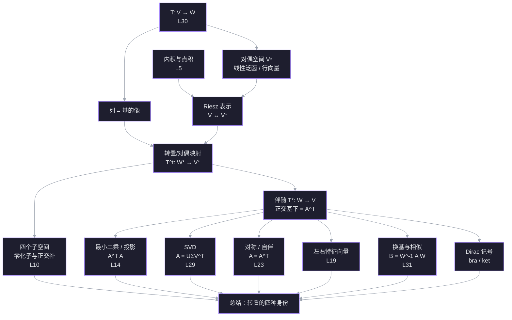

# L33 转置、对偶与空间变换

> 材料：[[你真的了解矩阵转置吗？转置与对偶是什么关系？]]、[[30. Linear Transformations and Their Matrices]]、[[31. Change of Basis; Image Compression]]、[[Change of Basis]]
> 前置：[[L5 转置·置换·向量空间]]、[[L10 四个基本子空间]]、[[L14 投影与最小二乘]]、[[L15 正交矩阵与 Gram-Schmidt]]、[[L19 特征值与特征向量]]、[[L23 对称矩阵与正定矩阵]]、[[L29 奇异值分解]]、[[L30 线性变换与矩阵表示]]、[[L31 换基与图像压缩]]
> 日期：2026-11-11

## 探针：起点与边缘

| 线索 | 你的回答 | 结论 |
| --- | --- | --- |
| $A_{3\times2}$ 的转置定义域 | $A^{\mathsf T}:\mathbb R^3\to\mathbb R^2$，且 $(Ax)\cdot y=x\cdot(A^{\mathsf T}y)$ | ✅ 稳 |
| 行向量的几何身份 | 线性泛函 | ✅ 稳 |
| 最小二乘为什么乘 $A^{\mathsf T}$ | 让残差正交于列空间 | ✅ 稳 |
| $A$ 与 $A^{\mathsf T}$ 的谱 | 特征值相同，特征向量一般不同 | ✅ 稳 |
| 斜基下伴随的矩阵 | I don't know | ❌ 缺口 |
| $V\cong V^*$ 是否典范 | I don't know | ❌ 缺口 |
| 左特征向量 | I don't know | ❌ 缺口 |

结论：结论层已经稳，缺口在**结构层**——为什么公式长这样、换一组基后怎么变。这一讲不重复基础，而是把「转置」当成一条主线。

## 依赖图

## 正文

### 节点 0 · 为什么现在讲「对偶」

前面每一讲都出现过转置，但它以四种不同身份出现：

1. **计算身份**：矩阵行列互换。
2. **点积身份**：$(Ax)\cdot y=x\cdot(A^{\mathsf T}y)$，转置是点积的搬运工（[[L5 转置·置换·向量空间]]）。
3. **逆身份**：正交基下 $Q^{\mathsf T}=Q^{-1}$（[[L15 正交矩阵与 Gram-Schmidt]]、[[L31 换基与图像压缩]]）。
4. **子空间身份**：$N(A^{\mathsf T})=C(A)^\perp$，左零空间是列空间的正交补（[[L10 四个基本子空间]]）。

这四种身份不是四个巧合，而是同一张图的不同投影。这张图叫**对偶**。先把图搭起来，后面所有公式都会变成它的推论。

### 节点 1 · 矩阵的两种读法：列推出，行量回

**动机。** L30 说「矩阵的列 = 基向量的像」。这句话只回答了变换把输入送到哪里，没有回答矩阵的行在干什么。行不是装饰：它决定输出的每一个坐标怎么从输入读出来。

设 $T:V\to W$，$\dim V=n$，$\dim W=m$。取基 $B=\{b_1,\dots,b_n\}$、$C=\{c_1,\dots,c_m\}$，矩阵 $A$ 由

$$
T(b_j)=\sum_{i=1}^{m}A_{ij}c_i
$$

定义。

**列读法（推出）。** 若 $x=\sum_j x_j b_j$，则

$$
T(x)=\sum_j x_jT(b_j)
=\sum_j x_j\sum_i A_{ij}c_i
=\sum_i\left(\sum_j A_{ij}x_j\right)c_i.
$$

所以 $A$ 的第 $j$ 列是 $T(b_j)$ 在 $C$ 下的坐标；输出的第 $i$ 个坐标是

$$
y_i=\sum_{j=1}^{n}A_{ij}x_j.
$$

**行读法（量回）。** 把第 $i$ 行单独拿出来，记 $r_i=(A_{i1},\dots,A_{in})$，则

$$
y_i=r_i^{\mathsf T}x.
$$

$r_i$ 是一个从 $V$ 到 $\mathbb R$ 的线性函数：吃进 $x$，吐出第 $i$ 个输出坐标。也就是说：

- **列住在 $W$**，是「像」；
- **行住在 $V^*$**，是「测量器」。

**数例。** $A=\begin{bmatrix}2&1\\0&3\end{bmatrix}$，$x=(1,2)$。

- 列：$a_1=(2,0)$，$a_2=(1,3)$，所以
  $$
  Ax=1\cdot a_1+2\cdot a_2=(2,0)+(2,6)=(4,6).
  $$
- 行：$r_1=(2,1)$，$r_2=(0,3)$，所以
  $$
  r_1^{\mathsf T}x=2\cdot1+1\cdot2=4,\qquad
  r_2^{\mathsf T}x=0\cdot1+3\cdot2=6.
  $$

两套读法给出同一个 $(4,6)$，但解释完全不同。

一句话：**列回答「基向量被送到哪里」，行回答「输出的每个坐标怎样从输入读出来」。**

![[viz-matrix-column-row-readings-1794408522598.svg|900]]

> [!question] $A=\begin{bmatrix}2&1\\0&3\end{bmatrix}$。下面哪一句把列和行的角色说对了？
> - 第一列 $(2,0)$ 是 $e_1$ 的像；第一行 $(2,1)$ 是读出第一个输出坐标的泛函
> - 第一列 $(2,0)$ 是第一个输出坐标的泛函；第一行 $(2,1)$ 是 $e_1$ 的像
> - 列和行都在 $W$ 中，都是输出的方向
> - I don't know

> [!question] 不知道
> 把两个角色分开看，不要被「都是两个数」骗了。
>
> **列是「像」。** 第一列是 $A e_1=A\begin{bmatrix}1\\0\end{bmatrix}=\begin{bmatrix}2\\0\end{bmatrix}$，所以 $(2,0)$ 是输入基向量 $e_1$ 被送到 $W$ 里的位置。
>
> **行是「测量器」。** 第一行 $r_1=(2,1)$ 满足
> $$
> (Ax)_1=2x_1+1x_2=r_1^{\mathsf T}x.
> $$
> 它吃进任意输入 $x$，吐出第一个输出坐标。它住在 $V^*$，不是 $W$ 里的箭头。
>
> 所以正确的那一句是：**第一列 $(2,0)$ 是 $e_1$ 的像；第一行 $(2,1)$ 是读出第一个输出坐标的泛函。**
>
> 一个快速的自检：列的长度等于输出的维数 $m$，行的长度等于输入的维数 $n$。$A$ 是 $2\times2$ 时两者都是 $2$，容易混；换成 $3\times2$ 就一眼看出来了——列是 $3$ 维，行是 $2$ 维。

### 节点 2 · 对偶空间：行向量到底住在哪

**动机。** 节点 1 说行是「测量器」。测量器本身也能相加、数乘：两个测量器加起来还是测量器。于是所有测量器构成一个向量空间，这就是对偶空间。

**定义。** 设 $V$ 是实数域上的向量空间。它的对偶空间是

$$
V^*=\mathcal L(V,\mathbb R)=\{f:V\to\mathbb R\mid f\text{ 线性}\}.
$$

$V^*$ 中的元素叫**线性泛函**（linear functional），也叫**余向量**（covector）或**一形式**（one-form）。加法与数乘逐点定义：

$$
(f+g)(x)=f(x)+g(x),\qquad (cf)(x)=c\,f(x).
$$

若 $\dim V=n$，则 $\dim V^*=n$。

**对偶基。** 取 $V$ 的一组基 $b_1,\dots,b_n$，定义

$$
b^i(b_j)=\delta^i_j=
\begin{cases}1,&i=j,\\0,&i\ne j.\end{cases}
$$

则 $b^1,\dots,b^n$ 是 $V^*$ 的一组基，叫**对偶基**。任意 $f\in V^*$ 可以写成

$$
f=\sum_{i=1}^{n}f(b_i)\,b^i.
$$

所以 $f$ 在这组对偶基下的坐标，就是行向量

$$
(f(b_1),\dots,f(b_n)).
$$

这就是「线性泛函就是行向量」的准确含义：**选好基之后，它的坐标是一个行向量**。泛函本身不依赖基。

**几何。** 非零泛函 $f$ 的等值集

$$
\{x\in V\mid f(x)=c\}
$$

是一组平行的超平面；二维时就是一组平行线。$f(v)$ 的值告诉你 $v$ 落在哪一层。等值线越密，泛函变化越快。

**数例。** $f(x,y)=2x+y$。等值线是 $2x+y=c$。因为

$$
f(1,1)=3,\qquad f(0,3)=3,
$$

所以 $(1,1)$ 与 $(0,3)$ 在同一条等值线 $c=3$ 上。

![[viz-linear-functional-level-sets-1794408587610.svg|900]]

> [!question] $f(x,y)=2x+y$。下面哪个向量与 $(1,1)$ 在同一条等值线上？
> - $(2,0)$
> - $(1,2)$
> - $(0,3)$
> - I don't know
