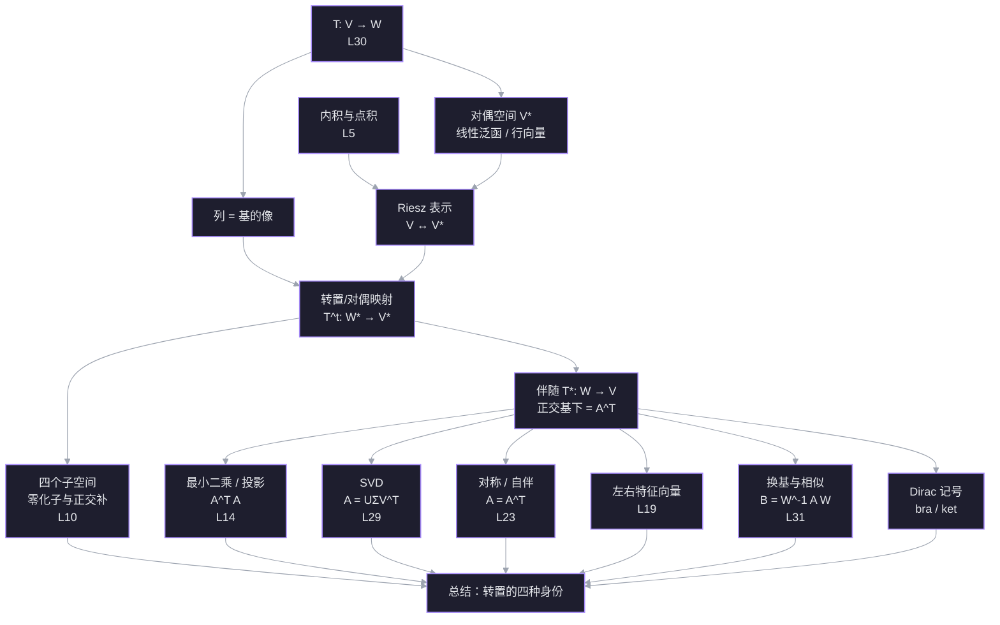

# L33 转置、对偶与空间变换

> 材料：[[你真的了解矩阵转置吗？转置与对偶是什么关系？]]、[[30. Linear Transformations and Their Matrices]]、[[31. Change of Basis; Image Compression]]、[[Change of Basis]]
> 前置：[[L5 转置·置换·向量空间]]、[[L10 四个基本子空间]]、[[L14 投影与最小二乘]]、[[L15 正交矩阵与 Gram-Schmidt]]、[[L19 特征值与特征向量]]、[[L23 对称矩阵与正定矩阵]]、[[L29 奇异值分解]]、[[L30 线性变换与矩阵表示]]、[[L31 换基与图像压缩]]
> 日期：2026-11-11

## 探针：起点与边缘

| 线索 | 你的回答 | 结论 |
| --- | --- | --- |
| $A_{3\times2}$ 的转置定义域 | $A^{\mathsf T}:\mathbb R^3\to\mathbb R^2$，且 $(Ax)\cdot y=x\cdot(A^{\mathsf T}y)$ | ✅ 稳 |
| 行向量的几何身份 | 线性泛函 | ✅ 稳 |
| 最小二乘为什么乘 $A^{\mathsf T}$ | 让残差正交于列空间 | ✅ 稳 |
| $A$ 与 $A^{\mathsf T}$ 的谱 | 特征值相同，特征向量一般不同 | ✅ 稳 |
| 斜基下伴随的矩阵 | I don't know | ❌ 缺口 |
| $V\cong V^*$ 是否典范 | I don't know | ❌ 缺口 |
| 左特征向量 | I don't know | ❌ 缺口 |

结论：结论层已经稳，缺口在**结构层**——为什么公式长这样、换一组基后怎么变。这一讲不重复基础，而是把「转置」当成一条主线。

## 依赖图

## 正文

### 节点 0 · 为什么现在讲「对偶」

前面每一讲都出现过转置，但它以四种不同身份出现：

1. **计算身份**：矩阵行列互换。
2. **点积身份**：$(Ax)\cdot y=x\cdot(A^{\mathsf T}y)$，转置是点积的搬运工（[[L5 转置·置换·向量空间]]）。
3. **逆身份**：正交基下 $Q^{\mathsf T}=Q^{-1}$（[[L15 正交矩阵与 Gram-Schmidt]]、[[L31 换基与图像压缩]]）。
4. **子空间身份**：$N(A^{\mathsf T})=C(A)^\perp$，左零空间是列空间的正交补（[[L10 四个基本子空间]]）。

这四种身份不是四个巧合，而是同一张图的不同投影。这张图叫**对偶**。先把图搭起来，后面所有公式都会变成它的推论。

### 节点 1 · 矩阵的两种读法：列推出，行量回

**动机。** L30 说「矩阵的列 = 基向量的像」。这句话只回答了变换把输入送到哪里，没有回答矩阵的行在干什么。行不是装饰：它决定输出的每一个坐标怎么从输入读出来。

设 $T:V\to W$，$\dim V=n$，$\dim W=m$。取基 $B=\{b_1,\dots,b_n\}$、$C=\{c_1,\dots,c_m\}$，矩阵 $A$ 由

$$
T(b_j)=\sum_{i=1}^{m}A_{ij}c_i
$$

定义。

**列读法（推出）。** 若 $x=\sum_j x_j b_j$，则

$$
T(x)=\sum_j x_jT(b_j)
=\sum_j x_j\sum_i A_{ij}c_i
=\sum_i\left(\sum_j A_{ij}x_j\right)c_i.
$$

所以 $A$ 的第 $j$ 列是 $T(b_j)$ 在 $C$ 下的坐标；输出的第 $i$ 个坐标是

$$
y_i=\sum_{j=1}^{n}A_{ij}x_j.
$$

**行读法（量回）。** 把第 $i$ 行单独拿出来，记 $r_i=(A_{i1},\dots,A_{in})$，则

$$
y_i=r_i^{\mathsf T}x.
$$

$r_i$ 是一个从 $V$ 到 $\mathbb R$ 的线性函数：吃进 $x$，吐出第 $i$ 个输出坐标。也就是说：

- **列住在 $W$**，是「像」；
- **行住在 $V^*$**，是「测量器」。

**数例。** $A=\begin{bmatrix}2&1\\0&3\end{bmatrix}$，$x=(1,2)$。

- 列：$a_1=(2,0)$，$a_2=(1,3)$，所以
  $$
  Ax=1\cdot a_1+2\cdot a_2=(2,0)+(2,6)=(4,6).
  $$
- 行：$r_1=(2,1)$，$r_2=(0,3)$，所以
  $$
  r_1^{\mathsf T}x=2\cdot1+1\cdot2=4,\qquad
  r_2^{\mathsf T}x=0\cdot1+3\cdot2=6.
  $$

两套读法给出同一个 $(4,6)$，但解释完全不同。

一句话：**列回答「基向量被送到哪里」，行回答「输出的每个坐标怎样从输入读出来」。**

![[viz-matrix-column-row-readings-1794408522598.svg|900]]

> [!question] $A=\begin{bmatrix}2&1\\0&3\end{bmatrix}$。下面哪一句把列和行的角色说对了？
> - 第一列 $(2,0)$ 是 $e_1$ 的像；第一行 $(2,1)$ 是读出第一个输出坐标的泛函
> - 第一列 $(2,0)$ 是第一个输出坐标的泛函；第一行 $(2,1)$ 是 $e_1$ 的像
> - 列和行都在 $W$ 中，都是输出的方向
> - I don't know

> [!question] 不知道
> 把两个角色分开看，不要被「都是两个数」骗了。
>
> **列是「像」。** 第一列是 $A e_1=A\begin{bmatrix}1\\0\end{bmatrix}=\begin{bmatrix}2\\0\end{bmatrix}$，所以 $(2,0)$ 是输入基向量 $e_1$ 被送到 $W$ 里的位置。
>
> **行是「测量器」。** 第一行 $r_1=(2,1)$ 满足
> $$
> (Ax)_1=2x_1+1x_2=r_1^{\mathsf T}x.
> $$
> 它吃进任意输入 $x$，吐出第一个输出坐标。它住在 $V^*$，不是 $W$ 里的箭头。
>
> 所以正确的那一句是：**第一列 $(2,0)$ 是 $e_1$ 的像；第一行 $(2,1)$ 是读出第一个输出坐标的泛函。**
>
> 一个快速的自检：列的长度等于输出的维数 $m$，行的长度等于输入的维数 $n$。$A$ 是 $2\times2$ 时两者都是 $2$，容易混；换成 $3\times2$ 就一眼看出来了——列是 $3$ 维，行是 $2$ 维。

### 节点 2 · 对偶空间：行向量到底住在哪

**动机。** 节点 1 说行是「测量器」。测量器本身也能相加、数乘：两个测量器加起来还是测量器。于是所有测量器构成一个向量空间，这就是对偶空间。

**定义。** 设 $V$ 是实数域上的向量空间。它的对偶空间是

$$
V^*=\mathcal L(V,\mathbb R)=\{f:V\to\mathbb R\mid f\text{ 线性}\}.
$$

$V^*$ 中的元素叫**线性泛函**（linear functional），也叫**余向量**（covector）或**一形式**（one-form）。加法与数乘逐点定义：

$$
(f+g)(x)=f(x)+g(x),\qquad (cf)(x)=c\,f(x).
$$

若 $\dim V=n$，则 $\dim V^*=n$。

**对偶基。** 取 $V$ 的一组基 $b_1,\dots,b_n$，定义

$$
b^i(b_j)=\delta^i_j=
\begin{cases}1,&i=j,\\0,&i\ne j.\end{cases}
$$

则 $b^1,\dots,b^n$ 是 $V^*$ 的一组基，叫**对偶基**。任意 $f\in V^*$ 可以写成

$$
f=\sum_{i=1}^{n}f(b_i)\,b^i.
$$

所以 $f$ 在这组对偶基下的坐标，就是行向量

$$
(f(b_1),\dots,f(b_n)).
$$

这就是「线性泛函就是行向量」的准确含义：**选好基之后，它的坐标是一个行向量**。泛函本身不依赖基。

**几何。** 非零泛函 $f$ 的等值集

$$
\{x\in V\mid f(x)=c\}
$$

是一组平行的超平面；二维时就是一组平行线。$f(v)$ 的值告诉你 $v$ 落在哪一层。等值线越密，泛函变化越快。

**数例。** $f(x,y)=2x+y$。等值线是 $2x+y=c$。因为

$$
f(1,1)=3,\qquad f(0,3)=3,
$$

所以 $(1,1)$ 与 $(0,3)$ 在同一条等值线 $c=3$ 上。

![[viz-linear-functional-level-sets-1794408587610.svg|900]]

> [!question] $f(x,y)=2x+y$。下面哪个向量与 $(1,1)$ 在同一条等值线上？
> - $(2,0)$
> - $(1,2)$
> - $(0,3)$
> - I don't know

> [!success] ✓ 正确
> $f(1,1)=3$，$f(0,3)=3$，所以两者都在等值线 $c=3$ 上。等值线是「同一测量值的所有输入」的集合。

> [!success] ✓ 正确
> $f(1,1)=3$，$f(0,3)=3$，两者在同一条等值线上。

### 节点 2.5 · 「测量器」到底在说什么，为什么行空间 / $A^{\mathsf T}$ 值得关心

先把比喻关掉，只看公式。

一个行向量 $r^{\mathsf T}=(r_1,\dots,r_n)$ 的作用是

$$
x\mapsto r^{\mathsf T}x=r_1x_1+\cdots+r_nx_n.
$$

它吃进一个向量，输出一个数。这就是线性泛函的定义，没有别的意思。矩阵 $A$ 的每一行，就是输出向量某一个坐标的公式。

**例。** $A=\begin{bmatrix}2&1\\0&3\end{bmatrix}$，$x=(x_1,x_2)$。两个输出坐标是

$$
(Ax)_1=2x_1+x_2=r_1^{\mathsf T}x,\qquad
(Ax)_2=3x_2=r_2^{\mathsf T}x.
$$

- 第一行 $(2,1)$ 问的是：「2 份 $x_1$ 加 1 份 $x_2$ 是多少？」
- 第二行 $(0,3)$ 问的是：「3 份 $x_2$ 是多少？」

输出就是这两个问题的答案。所以「行是测量器」的意思是：**行是输出坐标对输入提出的线性问题。**

**行空间是什么。** 行空间是所有行的线性组合，也就是「你能从输出里构造出的所有问题」。它衡量输出能看见输入的哪些方向。

- 若两行独立（行空间 $=\mathbb R^n$），两个问题能区分所有输入，零空间只有 $0$。
- 若两行相关（例如 $A=\begin{bmatrix}1&2\\2&4\end{bmatrix}$），两个问题其实是同一个问题的倍数；存在非零输入 $x$ 使 $Ax=0$。这个 $x$ 就是「所有行都测不到的方向」，也就是零空间。

**为什么行空间和零空间正交。** 若 $x\in N(A)$，则每一行都满足 $r_i^{\mathsf T}x=0$。所以 $x$ 与每个 $r_i$ 正交，也就与整个行空间正交。反过来，与行空间正交的向量会被每一行测成 $0$，所以它在零空间。于是

$$
N(A)=(\text{行空间})^\perp,\qquad \text{行空间}=N(A)^\perp.
$$

这就是四个子空间里「行空间 ⟂ 零空间」的来源；它不是背下来的，是「测不到」的定义直接推出来的。

**为什么 $A^{\mathsf T}$ 会出现。** 两个原因，其实是同一件事：

1. $A^{\mathsf T}$ 的列就是 $A$ 的行。所以「$A$ 的行空间」=「$A^{\mathsf T}$ 的列空间」。讨论行，就自然走到 $A^{\mathsf T}$。
2. $A^{\mathsf T}$ 把输出空间的测量拉回输入空间。若 $y$ 是输出空间的一个向量，则 $y^{\mathsf T}A$ 是输入空间的一个行向量，而
   $$
   (Ax)^{\mathsf T}y=x^{\mathsf T}(A^{\mathsf T}y).
   $$
   左边是「用 $y$ 量输出 $Ax$」，右边是「用 $A^{\mathsf T}y$ 量输入 $x$」。两者相等，所以 $A^{\mathsf T}y$ 就是**同一个测量在输入侧的表示**。

**最小二乘为什么乘 $A^{\mathsf T}$。** 你要 $Ax$ 接近 $b$，误差 $r=b-Ax$ 必须没有列空间分量。等价地，任何「在列空间上测值为 $0$」的输出测量 $y$（即 $A^{\mathsf T}y=0$）都必须把 $r$ 测成 $0$：

$$
y^{\mathsf T}r=0\quad\text{对所有 }A^{\mathsf T}y=0.
$$

这正是 $A^{\mathsf T}r=0$，也就是正规方程 $A^{\mathsf T}Ax=A^{\mathsf T}b$。$A^{\mathsf T}$ 不是「为了凑方阵」，而是把「输出误差正交于列空间」翻译成「输入侧的测量为零」。

**一句话。** 列告诉你输入被送到哪；行告诉你输出能看见输入的哪些方向。行空间是「看得见的方向」，零空间是「看不见的方向」，两者正交；$A^{\mathsf T}$ 是把输出侧的测量搬回输入侧的桥。

> [!question] $A=\begin{bmatrix}1&2\\2&4\end{bmatrix}$。哪个向量在零空间里，也就是两个行都测不到？
> - $(2,-1)$
> - $(1,2)$
> - $(1,0)$
> - I don't know

### 节点 3 · Riesz 表示：内积把 $V$ 和 $V^*$ 接起来

**动机。** $V$ 和 $V^*$ 维数相同，所以抽象地同构。但「同构」不等于「有唯一的配对方式」：选一组基，对偶基给出一个同构；换一组基，这个同构就变了。我们想要一个只依赖几何（长度、角度）、不依赖基的配对。内积正好提供它。

**构造。** 对每个 $v\in V$，定义 $R(v)\in V^*$ 为

$$
R(v)(x)=\langle v,x\rangle.
$$

$R$ 是线性的（实数域），且 $\ker R=\{0\}$：若 $\langle v,x\rangle=0$ 对所有 $x$ 成立，取 $x=v$ 得 $\|v\|^2=0$，所以 $v=0$。于是 $R:V\to V^*$ 是单射；两边维数相同，所以它是同构。

**Riesz 表示定理（有限维版本）。** 对任意 $f\in V^*$，存在唯一的 $v_f\in V$，使得

$$
f(x)=\langle v_f,x\rangle\quad\text{对所有 }x\in V.
$$

这个 $v_f$ 叫 $f$ 的 **Riesz 向量**。

**坐标怎么算。** 取基 $b_1,\dots,b_n$，Gram 矩阵

$$
G_{ij}=\langle b_i,b_j\rangle.
$$

若 $f$ 的行坐标是 $a=(f(b_1),\dots,f(b_n))^{\mathsf T}$，Riesz 向量写成 $v_f=\sum_j \alpha_j b_j$，则

$$
f(b_i)=\langle v_f,b_i\rangle=\sum_j \alpha_j\langle b_j,b_i\rangle=(G\alpha)_i.
$$

所以

$$
\alpha=G^{-1}a.
$$

- 标准正交基：$G=I$，于是 $\alpha=a$，**行坐标 = 列坐标**。
- 一般基：$G\ne I$，行坐标和列坐标不是一回事，必须过 $G^{-1}$。

**「典范」到底是什么意思。** 固定了内积之后，$R$ 不需要选基就能定义，所以这个同构是**典范的（canonical）**——只依赖内积。没有内积时，$V\cong V^*$ 仍然成立（维数相同），但没有典范同构；每个基给出一个不同的同构。真正无条件典范的是 $V\cong V^{**}$，$v\mapsto(\varphi\mapsto\varphi(v))$，它不需要任何额外结构。

**数例。** $V=\mathbb R^2$，$f(x,y)=2x+y$。

- 标准正交基 $e_1,e_2$：行 $(2,1)$，$G=I$，所以 $v_f=(2,1)$。
- 斜基 $b_1=(1,0)$，$b_2=(1,1)$：
  $$
  f(b_1)=2,\quad f(b_2)=3,\quad
  G=\begin{bmatrix}1&1\\1&2\end{bmatrix},\quad
  G^{-1}=\begin{bmatrix}2&-1\\-1&1\end{bmatrix}.
  $$
  于是
  $$
  \alpha=G^{-1}\begin{bmatrix}2\\3\end{bmatrix}
  =\begin{bmatrix}1\\1\end{bmatrix},
  $$
  即 $v_f=b_1+b_2=(2,1)$。

同一个泛函、同一个 Riesz 向量，换基只改坐标。

![[viz-riesz-vector-orthonormal-vs-oblique-1794408450398.svg|950]]

> [!question] 在斜基 $b_1=(1,0)$、$b_2=(1,1)$ 下，$f(x,y)=2x+y$ 的 Riesz 向量坐标是什么？
> - $(2,3)$
> - $(1,1)$
> - $(2,1)$
> - I don't know
