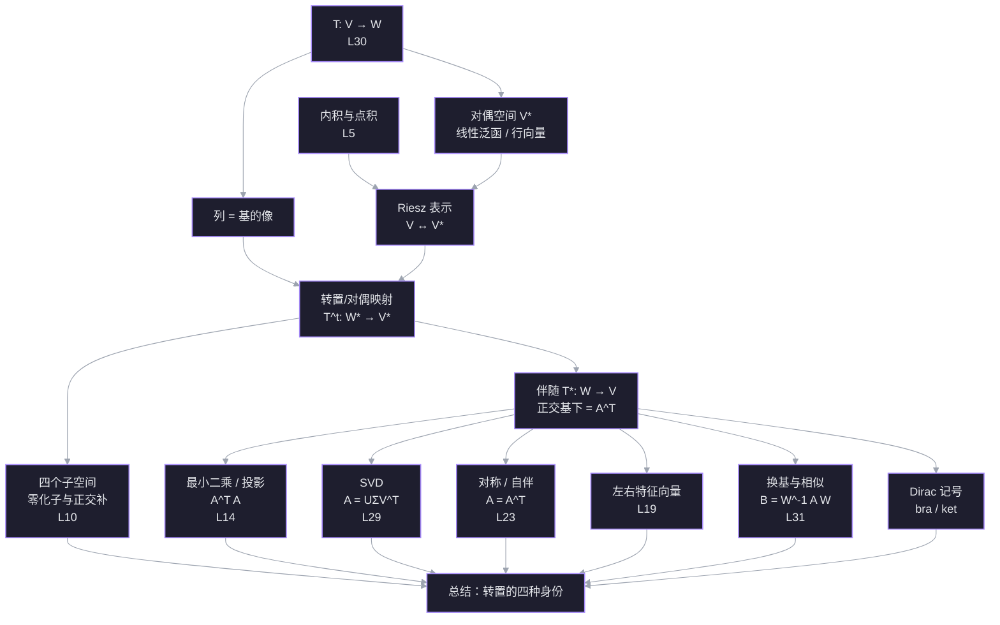

# L33 转置、对偶与空间变换

> 材料：[[你真的了解矩阵转置吗？转置与对偶是什么关系？]]、[[30. Linear Transformations and Their Matrices]]、[[31. Change of Basis; Image Compression]]、[[Change of Basis]]
> 前置：[[L5 转置·置换·向量空间]]、[[L10 四个基本子空间]]、[[L14 投影与最小二乘]]、[[L15 正交矩阵与 Gram-Schmidt]]、[[L19 特征值与特征向量]]、[[L23 对称矩阵与正定矩阵]]、[[L29 奇异值分解]]、[[L30 线性变换与矩阵表示]]、[[L31 换基与图像压缩]]
> 日期：2026-11-11

## 探针：起点与边缘

| 线索 | 你的回答 | 结论 |
| --- | --- | --- |
| $A_{3\times2}$ 的转置定义域 | $A^{\mathsf T}:\mathbb R^3\to\mathbb R^2$，且 $(Ax)\cdot y=x\cdot(A^{\mathsf T}y)$ | ✅ 稳 |
| 行向量的几何身份 | 线性泛函 | ✅ 稳 |
| 最小二乘为什么乘 $A^{\mathsf T}$ | 让残差正交于列空间 | ✅ 稳 |
| $A$ 与 $A^{\mathsf T}$ 的谱 | 特征值相同，特征向量一般不同 | ✅ 稳 |
| 斜基下伴随的矩阵 | I don't know | ❌ 缺口 |
| $V\cong V^*$ 是否典范 | I don't know | ❌ 缺口 |
| 左特征向量 | I don't know | ❌ 缺口 |

结论：结论层已经稳，缺口在**结构层**——为什么公式长这样、换一组基后怎么变。这一讲不重复基础，而是把「转置」当成一条主线。

## 依赖图

## 正文

### 节点 0 · 为什么现在讲「对偶」

前面每一讲都出现过转置，但它以四种不同身份出现：

1. **计算身份**：矩阵行列互换。
2. **点积身份**：$(Ax)\cdot y=x\cdot(A^{\mathsf T}y)$，转置是点积的搬运工（[[L5 转置·置换·向量空间]]）。
3. **逆身份**：正交基下 $Q^{\mathsf T}=Q^{-1}$（[[L15 正交矩阵与 Gram-Schmidt]]、[[L31 换基与图像压缩]]）。
4. **子空间身份**：$N(A^{\mathsf T})=C(A)^\perp$，左零空间是列空间的正交补（[[L10 四个基本子空间]]）。

这四种身份不是四个巧合，而是同一张图的不同投影。这张图叫**对偶**。先把图搭起来，后面所有公式都会变成它的推论。

### 节点 1 · 矩阵的两种读法：列推出，行量回

**动机。** L30 说「矩阵的列 = 基向量的像」。这句话只回答了变换把输入送到哪里，没有回答矩阵的行在干什么。行不是装饰：它决定输出的每一个坐标怎么从输入读出来。

设 $T:V\to W$，$\dim V=n$，$\dim W=m$。取基 $B=\{b_1,\dots,b_n\}$、$C=\{c_1,\dots,c_m\}$，矩阵 $A$ 由

$$
T(b_j)=\sum_{i=1}^{m}A_{ij}c_i
$$

定义。

**列读法（推出）。** 若 $x=\sum_j x_j b_j$，则

$$
T(x)=\sum_j x_jT(b_j)
=\sum_j x_j\sum_i A_{ij}c_i
=\sum_i\left(\sum_j A_{ij}x_j\right)c_i.
$$

所以 $A$ 的第 $j$ 列是 $T(b_j)$ 在 $C$ 下的坐标；输出的第 $i$ 个坐标是

$$
y_i=\sum_{j=1}^{n}A_{ij}x_j.
$$

**行读法（量回）。** 把第 $i$ 行单独拿出来，记 $r_i=(A_{i1},\dots,A_{in})$，则

$$
y_i=r_i^{\mathsf T}x.
$$

$r_i$ 是一个从 $V$ 到 $\mathbb R$ 的线性函数：吃进 $x$，吐出第 $i$ 个输出坐标。也就是说：

- **列住在 $W$**，是「像」；
- **行住在 $V^*$**，是「测量器」。

**数例。** $A=\begin{bmatrix}2&1\\0&3\end{bmatrix}$，$x=(1,2)$。

- 列：$a_1=(2,0)$，$a_2=(1,3)$，所以
  $$
  Ax=1\cdot a_1+2\cdot a_2=(2,0)+(2,6)=(4,6).
  $$
- 行：$r_1=(2,1)$，$r_2=(0,3)$，所以
  $$
  r_1^{\mathsf T}x=2\cdot1+1\cdot2=4,\qquad
  r_2^{\mathsf T}x=0\cdot1+3\cdot2=6.
  $$

两套读法给出同一个 $(4,6)$，但解释完全不同。

一句话：**列回答「基向量被送到哪里」，行回答「输出的每个坐标怎样从输入读出来」。**

![[viz-matrix-column-row-readings-1794408522598.svg|900]]

> [!question] $A=\begin{bmatrix}2&1\\0&3\end{bmatrix}$。下面哪一句把列和行的角色说对了？
> - 第一列 $(2,0)$ 是 $e_1$ 的像；第一行 $(2,1)$ 是读出第一个输出坐标的泛函
> - 第一列 $(2,0)$ 是第一个输出坐标的泛函；第一行 $(2,1)$ 是 $e_1$ 的像
> - 列和行都在 $W$ 中，都是输出的方向
> - I don't know

> [!question] 不知道
> 把两个角色分开看，不要被「都是两个数」骗了。
>
> **列是「像」。** 第一列是 $A e_1=A\begin{bmatrix}1\\0\end{bmatrix}=\begin{bmatrix}2\\0\end{bmatrix}$，所以 $(2,0)$ 是输入基向量 $e_1$ 被送到 $W$ 里的位置。
>
> **行是「测量器」。** 第一行 $r_1=(2,1)$ 满足
> $$
> (Ax)_1=2x_1+1x_2=r_1^{\mathsf T}x.
> $$
> 它吃进任意输入 $x$，吐出第一个输出坐标。它住在 $V^*$，不是 $W$ 里的箭头。
>
> 所以正确的那一句是：**第一列 $(2,0)$ 是 $e_1$ 的像；第一行 $(2,1)$ 是读出第一个输出坐标的泛函。**
>
> 一个快速的自检：列的长度等于输出的维数 $m$，行的长度等于输入的维数 $n$。$A$ 是 $2\times2$ 时两者都是 $2$，容易混；换成 $3\times2$ 就一眼看出来了——列是 $3$ 维，行是 $2$ 维。

### 节点 2 · 对偶空间：行向量到底住在哪

**动机。** 节点 1 说行是「测量器」。测量器本身也能相加、数乘：两个测量器加起来还是测量器。于是所有测量器构成一个向量空间，这就是对偶空间。

**定义。** 设 $V$ 是实数域上的向量空间。它的对偶空间是

$$
V^*=\mathcal L(V,\mathbb R)=\{f:V\to\mathbb R\mid f\text{ 线性}\}.
$$

$V^*$ 中的元素叫**线性泛函**（linear functional），也叫**余向量**（covector）或**一形式**（one-form）。加法与数乘逐点定义：

$$
(f+g)(x)=f(x)+g(x),\qquad (cf)(x)=c\,f(x).
$$

若 $\dim V=n$，则 $\dim V^*=n$。

**对偶基。** 取 $V$ 的一组基 $b_1,\dots,b_n$，定义

$$
b^i(b_j)=\delta^i_j=
\begin{cases}1,&i=j,\\0,&i\ne j.\end{cases}
$$

则 $b^1,\dots,b^n$ 是 $V^*$ 的一组基，叫**对偶基**。任意 $f\in V^*$ 可以写成

$$
f=\sum_{i=1}^{n}f(b_i)\,b^i.
$$

所以 $f$ 在这组对偶基下的坐标，就是行向量

$$
(f(b_1),\dots,f(b_n)).
$$

这就是「线性泛函就是行向量」的准确含义：**选好基之后，它的坐标是一个行向量**。泛函本身不依赖基。

**几何。** 非零泛函 $f$ 的等值集

$$
\{x\in V\mid f(x)=c\}
$$

是一组平行的超平面；二维时就是一组平行线。$f(v)$ 的值告诉你 $v$ 落在哪一层。等值线越密，泛函变化越快。

**数例。** $f(x,y)=2x+y$。等值线是 $2x+y=c$。因为

$$
f(1,1)=3,\qquad f(0,3)=3,
$$

所以 $(1,1)$ 与 $(0,3)$ 在同一条等值线 $c=3$ 上。

![[viz-linear-functional-level-sets-1794408587610.svg|900]]

> [!question] $f(x,y)=2x+y$。下面哪个向量与 $(1,1)$ 在同一条等值线上？
> - $(2,0)$
> - $(1,2)$
> - $(0,3)$
> - I don't know

> [!success] ✓ 正确
> $f(1,1)=3$，$f(0,3)=3$，所以两者都在等值线 $c=3$ 上。等值线是「同一测量值的所有输入」的集合。

> [!success] ✓ 正确
> $f(1,1)=3$，$f(0,3)=3$，两者在同一条等值线上。

### 节点 2.5 · 「测量器」到底在说什么，为什么行空间 / $A^{\mathsf T}$ 值得关心

输出就是这两个问题的答案。所以「行是测量器」的意思是：**行是输出坐标对输入提出的线性问题。**

**行空间是什么。** 行空间是所有行的线性组合，也就是「你能从输出里构造出的所有问题」。它衡量输出能看见输入的哪些方向。

- 若两行独立（行空间 $=\mathbb R^n$），两个问题能区分所有输入，零空间只有 $0$。
- 若两行相关（例如 $A=\begin{bmatrix}1&2\\2&4\end{bmatrix}$），两个问题其实是同一个问题的倍数；存在非零输入 $x$ 使 $Ax=0$。这个 $x$ 就是「所有行都测不到的方向」，也就是零空间。

![[viz-rank-1-rowspace-nullspace-1794412428126.svg|950]]

**最小二乘为什么乘 $A^{\mathsf T}$。** 你要 $Ax$ 接近 $b$，误差 $r=b-Ax$ 必须没有列空间分量。等价地，任何「在列空间上测值为 $0$」的输出测量 $y$（即 $A^{\mathsf T}y=0$）都必须把 $r$ 测成 $0$：

$$
y^{\mathsf T}r=0\quad\text{对所有 }A^{\mathsf T}y=0.
$$

这正是 $A^{\mathsf T}r=0$，也就是正规方程 $A^{\mathsf T}Ax=A^{\mathsf T}b$。$A^{\mathsf T}$ 不是「为了凑方阵」，而是把「输出误差正交于列空间」翻译成「输入侧的测量为零」。

**一句话。** 列告诉你输入被送到哪；行告诉你输出能看见输入的哪些方向。行空间是「看得见的方向」，零空间是「看不见的方向」，两者正交；$A^{\mathsf T}$ 是把输出侧的测量搬回输入侧的桥。

> [!question] $A=\begin{bmatrix}1&2\\2&4\end{bmatrix}$。哪个向量在零空间里，也就是两个行都测不到？
> - $(2,-1)$
> - $(1,2)$
> - $(1,0)$
> - I don't know

> [!success] ✓ 正确
> $A(2,-1)=(1\cdot2+2\cdot(-1),\,2\cdot2+4\cdot(-1))=(0,0)$。两个行都把它测成 $0$，而且 $(2,-1)$ 与行方向 $(1,2)$ 正交。这就是「零空间 = 行空间的正交补」的具体样子。

### 节点 2.6 · 坐标就是测量：$A^{\mathsf T}x$ 为什么给出坐标

**先把「坐标」翻译成测量。** 取标准正交基 $e_1,\dots,e_n$。任意向量 $v$ 的坐标是

$$
(v\cdot e_1,\ v\cdot e_2,\ \dots,\ v\cdot e_n).
$$

所以坐标不是别的，就是**用每个基向量去量 $v$** 得到的一串数。

**$A^{\mathsf T}x$ 的定义。** $A^{\mathsf T}$ 不是「把矩阵横过来」这么简单；它的定义是

$$
\langle A^{\mathsf T}x,\ v\rangle=\langle x,\ A v\rangle
\quad\text{对所有 }v.
$$

取 $v=e_i$，得到 $A^{\mathsf T}x$ 的第 $i$ 个坐标：

$$
(A^{\mathsf T}x)_i
=\langle A^{\mathsf T}x,\ e_i\rangle
=\langle x,\ A e_i\rangle
=x\cdot(\text{$A$ 的第 }i\text{ 列}).
$$

这就是「$A^{\mathsf T}x$ 为什么能给出坐标」的直接答案：**它的第 $i$ 个坐标，就是 $x$ 与 $A$ 的第 $i$ 列的点积。** $A^{\mathsf T}x$ 把「$x$ 对每一列的测量值」打包成了一个输入空间的坐标向量。

**数例。** $A=\begin{bmatrix}2&1\\0&3\end{bmatrix}$，$x=(1,1)$。两列是 $a_1=(2,0)$、$a_2=(1,3)$，所以

$$
x\cdot a_1=2,\qquad x\cdot a_2=1+3=4,
$$

而

$$
A^{\mathsf T}x=\begin{bmatrix}2&0\\1&3\end{bmatrix}\begin{bmatrix}1\\1\end{bmatrix}=(2,4).
$$

两个坐标正好是这两个点积。

**几何读法。** 把 $x$ 看成 $W$ 上的泛函 $y\mapsto x\cdot y$。它的等值线是 $x\cdot y=c$。把两条列向量代进去：$a_1$ 落在 $c=2$ 上，$a_2$ 落在 $c=4$ 上。$A^{\mathsf T}x$ 就是输入空间里坐标为 $(2,4)$ 的那个向量。

![[viz-atx-column-dot-products-1794412402781.svg|950]]

**斜基的提醒。** 上面「坐标 = 点积」只在标准正交基下成立。一般基下，测量值仍是 $x\cdot A b_i$，但坐标要通过 Gram 矩阵 $G^{-1}$ 换算；这正是节点 3 的 Riesz 公式。

> [!question] $A=\begin{bmatrix}2&1\\0&3\end{bmatrix}$，$x=(1,1)$。$A^{\mathsf T}x$ 的第二个坐标等于什么？
> - $x\cdot a_1=2$
> - $x\cdot a_2=4$
> - $6$
> - I don't know

### 节点 3 · Riesz 表示：内积把 $V$ 和 $V^*$ 接起来

**动机。** $V$ 和 $V^*$ 维数相同，所以抽象地同构。但「同构」不等于「有唯一的配对方式」：选一组基，对偶基给出一个同构；换一组基，这个同构就变了。我们想要一个只依赖几何（长度、角度）、不依赖基的配对。内积正好提供它。

**构造。** 对每个 $v\in V$，定义 $R(v)\in V^*$ 为

$$
R(v)(x)=\langle v,x\rangle.
$$

$R$ 是线性的（实数域），且 $\ker R=\{0\}$：若 $\langle v,x\rangle=0$ 对所有 $x$ 成立，取 $x=v$ 得 $\|v\|^2=0$，所以 $v=0$。于是 $R:V\to V^*$ 是单射；两边维数相同，所以它是同构。

**Riesz 表示定理（有限维版本）。** 对任意 $f\in V^*$，存在唯一的 $v_f\in V$，使得

$$
f(x)=\langle v_f,x\rangle\quad\text{对所有 }x\in V.
$$

这个 $v_f$ 叫 $f$ 的 **Riesz 向量**。

**坐标怎么算。** 取基 $b_1,\dots,b_n$，Gram 矩阵

$$
G_{ij}=\langle b_i,b_j\rangle.
$$

若 $f$ 的行坐标是 $a=(f(b_1),\dots,f(b_n))^{\mathsf T}$，Riesz 向量写成 $v_f=\sum_j \alpha_j b_j$，则

$$
f(b_i)=\langle v_f,b_i\rangle=\sum_j \alpha_j\langle b_j,b_i\rangle=(G\alpha)_i.
$$

所以

$$
\alpha=G^{-1}a.
$$

- 标准正交基：$G=I$，于是 $\alpha=a$，**行坐标 = 列坐标**。
- 一般基：$G\ne I$，行坐标和列坐标不是一回事，必须过 $G^{-1}$。

**「典范」到底是什么意思。** 固定了内积之后，$R$ 不需要选基就能定义，所以这个同构是**典范的（canonical）**——只依赖内积。没有内积时，$V\cong V^*$ 仍然成立（维数相同），但没有典范同构；每个基给出一个不同的同构。真正无条件典范的是 $V\cong V^{**}$，$v\mapsto(\varphi\mapsto\varphi(v))$，它不需要任何额外结构。

**数例。** $V=\mathbb R^2$，$f(x,y)=2x+y$。

- 标准正交基 $e_1,e_2$：行 $(2,1)$，$G=I$，所以 $v_f=(2,1)$。
- 斜基 $b_1=(1,0)$，$b_2=(1,1)$：
  $$
  f(b_1)=2,\quad f(b_2)=3,\quad
  G=\begin{bmatrix}1&1\\1&2\end{bmatrix},\quad
  G^{-1}=\begin{bmatrix}2&-1\\-1&1\end{bmatrix}.
  $$
  于是
  $$
  \alpha=G^{-1}\begin{bmatrix}2\\3\end{bmatrix}
  =\begin{bmatrix}1\\1\end{bmatrix},
  $$
  即 $v_f=b_1+b_2=(2,1)$。

同一个泛函、同一个 Riesz 向量，换基只改坐标。

![[viz-riesz-vector-orthonormal-vs-oblique-1794408450398.svg|950]]

> [!question] 在斜基 $b_1=(1,0)$、$b_2=(1,1)$ 下，$f(x,y)=2x+y$ 的 Riesz 向量坐标是什么？
> - $(2,3)$
> - $(1,1)$
> - $(2,1)$
> - I don't know

> [!success] ✓ 正确
> $(A^{\mathsf T}x)_2=x\cdot a_2=(1,1)\cdot(1,3)=4$。第一个坐标是 $x\cdot a_1=2$。$A^{\mathsf T}x=(2,4)$ 不是新的神秘向量，它就是这两个测量值排成的坐标。

> [!failure] ✗ 不对
> 你选的是 Riesz 向量在**标准基**下的坐标 $(2,1)$，不是它在 $b$ 基下的坐标。
>
> $v_f$ 作为平面上的箭头仍然是 $(2,1)$，但写成 $b$ 基的组合：
> $$
> v_f=\alpha_1b_1+\alpha_2b_2
> =\alpha_1(1,0)+\alpha_2(1,1)
> =(\alpha_1+\alpha_2,\ \alpha_2).
> $$
> 要等于 $(2,1)$，必须 $\alpha_2=1$、$\alpha_1=1$，所以 $b$ 基坐标是 $(1,1)$。
>
> 同一个泛函有**三张不同的数字脸**，不要混：
>
> | 写法 | 数字 |
> | --- | --- |
> | Riesz 向量在标准基下 | $(2,1)$ |
> | Riesz 向量在 $b$ 基下 | $(1,1)$ |
> | 泛函在对偶基下的行坐标 | $(2,3)$ |
>
> 你选的 $(2,1)$ 回答的是「这个箭头在标准坐标里长什么样」，而题目问的是「它在 $b$ 基下的坐标是什么」。换基不改变箭头，只改变数字。

> [!question] 已知 $v_f=b_1+b_2$。它在 $b$ 基下的坐标是？
> - $(1,1)$
> - $(2,1)$
> - $(2,3)$
> - I don't know

> [!success] ✓ 正确
> $v_f=b_1+b_2$ 的系数就是 $(1,1)$。同一个箭头在标准基下是 $(2,1)$，在 $b$ 基下是 $(1,1)$，在对偶基下的行坐标是 $(2,3)$——三张脸，一个对象。

### 节点 4 · 转置映射与伴随映射：两个不同的「反过来」

**动机。** 有了 $T:V\to W$，我们想要一个「反方向」的映射。但「反过来」有两种完全不同的意思：

1. **把测量反过来**：$W$ 上的泛函 $g$ 可以拉回 $V$ 上，定义 $g\circ T$。这不需要内积。
2. **把向量反过来**：想找一个 $W\to V$ 的映射 $T^*$，使得「先 $T$ 再量」等于「先拉回再量」。这需要两边的内积。

这两件事经常被混为一谈，但它们是不同的对象。

**转置/对偶映射。** 定义

$$
T^{\mathsf t}:W^*\to V^*,\qquad (T^{\mathsf t}g)(v)=g(Tv).
$$

读法：$g$ 是 $W$ 上的测量器；要量 $v$，先把 $v$ 送到 $Tv$，再用 $g$ 量。所以 $T^{\mathsf t}$ 是**拉回（pullback）**。

矩阵表示：若 $A=[T]_B^C$，对偶基为 $B^*,C^*$，则

$$
[T^{\mathsf t}]_{C^*}^{B^*}=A^{\mathsf T}.
$$

验证：设 $T b_j=\sum_i A_{ij}c_i$。则

$$
(T^{\mathsf t}c^a)(b_j)=c^a(Tb_j)
=c^a\left(\sum_i A_{ij}c_i\right)=A_{aj}.
$$

所以 $T^{\mathsf t}$ 的矩阵第 $(a,j)$ 项是 $A_{aj}$，也就是 $A^{\mathsf T}$。**这一步不需要内积，也不需要对基做任何正交假设。**

**伴随映射。** 若 $V,W$ 都有内积，定义 $T^*:W\to V$ 为满足

$$
\langle Tv,w\rangle_W=\langle v,T^*w\rangle_V
\quad\text{对所有 }v\in V,\ w\in W
$$

的唯一线性映射。有限维下它一定存在且唯一（可用 Riesz 表示证明）。

**矩阵表示。** 设 $A=[T]_B^C$。在标准正交基下，

$$
[T^*]_C^B=A^{\mathsf T}\quad(\text{实情况}).
$$

在一般基下，设 $G_V,G_W$ 是两边的 Gram 矩阵。由

$$
\langle Tv,w\rangle_W=(Av)^{\mathsf T}G_Ww,\qquad
\langle v,T^*w\rangle_V=v^{\mathsf T}G_VMw,
$$

令两者对所有 $v,w$ 相等，得到

$$
A^{\mathsf T}G_W=G_VM
\quad\Longrightarrow\quad
\boxed{[T^*]_C^B=G_V^{-1}A^{\mathsf T}G_W.}
$$

只有 $G_V=G_W=I$（标准正交基）时，才退化为 $A^{\mathsf T}$。

**两个「反过来」怎么接起来。** 用 Riesz 映射 $R_V:V\to V^*$、$R_W:W\to W^*$，有交换方块

$$
R_V\circ T^*=T^{\mathsf t}\circ R_W,
$$

也就是

$$
\begin{array}{ccc}
W & \xrightarrow{\ T^*\ } & V\\
{\scriptstyle R_W}\downarrow & & \downarrow{\scriptstyle R_V}\\
W^* & \xrightarrow{\ T^{\mathsf t}\ } & V^*
\end{array}
$$

一句话：**$T^{\mathsf t}$ 拉回测量，$T^*$ 拉回向量；Riesz 同构把两者翻译成彼此。**

**数例。** $A=\begin{bmatrix}2&1\\0&3\end{bmatrix}$，$x=(1,2)$，$y=(1,1)$。

$$
Ax=(4,6),\qquad \langle Ax,y\rangle=4+6=10.
$$

$$
A^{\mathsf T}y=\begin{bmatrix}2&0\\1&3\end{bmatrix}\begin{bmatrix}1\\1\end{bmatrix}=(2,4),\qquad
\langle x,A^{\mathsf T}y\rangle=2+8=10.
$$

两边相等，正是伴随的定义。

![[viz-adjoint-pullback-1794408547729.svg|900]]

> [!question] 在一般（非标准正交）基下，$T^*$ 的矩阵是什么？
> - 总是 $A^{\mathsf T}$，因为转置和基无关
> - 伴随没有矩阵表示
> - 只有标准正交基下是 $A^{\mathsf T}$；一般基是 $G_V^{-1}A^{\mathsf T}G_W$
> - I don't know

> [!success] ✓ 正确
> 转置映射 $T^{\mathsf t}$ 的矩阵永远是 $A^{\mathsf T}$，因为它只作用于对偶基，不需要内积；伴随 $T^*$ 作用在向量上，要先用量度把向量翻译成测量，所以一般基下多出 $G_V^{-1}$ 和 $G_W$。正交基时 $G=I$，两者才重合。

### 节点 5 · 四个子空间：对偶图

现在把节点 1–4 拼起来。设 $T:V\to W$，矩阵 $A$。

**两个基本子空间。**

$$
\operatorname{im}T=C(A)\quad(\text{列空间}),\qquad
\ker T=N(A)\quad(\text{零空间}).
$$

**对偶映射的两个子空间。** $T^{\mathsf t}:W^*\to V^*$。

- $\ker T^{\mathsf t}=\{g\in W^*\mid g(Tv)=0\ \forall v\}$，也就是「在 $\operatorname{im}T$ 上测值全为 $0$」的泛函。这叫 $\operatorname{im}T$ 的**零化子**，记作 $(\operatorname{im}T)^0$。
- $\operatorname{im}T^{\mathsf t}=(\ker T)^0$：所有「在零空间上测值为 $0$」的泛函，恰好是 $T^{\mathsf t}$ 的像。

**用 Riesz 翻译成正交补。** 把泛函看成向量，零化子就变成正交补：

$$
\ker T^*=(\operatorname{im}T)^\perp=C(A)^\perp,
\qquad
\operatorname{im}T^*=(\ker T)^\perp=(\text{行空间}).
$$

于是得到四对关系：

$$
N(A)=(\text{行空间})^\perp,\qquad
N(A^{\mathsf T})=C(A)^\perp.
$$

这就是四个基本子空间的正交配对。注意：

- $N(A)$ 和行空间都在输入空间 $V$（$\mathbb R^n$）；
- $N(A^{\mathsf T})$ 和列空间都在输出空间 $W$（$\mathbb R^m$）。

**行秩 = 列秩。** 因为 $T^{\mathsf t}$ 与 $T$ 的秩相同：

$$
\dim\operatorname{im}T^{\mathsf t}=\dim\operatorname{im}T.
$$

左边是行空间的维数（行秩），右边是列空间的维数（列秩）。或者用维数公式：

$$
\dim N(A)+\dim(\text{行空间})=n,\qquad
\dim N(A)+\operatorname{rank}(A)=n,
$$

两式相减也得行秩 = 列秩。

**数例。** $A=\begin{bmatrix}1&2&3\\2&4&6\end{bmatrix}$，秩 $r=1$。

- 行空间：$\operatorname{span}(1,2,3)$，维数 $1$。
- 零空间：$x+2y+3z=0$，维数 $3-1=2$。
- 列空间：$\operatorname{span}(1,2)$，维数 $1$。
- 左零空间 $N(A^{\mathsf T})$：$\operatorname{span}(2,-1)$，维数 $2-1=1$。

检查正交：$(2,-1)\cdot(1,2)=0$；零空间里任取 $(2,-1,0)$，与 $(1,2,3)$ 的点积 $2-2+0=0$。

![[viz-four-fundamental-subspaces-1794408716144.svg|950]]

> [!question] $A=\begin{bmatrix}1&2&3\\2&4&6\end{bmatrix}$。下面哪一对是正交补？
> - $N(A)$ 与列空间
> - $N(A)$ 与行空间
> - $N(A^{\mathsf T})$ 与行空间
> - I don't know

> [!success] ✓ 正确
> $N(A)$ 与行空间都在输入空间，且互为 Orthogonal complement；$N(A^{\mathsf T})$ 与列空间在输出空间互为 Orthogonal complement。跨空间的配对（例如 $N(A)$ 与列空间）没有内积意义。

### 节点 6 · 转置在整门课里的五种身份

到这里，前面所有笔记里的转置都可以归位了。

| 场景 | 公式 | 转置在做什么 | 笔记 |
| --- | --- | --- | --- |
| 正交基 | $Q^{\mathsf T}Q=I$，$Q^{-1}=Q^{\mathsf T}$ | 对偶基与原基重合 | [[L15 正交矩阵与 Gram-Schmidt]]、[[L31 换基与图像压缩]] |
| 最小二乘 | $A^{\mathsf T}Ax=A^{\mathsf T}b$ | 把输出误差的正交条件拉回输入 | [[L14 投影与最小二乘]] |
| SVD | $A=U\Sigma V^{\mathsf T}$ | 输入基 $V$ 与输出基 $U$ 成对 | [[L29 奇异值分解]] |
| 对称/自伴 | $A=A^{\mathsf T}$ | 左右特征向量重合 | [[L23 对称矩阵与正定矩阵]] |
| 行列式 | $\det A=\det A^{\mathsf T}$ | 体积因子相同 | [[L16 行列式的性质]] |
| 相似 | $B=W^{-1}AW\Rightarrow B^{\mathsf T}=P^{-1}A^{\mathsf T}P$ | 转置保持相似 | [[L31 换基与图像压缩]] |
| 特征值 | $\det(A-\lambda I)=\det(A^{\mathsf T}-\lambda I)$ | 同谱，特征向量不同 | [[L19 特征值与特征向量]] |

#### 6.1 正交基：$Q^{-1}=Q^{\mathsf T}$

若 $Q$ 的列标准正交，则 $Q^{\mathsf T}Q=I$，所以 $Q^{-1}=Q^{\mathsf T}$。这不是「转置恰好等于逆」，而是：**在内积下，对偶基与原基重合**。Riesz 把每个基向量 $q_i$ 变成泛函 $\langle q_i,\cdot\rangle$，而正交性保证这个泛函正好是坐标泛函 $q^i$。

斜基没有这个待遇。$W$ 的列若不正交，$W^{-1}\ne W^{\mathsf T}$；对偶基是 $W^{-\mathsf T}$ 的列，坐标要用 $W^{-1}$。这正是 L31 里「正交快捷键只对正交基有效」的底层原因。

#### 6.2 最小二乘：$A^{\mathsf T}$ 是拉回

残差 $r=b-Ax$ 必须垂直于列空间：

$$
r\perp C(A)\iff A^{\mathsf T}r=0
\iff A^{\mathsf T}(b-Ax)=0
\iff A^{\mathsf T}Ax=A^{\mathsf T}b.
$$

$A^{\mathsf T}$ 把「输出空间的垂直」翻译成「输入空间的方程」。这就是正规方程的几何来源。

#### 6.3 SVD：两套对偶基

$$
A=U\Sigma V^{\mathsf T},\qquad Av_i=\sigma_i u_i,\qquad A^{\mathsf T}u_i=\sigma_i v_i.
$$

- $V$ 的列是输入空间的标准正交基（右奇异向量）；
- $U$ 的列是输出空间的标准正交基（左奇异向量）；
- $A^{\mathsf T}A=V\Sigma^2V^{\mathsf T}$，$AA^{\mathsf T}=U\Sigma^2U^{\mathsf T}$。

所以 SVD 是「在输入和输出各选一组好基，让 $A$ 只做拉伸」；$V$ 与 $U$ 通过 $A$ 成对。对矩形 $A$，转置是 $A^{\mathsf T}=V\Sigma^{\mathsf T}U^{\mathsf T}$；只有方阵才能把 $\Sigma^{\mathsf T}$ 写成 $\Sigma$。

![[viz-svd-paired-orthonormal-bases-1794408552444.svg|950]]

#### 6.4 对称/自伴

$A=A^{\mathsf T}$ 时，$A$ 是自伴算子。实对称矩阵的特征值全实，特征向量可选为标准正交基，于是

$$
A=Q\Lambda Q^{\mathsf T}.
$$

这就是谱定理。注意：在一般内积下，「自伴」的矩阵条件是 $A^{\mathsf T}G=GA$，不只是 $A=A^{\mathsf T}$；$A=A^{\mathsf T}$ 是标准内积下的特例。

#### 6.5 行列式

$$
\det A=\det A^{\mathsf T}.
$$

两者描述同一个体积缩放因子。转置交换了行和列，但 rows 张成的平行体与 columns 张成的平行体体积相同，定向也相同。注意：这**不**意味着转置是旋转；它只是同一个体积因子的另一种写法。

#### 6.6 相似与转置

若 $B=W^{-1}AW$，则

$$
B^{\mathsf T}=W^{\mathsf T}A^{\mathsf T}(W^{-1})^{\mathsf T}
=P^{-1}A^{\mathsf T}P,\qquad P=(W^{-1})^{\mathsf T}.
$$

所以 $A^{\mathsf T}$ 与 $B^{\mathsf T}$ 也相似。换句话说，**转置与换基兼容**：先换基再转置，等于先用对偶基换基再转置。对偶基的换基矩阵正是 $P=(W^{-1})^{\mathsf T}$。

#### 6.7 左/右特征向量

右特征向量是列 $x$：

$$
Ax=\lambda x.
$$

左特征向量是行 $y^{\mathsf T}$：

$$
y^{\mathsf T}A=\lambda y^{\mathsf T}
\iff A^{\mathsf T}y=\lambda y.
$$

所以左特征向量就是 $A^{\mathsf T}$ 的右特征向量。由

$$
\det(A^{\mathsf T}-\lambda I)=\det(A-\lambda I)
$$

可知 $A$ 与 $A^{\mathsf T}$ 特征值相同（含代数重数），但特征向量一般不同。

若 $\lambda_i\ne\lambda_j$，则

$$
(\lambda_i-\lambda_j)y_j^{\mathsf T}x_i=0
\quad\Longrightarrow\quad
y_j^{\mathsf T}x_i=0.
$$

归一化后可写 $y_j^{\mathsf T}x_i=\delta_{ij}$，这叫**双正交**。于是（可对角化时）

$$
A=\sum_i\frac{\lambda_i\,x_i y_i^{\mathsf T}}{y_i^{\mathsf T}x_i}.
$$

对称矩阵时 $y_i=x_i$，退化为熟悉的 $Q\Lambda Q^{\mathsf T}$。复 Hermitian 矩阵要注意：$A^H$ 的特征值是 $A$ 的特征值的共轭，不是相同；「同特征值」是普通转置 $A^{\mathsf T}$ 的性质。

![[viz-left-right-eigenvectors-1794408476923.svg|950]]

> [!question] SVD 中 $V$ 的列与 $U$ 的列分别是什么空间的基？
> - $V$ 的列是输入基，$U$ 的列是输出基
> - $V$ 的列是输出基，$U$ 的列是输入基
> - 两者都是输入基
> - I don't know

> [!question] 左特征向量 $y$ 满足的方程是？
> - $Ay=\lambda y$
> - $A^{\mathsf T}y=\lambda y$
> - $y=Ay$
> - I don't know

> [!success] ✓ 正确
> $V$ 的列住在输入空间，$U$ 的列住在输出空间；$Av_i=\sigma_iu_i$ 把一对基向量配起来。

> [!success] ✓ 正确
> $y^{\mathsf T}A=\lambda y^{\mathsf T}$ 两边转置就是 $A^{\mathsf T}y=\lambda y$。所以左特征向量 = $A^{\mathsf T}$ 的右特征向量。

### 节点 7 · Dirac 记号：把整张图收进一个符号

量子力学把「向量」和「泛函」写成一对括号，正好把这一讲的图压缩成一行。

- **ket**：$|v\rangle\in V$，就是列向量。
- **bra**：$\langle v|\in V^*$，就是 $v$ 的对偶泛函，也就是行向量。
- **配对**：$\langle w|v\rangle$ 是内积，等于 $w$ 的泛函作用在 $v$ 上。
- **算子**：$A|v\rangle$ 是 $A$ 作用在 ket 上；$\langle w|A$ 是 $A$ 作用在 bra 上。

核心恒等式：

$$
\langle w|A|v\rangle
=\langle w,Av\rangle
=\langle A^\dagger w,v\rangle.
$$

读法：$A$ 可以从中间向右作用在 $|v\rangle$ 上，也可以先把 $\langle w|$ 用 $A^\dagger$ 变成 $\langle A^\dagger w|$，再与 $|v\rangle$ 配对。两种读法给出同一个数。

伴随的规则：

$$
(A|v\rangle)^\dagger=\langle v|A^\dagger,
\qquad
\langle w|A=(A^\dagger|w\rangle)^\dagger,
\qquad
(AB)^\dagger=B^\dagger A^\dagger.
$$

最后一条还是「顺序反过来」：$(AB)^\dagger=B^\dagger A^\dagger$。

**和前面的图怎么对应。**

- ket ↔ bra 就是 Riesz 同构 $V\leftrightarrow V^*$；
- $A\leftrightarrow A^\dagger$ 就是伴随；
- 括号 $\langle w|A|v\rangle$ 就是「测量—变换—测量」的配对；
- 复合的顺序反转，就是 $(AB)^{\mathsf T}=B^{\mathsf T}A^{\mathsf T}$ 的同一件事。

![[viz-dirac-ket-bra-adjoint-1794408612958.svg|950]]

> [!question] $\langle w|A|v\rangle$ 等于下面哪一个？
> - $\langle w|A^\dagger|v\rangle$
> - $\langle v|A|w\rangle$
> - $\langle A^\dagger w|v\rangle$
> - I don't know

### 节点 7.5 · 协变与逆变：物理里的同一张图

你在物理里见过的「协变/逆变」，就是这一讲的「向量/余向量」，只是换了指标写法。

| 对象 | 指标 | 基 | 换基时分量怎么变 |
| --- | --- | --- | --- |
| 向量 $v$ | 上指标 $v^i$ | $e_i$（协变基） | **逆变**：$v'^i=(A^{-1})^i{}_jv^j$ |
| 余向量 $f$ | 下指标 $f_i$ | $e^i$（对偶基/逆变基） | **协变**：$f'_i=A^j{}_if_j$ |

配对

$$
f(v)=f_i v^i
$$

在换基下不变：一个用 $A^{-1}$，一个用 $A$，正好抵消。

**Gram 矩阵就是度规。** $g_{ij}=e_i\cdot e_j$ 把上指标降下来：

$$
v_i=g_{ij}v^j;
$$

逆矩阵 $g^{ij}$ 把下指标升上去：

$$
f^i=g^{ij}f_j.
$$

这正是 Riesz 映射的指标写法。标准正交基下 $g_{ij}=\delta_{ij}$，升降指标不改变数字，所以「向量和余向量」看起来一样；这就是为什么普通欧氏坐标里这个区别容易被忽略。

**转置与伴随的指标形式。**

- 转置映射只交换上下指标：
  $$
  (T^{\mathsf t})_j{}^i=A^i{}_j,
  $$
  不需要度规。
- 伴随用度规升降指标：
  $$
  (T^*)^i{}_j=g^{ik}A^l{}_kg_{lj},
  $$
  写成矩阵就是 $G^{-1}A^{\mathsf T}G$。

**物理里的同一件事。**

- 晶体学：倒格子（reciprocal lattice）就是正格子的对偶基。
- 狭义相对论：四维势 $A^\mu$ 与 $A_\mu$ 通过 Minkowski 度规升降指标。
- 量子力学：bra $\langle\psi|$ 是 ket $|\psi\rangle$ 的对偶；$\langle\phi|\psi\rangle$ 是配对。
- 连续介质：速度是向量，梯度是余向量；点积/缩并需要度规。

**术语警告。** 「协变向量」「逆变向量」这两个词在不同书里可能指对象，也可能指分量，容易反。**看指标位置最可靠**：上指标是逆变分量，下指标是协变分量；基向量指标在下面，对偶基指标在上面。

> [!question] 斜基 $e_1=(1,0)$、$e_2=(1,1)$，$v=2e_1+e_2$，$f$ 的协变分量 $f_i=(3,2)$。$f(v)$ 等于多少？
> - $8$
> - $5$
> - $6$
> - I don't know

> [!success] ✓ 正确
> $f(v)=f_iv^i=3\cdot2+2\cdot1=8$。上下指标各用一套换基矩阵，配对时相消，所以这个数不随基改变。
