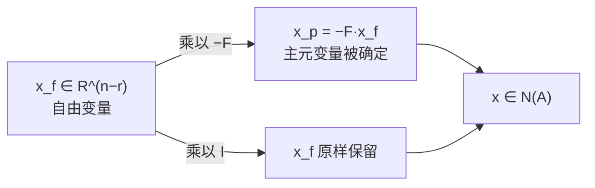

求任意 $m\times n$ 矩阵的零空间，是一条固定流水线：消元 → 行最简形 $R$ → 分清主元列 / 自由列 → 自由变量取单位值得特解 → 零空间 = 特解的全部线性组合。

## 例子与消元

$$
A=\begin{bmatrix}
1&2&2&2\\
2&4&6&8\\
3&6&8&10
\end{bmatrix}.
$$

肉眼可见第 2 列 = 2×第 1 列，第 3 行 = 第 1 行 + 第 2 行。消元只做行变换，**不改变零空间**（但会改变列空间）：

$$
U=\begin{bmatrix}
1&2&2&2\\
0&0&2&4\\
0&0&0&0
\end{bmatrix}.
$$

第 2 列在主元位置上是 0，跳过；主元只有 2 个，$\operatorname{rank}A=2$。

- **主元列**：第 1、3 列，对应主元变量 $x_1,x_3$。
- **自由列**：第 2、4 列，对应自由变量 $x_2,x_4$，可任意取值。

## 特解与零空间的基

规则：一个自由变量取 1、其余取 0，回代求主元变量。

- $x_2=1,x_4=0$：$x_1=-2,x_3=0$，

$$
s_1=\begin{bmatrix}-2\\1\\0\\0\end{bmatrix}.
$$

- $x_2=0,x_4=1$：$x_1=2,x_3=-2$，

$$
s_2=\begin{bmatrix}2\\0\\-2\\1\end{bmatrix}.
$$

$$
N(A)=\operatorname{span}\{s_1,s_2\},\qquad \dim N(A)=n-r=4-2=2.
$$

## 行最简形与 $[-F;I]$

继续消到 RREF：

$$
R=\begin{bmatrix}
1&2&0&-2\\
0&0&1&2\\
0&0&0&0
\end{bmatrix}.
$$

把主元列挪到前面，变量重排为 $(x_p\mid x_f)$：

$$
R'=\begin{bmatrix}I&F\\0&0\end{bmatrix},
\qquad
I=\begin{bmatrix}1&0\\0&1\end{bmatrix},\quad
F=\begin{bmatrix}2&-2\\0&2\end{bmatrix}.
$$

解 $R'x=0$：上半块 $Ix_p+Fx_f=0\Rightarrow x_p=-Fx_f$，下半块 $0=0$ 表示自由变量真的自由。于是

$$
x=\begin{bmatrix}x_p\\x_f\end{bmatrix}
=\begin{bmatrix}-F\\I\end{bmatrix}x_f.
$$

**$N=[-F;I]$ 就是「自由变量 → 解」这个线性映射的矩阵**，零空间是它的像。

**为什么是基**：

1. 无关：若 $Nc=0$，看下半块 $Ic=0\Rightarrow c=0$。
2. 张成：任何解都是 $Nx_f$，且 $\dim N(A)=n-r$，$n-r$ 个无关向量正好是基。

所以「自由变量取单位值」不是随意规定，而是**在参数空间取标准基，再把标准基推过映射**；$I$ 出现在自由变量一侧就是这件事的痕迹。

**换回原变量顺序**：按 $(x_1,x_3,x_2,x_4)$ 排列得到 $N$，再把第 2、3 行换回，正好是 $[s_1\ s_2]$。若主元恰好在前 $r$ 列，就不需要这一步。

**$F$ 与原矩阵的关系**：$F$ 记录列之间的线性关系。行变换保持这种关系，所以同样的系数对 $A$ 也成立：

$$
\begin{bmatrix}2\\4\\6\end{bmatrix}=2\begin{bmatrix}1\\2\\3\end{bmatrix},
\qquad
\begin{bmatrix}2\\8\\10\end{bmatrix}
=-2\begin{bmatrix}1\\2\\3\end{bmatrix}
+2\begin{bmatrix}2\\6\\8\end{bmatrix}.
$$

消元改变列向量本身，但保留列与列之间的线性关系——零空间正是这些关系系数的集合。

## 直观理解（3b1b）

- $A:\mathbb R^4\to\mathbb R^3$，4 个列向量落在 3 维空间里，必然相关；至少一个方向被压没。
- 秩 = 像的维数；零空间维数 = 被压到原点的方向数 $=n-r$。本例 $N(A)$ 是 $\mathbb R^4$ 中的二维平面。
- 列数 > 行数 ⇒ 必有非零零空间；宽矩阵（欠定方程组）总有非零解。
- 换基只改变坐标写法，零空间作为空间不变。

## 拓展延伸

- 秩-零化度：$\dim C(A)+\dim N(A)=n$。
- 下一讲 $Ax=b$：$b\in C(A)$ 时通解 = 一个特解 + $N(A)$ 的任意组合。
- 线性层 $W$ 列相关（秩亏）时，输入里有一整个子空间不影响输出，梯度里也有这个方向的不确定性。
- $A^{\mathsf T}A$ 奇异时正规方程无穷多解；加 L2 惩罚 $\lambda\|w\|^2$ 正好压住零空间方向。
- 数值上「主元是否为 0」要看数值秩：QR with pivoting / SVD，$10^{-16}$ 级主元视为 0。

## 术语

| 英文 | 中文 | 含义 |
| ---- | ---- | ---- |
| pivot / free column | 主元列 / 自由列 | 有主元 / 无主元 |
| free variable | 自由变量 | 可任意取值 |
| rank $r$ | 秩 | 主元个数 |
| special solution | 特解 | 一个自由变量取 1、其余取 0 |
| RREF $R$ | 行最简形 | 主元为 1 且上下清零，$[I\ F;0\ 0]$ |
| nullspace dimension | 零空间维数 | $n-r$ |

## 总结

求 $N(A)$：消元到 $R$，数主元得 $r$，分主元列 / 自由列，每个自由变量配一个单位赋值得到特解，零空间是特解的全部组合，维数 $n-r$。消元不改变零空间（但改变列空间），所以对任意矩阵都成立；$R=[I\ F;0\ 0]$ 时零空间基直接读作 $[-F;I]$。