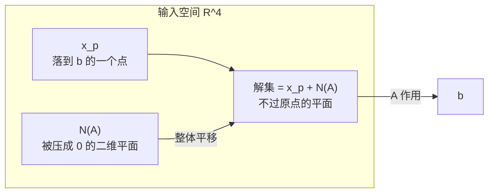

非齐次方程 $Ax=b$ 要回答三件事：有没有解、有几个、怎么写出全部解。流程是：增广消元 → 检查 $0=$ 非零 → 自由变量取 0 得特解 → 通解 = 特解 + 零空间。

## 增广矩阵与相容性

沿用 L7 的 $3\times4$ 矩阵，取 $b=(1,5,6)$：

$$
[A\mid b]=\left[\begin{array}{cccc|c}
1&2&2&2&1\\
2&4&6&8&5\\
3&6&8&10&6
\end{array}\right].
$$

对一般 $b$ 消元：

$$
\left[\begin{array}{cccc|c}
1&2&2&2&b_1\\
0&0&2&4&b_2-2b_1\\
0&0&0&0&b_3-b_2-b_1
\end{array}\right].
$$

最后一行左边全零，若 $b_3=b_1+b_2$ 则是 $0=0$，系统**相容**；否则 $0=$ 非零，无解。条件来自 $A$ 的第 3 行 = 第 1 行 + 第 2 行：**左边行之间有什么关系，右边 $b$ 就必须满足同样的关系**。

## 可解性的两种语言

| 语言 | 条件 | 直觉 |
| ---- | ---- | ---- |
| 列空间 | $b\in C(A)$ | $b$ 能写成列的组合 |
| 左零空间 | 若 $y^{\mathsf T}A=0$，则 $y^{\mathsf T}b=0$ | 行组合出零行 ⇒ 右端同样为零 |

本例 $y=(-1,-1,1)^{\mathsf T}$，$y^{\mathsf T}A=0$，$y^{\mathsf T}b=-1-5+6=0$。列空间说「$b$ 要在可达范围内」，左零空间说「$b$ 不能含到不了的方向分量」。

## 特解与通解

**特解**：令所有自由变量为 0，回代求主元变量。$x_2=x_4=0$：

$$
x_1+2x_3=1,\quad 2x_3=3
\Longrightarrow x_3=\tfrac32,\ x_1=-2,
$$

$$
x_p=\begin{bmatrix}-2\\0\\3/2\\0\end{bmatrix},\qquad Ax_p=b.
$$

自由列置零后，主元列构成列满秩的窄矩阵，消元后主元全非零，回代必有唯一解（前提是相容）。

**通解**：

$$
\boxed{x=x_p+x_n,\qquad x_n\in N(A).}
$$

证明一行：$A(x_p+x_n)=b+0=b$；反过来若 $x$ 也是解，$A(x-x_p)=0$，所以 $x-x_p\in N(A)$。

$$
x=\begin{bmatrix}-2\\0\\3/2\\0\end{bmatrix}
+c_1\begin{bmatrix}-2\\1\\0\\0\end{bmatrix}
+c_2\begin{bmatrix}2\\0\\-2\\1\end{bmatrix}.
$$

**$x_p$ 不能乘常数**：$A(3x_p)=3b\ne b$。$x_n$ 可任意缩放、相加；$x_p$ 只是一个代表点。解集不是子空间（不过原点），而是子空间平移后的**仿射子空间 / 陪集**。

## 行最简形一步写出通解

对 $[R\mid d]$（$R=[I\ F;0\ 0]$）：

$$
x=\underbrace{\begin{bmatrix}d\\0\end{bmatrix}}_{x_p}
+\underbrace{\begin{bmatrix}-F\\I\end{bmatrix}}_{N(A)}x_f.
$$

「$d$ 补齐零」就是「自由变量取 0」。$R$ 一出来，特解与零空间基同时到手。

## 秩决定一切

| 情形 | 形状 | $R$ | 解 |
| ---- | ---- | ---- | ---- |
| $r=m=n$ | 方阵满秩 | $I$ | 任意 $b$ 唯一解 |
| $r=n<m$ | 高瘦、列满秩 | $\begin{bmatrix}I\\0\end{bmatrix}$ | 0 或 1 个；$N(A)=\{0\}$ |
| $r=m<n$ | 矮胖、行满秩 | $\begin{bmatrix}I&F\end{bmatrix}$ | 任意 $b$ 都有解，无穷多 |
| $r<m$ 且 $r<n$ | 一般 | $\begin{bmatrix}I&F\\0&0\end{bmatrix}$ | 0 或无穷多 |

- 列满秩例：$A=\begin{bmatrix}1&3\\2&1\\6&1\\5&1\end{bmatrix}$（$4\times2,r=2$），无零空间，解至多一个。
- 行满秩例：上面的 $A^{\mathsf T}$（$2\times4,r=2$），对任意 $b$ 可解，但有 2 个自由变量 → 无穷多。
- 方阵满秩例：$A=\begin{bmatrix}1&2\\3&1\end{bmatrix}$，$R=I$，对任意 $b$ 唯一解。

**唯一性看 $r=n$（有没有自由变量），存在性看 $r=m$（有没有零行）。**

## 直观理解

解集是零空间的一个平移：先找任意一个落到 $b$ 的点 $x_p$，再加上被压到 0 的方向 $N(A)$——这些方向不改变落点，只把点沿平面滑动。

- 解集自由度 $=\dim N(A)=n-r$。
- 三种落点：$b\in C(A)$ 且 $N(A)=\{0\}$ → 唯一原像；$b\in C(A)$ 且零空间有厚度 → 一族原像；$b\notin C(A)$ → 无原像。

## 拓展延伸

- 秩判据：$Ax=b$ 有解 $\iff \operatorname{rank}([A\mid b])=\operatorname{rank}(A)$。
- 无解时改求最小二乘 $\min\|Ax-b\|^2$，正规方程 $A^{\mathsf T}Ax=A^{\mathsf T}b$ 总是相容，几何上是把 $b$ 投影到 $C(A)$。
- 无穷多解时取最小范数解 $x=A^{+}b$（伪逆），它落在行空间、与零空间正交。
- 线性层 $W$ 行不满秩时某些 $y$ 取不到；列不满秩时同一 $y$ 有无穷多 $x$，不敏感方向就是 $N(W)$。
- 过参数化网络有大量零方向，SGD 隐式选出最小范数附近的解。
- 数值上不能看精确 0，要用 SVD / QR with pivoting 与条件数。

## 术语

| 英文 | 中文 | 含义 |
| ---- | ---- | ---- |
| augmented matrix | 增广矩阵 | $[A\mid b]$，消元同步变换 |
| consistent | 相容 | 不出现 $0=$ 非零行 |
| particular solution $x_p$ | 特解 | 自由变量全取 0 |
| complete solution | 通解 | $x_p+N(A)$ |
| affine subspace / coset | 仿射子空间 / 陪集 | 子空间平移，一般不过原点 |
| full column / row rank | 列满秩 / 行满秩 | $r=n$ / $r=m$ |

## 总结

解 $Ax=b$：增广消元 → 看 $0=$ 非零判相容 → 自由变量取 0 得 $x_p$ → 通解 $x=x_p+x_n$。存在性由 $b\in C(A)$（等价于左零空间向量与 $b$ 正交）决定，自由度 $n-r$，唯一性只看 $r=n$。