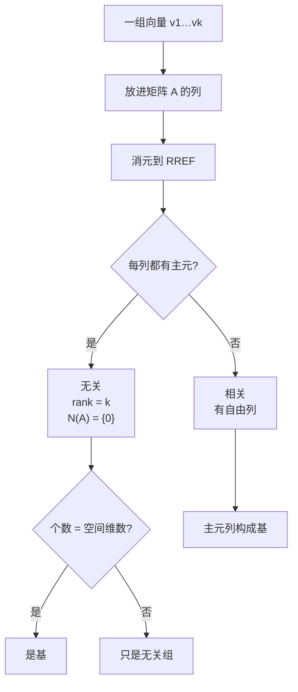

自由变量、秩、维数、张成在这里一次定义清楚，它们是一条链：

$$
\underbrace{\text{无关}}_{\text{没有冗余}}+\underbrace{\text{张成}}_{\text{够用}}
\Longrightarrow\underbrace{\text{基}}_{\text{不多不少}}
\Longrightarrow\underbrace{\text{维数}}_{\text{空间大小}}.
$$

关键事实：**$n>m$ ⇒ 零空间必有非零向量**。$n$ 个变量最多 $m$ 个主元，至少 $n-m$ 个自由变量，随便取非零值就得到非零解。

## 线性无关

$v_1,\dots,v_k$ **线性无关**，当且仅当

$$
c_1v_1+\cdots+c_kv_k=0\Longrightarrow c_1=\cdots=c_k=0.
$$

存在不全为零的系数使组合为 0，则**线性相关**。

- $v$ 与 $2v$ 相关。
- 一组向量里只要有零向量，立刻相关。
- 平面上任意三个向量必相关（$n>m$）。
- 例：$v_1=(2,1),v_2=(1,2),v_3=(3,0)$，解得 $c=(-2,1,1)$，验证 $-2v_1+v_2+v_3=0$。

**矩阵语言**（把向量放进列）：

$$
\text{列无关}\iff N(A)=\{0\}\iff\text{全为主元列}\iff\operatorname{rank}A=n,
$$

$$
\text{列相关}\iff N(A)\text{ 含非零向量}\iff\text{有自由列}\iff\operatorname{rank}A<n.
$$

「相关」的系数就是零空间里的向量：几何的「冗余方向」、代数的「非平凡零空间」、算法的「自由变量」是同一件事。

## 张成与基

- **张成**：$S$ 恰由 $v_1,\dots,v_k$ 的所有线性组合组成。所有组合自动构成子空间，所以它是包含这些向量的最小子空间。
- 列空间就是列向量张成的空间：$C(A)=\operatorname{span}\{a_1,\dots,a_n\}$。
- 相关 ⟺ 有冗余：某列是其他列的组合，删掉它张成不变。
- **基** = 线性无关 + 张成 = 「不多不少」；基不唯一，但同一空间的基向量个数相同。

**Strang 的坑**：

$$
A=\begin{bmatrix}1&2&3\\1&2&3\\2&5&8\end{bmatrix}.
$$

第三列 $(3,3,8)$ 看似凸出平面，其实

$$
-(1,1,2)+2(2,2,5)=(3,3,8),
$$

仍在平面里。更快的判法：第 1、2 行完全相同，方阵不可逆，列必相关。**判列的无关性可以借行来看**——这就是 L10 的「行秩 = 列秩」。

## 判定基的算法

把候选向量放进列，消元：

- 全是主元列（无自由列）→ 无关，秩 = 向量个数。
- 若又张成目标空间（个数等于维数）→ 是基。
- 特例：$n$ 个向量是 $\mathbb R^n$ 的基 $\iff n\times n$ 矩阵可逆。

## 维数

**所有基的向量个数相同**。证明（换出论证）：设两组基有 $k<\ell$ 个，把 $\ell$ 个向量用前一组基表示，得 $k\times\ell$ 系数矩阵；$n>m$ ⇒ 有非零零空间向量 ⇒ $\ell$ 个向量相关，矛盾。故 $k=\ell$。

这个共同个数就是**维数** $\dim S$。$\dim\mathbb R^n=n$；$\mathbb R^3$ 中过原点平面维数 2，直线 1，$\{0\}$ 为 0。**要算维数，就造一组基再数。**

## 例：同一个矩阵的列空间与零空间

$$
A=\begin{bmatrix}1&2&3&1\\1&1&2&1\\1&2&3&1\end{bmatrix}
\quad(c_1,c_2,c_3,c_4).
$$

- $c_3=c_1+c_2$，$c_4=c_1$，四列相关，不是 $C(A)$ 的基。
- 消元后主元在第 1、2 列：

$$
R=\begin{bmatrix}1&0&1&1\\0&1&1&0\\0&0&0&0\end{bmatrix}.
$$

**原矩阵的主元列就是 $C(A)$ 的基**，$\operatorname{rank}A=2=\dim C(A)$。其他基如 $\{c_1,c_3\}$、$\{c_2,c_4\}$ 也行。

- 零空间：$Rx=0$ 给 $x_1=-x_3-x_4,\ x_2=-x_3$，

$$
s_1=\begin{bmatrix}-1\\-1\\1\\0\end{bmatrix},\qquad
s_2=\begin{bmatrix}-1\\0\\0\\1\end{bmatrix},
$$

$\dim N(A)=2=n-r$。

**知道维数，无关就够了**：$C(A)$ 只有 2 维，两个无关向量必张成它。一般地，$\dim S=d$ 时，$d$ 个无关向量自动是基；$d$ 个张成 $S$ 的向量自动无关。

## 直观理解（3b1b）

- 基 = 坐标系。每个向量在基下有唯一坐标；唯一性来自无关性。
- 标准基只是最方便的一套刻度，不是唯一或更正确的；换基就是换视角。
- 维数 = 独立方向的个数。空间里最多 $d$ 个无关方向，再多必落在已有方向的张成里。

基是最小张成组，也是最大无关组；维数就是这个「刚好」的大小。

## 拓展延伸

- 换基：$[x]_C=P_{C\leftarrow B}[x]_B$，矩阵语言是相似变换 $P^{-1}AP$。
- 基的选择影响数值稳定性：几乎平行的基条件数大，正交基条件数为 1，这是 QR/SVD 要造正交基的原因。
- 秩-零化度：$\dim C(A)+\dim N(A)=n$，下一讲与行空间、左零空间拼成完整图景。
- 特征共线 ⇔ 设计矩阵列不满秩 ⇔ 参数不唯一；岭回归在冗余方向上选最小范数解。
- 表示坍缩：神经网络表示的有效秩远小于名义维数；PCA/SVD 则是按方差排序选正交基。

## 术语

| 英文 | 中文 | 含义 |
| ---- | ---- | ---- |
| linearly independent / dependent | 线性无关 / 相关 | 只有全零系数 / 存在非零系数组合出 0 |
| span | 张成 | 所有线性组合构成的最小子空间 |
| basis | 基 | 无关 + 张成 |
| dimension | 维数 | 任意一组基的向量个数 |
| standard basis | 标准基 | $e_1,\dots,e_n$ |
| coordinates $[x]_B$ | 坐标 | 向量在基 $B$ 下的系数 |

## 总结

无关 = 零空间平凡；张成 = 空间由所有组合填满；基 = 无关 + 张成；维数 = 任意基的向量个数。判定统一落到「放进列 → 消元 → 数主元」：列空间维数是秩，零空间维数是 $n-r$。