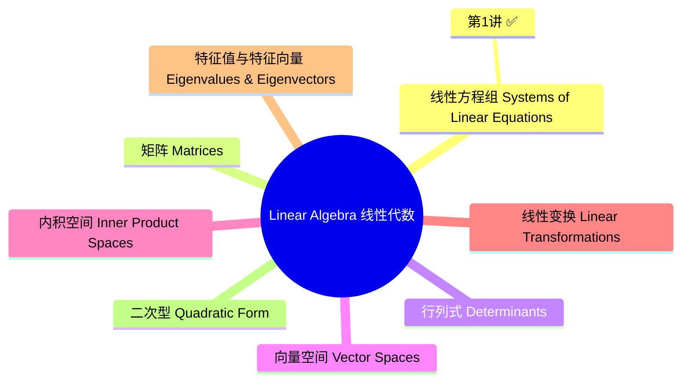

# Linear Algebra(线性代数)主页

> 课程:Applied Mathematical Modelling 1 — Elementary Linear Algebra

## 栏目导航

- [[Linear Algebra/学习笔记/学习笔记|学习笔记]] — 知识点笔记(默认归这里)
- [[Linear Algebra/Assignments/Assignments|Assignments]] — 涉及大量题目的内容

## 课程总导图(整体架构)



## 今日学习(2026-10-11)

1. **第1讲 线性方程组(Systems of Linear Equations)** — 线性方程与方程组的定义、解的唯一/无/无穷三种情况、矩阵表示(系数矩阵与增广矩阵)、等价变换与初等行变换、高斯消元到行阶梯形、高斯-约当到行最简形、齐次方程组。是整个线性代数的入口。

**统计:2026-10-11 完成 1 个章节的学习。**

### 2026-10-11 大纲 / 结构树

```
Linear Algebra(2026-10-11)
└── 第1讲 线性方程组 Systems of Linear Equations
    ├── 必要性     为什么要有线性方程组(历史 / 意义)
    ├── 主要内容   定义 → 矩阵表示 → 初等行变换 → 高斯消元 / 高斯-约当 → 齐次方程组
    ├── 直观理解   空间视角(超平面交点 / 消元 = 钉死交点 / 自由变量 = 可滑维度)
    └── 拓展延伸   与 AI / 计算机(numpy·torch 的 solve、最小二乘、神经网络线性层)
```

## 思考栏(当日总结)

- 今日总结由你填写:`[[总结-2026-10-11]]`(待创建)
