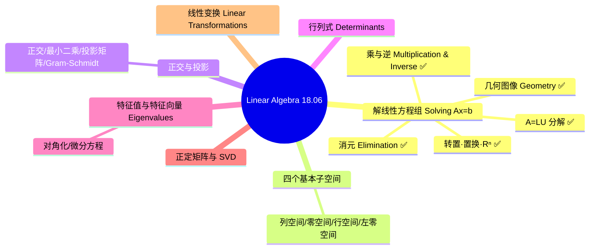

# Linear Algebra(线性代数)主页

> 课程:**MIT 18.06 Linear Algebra(Gilbert Strang, OCW)** —— 2026-10-20 起改用此课(原「Elementary Linear Algebra」阶段见下方历史)。

## 栏目导航

- [[Linear Algebra/学习笔记/学习笔记|学习笔记]] — 知识点笔记(四段式,默认归这里)
- [[Linear Algebra/Assignments/Assignments|Assignments]] — 涉及大量题目的内容
- [[Linear Algebra/Ref/1. The Geometry of Linear Equations|Ref · 18.06 字幕转写]] — Strang 18.06 视频字幕(原始材料,lecture 1~5)

## 课程总导图(整体架构 · MIT 18.06)



## 今日学习(2026-10-22)

**继续 18.06 第 6 讲 + 关联 3b1b 直观材料**:

1. **L6 列空间与零空间 Column Space and Nullspace** — 列空间 C(A)(Ax=b 可解 ⟺ b∈C(A))、零空间 N(A)(Ax=0 的解)、子空间并集/交集判断、描述子空间的两种方式(给向量取组合 vs 给方程约束)

2. **3b1b 关联(只关联已学部分)** — 「Essence of linear algebra」第 1~5、7 章 + Subspaces 反向链接到对应 L1/L3/L5/L6 笔记;第 6 章(行列式)主课还没讲到,暂不处理

**统计:2026-10-22 新增 L6 笔记 + 7 个 3b1b clip 反链到主课笔记。**

---

## 今日学习(2026-10-20)

**切换到 MIT 18.06(Strang)**。已抓取 lecture 1~5 字幕转写入 `Ref/`:

1. **L1 线性方程的几何 The Geometry of Linear Equations** — 行图像(直线/平面交点)vs 列图像(列向量线性组合)、Ax=b 两种解读、奇异 vs 可逆
2. **L2 消元 Elimination with Matrices** — 消元成功/失败条件、消元矩阵 E、矩阵乘法、增广矩阵
3. **L3 乘与逆 Multiplication and Inverse Matrices** — 乘法四视角、逆矩阵、Gauss-Jordan 求逆
4. **L4 A=LU 分解 Factorization into A=LU** — 消元因式分解、消元成本 n³/3、置换矩阵
5. **L5 转置·置换·Rⁿ 空间 Transposes, Permutations, Spaces Rⁿ** — 置换、转置、对称矩阵、向量空间与子空间

外加 `An Overview of Key Ideas`(课程总览)+ `Rec 1`(18.085 习题课:线代核心思想)。

**统计:2026-10-20 抓取 18.06 前 5 讲字幕,并整理成 L1~L5 四段式笔记(旧「Elementary Linear Algebra」第 1~3 讲已并入并归档)。**

---

## 历史(原「Elementary Linear Algebra」阶段,2026-10-11)

### 今日学习(2026-10-11)

1. **第1讲 线性方程组(Systems of Linear Equations)** — 线性方程与方程组的定义、解的唯一/无/无穷三种情况、矩阵表示(系数矩阵与增广矩阵)、等价变换与初等行变换、高斯消元到行阶梯形、高斯-约当到行最简形、齐次方程组。是整个线性代数的入口。
2. **第2讲 矩阵运算(Operations with Matrices)** — 矩阵分类(方阵/三角/对角/单位/零/行/列)、矩阵算术(数乘/加法/乘法)、矩阵乘法三大反直觉性质(不可交换/零因子/无消去律)、转置与对称矩阵;配 manim 动画演示「矩阵乘法不可交换」。
3. **第3讲 矩阵的逆(The Inverse of a Matrix)** — 可逆/奇异的定义、逆的唯一性、高斯-约当消元求逆 [A|I]→[I|A⁻¹]、乘积求逆反序 (AB)⁻¹=B⁻¹A⁻¹、可逆矩阵 6 条性质、用逆矩阵解方程组 x=A⁻¹b;配 manim 动画演示「可逆 vs 奇异矩阵」。

**统计:2026-10-11 完成 3 个章节的学习。**

### 2026-10-11 大纲 / 结构树

```
Linear Algebra(2026-10-11 · 原课程阶段)
├── 第1讲 线性方程组 Systems of Linear Equations
│   ├── 必要性     为什么要有线性方程组(历史 / 意义)
│   ├── 主要内容   定义 → 矩阵表示 → 初等行变换 → 高斯消元 / 高斯-约当 → 齐次方程组
│   ├── 直观理解   空间视角(超平面交点 / 消元 = 钉死交点 / 自由变量 = 可滑维度)
│   └── 拓展延伸   与 AI / 计算机(numpy·torch 的 solve、最小二乘、神经网络线性层)
├── 第2讲 矩阵运算 Operations with Matrices
│   ├── 必要性     给矩阵定义算术(消元的真正语言)
│   ├── 主要内容   矩阵分类 → 数乘/加法/乘法 → 三大反直觉性质 → 转置/对称
│   ├── 直观理解   矩阵 = 变换,乘法 = 复合,转置 = 翻转(配 manim 动画)
│   └── 拓展延伸   GEMM/AI 算力、backprop 转置、对称矩阵、AlphaTensor
└── 第3讲 矩阵的逆 The Inverse of a Matrix
    ├── 必要性     矩阵的「除法」与「撤销变换」
    ├── 主要内容   可逆/奇异 → 逆唯一 → 高斯-约当求逆 → (AB)⁻¹=B⁻¹A⁻¹ → 6 性质 → 解方程组
    ├── 直观理解   逆 = 撤销;可逆 ⟺ 基向量不共线,奇异 = 压扁(配 manim 动画)
    └── 拓展延伸   求逆的数值实践、协方差求逆、归一化流、逆运动学、岭回归
```

## 思考栏(当日总结)

- 今日总结由你填写:`[[总结-2026-10-11]]`(待创建)
