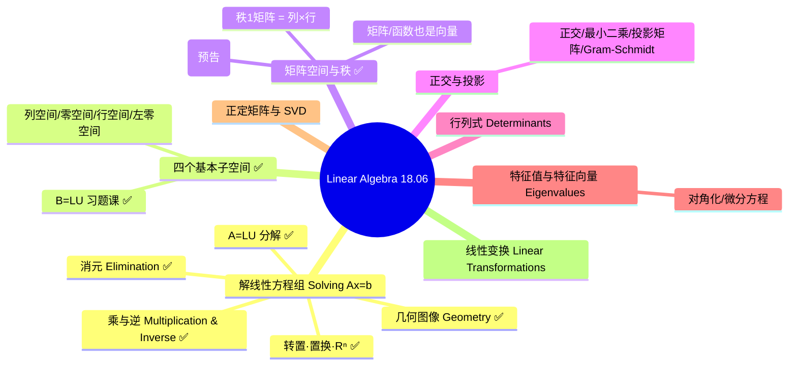

# Linear Algebra(线性代数)主页

> 课程:**MIT 18.06 Linear Algebra(Gilbert Strang, OCW)** —— 2026-10-20 起改用此课(原「Elementary Linear Algebra」阶段见下方历史)。

## 栏目导航

- [[Linear Algebra/学习笔记/学习笔记|学习笔记]] — 知识点笔记(四段式,默认归这里)
- [[Linear Algebra/Assignments/Assignments|Assignments]] — 涉及大量题目的内容
- [[Linear Algebra/Ref/1. The Geometry of Linear Equations|Ref · 18.06 字幕转写]] — Strang 18.06 视频字幕(原始材料,lecture 1~10 + 习题课)

## 课程总导图(整体架构 · MIT 18.06)



## 今日学习(2026-10-25)

**18.06 第 8~10 讲正式笔记补齐(10-24 先过一遍,今天按四段式成文):**

1. **L8 求解 Ax=b:行最简形与完整解** — 增广矩阵消元 → 相容性($0=$ 非零行 / $b\in C(A)$ / 左零空间条件 $y^{\mathsf T}b=0$);自由变量取 0 得特解 $x_p=(-2,0,3/2,0)$;通解 $x=x_p+x_n$,解集是零空间的平移(仿射子空间、不过原点);$[I\ F]$ 一步写出特解与基;秩的四种情形表($r=m=n$ 唯一 / $r=n<m$ 0 或 1 / $r=m<n$ 恒有且无穷多 / 一般 0 或无穷多)
2. **L9 线性无关、基与维数** — $n>m$ ⇒ 零空间非平凡(至少 $n-m$ 个自由变量);无关 ⇔ $N(A)=\{0\}$ ⇔ 全主元列;$k$ 个向量张成 = 最小子空间;基 = 无关 + 张成(不多不少),$\mathbb R^n$ 中 $n$ 个向量是基 ⇔ 矩阵可逆;所有基向量数相同 → 维数;Strang 的 $(3,3,8)$ 纠错:看行(两行相同)即知三列相关;$\dim C(A)=r$、$\dim N(A)=n-r$
3. **L10 四个基本子空间** — $C(A)\subseteq\mathbb R^m$、$N(A)\subseteq\mathbb R^n$、行空间 $C(A^{\mathsf T})$、左零空间 $N(A^{\mathsf T})$;维数 $r,r,n-r,m-r$;四组基的算法(原矩阵主元列 / $R$ 的非零行 / 特解 / $E$ 的零行);$C(A^{\mathsf T})\perp N(A)$、$C(A)\perp N(A^{\mathsf T})$,两个直和分解;$A$ 在行空间与列空间之间是同构、零空间压成 0;矩阵空间($3\times3$:上三角 6 维 / 对称 6 维 / 对角 3 维)
4. **Ref 反链** — 第 8~10 讲字幕与 18.06SC 习题课已加「对应主课笔记」双向链接
5. **L4 A=LU 补具体例子(按反馈「没看出有什么用」)** — §2.1 完整数字算例(乘数 3/2、$LU$ 逐行验算、$E_{32}E_{21}$ 多出 6);§5 同一副 $L,U$ 解两个 $b$(前代 + 回代)、$n=1000$ / 100 个 $b$ 的成本对比(约 77 倍)、$PA=LU$ 数字例、小主元 3 位精度的反例;§6 $\det A=\pm\prod u_{ii}$、求逆、Cholesky / 多输出回归、`lu_factor` + `lu_solve` 代码写法
6. **L10 §6 扩写(按追问「矩阵空间有什么价值、维度怎么算」)** — 摊平 $\operatorname{vec}$ 与 $E_{ij}$ 基;维数表扩到 9 行(对称 6 / 反对称 3 / 严格上三角 3 / 迹零 8 / 对称迹零 5);用维数公式与秩-零化度算维数;$SO(3)=9-6=3$、$SE(3)=6$ 与姿态自由度的对应;价值 7 条(Sylvester 方程化成 $n^2$ 维系统、参数计数、几何自由度、低秩 $r(m+n-r)$、Frobenius 内积、结构化求解、子空间→代数)
7. **L10 习题课 §4 补「定义 vs. 读 $E$」(按追问「左零空间不就是解 $B^{\mathsf T}y=0$ 吗,为什么从 $L^{-1}$ 入手」)** — 讲清定义($B^{\mathsf T}$,问行组合)与算法(读 $E$ 零行)是同一问题的两种解法:$EB=U$ 按行分块一行证明、$E$ 记操作而 $L$ 记乘数、代价对比(直接解 $O(n^3)$ vs 读 $E$ 零额外 / 单行 $L^{\mathsf T}y=e_i$ 仅 $O(n^2)$)、何时改用 SVD / 直接解
8. **L11 矩阵空间·秩 1·小世界图** — 矩阵当向量($M_{3\times3}$ 是 9 维,$E_{ij}$ 基);对称 6 / 上三角 6 / 交 = 对角 3 / 和 = 全体 9,维数公式 $\dim(S+U)=\dim S+\dim U-\dim(S\cap U)$;$y''+y=0$ 解空间 2 维($\cos,\sin$ 是基,算子零空间);秩 1 矩阵 $=uv^{\mathsf T}$、秩 $r$ = $r$ 块积木($A=CR$)、秩 1 集合不是子空间;$R^4$ 分量和为零 = $[1\ 1\ 1\ 1]$ 的零空间(四空间维数 3/1/1/0,零维基为空集);图 = 节点 + 边,关联矩阵留到下一讲
9. **L11 习题课 矩阵空间的判定与基** — 「$x_0\in N(A)$」翻译成 $Ax_0=0$ ⇒ 每行满足 $2a+b+c=0$;子空间三条验证;两行各 2 个自由参数 ⇒ 4 个模板基、维数 4;线性映射 $\varphi(A)=Ax_0$ 的核($\operatorname{rank}2$、$mn-m$ 一般式);反例:$\{A:[2,1]^{\mathsf T}\in C(A)\}$ 零矩阵不在其中 ⇒ 不是子空间(齐次 vs 存在量词)

**统计:2026-10-25 新增 L8 / L9 / L10 / L11 四段式笔记 4 篇 + L11 习题课 1 篇 + L4 补例 3 节 + L10 §6 扩写 + L10 习题课 §4「定义 vs. 读数」+ 7 个 Ref clip 反链 + 编号总览与标签聚类更新;顺带修正 L1~L4 的 L5 双链名。**

---

## 今日学习(2026-10-24)

**18.06 第 8~10 讲 + 习题课(先简单过一遍,正式笔记 2026-10-25 补齐):**

1. **L8 求解 Ax=b** — 行最简形 $R$、可解性条件、通解 = 一个特解 + 零空间
2. **L9 独立·基·维数** — 线性无关、基、维数,为「秩 = 列空间的维数」补上定义
3. **L10 四个基本子空间** — $C(A)$、$N(A)$、$C(A^{\mathsf T})$、$N(A^{\mathsf T})$ 的维数与两组正交关系
4. **18.06SC 习题课 · 四个基本子空间的计算($B=LU$)** — 不乘开 $B$,直接从 $L$、$U$、$L^{-1}$ 读出四个子空间的基与维数;详见 [[L10 四个基本子空间的计算 · 习题课]]
5. **3b1b 第 15 章(特征值快速技巧)** — 字幕已存,待主课讲到特征值时再正式关联

**统计:2026-10-24 新增 L10 习题课四段式笔记 1 篇(含三角矩阵的维度作用)+ L8~L10 / 习题课 / 3b1b 第 15 章 Ref 素材。**

---

## 今日学习(2026-10-23)

**18.06 第 7 讲 + 习题课 + 3b1b 直观材料:**

1. **L7 求解 Ax=0:主变量与特解** — 消元到行最简形 $R$(不改变零空间、但改变列空间)、主元列 / 自由列、自由变量取单位值回代得特解、$N(A)$ = 特解的全部组合、$\dim N(A)=n-r$(本例 $4-2=2$)、$R=[I\ F;0\ 0]$ 直接读出特解
2. **18.06SC Rec · Solving Ax=0** — 用 $x-5y+2z=0$ 讲「一个约束 → 维数减一 → 平面」;$Ax=b$ 的解集是 $Ax=0$ 解集的平移(非齐次解集不过原点)
3. **3b1b 关联** — 第 8 章(非方阵 = 维数不对等的变换)反链 L6 / L7;第 13 章(换基)作直观预习,待 L9~L10「基与维数」再正式关联

**统计:2026-10-23 新增 L7 四段式笔记 + 4 个 Ref clip 反链(第 7 讲 / 18.06SC / 3b1b 第 8、13 章)。**

---

## 今日学习(2026-10-22)

**继续 18.06 第 6 讲 + 关联 3b1b 直观材料**:

1. **L6 列空间与零空间 Column Space and Nullspace** — 列空间 C(A)(Ax=b 可解 ⟺ b∈C(A))、零空间 N(A)(Ax=0 的解)、子空间并集/交集判断、描述子空间的两种方式(给向量取组合 vs 给方程约束)

2. **3b1b 关联(只关联已学部分)** — 「Essence of linear algebra」第 1~5、7 章 + Subspaces 反向链接到对应 L1/L3/L5/L6 笔记;第 6 章(行列式)主课还没讲到,暂不处理

**统计:2026-10-22 新增 L6 笔记 + 7 个 3b1b clip 反链到主课笔记。**

---

## 今日学习(2026-10-20)

**切换到 MIT 18.06(Strang)**。已抓取 lecture 1~5 字幕转写入 `Ref/`:

1. **L1 线性方程的几何 The Geometry of Linear Equations** — 行图像(直线/平面交点)vs 列图像(列向量线性组合)、Ax=b 两种解读、奇异 vs 可逆
2. **L2 消元 Elimination with Matrices** — 消元成功/失败条件、消元矩阵 E、矩阵乘法、增广矩阵
3. **L3 乘与逆 Multiplication and Inverse Matrices** — 乘法四视角、逆矩阵、Gauss-Jordan 求逆
4. **L4 A=LU 分解 Factorization into A=LU** — 消元因式分解、消元成本 n³/3、置换矩阵
5. **L5 转置·置换·Rⁿ 空间 Transposes, Permutations, Spaces Rⁿ** — 置换、转置、对称矩阵、向量空间与子空间

外加 `An Overview of Key Ideas`(课程总览)+ `Rec 1`(18.085 习题课:线代核心思想)。

**统计:2026-10-20 抓取 18.06 前 5 讲字幕,并整理成 L1~L5 四段式笔记(旧「Elementary Linear Algebra」第 1~3 讲已并入并归档)。**

---

## 历史(原「Elementary Linear Algebra」阶段,2026-10-11)

### 今日学习(2026-10-11)

1. **第1讲 线性方程组(Systems of Linear Equations)** — 线性方程与方程组的定义、解的唯一/无/无穷三种情况、矩阵表示(系数矩阵与增广矩阵)、等价变换与初等行变换、高斯消元到行阶梯形、高斯-约当到行最简形、齐次方程组。是整个线性代数的入口。
2. **第2讲 矩阵运算(Operations with Matrices)** — 矩阵分类(方阵/三角/对角/单位/零/行/列)、矩阵算术(数乘/加法/乘法)、矩阵乘法三大反直觉性质(不可交换/零因子/无消去律)、转置与对称矩阵;配 manim 动画演示「矩阵乘法不可交换」。
3. **第3讲 矩阵的逆(The Inverse of a Matrix)** — 可逆/奇异的定义、逆的唯一性、高斯-约当消元求逆 [A|I]→[I|A⁻¹]、乘积求逆反序 (AB)⁻¹=B⁻¹A⁻¹、可逆矩阵 6 条性质、用逆矩阵解方程组 x=A⁻¹b;配 manim 动画演示「可逆 vs 奇异矩阵」。

**统计:2026-10-11 完成 3 个章节的学习。**

### 2026-10-11 大纲 / 结构树

```
Linear Algebra(2026-10-11 · 原课程阶段)
├── 第1讲 线性方程组 Systems of Linear Equations
│   ├── 必要性     为什么要有线性方程组(历史 / 意义)
│   ├── 主要内容   定义 → 矩阵表示 → 初等行变换 → 高斯消元 / 高斯-约当 → 齐次方程组
│   ├── 直观理解   空间视角(超平面交点 / 消元 = 钉死交点 / 自由变量 = 可滑维度)
│   └── 拓展延伸   与 AI / 计算机(numpy·torch 的 solve、最小二乘、神经网络线性层)
├── 第2讲 矩阵运算 Operations with Matrices
│   ├── 必要性     给矩阵定义算术(消元的真正语言)
│   ├── 主要内容   矩阵分类 → 数乘/加法/乘法 → 三大反直觉性质 → 转置/对称
│   ├── 直观理解   矩阵 = 变换,乘法 = 复合,转置 = 翻转(配 manim 动画)
│   └── 拓展延伸   GEMM/AI 算力、backprop 转置、对称矩阵、AlphaTensor
└── 第3讲 矩阵的逆 The Inverse of a Matrix
    ├── 必要性     矩阵的「除法」与「撤销变换」
    ├── 主要内容   可逆/奇异 → 逆唯一 → 高斯-约当求逆 → (AB)⁻¹=B⁻¹A⁻¹ → 6 性质 → 解方程组
    ├── 直观理解   逆 = 撤销;可逆 ⟺ 基向量不共线,奇异 = 压扁(配 manim 动画)
    └── 拓展延伸   求逆的数值实践、协方差求逆、归一化流、逆运动学、岭回归
```

## 思考栏(当日总结)

- 今日总结由你填写:`[[总结-2026-10-11]]`(待创建)
