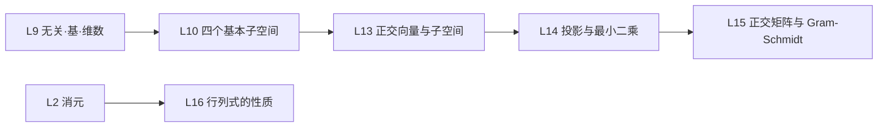

课程：MIT 18.06 Linear Algebra（Gilbert Strang, OCW）。

## 课程材料

- [[Linear Algebra/学习笔记/学习笔记|学习笔记]] — L1~L16 知识点
- [[Linear Algebra/一页纸|一页纸]] — 16 条命题与推理链，复习只看这一张
- [[Linear Algebra/Ref/1. The Geometry of Linear Equations|Ref · 18.06 字幕]] — lecture 1~18、Quiz 1 Review、Exam 1 与习题课原始材料
  - lecture 14~18：[[14. Orthogonal Vectors and Subspaces]] · [[15. Projections onto Subspaces]] · [[16. Projection Matrices and Least Squares]] · [[17. Orthogonal Matrices and Gram-Schmidt]] · [[18. Properties of Determinants]]
  - 习题课：[[Orthogonal Vectors and Subspaces]] · [[Projection into Subspaces]] · [[Least Squares Approximation]] · [[Gram-Schmidt Orthogonalization]] · [[Properties of Determinants]]
- Ref · 数学不难（直观视频摘录）：[[9. 三分钟，玩转，格拉姆-施密特正交化  数学不难：线性代数|9 Gram-Schmidt]] · [[10. 线性回归：投影视角直观解读  数学不难：线性代数|10 线性回归]] · [[11 特征值分解的几何本质 The Geometry of Eigenvalue Decomposition  数学不难：线性代数 Linear Algebra Made Easy|11 特征值分解]] · [[12. 主成分分析：看见数据的主方向   Principal Component Analysis Seeing the Principal Directions  数学不难：线性代数|12 PCA]] · [[13.1  二次型：矩阵如何“塑造”曲面？ Quadratic Form How a Matrix Shapes Geometry  数学不难：线性代数 Linear Algebra|13.1 二次型]]
- [[Linear Algebra/Assignments/Assignments|Assignments]] — 题目类内容

## 待整理原始材料

- [[13. Quiz 1 Review]] · [[Exam 1 Problem Solving]] — 复习与习题课材料，暂不单独成笔记
- 数学不难 11 特征值分解、12 PCA、13.1 二次型 — 对应 L15 之后或拓展内容，暂不单独成笔记

## 笔记链接

- [[L1 线性方程的几何]] — 行图像 vs 列图像；线性组合能否到达 $b$，奇异判定。
- [[L2 消元]] — 消元、主元与回代；消元矩阵 $E$、置换 $P$、RREF。
- [[L3 矩阵乘法与逆]] — 矩阵乘法五种视角；逆、奇异判据、Gauss-Jordan。
- [[L4 A=LU 分解]] — $A=LU$、乘数账本、$n^3/3$、$PA=LU$。
- [[L5 转置·置换·向量空间]] — 置换、转置、对称；向量空间与列空间。
- [[L6 列空间与零空间]] — 可解性与子空间的两种描述。
- [[L7 求解Ax=0主变量与特解]] — 零空间算法；主元/自由变量、特解、$[-F;I]$。
- [[L8 求解Ax=b]] — 增广消元；通解 = 特解 + 零空间；秩的四种情形。
- [[L9 线性无关·基·维数]] — 无关、张成、基、维数。
- [[L10 四个基本子空间]] — 维数 $r,r,n-r,m-r$；正交补；矩阵空间；$B=LU$ 习题课。
- [[L11 矩阵空间·秩1·小世界图]] — 矩阵与函数当向量；秩 1 积木；图与小世界；矩阵空间判定习题课。
- [[L12 图·网络·关联矩阵]] — 等电位、KCL、树、回路、欧拉公式、拉普拉斯矩阵；读图习题课。
- [[L13 正交向量与子空间]] — 点积判正交、勾股定理、子空间正交、四个基本子空间的正交补、$A^{\mathsf T}A$ 的秩与可逆性。
- [[L14 投影与最小二乘]] — 投影到直线/子空间、投影矩阵、正规方程、拟合直线、误差正交与最小性。
- [[L15 正交矩阵与 Gram-Schmidt]] — $Q^{\mathsf T}Q=I$、$Q^{\mathsf T}=Q^{-1}$、$P=QQ^{\mathsf T}$、$\hat x=Q^{\mathsf T}b$、Gram-Schmidt、$A=QR$。
- [[L16 行列式的性质]] — 三条定义性质推出十条、消元求行列式、四道习题、斜对称矩阵补充。

## 依赖图

## 当前进度

- 当前：L16 行列式的性质笔记完成；lecture 18 与行列式习题课已整理进 L16。

## 掌握度

状态词：待自测 / 能复述 / 能做对 / 易错。

| 讲次 | 笔记 | 掌握 | 错题 |
| --- | --- | --- | --- |
| L1~L12 | 完成 | 待自测 | 0 |
| L13 正交向量与子空间 | 完成 | 待自测 | 0 |
| L14 投影与最小二乘 | 完成 | 待自测 | 0 |
| L15 正交矩阵与 Gram-Schmidt | 完成 | 待自测 | 0 |
| L16 行列式的性质 | 完成 | 待自测 | 0 |

错题记在 [[错题本]]，每条指到具体小节；每日题目见 [[题目/题目]]。

## 下一步

- L17：行列式公式与代数余子式（lecture 19），Ref 尚无材料，待补。
