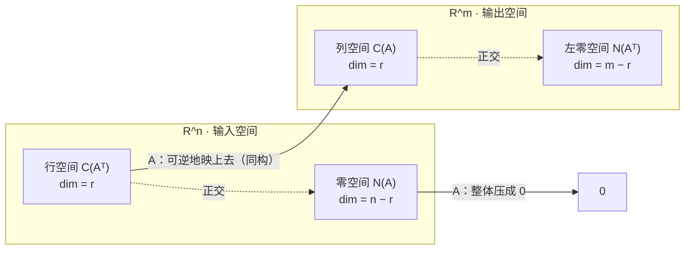

---
tags:
  - 线性代数LinearAlgebra
  - 四个基本子空间FourSubspaces
  - 列空间ColumnSpace
  - 零空间NullSpace
  - 行空间RowSpace
  - 左零空间LeftNullSpace
  - 秩Rank
  - 维数Dimension
  - 正交Orthogonality
---

# 四个基本子空间 The Four Fundamental Subspaces · 18.06 L10

**时间:** 2026-10-25
**标签:** #线性代数LinearAlgebra #四个基本子空间FourSubspaces #列空间ColumnSpace #零空间NullSpace #行空间RowSpace #左零空间LeftNullSpace #秩Rank #维数Dimension #正交Orthogonality
**关联:** [[L6 列空间与零空间]]（前两个空间的定义）· [[L7 求解Ax=0主变量与特解]]（特解 = 零空间的基）· [[L8 求解Ax=b]]（可解性与秩的四种情形）· [[L9 线性无关·基·维数]]（基与维数的定义）· [[L10 四个基本子空间的计算 · 习题课]]（$B=LU$ 直接读基）· [[L3 矩阵乘法与逆]]（Gauss-Jordan 求逆，$E$ 的来源）

## 必要性（为什么要有这一章）

到这里我们已经零散地见过两个空间：**列空间** $C(A)$（L6）和**零空间** $N(A)$（L6–L7），又刚学会用**基和维数**给空间「量尺寸」（L9）。这一讲把它们拼成一张完整的图：

- 一个矩阵 $A$ 天然带着**四个**子空间，不是两个；
- 四个空间的**维数只由秩 $r$ 决定**，基可以用一次消元全部读出；
- 两对空间之间是**正交关系**，合起来正好铺满输入空间和输出空间。

这被称为线性代数的**基本定理**（Fundamental Theorem of Linear Algebra）。Strang 说它是「半个线性代数的全部内容」。

开场还有一段著名的**纠错**：L9 里 Strang 说 $(3,3,8)$ 与 $(1,1,2),(2,2,5)$ 无关，学生指出矩阵

$$
\begin{bmatrix}1&2&3\\1&2&3\\2&5&8\end{bmatrix}
$$

有**两行相同**，所以不可逆、三列必相关。这个错误正好引出本讲的主题：**行能告诉你列的信息**——行空间和列空间的维数一样。

## 主要内容

### 1. 四个空间的定义

设 $A$ 是 $m\times n$ 矩阵：

| 空间 | 记号 | 定义 | 住在哪 |
| ---- | ---- | ---- | ---- |
| 列空间 | $C(A)$ | $A$ 各列的全体线性组合 | $\mathbb R^m$ |
| 零空间 | $N(A)$ | $\{x:Ax=0\}$ | $\mathbb R^n$ |
| 行空间 | $C(A^{\mathsf T})$ | $A$ 各行的全体组合（= $A^{\mathsf T}$ 的列空间） | $\mathbb R^n$ |
| 左零空间 | $N(A^{\mathsf T})$ | $\{y:A^{\mathsf T}y=0\}$ | $\mathbb R^m$ |

- **行空间**其实就是「行的组合」，只是行向量横着写不方便，转置一下让它站起来——没有新数学，只是换记号。
- **左零空间**的名字来自

$$
A^{\mathsf T}y=0
\;\overset{\text{转置}}{\Longleftrightarrow}\;
y^{\mathsf T}A=0^{\mathsf T},
$$

$y$ 从**左边**乘 $A$。它收集的是「行的哪些组合给出零行」，也就是行与行之间的线性关系。

### 2. 维数：一张表定天下

设 $\operatorname{rank}A=r$。四个空间的维数是：

$$
\boxed{
\dim C(A)=r,\quad
\dim C(A^{\mathsf T})=r,\quad
\dim N(A)=n-r,\quad
\dim N(A^{\mathsf T})=m-r
}
$$

- $\dim C(A)=r$：$r$ 个主元列构成基（L9 已证）。
- **行秩 = 列秩**：$\dim C(A^{\mathsf T})=r$。消元后 $R$ 有 $r$ 个非零行，它们无关且张成行空间；而行变换不改变行空间（见 §4），所以行空间维数也是 $r$。
- $\dim N(A)=n-r$：自由变量个数（L7）。
- $\dim N(A^{\mathsf T})=m-r$：把上面规则用在 $A^{\mathsf T}$（$n\times m$、秩同为 $r$）上，它有 $m$ 列，自由变量 $m-r$ 个。

**两两相加正好补满**：

$$
\underbrace{r}_{\text{行空间}}+\underbrace{(n-r)}_{\text{零空间}}=n,
\qquad
\underbrace{r}_{\text{列空间}}+\underbrace{(m-r)}_{\text{左零空间}}=m .
$$

### 3. 四个空间的一组基（怎么算）

用**同一个** $3\times4$ 矩阵贯穿（L9 的例子）：

$$
A=\begin{bmatrix}1&2&3&1\\1&1&2&1\\1&2&3&1\end{bmatrix},
\qquad
R=\begin{bmatrix}1&0&1&1\\0&1&1&0\\0&0&0&0\end{bmatrix}
$$

$m=3,\ n=4,\ r=2$。

| 空间 | 基 | 怎么来 | 本例 |
| ---- | ---- | ---- | ---- |
| $C(A)$ | $A$ 的**主元列**（原矩阵的列！） | 消元定出主元位置，回原矩阵取列 | 第 1、2 列：$(1,1,1)^{\mathsf T},(2,1,2)^{\mathsf T}$ |
| $C(A^{\mathsf T})$ | $R$ 的**前 $r$ 个非零行** | 行变换保持行空间，$R$ 的行空间最干净 | $(1,0,1,1),(0,1,1,0)$ |
| $N(A)$ | **特解**（每个自由变量配一个） | $Rx=0$ 回代 | $(-1,-1,1,0)^{\mathsf T},(-1,0,0,1)^{\mathsf T}$ |
| $N(A^{\mathsf T})$ | $E$ 的**后 $m-r$ 行** | 解 $EA=R$，见下 | $(-1,0,1)$ |

#### 3.1 列空间的基：必须是原矩阵的主元列

消元后的 $R$ 的列与 $A$ 的列**不是同一批向量**（$C(R)\ne C(A)$）。但消元**保持列与列之间的线性关系**，所以「第 3 列 = 第 1 列 + 第 2 列」在两个矩阵里都成立。主元列在 $R$ 里是单位列，显然无关；关系又不变，所以原矩阵对应的主元列也无关，并张成同样的列空间。

#### 3.2 行空间的基：用 $R$ 的行，不用 $A$ 的行

行变换 = 行与行的组合，**不会跑出行空间**，所以 $C(A^{\mathsf T})=C(R^{\mathsf T})$。$R$ 的非零行有 $r$ 个、彼此无关（各有独立的主元位置），因此是一组基。

> 对比记忆：**列空间用原矩阵的列，行空间用 $R$ 的行。** 因为消元动的是行：行空间不变（可以放心用 $R$），列空间变了（必须回 $A$）。

#### 3.3 左零空间：借 Gauss-Jordan 的 $E$

对 $[A\mid I]$ 做消元，得到

$$
[A\mid I]\ \longrightarrow\ [R\mid E],
\qquad\text{即}\qquad EA=R .
$$

$E$ 是 $m\times m$、可逆，记录了「全部行操作」。看 $E$ 的**最后 $m-r$ 行**：它们乘 $A$ 得到 $R$ 的零行，所以

$$
(\text{$E$ 的零行})\,A=0
\;\Longleftrightarrow\;
A^{\mathsf T}(\text{该行的转置})=0,
$$

正是左零空间的向量。本例：

$$
E=\begin{bmatrix}-1&2&0\\1&-1&0\\-1&0&1\end{bmatrix}
\;\Longrightarrow\;
EA=R\ ✅,
\qquad
N(A^{\mathsf T})=\operatorname{span}\{(-1,0,1)\}
$$

验证：$-(\text{row}_1)+(\text{row}_3)=0$ ✅。也可以直接从 $A$ 看出：第 3 行 = 第 1 行，所以系数 $(-1,0,1)$——$E$ 只是把「消元过程中发现的这个关系」存了下来。

### 4. 正交关系：四个空间的几何结构

两对空间**互相垂直**：

$$
C(A^{\mathsf T})\perp N(A)\quad(\text{都在 }\mathbb R^n),
\qquad
C(A)\perp N(A^{\mathsf T})\quad(\text{都在 }\mathbb R^m).
$$

证明只需一行：若 $x\in N(A)$，则对 $A$ 的每一行 $a_i^{\mathsf T}$ 都有 $a_i^{\mathsf T}x=0$；行空间的任意向量是行的组合，自然也与 $x$ 正交。

IMAGINE 零向量和任意向量的关系

更强的是：它们互为**正交补**（orthogonal complement），于是

$$
\mathbb R^n=C(A^{\mathsf T})\oplus N(A),
\qquad
\mathbb R^m=C(A)\oplus N(A^{\mathsf T}).
$$

*图：$A$ 只「看见」行空间，把它一一对应到列空间；零空间被整个压成原点。左零空间与列空间正交，是「输出端到不了的方向」。*

### 5. 例子：把全部信息摊开

本例 $r=2$：

| 空间 | 维数 | 基 |
| ---- | ---- | ---- |
| $C(A)\subseteq\mathbb R^3$ | 2 | $(1,1,1),(2,1,2)$ |
| $N(A^{\mathsf T})\subseteq\mathbb R^3$ | 1 | $(-1,0,1)$ |
| $C(A^{\mathsf T})\subseteq\mathbb R^4$ | 2 | $(1,0,1,1),(0,1,1,0)$ |
| $N(A)\subseteq\mathbb R^4$ | 2 | $(-1,-1,1,0),(-1,0,0,1)$ |

正交性验收：

$$
(1,1,1)\cdot(-1,0,1)=0,\quad
(2,1,2)\cdot(-1,0,1)=0,
$$
$$
(1,0,1,1)\cdot(-1,-1,1,0)=0,\quad
(1,0,1,1)\cdot(-1,0,0,1)=0 .
$$

维度验收：$2+1=3=m$，$2+2=4=n$ ✅。

### 6. 矩阵本身也是向量：矩阵空间

本讲最后把「向量空间」的概念推进一步：**$3\times3$ 矩阵全体也构成一个向量空间** $M$——因为矩阵能加、能乘数，满足向量空间的全部规则（这个语境下**不关心**矩阵乘法）。

它的子空间与维数（维数 = 基里矩阵的个数）：

| 子空间 | 维数 | 一组基 |
| ---- | ---- | ---- |
| 全部 $3\times3$ 矩阵 $M$ | 9 | $E_{ij}$（只有一个位置是 1） |
| 上三角矩阵 | 6 | $E_{ij},\ i\le j$ |
| 对称矩阵 | 6 | 对角 3 个 + 上三角 3 个 |
| 对角矩阵（上三角 ∩ 对称） | 3 | $E_{11},E_{22},E_{33}$ |

「上三角 ∩ 对称 = 对角」正是「子空间的交仍是子空间」的例子，而且维度从 6、6 掉到 3——**交空间比两者都小**。

## 直观理解（3Blue1Brown 视角）

- **$A$ 在行空间上是可逆的**。把 $A$ 限制在行空间上：核只有 $0$（行空间 ∩ 零空间 = $\{0\}$），像正好是列空间，维数都是 $r$ ⇒ 这是一个**同构**。所以「$A$ 有 $r$ 维的有效信息通道」。
- **零空间是被压扁的方向**：$x$ 在零空间里的分量对 $Ax$ 毫无贡献。任意 $x$ 都能唯一拆成

$$
x=\underbrace{x_r}_{\in C(A^{\mathsf T})}+\underbrace{x_n}_{\in N(A)},
\qquad
Ax=Ax_r .
$$

这意味着：**只保留 $x$ 的行空间分量，输出完全不变**。3b1b 第 7、8 章里「变换把平面压成直线、把三维压成平面」的图，压掉的方向就是零空间，留下的像就是列空间。
- **四个维数像收支表**：输入端 $n$ 被拆成「有效 $r$」+「被压掉 $n-r$」；输出端 $m$ 被拆成「能到达 $r$」+「到不了 $m-r$」。秩 $r$ 同时是通道宽度和堵塞宽度。
- **左零空间 = 输出端的盲区**：$y\in N(A^{\mathsf T})$ 与所有列正交，任何 $Ax$ 在 $y$ 方向上的分量都是 0。所以 $Ax=b$ 可解的必要条件是 $y^{\mathsf T}b=0$——这就是 L8 的可解性条件。

## 拓展延伸

- **线性代数基本定理**（Strang 的表述）：$A$ 把行空间同构地送到列空间，把零空间送到 $0$；$\mathbb R^n$ 与 $\mathbb R^m$ 各自被一对正交补空间「四等分」。L10 习题课里「不乘开 $B$、直接从 $L,U,L^{-1}$ 读四个子空间的基」就是这张图的计算版，见 [[L10 四个基本子空间的计算 · 习题课]]。
- **伪逆与投影**：$A^{+}:C(A)\to C(A^{\mathsf T})$ 把 $b$ 送回「行空间中的那个原像」，从而得到最小范数解；投影矩阵 $P=A(A^{\mathsf T}A)^{-1}A^{\mathsf T}$ 把任意 $b$ 投到 $C(A)$。最小二乘的几何就是「沿左零空间方向丢掉残差」。
- **SVD 是这张图的终极版本**：$A=U\Sigma V^{\mathsf T}$，$V$ 的前 $r$ 列与后 $n-r$ 列分别给出 $C(A^{\mathsf T})$ 与 $N(A)$ 的正交基；$U$ 的前 $r$ 列与后 $m-r$ 列给出 $C(A)$ 与 $N(A^{\mathsf T})$ 的正交基。四个空间、四个维数，一次分解全拿到。
- **与 AI 的联系**：
  - 线性层 $W\in\mathbb R^{m\times n}$：输入空间被拆成「$W$ 看得见的行空间」与「看不见的零空间」——后者是模型结构的**零代价方向**，也是剪枝/压缩的切入口。
  - **LoRA / 低秩微调**：$\Delta W=BA$ 的秩 $r\ll\min(m,n)$，等于只允许在 $r$ 维子空间里改动，参数量从 $mn$ 降到 $r(m+n)$。
  - **表示坍缩 / 秩亏**：训练中若某层权重的有效秩持续下降，说明多个输入方向被压到同一输出，是容量损失或退化信号；监控奇异值谱比看单个权重更直接。
  - **可解释性**：零空间方向改变输入但不改变输出，可用于构造对抗样本或做「不变性」分析。

## Note

前两个空间来自 [[L6 列空间与零空间]]，$N(A)$ 的基来自 [[L7 求解Ax=0主变量与特解]]，维数与基的定义来自 [[L9 线性无关·基·维数]]，可解性条件与秩的四种情形来自 [[L8 求解Ax=b]]。$E$ 的构造是 [[L3 矩阵乘法与逆]] 里 Gauss-Jordan 的推广（方阵时 $R=I$、$E=A^{-1}$）。

## 思考

（留白 —— 为什么「行变换保持行空间」而「列空间会变」？两者不对称的根源在哪？另外：$E$ 的后 $m-r$ 行给出左零空间的基，那 $E$ 的前 $r$ 行有什么意义？最后：如果 $A$ 是方阵且可逆，四个空间分别变成什么？这与「可逆矩阵各行/各列都无关」如何对应？）

## 总结

**本质：** 每个 $m\times n$ 矩阵带四个子空间：列空间与左零空间在 $\mathbb R^m$，行空间与零空间在 $\mathbb R^n$；维数由秩 $r$ 完全决定——$r,\ r,\ n-r,\ m-r$。基的算法：列空间取原矩阵主元列，行空间取 $R$ 的非零行，零空间取特解，左零空间取 $E$ 的零行。两对空间互为正交补，$\mathbb R^n$ 与 $\mathbb R^m$ 被完整劈开，$A$ 在行空间与列空间之间是同构、把零空间压成 0。**秩是唯一的关键数字。**

**标签:** #线性代数LinearAlgebra #四个基本子空间FourSubspaces #列空间ColumnSpace #零空间NullSpace #行空间RowSpace #左零空间LeftNullSpace #秩Rank #维数Dimension #正交Orthogonality

## 本讲新引入的专业术语

| 英文术语 | 中文 | 含义 |
| ---- | ---- | ---- |
| row space $C(A^{\mathsf T})$ | 行空间 | 各行向量的全部线性组合，位于 $\mathbb R^n$ |
| left null space $N(A^{\mathsf T})$ | 左零空间 | $\{y:A^{\mathsf T}y=0\}$，即行之间的关系，位于 $\mathbb R^m$ |
| four fundamental subspaces | 四个基本子空间 | $C(A),N(A),C(A^{\mathsf T}),N(A^{\mathsf T})$ |
| row rank = column rank | 行秩 = 列秩 | 行空间与列空间维数都等于 $r$ |
| orthogonal complement | 正交补 | 与给定子空间所有向量正交的最大子空间 |
| direct sum $\oplus$ | 直和 | 每个向量唯一分解为两个子空间分量之和 |
| Fundamental Theorem of Linear Algebra | 线性代数基本定理 | 四个空间、维数与正交关系的完整图景 |
| rank-nullity | 秩-零化度关系 | $\dim C(A)+\dim N(A)=n$ |
