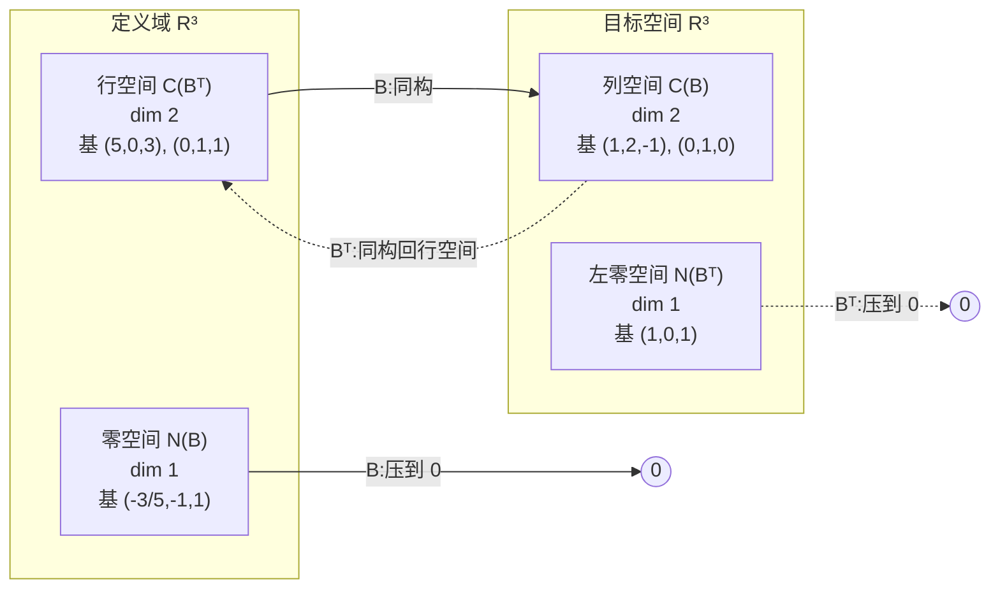

---
tags:
  - 线性代数LinearAlgebra
  - 四个基本子空间FourSubspaces
  - 列空间ColumnSpace
  - 零空间NullSpace
  - 行空间RowSpace
  - 左零空间LeftNullSpace
  - LU分解LUfactorization
  - 三角矩阵TriangularMatrix
  - 秩Rank
---

# 四个基本子空间的计算 · 18.06SC 习题课(L10)

**时间:** 2026-10-24
**标签:** #线性代数LinearAlgebra #四个基本子空间FourSubspaces #列空间ColumnSpace #零空间NullSpace #行空间RowSpace #左零空间LeftNullSpace #LU分解LUfactorization #三角矩阵TriangularMatrix #秩Rank
**关联:** [[Computing the Four Fundamental Subspaces]](原始字幕)·[[10. The Four Fundamental Subspaces]](L10 主课)·[[L4 A=LU 分解]](L、U 从哪来)·[[L6 列空间与零空间]](四个子空间的定义)·[[L7 求解Ax=0主变量与特解]](零空间的算法)·[[8. Solving Ax = b Row Reduced Form R]]·[[9. Independence, Basis, and Dimension]]

## 必要性

L6 把四个子空间的**定义**摆了出来,L7 只解决了其中一个——零空间 $N(A)$ 的算法。真正的问题是:

> 拿到一个矩阵,能不能**一次**把四个子空间的**维数和基**全部算出来?

这道习题故意**不直接给 $B$**,只给它的 LU 分解 $B=LU$。这样设计是为了逼你看见:**三角因子本身就是答案的索引**——列空间看 $L$,零空间和行空间看 $U$,左零空间看 $L^{-1}$。把 $B$ 乘开反而绕远路。

这也是 L8($Ax=b$)、L9(基与维数)、L10(四个基本子空间)三讲内容的汇合点。

## 题目

设

$$
B=LU,\qquad
L=\begin{bmatrix}1&0&0\\2&1&0\\-1&0&1\end{bmatrix},\qquad
U=\begin{bmatrix}5&0&3\\0&1&1\\0&0&0\end{bmatrix}
$$

$L$ 是单位下三角矩阵,$U$ 是上三角矩阵,$B$ 是 $3\times 3$。求 $C(B)$、$N(B)$、$C(B^{\mathsf T})$、$N(B^{\mathsf T})$ 各自的**维数**与**一组基**。

> 题目只给 $L$ 和 $U$;下面会看到,求四个子空间根本不需要先把 $B$ 乘出来。

## 预备:三角矩阵为什么是这道题的钥匙

### 1. $L$ 可逆 ⇒ 零空间、行空间可以「搬走」

$L$ 是单位下三角,对角线全是 $1$,所以

$$
\det L=1\neq 0\quad\Longrightarrow\quad L\text{ 可逆}.
$$

于是对任意 $x$:

$$
Bx=0\iff LUx=0\iff Ux=0.
$$

**左乘一个可逆矩阵不改变零空间。**
U在此更加反映了这个矩阵的本质性质,INFACTO,这也是LU的价值之一
同理,$U=EB$(其中 $E=L^{-1}$)说明 $U$ 的每一行都是 $B$ 的行的线性组合;反过来 $B=LU$ 说明 $B$ 的每一行都是 $U$ 的行的线性组合。所以

$$
C(B^{\mathsf T})=C(U^{\mathsf T}).
$$

**行变换(左乘可逆矩阵)保持行空间不变。**

但**列空间会变**——$L$ 把 $U$ 的列重新组合了。$B$ 和 $U$ 的列空间维数相同($L$ 可逆保持秩),但**具体的列空间不同**。这就是为什么求列空间不能看 $U$ 的列,而要回到 $L$ 上。

### 2. $U$ 是上三角 ⇒ 主元、秩、自由变量一眼可见

消元的目标就是把矩阵变成上三角,因为上三角是「**已经解完**」的形状:

- 主元落在对角线上(本题的 $U$ 就是这种标准情形),主元个数 = 秩;
- 最后一个方程只含最后一个未知量,直接解;
- 倒数第二个方程只含最后两个未知量,代回去……一路**回代**;
- 解一个三角方程组只需 $O(n^2)$,而一般矩阵消元要 $O(n^3)$。

本题 $U$ 的主元是 $5$ 和 $1$(第 1、2 行),第 3 行全零:

$$
\#\text{pivots}=2\quad\Longrightarrow\quad \operatorname{rank}B=\operatorname{rank}U=2.
$$

第 3 列没有主元 ⇒ 是自由列 ⇒ 零空间维数 $=3-2=1$。

### 3. $L^{-1}$ 仍是下三角 ⇒ 左零空间可以直接读

$E=L^{-1}$ 也是单位下三角(三角矩阵求逆不改变三角形状)。$EB=U$ 的**第 3 行**给出

$$
(\text{$E$ 的第 3 行})\,B=(\text{$U$ 的第 3 行})=0.
$$

一个行向量左乘 $B$ 得零,它就是 $B^{\mathsf T}$ 的零空间向量——**左零空间不用解方程,直接读 $E$ 的零行**。这就是三角结构的第三个好处。

> 三句话总结:L 可逆 → 零空间/行空间不变;U 上三角 → 主元/秩/回代;L⁻¹ 下三角 → 左零空间可读。

## 逐个求解

### 0. 先把 $B$ 乘出来(只用于最后验算)

$$
B=LU=
\begin{bmatrix}
5&0&3\\
10&1&7\\
-5&0&-3
\end{bmatrix}
$$

肉眼可见:第 3 行 $=-$第 1 行,所以秩确实是 2。**但下面的推导都不依赖这个乘积**。

### 1. 列空间 $C(B)$:看 $L$ 的主元列

**维数:** $\dim C(B)=r=2$(主元个数)。

**基:** $B$ 的第 $j$ 列是 $L$ 乘以 $U$ 的第 $j$ 列:

$$
B\text{ 的第 }j\text{ 列}=L\,(U\text{ 的第 }j\text{ 列}).
$$

$U$ 的主元列是

$$
\begin{bmatrix}5\\0\\0\end{bmatrix}=5e_1,\qquad
\begin{bmatrix}0\\1\\0\end{bmatrix}=e_2,
$$

它们张成 $C(U)$(自由列 $U_3=(3/5)U_1+1\cdot U_2$)。$L$ 可逆,把 $C(U)$ 一一映到 $C(B)$,所以 $U$ 的主元列在 $L$ 下的像就是 $C(B)$ 的基:

$$
L(5e_1)=5\begin{bmatrix}1\\2\\-1\end{bmatrix},\qquad
L(e_2)=\begin{bmatrix}0\\1\\0\end{bmatrix}.
$$

去掉倍数 $5$,得

$$
\boxed{\ C(B)=\operatorname{span}\left\{\begin{bmatrix}1\\2\\-1\end{bmatrix},\ \begin{bmatrix}0\\1\\0\end{bmatrix}\right\},\qquad \dim C(B)=2.\ }
$$

这两个向量恰好就是 **$L$ 的前两列**(主元列)。验证:$B$ 的第 1 列 $=(5,10,-5)^{\mathsf T}=5(1,2,-1)^{\mathsf T}$,第 2 列 $=(0,1,0)^{\mathsf T}$。

> 严格说,基是「$L$ 乘以 $U$ 的主元列」;本题 $U$ 的主元列正好是 $5e_1$ 和 $e_2$,所以结果看起来就是 $L$ 的主元列。若 $U$ 的主元列不是标准基向量,就不能直接拿 $L$ 的列,见 Note。

### 2. 零空间 $N(B)$:看 $U$,解 $Ux=0$

**维数:** $\dim N(B)=n-r=3-2=1$(自由变量个数)。

**基:** 因为 $L$ 可逆,$Bx=0\iff Ux=0$。写开:

$$
\begin{cases}
5x_1+3x_3=0\\
x_2+x_3=0
\end{cases}
$$

第 3 列是自由列,令自由变量 $x_3=1$,回代:

- 第 2 行:$x_2=-1$;
- 第 1 行:$5x_1+3=0\Rightarrow x_1=-\dfrac35$.

$$
\boxed{\ N(B)=\operatorname{span}\left\{\begin{bmatrix}-3/5\\-1\\1\end{bmatrix}\right\},\qquad \dim N(B)=1.\ }
$$

乘 $5$ 去掉分数,同一个基可以写成 $(-3,-5,5)^{\mathsf T}$。

**验算:**

$$
B\begin{bmatrix}-3/5\\-1\\1\end{bmatrix}
=\begin{bmatrix}5&0&3\\10&1&7\\-5&0&-3\end{bmatrix}
\begin{bmatrix}-3/5\\-1\\1\end{bmatrix}
=\begin{bmatrix}-3+3\\-6-1+7\\3-3\end{bmatrix}
=\begin{bmatrix}0\\0\\0\end{bmatrix}.✅
$$

### 3. 行空间 $C(B^{\mathsf T})$:看 $U$ 的主元行

**维数:** $\dim C(B^{\mathsf T})=r=2$(行秩 = 列秩)。

**基:** 消元不改变行空间,$B$ 的行空间就是 $U$ 的行空间。$U$ 的主元行是第 1、2 行:

$$
\boxed{\ C(B^{\mathsf T})=\operatorname{span}\left\{\begin{bmatrix}5\\0\\3\end{bmatrix},\ \begin{bmatrix}0\\1\\1\end{bmatrix}\right\},\qquad \dim C(B^{\mathsf T})=2.\ }
$$

验证:$B$ 的三行分别是 $r_1$、$2r_1+r_2$、$-r_1$,确实都在 $U$ 的前两行张成的空间里。

### 4. 左零空间 $N(B^{\mathsf T})$:看 $L^{-1}$ 的零行

**先厘清:定义与算法是两件事**

左零空间的定义就是解方程

$$
N(B^{\mathsf T})=\{y:B^{\mathsf T}y=0\},
$$

注意矩阵是 $B^{\mathsf T}$ 而不是 $B$:它问的是「$B$ 的哪些**行**组合为零」,而 §2 的零空间问的是「$B$ 的哪些**列**组合为零」。本题两者恰好都是 1 维,但向量完全不同——$N(B)$ 的基是 $(-3/5,-1,1)^{\mathsf T}$,$N(B^{\mathsf T})$ 的基是 $(1,0,1)^{\mathsf T}$。

按定义硬解,要先把 $B$ 转置、对 $B^{\mathsf T}$ 再做一遍完整消元(还得先花 $O(n^3)$ 把 $B$ 乘开)、再回代。而 $EB=U$ 已经把这个过程做完了。两者是同一个问题的两种算法:

- **定义**:解 $B^{\mathsf T}y=0$;
- **算法**:从 $U$ 的零行对应的 $E$ 的行里直接读。

**为什么可以读 $E$:一行证明**

由 $B=LU$ 得 $EB=U$($E=L^{-1}$)。按行分块:

$$
(\text{$E$ 的第 } i \text{ 行})\,B=(\text{$U$ 的第 } i \text{ 行}).
$$

所以 $U$ 的第 $i$ 行若是零行,$E$ 的第 $i$ 行左乘 $B$ 就得零,它正是 $B^{\mathsf T}y=0$ 的解。个数也对得上:$U$ 有 $m-r$ 个零行,而 $E$ 可逆 ⇒ 它的行线性无关 ⇒ 这 $m-r$ 行也线性无关,正好构成 $N(B^{\mathsf T})$ 的一组基。

**为什么是 $E$ 而不是 $L$**

- $L$ 是「乘数账本」:说明怎么从 $U$ **拼出** $B$($U\to B$,组装说明书);
- $E=L^{-1}$ 是「操作记录」:说明怎么把 $B$ **消成** $U$($B\to U$,拆解说明书)。

左零空间问的是「哪些行加起来抵消为零」,这是**拆解动作**,所以答案在 $E$ 里;而 $L$ 只回答「怎么造出 $B$ 的每一行」。

**代价对比**

- 直接解:转置 + 对 $B^{\mathsf T}$ 消元 + 回代,约 $O(n^3)$,而且要求 $B$ 已经显式存在;
- 读 $E$:$B=LU$ 已经把 $E$ 备好了,零额外消元;若只需要某一行,解三角方程 $L^{\mathsf T}y=e_i$ 即可,每行 $O(n^2)$。**不要真的去求整个 $L^{-1}$**——求逆是 $O(n^3)$,并且会把稀疏矩阵填充成稠密。

**什么时候反而该直接解**

- 要**正交基**或数值稳定 → 用 SVD:$B=U\Sigma V^{\mathsf T}$,$U$ 的后 $m-r$ 列就是左零空间的标准正交基,四个子空间一次拿全;
- $B$ 已显式给出、且本来就要分解 $B^{\mathsf T}$(例如还要做 QR)→ 直接用,不必绕到 $LU$;
- $B$ 很大或稀疏 → 别构造 $L^{-1}$,直接解 $B^{\mathsf T}y=0$(迭代法 / 稀疏分解)。

**维数:** $\dim N(B^{\mathsf T})=m-r=3-2=1$(行数减主元数)。

**基:** 令 $E=L^{-1}$。手算(或对 $L$ 做高斯-约当):

$$
E=L^{-1}=
\begin{bmatrix}
1&0&0\\
-2&1&0\\
1&0&1
\end{bmatrix}.
$$

于是

$$
EB=U=
\begin{bmatrix}
5&0&3\\
0&1&1\\
0&0&0
\end{bmatrix}.
$$

**第 3 行**乘 $B$ 得 $U$ 的第 3 行 $=0$,所以 $E$ 的第 3 行就在左零空间里:

$$
\boxed{\ N(B^{\mathsf T})=\operatorname{span}\left\{\begin{bmatrix}1\\0\\1\end{bmatrix}\right\},\qquad \dim N(B^{\mathsf T})=1.\ }
$$

验证:$(1,0,1)B=(5,0,3)+(-5,0,-3)=(0,0,0)$。

### 5. 结果汇总

| 子空间 | 记号 | 维数 | 一组基 | 从哪个因子读 |
| ------ | ---- | :--: | ------ | ------------ |
| 列空间 | $C(B)$ | 2 | $(1,2,-1)^{\mathsf T},\ (0,1,0)^{\mathsf T}$ | $L$ 的主元列(严格说是 $L\cdot U$ 的主元列) |
| 零空间 | $N(B)$ | 1 | $(-3/5,-1,1)^{\mathsf T}$ | $U$:自由变量取 1、回代 |
| 行空间 | $C(B^{\mathsf T})$ | 2 | $(5,0,3)^{\mathsf T},\ (0,1,1)^{\mathsf T}$ | $U$ 的主元行 |
| 左零空间 | $N(B^{\mathsf T})$ | 1 | $(1,0,1)^{\mathsf T}$ | $L^{-1}$ 对应 $U$ 零行的那一行 |

维数满足两条守恒律:

$$
\underbrace{2}_{r}+\underbrace{1}_{n-r}=3=n,\qquad
\underbrace{2}_{r}+\underbrace{1}_{m-r}=3=m.
$$

## 四空间全景图

两条正交关系:

- 行空间 $\perp$ 零空间(同在 $\mathbb R^3$ 的定义域一侧);
- 列空间 $\perp$ 左零空间(同在 $\mathbb R^3$ 的目标一侧)。

本题可以直接验:$(5,0,3)\cdot(-3/5,-1,1)=-3+0+3=0$;$(1,0,1)\cdot(1,2,-1)=1-1=0$。

## 直观理解

- **$B$ 是一台「降维机器」**:$\mathbb R^3\to\mathbb R^3$,但只保留 2 维信息。它把零空间那条直线整个压到原点,把行空间(2 维平面)**一一地**搬到列空间(另一个 2 维平面)上。$\operatorname{rank}$ 就是「被保留的维数」,$\dim N$ 就是「被压掉的维数」。
- **三角因子是这台机器的「拆解说明书」**:$L$ 记录消元时做了哪些行操作(可逆,不影响哪些方向被压掉);$U$ 是消元后的骨架,主元、自由列、零空间都直接看得见;$L^{-1}$ 记录行的线性关系,最后那行零正好指出「哪一组行加起来是 0」。
- **$B^{\mathsf T}$ 是同一台机器的反向视图**:它把左零空间压掉,把列空间搬回行空间。行秩 = 列秩,就是「两个方向看的保留维数相同」。
- **为什么不用 $B$ 本身?** 用 $B$ 也能做,但你得先消元求 $E$;而 $B=LU$ 已经把 $L$、$U$、$E$ 全部准备好了。**LU 分解把「算」变成了「读」**。

## 拓展延伸:三角矩阵为什么贯穿整个线性代数

### 1. 三角 = 可解的形状

高斯消元的目的就是把矩阵变成上三角,因为三角方程组可以逐层代入:

- $Lc=b$:前代(forward substitution);
- $Ux=c$:回代(back substitution);
- 每步只解一个未知量,总共 $O(n^2)$。

这也是为什么几乎所有分解都尽量产出三角因子:

| 分解 | 形式 | 三角因子的作用 |
| ---- | ---- | -------------- |
| LU | $A=LU$ | 解方程、算行列式($\det A=\prod u_{ii}$) |
| Cholesky | $A=LL^{\mathsf T}$(正定) | 对称正定系统的快速稳定解法 |
| QR | $A=QR$,$R$ 上三角 | 最小二乘、Gram-Schmidt、$|\det A|=\prod|r_{ii}|$ |
| Schur | $A=QTQ^{\mathsf T}$,$T$ 上三角 | 特征值就躺在 $T$ 的对角线上 |
| Jordan | 分块三角 | 特征值 + 广义特征向量的完整结构 |

### 2. 三角矩阵对维度的直接影响

**(a) 行列式与可逆性**

$$
\det T=\prod_{i=1}^{n}t_{ii}.
$$

所以三角矩阵可逆 $\iff$ 对角元全非零。本题 $\det L=1$、$\det U=0$,故 $\det B=0$。

**(b) 秩与主元**

- 标准消元得到的 $U$(不交换行)通常把主元放在对角线上;但一般的上三角矩阵允许「跳过」零对角元,主元出现在对角线右侧,例如 $T=\begin{bmatrix}0&1\\0&0\end{bmatrix}$;
- 对角元全非零 $\Rightarrow$ 满秩(因为 $\det T\neq 0$);
- 对角元有 0 $\Rightarrow$ 一定不满秩,但秩可能**大于**非零对角元的个数(上例秩为 1,非零对角元为 0 个)。准确的下界是
  $$
  \operatorname{rank}T\ \ge\ \#\{i:t_{ii}\neq 0\},
  $$
  且**对角元全非零时取等号(满秩)**。
- 本题 $U$ 的非零对角元有 2 个,秩正好是 2。

**(c) 特征值**

三角矩阵的特征多项式也是三角的:

$$
\det(\lambda I-T)=\prod_{i=1}^{n}(\lambda-t_{ii}),
$$

所以**特征值就是对角元**。这是 Schur 分解和 QR 迭代求特征值的根基。

**(d) 严格三角 ⇒ 幂零**

若 $T$ 是严格上三角(对角元全 0),则

$$
T^n=0.
$$

直观理由见下一条:每乘一次,$T$ 都把第 $k$ 个方向压到更低的维度,压 $n$ 次就全部归零。所以严格三角矩阵只有特征值 $0$(代数重数为 $n$)。

**(e) 不变子空间与「维度阶梯」**

设 $T$ 是上三角,$V_k=\operatorname{span}\{e_1,\dots,e_k\}$。因为 $T$ 的第 $j$ 列在 $j$ 行以下全为 0,

$$
T(V_k)\subseteq V_k\qquad(k=1,\dots,n).
$$

于是得到一条**不变子空间链**:

$$
\{0\}=V_0\subset V_1\subset V_2\subset\cdots\subset V_n=\mathbb R^n,
\qquad \dim V_k=k.
$$

三角矩阵就是「在这条阶梯上逐层作用」的矩阵:第 $k$ 层只和前面几层耦合,不会往后漏。这正是维度层面的核心影响——**三角结构把 $n$ 维空间拆成一串一维一维长出来的不变子空间**,特征值也按这个顺序逐个出现。严格上三角则把 $V_k$ 压进 $V_{k-1}$,所以幂零。

**(f) 分块三角**

$$
T=\begin{bmatrix}A&B\\0&D\end{bmatrix}
$$

中,$\det T=\det A\det D$,特征值是 $A$ 与 $D$ 特征值的并集,且

$$
\operatorname{rank}T\ge \operatorname{rank}A+\operatorname{rank}D.
$$

消元中的 Schur 补、矩阵的直和分解,都是分块三角的应用。

### 3. 和 AI 的一点联系

Transformer 的**因果注意力掩码**是一个下三角的 0/1 矩阵:位置 $i$ 只能看到 $j\le i$。这条「三角约束」保证信息沿序列单向流动,和上三角矩阵的维数阶梯是同一个结构——**三角 = 有方向的、逐层展开的依赖关系**。自回归模型

$$
p(x_1,\dots,x_T)=\prod_{t=1}^{T}p(x_t\mid x_{<t})
$$

也是把联合分布按这个三角顺序逐层分解。

## Note

- 视频板书只给了 $L$ 和 $U$,没有直接写 $B$;上面的 $L$、$U$ 数值是根据字幕里出现的 $[1,2,-1]$、$[0,1,0]$、$-1$、$-3/5$、$[1,0,1]$ 以及 $L^{-1}$ 的系数复原的,并与四个子空间的结果逐项核对过。
- 字幕里说「第二个数是 $-1$,第三个变量是 $-3/5$」是口播顺序的问题;按 $Ux=0$ 正确解出的是 $x=(-3/5,\,-1,\,1)^{\mathsf T}$,即第一个分量才是 $-3/5$。
- 「取 $L$ 的主元列」严格说应写成「取 $L$ 乘以 $U$ 的主元列」。本题 $U$ 的主元列是 $5e_1$ 和 $e_2$,所以结果恰好是 $L$ 的前两列(差一个倍数);一般情形下 $U$ 的主元列不是标准基向量,不能直接照搬。
- $C(B)\neq C(U)$。左乘可逆矩阵保持秩,但会把列空间整体「扭」一下;只有维数相同,空间本身不同。行空间则相反:行变换不改变行空间。
- 本题的 $U$ 已经是行阶梯形;一般三角矩阵不一定,主元可能不在对角线上,但「主元个数 = 秩」始终成立。

## 思考

1. 如果把 $L$ 换成任意可逆矩阵 $P$,考察 $PB$:哪些子空间不变?哪些会变?
   (提示:$N(PB)=N(B)$、行空间不变;列空间会变;左零空间变成 $(P^{\mathsf T})^{-1}N(B^{\mathsf T})$。)
2. §4 已说明「为什么能从 $E$ 的行直接读左零空间」;再往下一层:为什么**行**操作对应左零空间、**列**关系对应零空间?把 $B$ 看成映射时,左零空间里的向量是在「拦住」哪个方向?(提示:它们与 $C(B)$ 正交,可对偶空间的角度看。)
3. 如果 $U$ 的第 3 列也有主元(即 $U$ 满秩),四个子空间的维数会变成什么?此时 $B$ 可逆,$N(B)$ 和 $N(B^{\mathsf T})$ 是什么?
4. 只给 $B$、不给 LU,直接消元求四个子空间,和用 LU 相比多了哪些计算?为什么说 LU 把「算」变成了「读」?

## 总结

**这道题的方法论:** 看到 $B=LU$,不要急着乘开。

- **$L$ 可逆** ⇒ 零空间、行空间可以整体搬到 $U$ 上处理;
- **$U$ 上三角** ⇒ 主元个数给出秩(2),自由列给出 $\dim N=1$,主元行给出行空间;
- **$L^{-1}$ 下三角** ⇒ 对应 $U$ 零行的那一行给出左零空间;
- **列空间**是个例外:左乘 $L$ 会改变它,只能取 $L$ 作用下 $U$ 主元列的像。

**四个维数:** $r=2$,$\dim N=1$,$\dim C(B^{\mathsf T})=2$,$\dim N(B^{\mathsf T})=1$;两条守恒律 $r+(n-r)=n$、$r+(m-r)=m$。

**三角矩阵的意义:** 它是「已经解完」的形状——行列式看对角元乘积,特征值看对角元,秩看主元,方程用前代/回代 $O(n^2)$ 解;它还给出不变子空间链 $V_0\subset\cdots\subset V_n$,把维度问题拆成一维一维的阶梯。LU、QR、Cholesky、Schur、Jordan 全都在生产三角因子,原因就在这里。

## 本讲新引入的专业术语

| 英文术语 | 中文 | 含义 |
| -------- | ---- | ---- |
| four fundamental subspaces | 四个基本子空间 | $C(A)$、$N(A)$、$C(A^{\mathsf T})$、$N(A^{\mathsf T})$ |
| column space $C(A)$ | 列空间 | 列的线性组合,也是 $Ax=b$ 的可解 $b$ 的集合 |
| nullspace $N(A)$ | 零空间 | $Ax=0$ 的全部解 |
| row space $C(A^{\mathsf T})$ | 行空间 | 行的线性组合,维数等于列空间 |
| left nullspace $N(A^{\mathsf T})$ | 左零空间 | $A^{\mathsf T}y=0$ 的解,即 $y^{\mathsf T}A=0$ |
| unit lower triangular | 单位下三角 | 对角线全 1 的下三角矩阵($L$) |
| forward/back substitution | 前代 / 回代 | 解三角方程组的逐层代入法,$O(n^2)$ |
| rank-nullity theorem | 秩-零化度定理 | $\dim C(A)+\dim N(A)=n$ |
| invariant subspace | 不变子空间 | $T(V)\subseteq V$ 的子空间 |
| nilpotent | 幂零 | 某个正整数次幂为零矩阵;$T^n=0$ |
