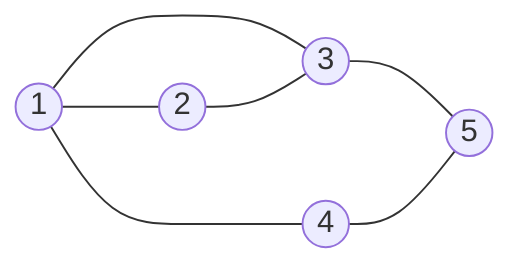
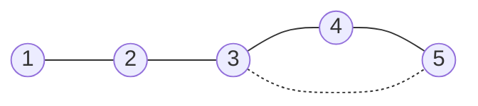
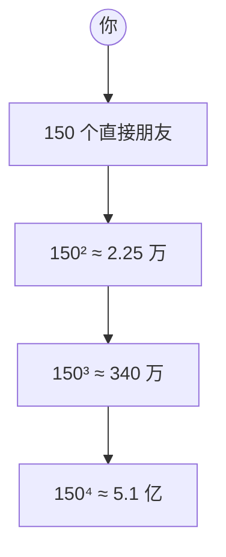
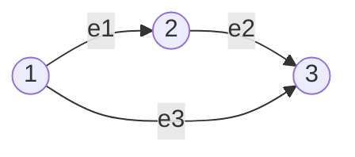

---
tags:
  - 线性代数LinearAlgebra
  - 矩阵空间MatrixSpace
  - 向量空间VectorSpace
  - 子空间Subspace
  - 基Basis
  - 维数Dimension
  - 秩1矩阵RankOneMatrix
  - 秩Rank
  - 小世界图SmallWorldGraph
---

# 矩阵空间·秩1·小世界图 Matrix Spaces; Rank 1; Small World Graphs · 18.06 L11

**时间:** 2026-10-25（§6 图部分按反馈重写：5 张 Mermaid 图 + 距离矩阵 + 捷径 / 六度数字实例）
**标签:** #线性代数LinearAlgebra #矩阵空间MatrixSpace #向量空间VectorSpace #子空间Subspace #基Basis #维数Dimension #秩1矩阵RankOneMatrix #秩Rank #小世界图SmallWorldGraph
**关联:** [[L9 线性无关·基·维数]]（基与维数，本讲把对象从 $\mathbb R^n$ 换成矩阵/函数）· [[L10 四个基本子空间]]（§6 矩阵空间的铺垫）· [[L7 求解Ax=0主变量与特解]]（特解 = 零空间的基，与 ODE 的「特解」同构）· [[L10 四个基本子空间的计算 · 习题课]]（$R^4$ 一例复习四个空间）· [[11. Matrix Spaces; Rank 1; Small World Graphs]]（原始字幕）

## 必要性（为什么要有这一章）

L9–L10 的「基、维数、子空间」一直用在 $\mathbb R^n$、$\mathbb R^m$ 里的箭头上。这一讲要拆掉两个隐含假设：

1. **向量不必是箭头。** 只要一个集合上能定义「相加」和「数乘」，并且封闭，基、维数、子空间这一整套语言就原封不动地适用于它。**矩阵可以当向量**（$3\times3$ 矩阵空间是 9 维的），**函数也可以当向量**（微分方程的解空间是 2 维的）。这是泛函分析、矩阵分析、量子力学的共同入口。
2. **秩还有另一张脸。** 前面秩是「主元个数」；这一讲把矩阵拆成**秩 1 矩阵**的和——任何秩 $r$ 的矩阵都是 $r$ 块积木的叠加。SVD、低秩近似、推荐系统、LoRA 全是这一句话的推论。

最后用 $R^4$ 的一个具体子空间把四个基本子空间复习一遍，并引出**图**：节点与边的连接关系可以用矩阵表示，下一讲正式展开。

## 主要内容

### 1. 矩阵空间 $M$：把 $3\times3$ 矩阵当成 9 维向量

取 $M$ = 全体 $3\times3$ 实矩阵。

- **允许的运算**：矩阵相加、矩阵数乘。**矩阵乘法不算**——向量空间只要求「加」和「数乘」。
- **自然基**：$E_{ij}$（第 $i$ 行第 $j$ 列是 1、其余为 0），共 9 个。
  $$M=\operatorname{span}\{E_{11},E_{12},\dots,E_{33}\},\qquad \dim M=9.$$
- **与 $\mathbb R^9$ 同构**：把矩阵按行摊平成 9 个数即可，一一对应且保持加法与数乘。区别只在「摆法」：$\mathbb R^9$ 排成一列，矩阵排成方阵；但矩阵空间自带「行 / 列 / 对称」等结构，$\mathbb R^9$ 没有。

> 同构（isomorphism）= 一一对应 + 保持两种运算。它允许我们「借」$\mathbb R^9$ 的结论，但不会把矩阵的额外结构带过去。

**数字实例**：取

$$
M=\begin{bmatrix}1&2&3\\4&5&6\\7&8&9\end{bmatrix}
=1E_{11}+2E_{12}+3E_{13}+4E_{21}+5E_{22}+6E_{23}+7E_{31}+8E_{32}+9E_{33}.
$$

- 系数就是九个格子里的数——求坐标的方式是「逐个格子读数」。
- 矩阵相加 = 九个系数分别相加：$M+M=2M$ 对应系数 $(2,4,6,\dots,18)$。
- 摊平后 $\operatorname{vec}(M)=(1,2,3,4,5,6,7,8,9)^{\mathsf T}\in\mathbb R^9$。

### 2. 三个子空间、交与和

| 子空间 | 定义 | 维数 | 一组基 |
| ---- | ---- | :--: | ---- |
| 对称 $S$ | $A^{\mathsf T}=A$ | 6 | $E_{ii}$（3 个）$+$ $E_{ij}+E_{ji}$（3 个） |
| 上三角 $U$ | $i>j$ 处为 0 | 6 | $E_{ij},\ i\le j$（6 个） |
| 对角 $D$ | 非对角为 0 | 3 | $E_{ii}$（3 个） |

- **$S\cap U=D$**：既对称又上三角 ⇒ 只能是**对角**矩阵。$\dim(S\cap U)=3$。
- **$S\cup U$ 不是子空间**：一个对称矩阵加一个上三角矩阵，一般既不对称也不上三角。这和 $\mathbb R^2$ 里「两条直线并起来不是子空间」是同一件事——并集不封闭。
- **$S+U=M$**：任意矩阵都能写成一个对称矩阵 + 一个上三角矩阵。构造如下（给定 $M$）：
  $$U_0=\operatorname{diag}(M)+\operatorname{strict\text{-}upper}(M-M^{\mathsf T}),\qquad S_0=M-U_0,$$
  则 $U_0$ 上三角、$S_0$ 对称（$i<j$ 时 $S_{0,ij}=M_{ji}=S_{0,ji}$，对角为 0）。所以 $\dim(S+U)=9$。

**数字实例**：还是那个 $M$。先算 $M-M^{\mathsf T}$：

$$
M-M^{\mathsf T}=\begin{bmatrix}0&-2&-4\\2&0&-2\\4&2&0\end{bmatrix}.
$$

按构造取出 $U_0$（对角 + 严格上三角），相减得 $S_0$：

$$
U_0=\begin{bmatrix}1&-2&-4\\0&5&-2\\0&0&9\end{bmatrix},\qquad
S_0=M-U_0=\begin{bmatrix}0&4&7\\4&0&8\\7&8&0\end{bmatrix}.
$$

验算：$U_0$ 上三角 ✓，$S_0$ 对称（$S_0^{\mathsf T}=S_0$，对角全 0）✓，且

$$
S_0+U_0=\begin{bmatrix}1&2&3\\4&5&6\\7&8&9\end{bmatrix}=M.✓
$$

**并集为什么不行**：$S_0\in S$、$U_0\in U$，可它们的和 $M$ 既不对称（$m_{12}=2\ne m_{21}=4$）也不是上三角（$m_{21}=4\ne0$）——$M\notin S\cup U$。两个成员相加掉出集合，所以 $S\cup U$ 不是子空间；而 $S+U$（允许相加）才是。

**维数公式**（子空间的容斥原理）：

$$\dim(S+U)=\dim S+\dim U-\dim(S\cap U)\qquad\Longleftrightarrow\qquad 9=6+6-3.$$

这条公式对任意两个子空间都成立，后面学秩时还会以「秩-零化度」的形式再遇到。

### 3. 微分方程：函数也是向量

考虑二阶线性齐次方程

$$y''+y=0.$$

- $\cos x$、$\sin x$ 都是解；任意解是
  $$y=c_1\cos x+c_2\sin x.$$
- 解集对加法、数乘封闭 ⇒ 是**向量空间**；$\{\cos x,\sin x\}$ 是一组**基**，$\dim=2$。
- 另一组基：$\{e^{ix},e^{-ix}\}$（因为 $\cos x,\sin x$ 可由它们线性组合得到）。基不唯一，但维数唯一。

**数字实例**：取 $y=3\cos x-2\sin x$。

$$
y''=-3\cos x+2\sin x,\qquad y''+y=(-3+3)\cos x+(2-2)\sin x=0.✓
$$

- 加法封闭：$y_1=3\cos x-2\sin x$、$y_2=\cos x+4\sin x$，则 $y_1+y_2=4\cos x+2\sin x$ 仍是解。
- 数乘封闭：$5y_1=15\cos x-10\sin x$ 仍是解。
- **换基就是换坐标**：在基 $\{\cos x,\sin x\}$ 下 $y$ 的坐标是 $(3,-2)$。换到 $\{e^{ix},e^{-ix}\}$，用
  $$\cos x=\frac{e^{ix}+e^{-ix}}2,\qquad \sin x=\frac{e^{ix}-e^{-ix}}{2i},$$
  得
  $$y=\left(\frac32+i\right)e^{ix}+\left(\frac32-i\right)e^{-ix},$$
  坐标变成 $(3/2+i,\ 3/2-i)$。同一个函数，不同基下坐标不同。

- **为什么是 2 维？** 二阶方程有两个独立解——和 $Ax=0$ 有 $n-r$ 个特解是同一回事：这里 $\cos x,\sin x$ 就是「特解」。
- **算子视角**：令 $L=\dfrac{d^2}{dx^2}+I$，$L$ 是线性算子，解空间就是 $L$ 的**零空间**（kernel）。

> 线性微分方程课的核心任务，用线性代数的话说就是：**求解空间的一组基**。

### 4. 秩 1 矩阵：所有矩阵的积木

**定义**：$\operatorname{rank}(A)=1$ ⇔ 所有行都是同一行的倍数 ⇔ 所有列都是同一列的倍数。

**表示定理**：秩 1 的 $m\times n$ 矩阵一定能写成**一列 × 一行**：

$$A=uv^{\mathsf T},\qquad u\in\mathbb R^m,\ v\in\mathbb R^n.$$

例：

$$
\begin{bmatrix}1&4&5\\2&8&10\end{bmatrix}
=\begin{bmatrix}1\\2\end{bmatrix}\begin{bmatrix}1&4&5\end{bmatrix}.
$$

- 行空间 $=\operatorname{span}\{v^{\mathsf T}\}$（1 维），列空间 $=\operatorname{span}\{u\}$（1 维），与秩 $=1$ 一致。
- **秩 $r$ 的矩阵 = $r$ 个秩 1 矩阵之和**：把 $A$ 化成 $A=CR$（$C$ = 主元列，$m\times r$；$R$ = 行最简形的非零行，$r\times n$），则
  $$A=\sum_{k=1}^{r} c_k r_k^{\mathsf T}.$$
  $5\times17$、秩 4 的矩阵 = 4 块积木。这正是 SVD 的前身（SVD 只是把这 $r$ 块选成**正交**的、按重要性排序）。

**数字实例（拆成秩 1 积木）**：取

$$
A=\begin{bmatrix}1&2&3\\2&4&6\\1&1&2\end{bmatrix}.
$$

行最简形 $R=\begin{bmatrix}1&0&1\\0&1&1\\0&0&0\end{bmatrix}$，主元列拼成 $C=\begin{bmatrix}1&2\\2&4\\1&1\end{bmatrix}$，于是

$$
A=CR=
\underbrace{\begin{bmatrix}1\\2\\1\end{bmatrix}\begin{bmatrix}1&0&1\end{bmatrix}}_{\text{秩 }1}
+\underbrace{\begin{bmatrix}2\\4\\1\end{bmatrix}\begin{bmatrix}0&1&1\end{bmatrix}}_{\text{秩 }1}
=\begin{bmatrix}1&0&1\\2&0&2\\1&0&1\end{bmatrix}
+\begin{bmatrix}0&2&2\\0&4&4\\0&1&1\end{bmatrix}.
$$

两块秩 1 矩阵相加，正好还原 $A$（秩 2）。

**数字实例（秩 1 集合不封闭）**：

$$
\begin{bmatrix}1&4&5\\2&8&10\end{bmatrix}
+\begin{bmatrix}1&0&1\\1&0&1\end{bmatrix}
=\begin{bmatrix}2&4&6\\3&8&11\end{bmatrix}.
$$

左端两个都是秩 1，右端两行 $(2,4,6)$、$(3,8,11)$ 不成比例，秩为 2——加法掉出了「秩 1 集合」。这也说明**含零不是子空间的充分条件**：秩 1 集合不含零，但就算放宽成「秩 $\le1$」，加法仍不封闭。

- **秩 1 矩阵的集合不是子空间**：两个秩 1 矩阵相加，一般秩 2；而且零矩阵不在其中。
- **秩 $\le r$ 的矩阵集合也不是子空间**：含零矩阵，但加法不封闭（两个秩 1 相加可到秩 2）。
- 常用不等式：$\operatorname{rank}(A+B)\le \operatorname{rank}A+\operatorname{rank}B$。

### 5. $R^4$ 的一个子空间：分量之和为零

$$S=\{v\in\mathbb R^4: v_1+v_2+v_3+v_4=0\}.$$

- **是子空间**：$v,w\in S\Rightarrow (v+w)$ 分量和 $=0+0=0$；$cv$ 分量和 $=c\cdot0=0$；零向量在 $S$ 中。
- **它是零空间！** 取 $A=\begin{bmatrix}1&1&1&1\end{bmatrix}$（$1\times4$），则 $S=N(A)$。
- $r=\operatorname{rank}(A)=1$，所以 $\dim S=n-r=4-1=3$。
- **一组基（特解）**：自由变量 $v_2,v_3,v_4$ 各取 1，主变量 $v_1=-1$：
  $$\{(-1,1,0,0)^{\mathsf T},\ (-1,0,1,0)^{\mathsf T},\ (-1,0,0,1)^{\mathsf T}\}.$$

**数字实例（坐标）**：取 $v=(3,-1,2,-4)^{\mathsf T}$，分量和 $3-1+2-4=0$，所以 $v\in S$。用上面那组基表示：

$$
v=(-1)\begin{bmatrix}-1\\1\\0\\0\end{bmatrix}
+2\begin{bmatrix}-1\\0\\1\\0\end{bmatrix}
+(-4)\begin{bmatrix}-1\\0\\0\\1\end{bmatrix}
=\begin{bmatrix}3\\-1\\2\\-4\end{bmatrix},
$$

坐标为 $(-1,2,-4)$。换一组基 $\{(1,-1,0,0)^{\mathsf T},(1,0,-1,0)^{\mathsf T},(1,0,0,-1)^{\mathsf T}\}$，同一个 $v$ 的坐标变成 $(1,-2,4)$：

$$
1\begin{bmatrix}1\\-1\\0\\0\end{bmatrix}
+(-2)\begin{bmatrix}1\\0\\-1\\0\end{bmatrix}
+4\begin{bmatrix}1\\0\\0\\-1\end{bmatrix}
=\begin{bmatrix}3\\-1\\2\\-4\end{bmatrix}.✓
$$

**基不同，坐标不同，向量本身不变**——这就是「坐标是相对的」。

- 四个基本子空间一次看全：

| 空间 | 所在空间 | 维数 | 基 |
| ---- | ---- | :--: | ---- |
| 零空间 $N(A)$ | $\mathbb R^4$ | 3 | 上面三个特解 |
| 行空间 $C(A^{\mathsf T})$ | $\mathbb R^4$ | 1 | $(1,1,1,1)^{\mathsf T}$ |
| 列空间 $C(A)$ | $\mathbb R^1$ | 1 | $(1)^{\mathsf T}$，即整个 $\mathbb R^1$ |
| 左零空间 $N(A^{\mathsf T})$ | $\mathbb R^1$ | 0 | $\{0\}$，基是**空集** |

维数守恒：$3+1=4=n$，$1+0=1=m$。**零维空间的基是空集**——这是本题最容易被忽略的细节。

### 6. 图与小世界（下一讲的引子）

- **图** = 一组**节点**（nodes）+ 一组**边**（edges），边连接节点。这里的「图」不是函数图像。



> 5 个节点、6 条边。**每个圆圈是一个节点，每条线是一条边**；边只表示「连接」，不表示方向（无向图）。

- 5 个节点、6 条边 ⇒ 一个 $5\times6$ 的**关联矩阵**（incidence matrix）记录「哪条边连着哪两个节点」，下一讲展开。它和 $5\times5$ 的**邻接矩阵**不是一回事：

| 矩阵 | 尺寸 | 元素 | 记录什么 |
| ---- | :--: | ---- | ---- |
| 邻接矩阵 $A$ | $n\times n$（$5\times5$） | $A_{ij}=1$ 当且仅当 $i,j$ 相连 | 谁和谁相连 |
| 关联矩阵 $B$ | $n\times m$（$5\times6$） | 每列对应一条边，两个端点处为 $+1/-1$ | 每条边连接哪两个节点 |

- **距离**：两人之间最少经过几条边。Strang 与克林顿的距离是 2（他认识一个认识克林顿的人）。用上面的图数一数：

```
1 到 2、3、4：1 步（直接相连）
1 到 5：      2 步（1-3-5 或 1-4-5）
2 到 4：      2 步（2-1-4）
```

把 10 对距离排成**距离矩阵**（行、列都是节点）：

$$
D=\begin{bmatrix}
0&1&1&1&2\\
1&0&1&2&2\\
1&1&0&2&1\\
1&2&2&0&1\\
2&2&1&1&0
\end{bmatrix}.
$$

它对称、对角为 0；**所有元素之和 $=28$**，除以 2（每对算了两遍）得 $14$，与上面逐对数的一致。

**直径**（最大非对角元）$=2$；**平均距离** $=14/10=1.4$。这两个数就是「图有多紧凑」的度量。

- **六度分隔（six degrees of separation）**：真实社交网络中，任意两人的距离通常不超过 6。**少数「捷径」边会让平均距离骤降**——这就是「小世界」。

**先看没有捷径的链**：


**只加一条捷径 $(3,5)$**（虚线边）：



**数字实例（一条捷径的效果）**：5 个节点排成一条链 $1-2-3-4-5$。两两距离求和：

```
1-2=1  1-3=2  1-4=3  1-5=4
2-3=1  2-4=2  2-5=3
3-4=1  3-5=2
4-5=1

总和 20，平均 2.0，最远 4（节点 1 到 5）
```

只加一条边 $(3,5)$：$1$ 到 $5$ 从 $1-2-3-4-5$（4 步）变成 $1-2-3-5$（3 步），$2$ 到 $5$ 从 3 步变 2 步，平均距离降到 $17/10=1.7$，最远距离降到 3。**一条捷径就把整个图的距离结构压了一截。**

| 点对 | 只有链 | 加 $(3,5)$ 后 |
| ---- | :--: | :--: |
| $1\to5$ | 4 步 | 3 步（$1-2-3-5$） |
| $2\to5$ | 3 步 | 2 步（$2-3-5$） |
| $3\to5$ | 2 步 | 1 步（直接相连） |
| 平均 | 2.0 | 1.7 |
| 直径 | 4 | 3 |

**直觉**：捷径连接的是链的两个「远端分支」，所以借道它的路径**同时**变短；一条边只占 $1/6$ 的边数，却改写了多对节点的距离。真实网络里这种边很少，但足以把「平均距离随节点数线性增长」压成「按对数增长」。

**六度的分支树**（忽略重叠时）：



**数字实例（六度的数量级）**：若每人平均认识 150 人，忽略重叠，$d$ 步能触达 $150^d$ 人：

```
150^2 = 2.25 × 10^4
150^3 ≈ 3.4  × 10^6      （不够）
150^4 ≈ 5.1  × 10^8      （超过美国人口 2.6 × 10^8）
```

所以「无重叠」时 4 步就够；真实网络有大量重叠，实际约 6 步——这就是六度分隔的数量级来源。

**图 → 线性代数：关联矩阵长什么样**（预告）

以三角形（3 节点 3 边）为例：



给每条边定一个方向（$e_1:1\to2$，$e_2:2\to3$，$e_3:1\to3$），关联矩阵是

$$
B=\begin{bmatrix}
 1 & 0 & 1\\
-1 & 1 & 0\\
 0 &-1 &-1
\end{bmatrix}.
$$

- **每一列**对应一条边，只有两个非零元（起点 $+1$、终点 $-1$）；
- **每列之和为 0** ⇒ 三行相加等于零行 ⇒ 行线性相关 ⇒ 秩最多 2；连通图的秩恰好是 $n-1=2$；
- 全 1 向量 $(1,1,1)^{\mathsf T}$ 在**左零空间**：$B^{\mathsf T}(1,1,1)^{\mathsf T}=0$（因为每列和为 0）；
- 回路 $1\to2\to3\to1$ 对应 $(1,1,-1)^{\mathsf T}$，且 $B(1,1,-1)^{\mathsf T}=0$ ⇒ **零空间记录回路**。

下一讲会把这些一句话说完整：**秩 $=n-$ 连通分量数，零空间维数 $=$ 独立回路个数**。图论里的「连通」「回路」，到线性代数里就是「秩」和「零空间」。

- 万维网也是图：网站 = 节点，链接 = 边。下一讲用线性代数（关联矩阵、零空间、回路）研究图。

## 直观理解（空间视角）

- **矩阵空间 = 9 个格子的积木盒**：基 $E_{ij}$ 就是「只在第 $(i,j)$ 格放一个 1」的模板，任何矩阵都是这 9 块模板按格子里的数加权叠加。对称矩阵只能动 6 个格子（对角 3 + 上三角 3），所以是 6 维。
- **交 = 共同方向，和 = 拼起来的方向**：$S\cap U$ 是「既对称又上三角」，只剩对角；$S+U$ 是「对称的 + 上三角的」，恰好铺满整个空间。维数公式就是「两个空间的尺寸相加，再减掉重叠部分」。
- **并集为什么不行**：两条不同方向的直线并起来，取两线上各一点求中点，中点掉到线外——空间「漏」了。子空间必须对**任意线性组合**封闭，不只是对「取成员」封闭。
- **秩 1 = 一张「外积纸」**：$uv^{\mathsf T}$ 的每一行都是 $v^{\mathsf T}$ 的倍数，所有信息只有「一个方向 + 一组系数」。秩 $r$ 就是 $r$ 张这样的纸叠起来。
- **低秩为什么能压缩**：秩 1 的 $uv^{\mathsf T}$ 只需存 $m+n$ 个数，却铺满 $m\times n$ 个格子。$100\times100$ 的矩阵要存 10000 个数，秩 1 只要 200 个；低秩近似就是「用几百个数概括一万个数」。
- **矩阵加法就是「格子相加」**：把矩阵摊平就是 $\mathbb R^9$ 里的箭头，两个矩阵相加 = 九个格子分别相加。所以 $\mathbb R^9$ 里的子空间直觉（平面、直线、过原点）可以先照搬，再回到方阵的摆法上。
- **ODE 解空间 = 算子的零空间**：$\cos,\sin$ 像 $Ax=0$ 的两个特解；「二阶 ⇒ 二维」和「$n-r$ 个自由变量」是同一个计数。
- **二阶 ⇒ 2 维的直觉**：每积一次分多一个任意常数。$y''+y=0$ 相当于积两次，所以有两个常数——$\cos$ 和 $\sin$ 就是这两个常数的载体。
- **$\cos,\sin$ 为什么天然是基**：$\dfrac{d^2}{dx^2}$ 把 $\cos x$ 变成 $-\cos x$、把 $\sin x$ 变成 $-\sin x$，再与 $y$ 相加正好抵消。（这是「特征函数」的雏形，特征值一章会正式化。）
- **图 = 把关系变成矩阵**：节点是坐标，边是矩阵里的非零元；路径、回路、连通性都能翻译成零空间/秩的问题（下一讲见分晓）。
- **小世界 = 长链上架天桥**：规则网格像一条条长街，两点之间要绕很远；几条捷径像高架桥，把远端分支直接连起来，平均距离立刻从「随人数线性增长」压成「按对数增长」。
- **关联矩阵 = 每条边投一张「$+1/-1$」票**：一条边只关心自己的两个端点，所以一列只有两个非零元；所有列一起看，连通性和回路就浮出来了。
- **六度不是精确值，是数量级**：每层乘 150，四层就超过全美人口；真实朋友有重叠，所以实际落在 6 附近，而不是「恰好 6」。

## 拓展延伸（与 AI / 计算机的关联）

- **低秩近似与 SVD**：$A=\sum_{i=1}^{r}\sigma_i u_i v_i^{\mathsf T}$。截断到前 $k$ 项得到最优秩 $k$ 近似（Eckart–Young 定理），用于图像压缩、推荐系统（用户-物品矩阵分解）、降噪。**LoRA** 就是给权重矩阵加一个秩 $r$ 的修正 $\Delta W=BA$，$r\ll\min(m,n)$，可训练参数从 $mn$ 降到 $r(m+n)$。
- **矩阵空间上的几何**：配上 Frobenius 内积 $\langle A,B\rangle=\operatorname{tr}(A^{\mathsf T}B)$，$M_{m\times n}$ 就成为欧氏空间，投影、正交、最小二乘全部照搬——矩阵补全、协方差估计都在这套几何里做。
- **线性 ODE 与算子谱**：解空间维数 = 方程阶数；边界条件把解空间切小（子空间语言）；Sturm–Liouville 理论给出一组正交基（本征函数），是傅里叶级数与量子力学的前身。
- **图与线性代数**：关联矩阵 $B$ 满足 $B^{\mathsf T}B=$ 拉普拉斯矩阵；$\dim N(B)$ = 连通分量数；Fiedler 向量用于谱聚类，PageRank 是转移矩阵的主特征向量。**图神经网络**的一层消息传递，本质就是邻接矩阵乘法。
- **小世界网络**：Watts–Strogatz 模型说明「少量随机捷径」能把平均路径长度从 $O(n)$ 压到 $O(\log n)$，同时保持高聚类系数——这是社交网络、神经网络连接拓扑的共同现象。

## Note（连接 / 深化）

- **连接**：L11 把 L9 的「基与维数」从 $\mathbb R^n$ 推广到任意向量空间——矩阵、函数、ODE 解都能装进同一套语言；$R^4$ 的例子是 L10 四个子空间的快速复习；秩 1 分解连接 L7「主元列 + 自由列」的结构（$A=CR$）。
- **深化**：秩 1 分解的最优版本就是 SVD；$A=CR$ 与 $A=LU$ 是同一矩阵的两套「骨架」（前者按列/行，后者按消元）；图的关联矩阵下一讲正式进入四个子空间。

## 思考

1. $3\times3$ 矩阵空间中，**反对称**矩阵 $K$（$A^{\mathsf T}=-A$）的维数是多少？$S\cap K$、$S+K$ 分别是什么？用维数公式验证一遍。
2. 为什么「秩恰好等于 $r$」的矩阵集合不是子空间？「秩不超过 $r$」呢？（提示：零矩阵与加法封闭性。）
3. $M_{3\times3}$ 中「迹为零」的子空间维数是多少？它与 $S\cap U$（对角矩阵）的交是什么？
4. $y''+y=0$ 的解空间是 2 维；那 $y''=0$ 呢？$y''+y=\sin x$ 的解集**不是**子空间，为什么？（对比 $Ax=b$ 的解集。）
5. 5 个节点、6 条边的图，关联矩阵是 $5\times6$。它的秩最大能到多少？每列只有两个非零元、每行和为零，这对秩意味着什么？（下一讲回答。）

## 总结

**本质**：向量空间只要求「能加、能数乘、封闭」。于是矩阵（$M_{3\times3}$ 是 9 维）、函数（$y''+y=0$ 的解空间是 2 维）都成了向量，基与维数的整套语言原样适用。矩阵空间里：对称 6 维、上三角 6 维、交 = 对角 3 维、和 = 全体 9 维，验证 $\dim S+\dim U=\dim(S\cap U)+\dim(S+U)$。秩 1 矩阵是「列 × 行」的外积，任何秩 $r$ 矩阵都是 $r$ 块这样的积木之和——这是 SVD 与低秩近似的源头。$R^4$ 中「分量和为零」的子空间就是 $A=[1\ 1\ 1\ 1]$ 的零空间，四个空间维数 $3/1/1/0$，零维空间的基是空集。最后，图（节点 + 边）可以用关联矩阵装进线性代数，下一讲展开。

### 本讲新引入的专业术语

| 英文术语 | 中文 | 含义 |
| ---- | ---- | ---- |
| matrix space $M$ | 矩阵空间 | 以矩阵为向量的向量空间，运算只有加法与数乘 |
| isomorphic | 同构 | 一一对应且保持加法与数乘，$M_{3\times3}\cong\mathbb R^9$ |
| symmetric / upper triangular / diagonal | 对称 / 上三角 / 对角 | $S,U,D$ 三个子空间，维数 $6,6,3$ |
| intersection $S\cap U$ | 交 | 同时属于两个子空间的向量全体，$S\cap U=D$ |
| sum $S+U$ | 和 | 一个来自 $S$、一个来自 $U$ 的向量之和的全体 |
| dimension formula | 维数公式 | $\dim(S+U)=\dim S+\dim U-\dim(S\cap U)$ |
| solution space | 解空间 | 线性方程/线性算子的零空间 |
| basis of solutions | 基础解系 | 解空间的一组基；ODE 里的「两个独立解」 |
| rank one matrix | 秩 1 矩阵 | $A=uv^{\mathsf T}$，一行 × 一列的积 |
| outer product | 外积 | $uv^{\mathsf T}$，$m\times1$ 乘 $1\times n$ 得 $m\times n$ |
| building block | 积木 | 秩 $r$ 矩阵 = $r$ 个秩 1 矩阵之和 |
| incidence matrix | 关联矩阵 | 图的「节点-边」关系表，下一讲使用 |
| small world | 小世界 | 少量捷径让图中平均距离骤降（六度分隔） |

**标签:** #线性代数LinearAlgebra #矩阵空间MatrixSpace #向量空间VectorSpace #子空间Subspace #基Basis #维数Dimension #秩1矩阵RankOneMatrix #秩Rank #小世界图SmallWorldGraph
