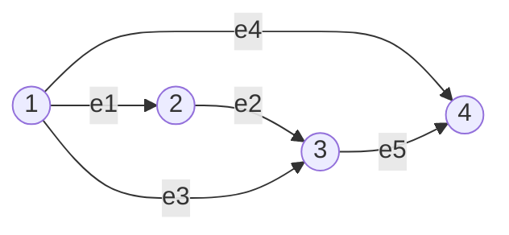
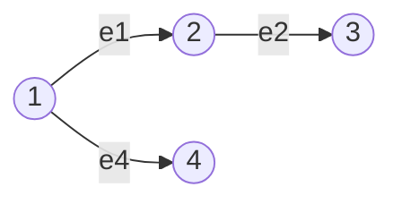
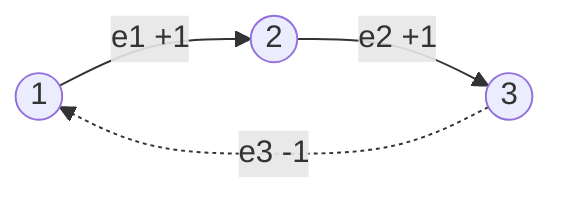
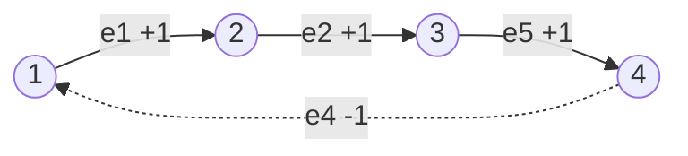
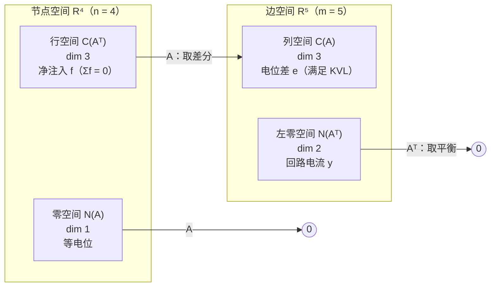
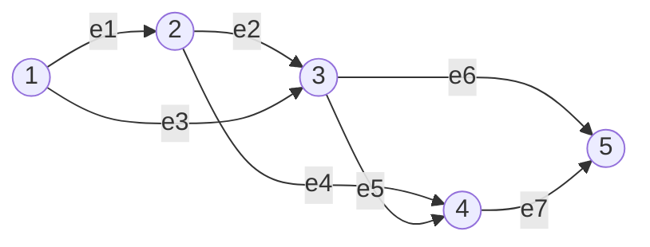
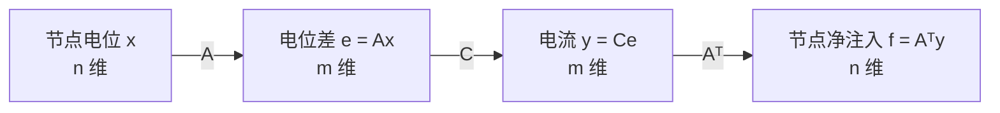

---
tags:
  - 线性代数LinearAlgebra
  - 图Graph
  - 关联矩阵IncidenceMatrix
  - 四个基本子空间FourSubspaces
  - 零空间NullSpace
  - 左零空间LeftNullSpace
  - 秩Rank
  - 树Tree
  - 回路Loop
  - 欧拉公式EulerFormula
  - 基尔霍夫定律KirchhoffLaw
  - 拉普拉斯矩阵Laplacian
---

# 图·网络·关联矩阵 Graphs, Networks, Incidence Matrices · 18.06 L12

**时间:** 2026-10-25
**标签:** #线性代数LinearAlgebra #图Graph #关联矩阵IncidenceMatrix #四个基本子空间FourSubspaces #零空间NullSpace #左零空间LeftNullSpace #秩Rank #树Tree #回路Loop #欧拉公式EulerFormula #基尔霍夫定律KirchhoffLaw #拉普拉斯矩阵Laplacian
**关联:** [[L11 矩阵空间·秩1·小世界图]]（图与关联矩阵的引子）· [[L10 四个基本子空间]]（四个空间在真实矩阵上落地）· [[L9 线性无关·基·维数]]（基、维数、秩）· [[L7 求解Ax=0主变量与特解]]（零空间的求法）· [[12. Graphs, Networks, Incidence Matrices]]（原始字幕）

## 必要性（为什么要有这一章）

前面十一讲的矩阵大多是「老师随手造的」，元素之间没有关系。真实的线性代数不是这样：**矩阵从问题里长出来，带着结构，而结构决定答案。**

这一讲的主角是**图（graph）**——应用数学里最重要的离散模型：

- 互联网 = 网页 + 链接；电话网 = 交换机 + 线路；社交网 = 人 + 朋友关系；
- 电路 = 节点 + 导线；桁架桥 = 节点 + 杆件；水管网 = 接头 + 管道。

把图写成矩阵，只需要一张**关联矩阵（incidence matrix）**：一行一条边，一列一个节点，元素只有 $+1,-1,0$。矩阵很大但极稀疏（每行只有两个非零元，全矩阵共 $2m$ 个）。

它的价值在于：**四个基本子空间全部有了物理含义。**

| 线性代数 | 电路里的名字 |
| ---- | ---- |
| $Ax$ | 各边**电位差**（电压降） |
| $N(A)$ | **等电位**分布（差一个常数） |
| $A^{\mathsf T}y=0$ | **基尔霍夫电流定律**（流入 = 流出） |
| $N(A^{\mathsf T})$ | **回路电流**（绕圈流，不在节点堆积） |
| $\operatorname{rank}A$ | 节点数 $-$ 1，即**生成树**的边数 |
| $m-r$ | **独立回路**个数 |

最后这三条方程合起来就是应用数学最基本的结构：

$$
Ax=e,\qquad y=Ce\ (\text{欧姆定律}),\qquad A^{\mathsf T}y=f\ (\text{电流平衡}).
$$

## 主要内容

### 1. 图与关联矩阵

一张图由 **节点（nodes/vertices）** 和 **边（edges）** 组成。给每条边指定一个方向（方向是人为的，只用来定正负号），就得到**有向图**。

Strang 的例题：$n=4$ 个节点、$m=5$ 条边。

**关联矩阵 $A$**：行对应边，列对应节点。一条边 $i\to j$ 在行里写 $i$ 列为 $-1$、$j$ 列为 $+1$（**尾 $-1$、头 $+1$**），其余为 $0$。

$$
A=\begin{bmatrix}
-1 & 1 & 0 & 0\\
0 & -1 & 1 & 0\\
-1 & 0 & 1 & 0\\
-1 & 0 & 0 & 1\\
0 & 0 & -1 & 1
\end{bmatrix}
\quad
\begin{array}{l}
e_1:1\to2\\
e_2:2\to3\\
e_3:1\to3\\
e_4:1\to4\\
e_5:3\to4
\end{array}
$$

三个一眼可见的结构：

1. **每行两个非零元**：$+1$ 和 $-1$，所以**每行之和为 0**（这正是零空间含常数向量的原因）；
2. **每列的非零元个数 = 该节点的度数**（习题课里用它算迹）；
3. 非零元总数 $=2m=10$，所以图越大矩阵越稀疏。

**$Ax$ 是什么？** 设节点电位 $x=(x_1,x_2,x_3,x_4)^{\mathsf T}$，则

$$
Ax=\begin{bmatrix}x_2-x_1\\ x_3-x_2\\ x_3-x_1\\ x_4-x_1\\ x_4-x_3\end{bmatrix}
=\text{每条边上的电位差}.
$$

**数字实例**：取 $x=(3,1,1,0)^{\mathsf T}$，

$$
Ax=(1-3,\ 1-1,\ 1-3,\ 0-3,\ 0-1)^{\mathsf T}=(-2,0,-2,-3,-1)^{\mathsf T}.
$$

如果把所有电位同时抬高 $c=2$，即 $x'=(5,3,3,2)^{\mathsf T}$，再算一遍：

$$
Ax'=(3-5,\ 3-3,\ 3-5,\ 2-5,\ 2-3)^{\mathsf T}=(-2,0,-2,-3,-1)^{\mathsf T}=Ax.
$$

**差不变，是因为 $A$ 的每一行加起来为零**——共同的偏移被 $+1$ 和 $-1$ 抵消了。这句话就是下一节零空间的全部内容。

### 2. 零空间 $N(A)$：等电位

$$
Ax=0\iff \text{每条边两端电位都相等}.
$$

图是连通的，所有节点被边串在一起 ⇒ **所有 $x_i$ 必须相等**：

$$
N(A)=\operatorname{span}\left\{(1,1,1,1)^{\mathsf T}\right\},\qquad \dim N(A)=1.
$$

**物理含义**：电位只能确定到一个常数。真正驱动电流的是**电位差**，所有电位同时加 $c$，什么也不会发生。这和微积分里不定积分带一个 $+C$、温度可以用摄氏也可以用开尔文，是同一件事。

**工程做法：接地（grounding）。** 把某个节点电位固定为 0（通常是最后一个节点），未知数就从 4 个变成 3 个，$A$ 去掉一列后三列线性无关，可以解出唯一答案。

> **一般情形（连通分量）**：图若有 $c$ 个连通分量，每个分量内部电位一致、分量之间互不相干，于是
> $$\dim N(A)=c,\qquad \operatorname{rank}A=n-c.$$
> 例：两条互不相连的边（$n=4,m=2$），$A=\begin{bmatrix}-1&1&0&0\\0&0&-1&1\end{bmatrix}$，秩 $2=4-2$，零空间由 $(1,1,0,0)$ 和 $(0,0,1,1)$ 张成，维数 $2$。

### 3. 秩与树：$r=n-1$

由 $\dim N(A)=1$ 与秩-零化度定理：

$$
r=n-\dim N(A)=4-1=3.
$$

也就是说：**$4$ 个节点里只有 $3$ 个电位的「差」是独立的**，第 4 个只能当参考点。

哪些行（边）是独立的？Strang 选出的主元行是 **$e_1,e_2,e_4$**——它们恰好构成一棵**树（tree）**：

**树 = 连通且没有回路的图。** 它的三条性质正好对应三个代数事实：

| 图的性质 | 代数含义 |
| ---- | ---- |
| $n$ 个节点的树恰有 $n-1$ 条边 | $\operatorname{rank}A=n-1$ |
| 树中任意两点只有一条路径 | 行（边）之间没有线性关系 |
| 加一条边必产生一个回路 | 增加的行落入已有行的张成，秩不变 |
| 删一条边必分成两块 | 去掉一个独立约束，秩减 1 |

所以**秩 = 生成树所需的边数**；其余的边都是「多余」的，每多一条就多一个回路。

### 4. 左零空间 $N(A^{\mathsf T})$：基尔霍夫电流定律

现在看 $A^{\mathsf T}y=0$。$y=(y_1,\dots,y_5)$ 是每条边上的**电流**（顺着箭头为正）。把 $A^{\mathsf T}$ 写出来：

$$
A^{\mathsf T}=\begin{bmatrix}
-1 & 0 & -1 & -1 & 0\\
1 & -1 & 0 & 0 & 0\\
0 & 1 & 1 & 0 & -1\\
0 & 0 & 0 & 1 & 1
\end{bmatrix},
\qquad
A^{\mathsf T}y=\begin{bmatrix}
-y_1-y_3-y_4\\
y_1-y_2\\
y_2+y_3-y_5\\
y_4+y_5
\end{bmatrix}.
$$

**每一行对应一个节点**，方程说的是：**流入该节点的电流 = 流出该节点的电流**（净流量为零）——这就是**基尔霍夫电流定律（KCL）**，电荷不在节点堆积。

- 节点 1：$y_1+y_3+y_4$ 全向外，所以和为 0；
- 节点 2：$y_1=y_2$，一进一出；
- 节点 3：$y_2+y_3$ 流入，$y_5$ 流出；
- 节点 4：$y_4+y_5=0$。

**维数**：$m=5$ 列，秩 $r=3$，所以

$$
\dim N(A^{\mathsf T})=m-r=5-3=2.
$$

$2$ 正好是**独立回路的个数**。基向量就是两股「绕圈流」的电流：

**回路一**：沿三角形 $1\to2\to3\to1$ 流 $1$ 安培（$e_3$ 逆着箭头，所以是 $-1$）。

$$
y^{(1)}=(1,\ 1,\ -1,\ 0,\ 0)^{\mathsf T}.
$$

逐个节点验算：节点 1 出 $1$、出 $-1$（即进 $1$），净 $0$；节点 2 进 $1$ 出 $1$；节点 3 进 $1$、进 $-1$（即出 $1$）。平衡。

**回路二**：沿三角形 $1\to3\to4\to1$ 流 $1$ 安培（$e_4$ 逆着箭头）。

$$
y^{(2)}=(0,\ 0,\ 1,\ -1,\ 1)^{\mathsf T}.
$$

**大回路**（$1\to2\to3\to4\to1$）的电流是两者之和：

$$
y^{(1)}+y^{(2)}=(1,\ 1,\ 0,\ -1,\ 1)^{\mathsf T}.
$$

中间那条 $e_3$ 上两股反向电流相互抵消，所以它不出现。**大回路不是新的独立回路，而是两个小回路的叠加**——这就是「独立回路」中「独立」二字的含义。

> **回路空间的维数公式**：独立回路数 $=m-r=m-(n-1)=m-n+1$。

### 5. 四个基本子空间在电路里的位置

$A$ 把行空间**同构**地送到列空间（维数都是 3），把零空间压成 0；$A^{\mathsf T}$ 反过来把左零空间压成 0、把列空间送回行空间。

| 子空间 | 所在空间 | 维数（本例） | 物理含义 |
| ---- | :--: | :--: | ---- |
| 列空间 $C(A)$ | $\mathbb R^5$（边） | $3$ | 能由电位产生的**电位差**分布（满足基尔霍夫电压定律） |
| 零空间 $N(A)$ | $\mathbb R^4$（节点） | $1$ | **等电位**：所有节点同加一个常数 |
| 行空间 $C(A^{\mathsf T})$ | $\mathbb R^4$（节点） | $3$ | 能作为**外部注入电流** $f$ 的分布（净注入必须为 0） |
| 左零空间 $N(A^{\mathsf T})$ | $\mathbb R^5$（边） | $2$ | **回路电流**：绕圈流，不改变节点电荷 |

两组正交关系在这里有了名字：

- $C(A)\perp N(A^{\mathsf T})$ ⇔ $\;y^{\mathsf T}(Ax)=0$ 对任意回路电流 $y$、任意电位 $x$ 成立 ⇔ **绕任意回路一圈，电位差之和为零**——这就是**基尔霍夫电压定律（KVL）**。
- $C(A^{\mathsf T})\perp N(A)$ ⇔ $f^{\mathsf T}\mathbf 1=0$ ⇔ **外部注入的总电流为零**（有进必有出），否则电荷会无限堆积，方程无解。

**数字验证 KVL**：取电位 $x=(1,2,4,3)^{\mathsf T}$，则

$$
e=Ax=(2-1,\ 4-2,\ 4-1,\ 3-1,\ 3-4)^{\mathsf T}=(1,2,3,2,-1)^{\mathsf T}.
$$

用回路一 $y^{(1)}=(1,1,-1,0,0)$ 做内积：

$$
y^{(1)\mathsf T}e=1\cdot1+1\cdot2+(-1)\cdot3+0+0=0. \quad\checkmark
$$

### 6. 欧拉公式：$n-m+\text{回路数}=1$

把上面的公式拼起来。对连通图：

$$
\#\text{回路}=m-r=m-(n-1)=m-n+1,
$$

移项即

$$
\boxed{\;n-m+\#\text{回路}=1\;}
$$

这就是**欧拉公式**（Euler's formula）的图论版本。Strang 的原话：**线性代数证明了欧拉公式。**

**第二个例子**：$5$ 个节点、$7$ 条边、$3$ 个独立回路（三个三角形串成一条链）。

$$
5-7+3=1.\quad\checkmark
$$

| 类型 | 维数直觉 | 本例计数 |
| ---- | ---- | :--: |
| 节点 | $0$ 维对象（点） | $5$ |
| 边 | $1$ 维对象（线段） | $7$ |
| 回路 | $2$ 维对象（有面积） | $3$ |

交替相加减得到 $1$，是**拓扑不变量**（连通图的欧拉示性数）。树是最极端的例子：$m=n-1$、回路 $0$，代入仍得 $1$。

> **与平面图欧拉公式的关系**：连通平面图满足 $V-E+F=2$（$F$ 是面数，含外部无限面）。而 $F=\text{回路数}+1$（外部面不算回路围成的面），代入即得 $V-E+\text{回路数}=1$。两套公式是同一件事。
>
> **多个连通分量**：若图有 $c$ 个分量，则 $n-m+\text{回路数}=c$。上文的「两条孤立边」：$4-2+0=2$，与 $\operatorname{rank}=n-c=2$ 一致。

### 7. 应用数学的三条方程（完整电路算例）

1. **$e=Ax$**：电位 → 电位差（几何/差分算子）。
2. **$y=Ce$**：电位差 → 电流。$C$ 是对角矩阵，对角元是各边的**电导**（电阻的倒数）。这就是**欧姆定律** $I=\dfrac{\Delta V}{R}$。
3. **$A^{\mathsf T}y=f$**：电流必须满足平衡；$f$ 是外部注入每个节点的电流源。

三步串起来：

$$
A^{\mathsf T}C\,A\,x=f.
$$

当所有电导为 $1$（$C=I$）时就是 $A^{\mathsf T}A\,x=f$。**这就是有限元、电路仿真、弹簧网络、热传导共用的方程。**

**$A^{\mathsf T}A$ 是什么？** 对本例：

$$
A^{\mathsf T}A=\begin{bmatrix}
3 & -1 & -1 & -1\\
-1 & 2 & -1 & 0\\
-1 & -1 & 3 & -1\\
-1 & 0 & -1 & 2
\end{bmatrix}
=L.
$$

- 对角元 = 节点的**度数**（接到几条边）：$(3,2,3,2)$；
- 非对角元 = 两节点间有边则为 $-1$，否则 $0$；
- 这个矩阵叫**拉普拉斯矩阵（graph Laplacian）**，必然对称、行和为 0、半正定，零空间就是 $(1,1,1,1)$。

**完整数字算例**：设所有电阻为 $1$，节点 4 接地（$x_4=0$），在节点 1 注入 $1$ A、从节点 3 抽出 $1$ A，即

$$
f=(1,\ 0,\ -1,\ 0)^{\mathsf T},\qquad \textstyle\sum f_i=0.
$$

解 $Lx=f$（删去第 4 行第 4 列，因为 $x_4=0$ 已知）：

$$
\begin{bmatrix}3&-1&-1\\-1&2&-1\\-1&-1&3\end{bmatrix}
\begin{bmatrix}x_1\\x_2\\x_3\end{bmatrix}
=\begin{bmatrix}1\\0\\-1\end{bmatrix}
\;\Longrightarrow\;
x=\begin{bmatrix}1/4\\ 0\\ -1/4\end{bmatrix}.
$$

**回代求电流** $y=Ax$（取 $x_4=0$）：

$$
y=\left(-\tfrac14,\ -\tfrac14,\ -\tfrac12,\ -\tfrac14,\ \tfrac14\right)^{\mathsf T}.
$$

**逐节点验算 KCL**：

- 节点 1：三条边都以节点 1 为起点，有向流量 $y_1+y_3+y_4=-1$，负号表示实际**流入** $1$ A，正是 $f_1=1$；
- 节点 2：$y_1-y_2=0$；
- 节点 3：$y_2+y_3-y_5=-\tfrac14-\tfrac12-\tfrac14=-1$，即净流出 $1$ A，正是 $f_3=-1$；
- 节点 4：$y_4+y_5=0$（接地端只做参考，不注入电流）。

全部吻合。注意：**原来的 $4\times4$ 拉普拉斯矩阵奇异（零空间是常数向量），接地删掉一行一列后才可逆**——这是所有电路仿真软件都要做的第一步。

## 直观理解（空间视角）

- **电位 = 海拔**：水流只由高度差驱动，整片地形同时抬高 $100$ 米，水流方向一点不变。零空间的那个 $(1,1,1,1)$ 就是「整体抬高」。
- **接地 = 选海平面**：海拔的绝对值没有意义，必须先规定哪里是 $0$。参考点选谁都行，选完后所有电位唯一，但**算出的电位差（电流）与选择无关**。
- **KCL = 水龙头分叉处的水量守恒**：流入的水要么流出，要么在节点积起来——稳态下不积水，所以进出相等。
- **回路电流 = 水里的漩涡**：单独一股绕圈流，每个节点都是「进多少出多少」，所以完全不违反 KCL。任何复杂的环流都能拆成几个基本漩涡的叠加；大回路 = 两个小漩涡叠加，中间那条边互相抵消。
- **树 = 脚手架**：$n$ 个节点只要 $n-1$ 根杆就能连成一体，这是最省的。每多加一根杆，就多围出一个回路——**回路数 $=m-(n-1)$ 是「多买了几根杆」**。
- **秩 = 脚手架的根数**：$\operatorname{rank}A=n-1$ 不是巧合，它数的是「连通 $n$ 个节点至少需要几条边」。
- **欧拉公式 = 按维数数数**：点（0 维）、线（1 维）、面（2 维）交替加减，任何连通图都得 $1$。这是拓扑学里欧拉示性数最简单的样本。
- **拉普拉斯矩阵 = 每个节点的「不适感」**：$(Lx)_i=\sum_{j\sim i}(x_i-x_j)$，即「我比邻居平均高多少」。邻居都跟我一样高就没感觉。热传导、扩散、图像去噪都靠这个算子。
- **$C(A)\perp N(A^{\mathsf T})$ 就是 KVL**：电位差是由电位产生的，所以绕任意闭合回路走一圈，上上下下加起来必然回到原点——电压降之和为零。回路电流与它正交，正是这句话的内积写法。
- **$C(A^{\mathsf T})\perp N(A)$ 就是总电荷守恒**：能注入网络的电流模式，必须与「所有节点同加常数」正交，也就是各节点注入量之和为零（有进有出）。
- **$A^{\mathsf T}A$ 为什么对称**：$(A^{\mathsf T}A)^{\mathsf T}=A^{\mathsf T}A$ 恒成立；在图上它还多一层意思——第 $i$ 行第 $j$ 列只由节点 $i,j$ 是否相邻决定，**矩阵就是图的另一张画像**。

## 拓展延伸（与 AI / 计算机的关联）

- **谱图理论（spectral graph theory）**：$L=A^{\mathsf T}A$ 的特征值刻画图的结构。$0$ 特征值的重数 = 连通分量数；第二个最小特征值 $\lambda_2$（Fiedler 值）衡量「多好切」；对应的 Fiedler 向量给出**谱聚类**的切分方向。图像分割、社区发现都用它。
- **图神经网络（GNN）**：一层消息传递 $H'=\hat A H W$，$\hat A$ 是归一化邻接矩阵；图卷积网络（GCN）的传播算子本质是拉普拉斯矩阵的多项式。**PageRank** 则是随机游走转移矩阵的主特征向量。
- **有限元与结构力学**：杆件/弹簧网络的刚度矩阵就是 $A^{\mathsf T}CA$ 的形式，$C$ 是材料刚度。整座桥、整架飞机的应力分析都归结为解一个巨大的稀疏 $A^{\mathsf T}CA\,x=f$。
- **电路仿真（SPICE）**：节点分析法（nodal analysis）直接就是 $A^{\mathsf T}CA\,x=f$；接地、电压源、电流源分别对应删列、加约束、加右端项。
- **稀疏矩阵与计算**：关联矩阵每行只有两个非零元。消元会产生「填充（fill-in）」，矩阵的行列重排（图划分）能大幅减少计算量——并行求解器的负载均衡就是在给图做分割。
- **拓扑与同调**：$b_0=c$（连通分量数）、$b_1=$ 独立回路数，正是零维与一维 Betti 数；$n-m+\text{回路}=c$ 是欧拉示性数。更高维的单纯复形、持续同调（persistent homology）是同一套「边界算子 + 零空间」的语言。
- **编码理论**：把关联矩阵放到二元域 $\mathbb F_2$ 上（$+1\equiv-1$），$A$ 的零空间就是**环空间**，LDPC 码、量子纠错码的校验矩阵正是这种稀疏 0/1 矩阵。
- **最小二乘与网络流**：$A^{\mathsf T}A$ 是正规方程的核心；网络流、最短路、匹配等问题都在关联矩阵的零空间/列空间里做文章。

## Note（连接 / 深化）

- **连接**：这一讲把 L10 的四个基本子空间全部「落地」——之前是抽象维数，现在是电位、电流、回路、注入；L9 的基与维数在这里变成了「树」和「回路数」；L11 结尾的关联矩阵预告在此兑现；L7 的零空间算法（消元求特解）在这里被「看图直接写出基」取代。
- **深化**：$A^{\mathsf T}A$ 是拉普拉斯矩阵，把线性代数接到谱图理论；「回路数 $=m-n+1$」是拓扑欧拉示性数的特例；$A^{\mathsf T}CA$ 是有限元/电路仿真的通用骨架。Strang 留下的问题「$A^{\mathsf T}A$ 有什么性质」——对称、半正定、零空间与 $A$ 相同，是后面正定矩阵与 SVD 的伏笔。

## 思考

1. 如果图不连通（比如 $c=3$ 个分量），$\operatorname{rank}A$、$\dim N(A)$、独立回路数分别是多少？欧拉公式变成什么？
2. 在一棵树上**加一条边**，秩、零空间维数、左零空间维数各怎么变？**删一条边**呢？
3. 接地时选哪个节点有区别吗？最终算出的电流 $y$ 会不会变？为什么？
4. 为什么 $f$ 必须满足 $\sum f_i=0$？如果不满足，$A^{\mathsf T}CA\,x=f$ 有解吗？物理上发生了什么？
5. $A^{\mathsf T}A$ 与 $AA^{\mathsf T}$ 分别是什么尺寸？它们的非零特征值有什么关系？零空间分别是什么？
6. 平面图的 $V-E+F=2$ 与本讲的 $n-m+\text{回路}=1$ 如何互相推出？
7. 若把关联矩阵的所有元素取绝对值（丢掉方向），得到的矩阵还能区分「树」和「有回路的图」吗？

## 总结

**本质**：图 = 节点 + 边；关联矩阵 $A$ 一行一条边（尾 $-1$、头 $+1$），把图翻译成线性代数。于是 $Ax$ 是电位差，$N(A)$ 是等电位（维数 = 连通分量数），$\operatorname{rank}A=n-c$（连通时 $n-1$，对应生成树的边数），$N(A^{\mathsf T})$ 是回路电流（维数 $m-r=m-n+1$）。四个基本子空间分别对应电位差、等电位、可注入电流、回路电流；两组正交关系就是 KVL 与总电荷守恒。独立回路数代入秩公式得到欧拉公式 $n-m+\text{回路}=1$。最后 $e=Ax$、$y=Ce$、$A^{\mathsf T}y=f$ 串成 $A^{\mathsf T}CA\,x=f$——有限元、电路、弹簧网络、热传导的共同骨架，而 $A^{\mathsf T}A$ 就是图拉普拉斯矩阵。

### 本讲新引入的专业术语

| 英文术语 | 中文 | 含义 |
| ---- | ---- | ---- |
| graph / node / edge | 图 / 节点 / 边 | 离散模型的基本对象 |
| incidence matrix | 关联矩阵 | 行 = 边、列 = 节点，元素为 $-1,0,+1$ |
| orientation | 定向 | 给边人为指定方向，用来定电流正负 |
| sparse matrix | 稀疏矩阵 | 非零元很少（关联矩阵每行仅 2 个） |
| potential | 电位 | 节点上的标量，差一个常数不影响物理 |
| potential difference | 电位差 | $Ax$ 的分量，驱动电流 |
| grounding | 接地 | 固定某节点电位为 0，消除常数自由度 |
| current | 电流 | 边上的流量，$y=Ce$ |
| conductance | 电导 | 电阻的倒数，$C$ 的对角元 |
| Ohm's law | 欧姆定律 | $y=Ce$，电流正比于电位降 |
| Kirchhoff's current law (KCL) | 基尔霍夫电流定律 | $A^{\mathsf T}y=0$：流入 = 流出 |
| Kirchhoff's voltage law (KVL) | 基尔霍夫电压定律 | 回路电位差之和为零（$e\perp N(A^{\mathsf T})$） |
| loop / cycle | 回路 | 闭合路径，对应 $N(A^{\mathsf T})$ 的基向量 |
| independent loops | 独立回路 | 回路空间的维数 $m-n+1$ |
| tree / spanning tree | 树 / 生成树 | 连通无回路；$n-1$ 条边，对应主元行 |
| rank | 秩 | 连通图 $r=n-1$，一般 $r=n-c$ |
| graph Laplacian | 图拉普拉斯矩阵 | $L=A^{\mathsf T}A$，对角为度数、邻接为 $-1$ |
| Euler's formula | 欧拉公式 | $n-m+\text{回路数}=c$（连通时 $=1$） |
| Euler characteristic | 欧拉示性数 | 交替计数得到的不变量 |
| connected component | 连通分量 | 极大连通子图，个数 $c$ |

**标签:** #线性代数LinearAlgebra #图Graph #关联矩阵IncidenceMatrix #四个基本子空间FourSubspaces #零空间NullSpace #左零空间LeftNullSpace #秩Rank #树Tree #回路Loop #欧拉公式EulerFormula #基尔霍夫定律KirchhoffLaw #拉普拉斯矩阵Laplacian
