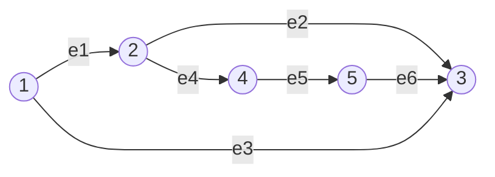
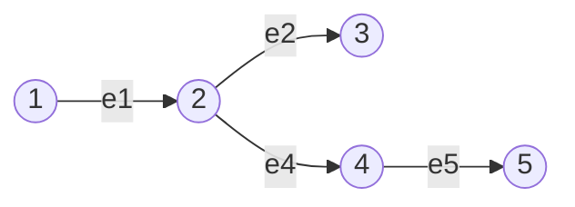
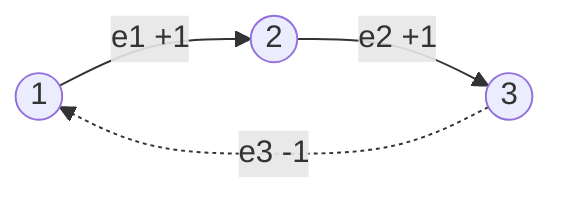
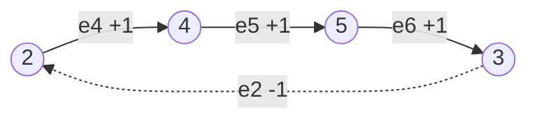

---
tags:
  - 线性代数LinearAlgebra
  - 图Graph
  - 关联矩阵IncidenceMatrix
  - 零空间NullSpace
  - 左零空间LeftNullSpace
  - 迹Trace
  - 拉普拉斯矩阵Laplacian
  - 基尔霍夫定律KirchhoffLaw
---

# 图与网络 · 18.06SC 习题课(L12)

**时间:** 2026-10-25
**标签:** #线性代数LinearAlgebra #图Graph #关联矩阵IncidenceMatrix #零空间NullSpace #左零空间LeftNullSpace #迹Trace #拉普拉斯矩阵Laplacian #基尔霍夫定律KirchhoffLaw
**关联:** [[L12 图·网络·关联矩阵]]（主课：四空间、树、回路、欧拉公式）· [[L10 四个基本子空间]]（零空间与左零空间）· [[L11 矩阵空间·秩1·小世界图]]（图的预告）· [[Graphs and Networks]]（原始字幕）

## 必要性

主课把四个基本子空间搬到了电路上，这一讲习题课要练的是**反过来**：

> 不做任何行变换，只看着图，把关联矩阵的零空间、左零空间、秩、迹全部读出来。

这是本讲最值钱的能力。消元法当然能算，但图的结构已经把答案写在脸上：

- 零空间 = 「所有节点电位相同」；
- 左零空间 = 「绕回路流的电流」；
- 秩 = 「生成树需要几条边」；
- $\operatorname{tr}(A^{\mathsf T}A)$ = 「所有节点度数之和」。

## 题目

给定下图：$5$ 个节点、$6$ 条边，边已编号并标好方向。

1. 写出关联矩阵 $A$；
2. 求 $\ker A$；
3. 求 $\ker A^{\mathsf T}$；
4. 求 $\operatorname{tr}(A^{\mathsf T}A)$。

## 主要内容

### 1. 写关联矩阵

规则：**行 = 边，列 = 节点；尾 $-1$、头 $+1$，其余为 $0$。**

$$
A=\begin{bmatrix}
-1 & 1 & 0 & 0 & 0\\
0 & -1 & 1 & 0 & 0\\
-1 & 0 & 1 & 0 & 0\\
0 & -1 & 0 & 1 & 0\\
0 & 0 & 0 & -1 & 1\\
0 & 0 & 1 & 0 & -1
\end{bmatrix}
\quad
\begin{array}{l}
e_1:1\to2\\
e_2:2\to3\\
e_3:1\to3\\
e_4:2\to4\\
e_5:4\to5\\
e_6:5\to3
\end{array}
$$

三条结构性检查（每次写完都该验）：

- 每行恰好一个 $+1$、一个 $-1$ ⇒ **行和为 0**（零空间含常向量）；
- 每列非零元个数 = 该节点的度数（后面算迹要用）；
- 非零元共 $2m=12$ 个。

### 2. $\ker A$：等电位

$Ax=0$ 的意思是每条边两端的电位差为零。图是连通的，边把所有节点串在一起，所以

$$
x_1=x_2=x_3=x_4=x_5.
$$

$$
\boxed{\;\ker A=\operatorname{span}\left\{(1,1,1,1,1)^{\mathsf T}\right\},\qquad \dim\ker A=1.\;}
$$

**不用消元，用连通性。** 同时得到秩：

$$
\operatorname{rank}A=n-\dim\ker A=5-1=4,
$$

正好是「$5$ 个节点的生成树需要 $4$ 条边」。例如 $e_1,e_2,e_4,e_5$ 这四条边就把五个节点全连起来且没有回路：

这四行线性无关，可以作为行空间的一组基；剩下两条边 $e_3,e_6$ 各自带来一个回路。

### 3. $\ker A^{\mathsf T}$：平衡的回路电流

$A^{\mathsf T}y=0$ 是每个节点的**基尔霍夫电流定律**：流入 = 流出。维数由秩-零化度给出：

$$
\dim\ker A^{\mathsf T}=m-\operatorname{rank}A=6-4=2,
$$

所以需要 **2 个独立回路**。这个图确实有两个基本回路：上面的三角形和下面的四边形。

**回路一（三角形 $1\to2\to3\to1$）**：沿 $e_1,e_2$ 正向流，沿 $e_3$ 反向流。

$$
y^{(1)}=(1,\ 1,\ -1,\ 0,\ 0,\ 0)^{\mathsf T}.
$$

**回路二（四边形 $2\to4\to5\to3\to2$）**：沿 $e_4,e_5,e_6$ 正向流，沿 $e_2$ 反向流。

$$
y^{(2)}=(0,\ -1,\ 0,\ 1,\ 1,\ 1)^{\mathsf T}.
$$

**逐节点验算 KCL**（$A^{\mathsf T}y$ 的第 $i$ 个分量 = 节点 $i$ 的净流入）：

| 节点 | $A^{\mathsf T}y^{(1)}$ | $A^{\mathsf T}y^{(2)}$ |
| :--: | ---- | ---- |
| 1 | $-y_1-y_3=-1+1=0$ | $0$ |
| 2 | $y_1-y_2-y_4=1-1-0=0$ | $0-(-1)-1=0$ |
| 3 | $y_2+y_3+y_6=1-1+0=0$ | $-1+0+1=0$ |
| 4 | $y_4-y_5=0-0=0$ | $1-1=0$ |
| 5 | $y_5-y_6=0-0=0$ | $1-1=0$ |

**第三个「回路」是外圈** $1\to2\to4\to5\to3\to1$：

$$
y^{(1)}+y^{(2)}=(1,\ 0,\ -1,\ 1,\ 1,\ 1)^{\mathsf T}.
$$

共用的边 $e_2$ 上一正一负抵消，所以外圈向量里 $e_2$ 为 0。它**不是新的独立回路**，只是前两个的叠加——这就是「共有 3 个回路、但只有 2 个独立」的含义。

> 所以 $\ker A^{\mathsf T}$ 的一组基是 $\{y^{(1)},y^{(2)}\}$；外圈向量落在它们的张成里。**回路空间的维数 = 边数 $-$ 生成树边数 $=m-(n-1)$。**

### 4. $\operatorname{tr}(A^{\mathsf T}A)$：数度数

**方法一：迹的定义。** $A^{\mathsf T}A$ 的 $(i,i)$ 元是 $A$ 第 $i$ 列的模长平方。关联矩阵每列只有 $+1,-1,0$，平方后只剩 $0/1$，所以

$$
(A^{\mathsf T}A)_{ii}=\text{第 }i\text{ 列的非零元个数}=\text{节点 }i\text{ 的度数}.
$$

本图各节点度数：

| 节点 | 相连的边 | 度数 |
| :--: | ---- | :--: |
| 1 | $e_1,e_3$ | 2 |
| 2 | $e_1,e_2,e_4$ | 3 |
| 3 | $e_2,e_3,e_6$ | 3 |
| 4 | $e_4,e_5$ | 2 |
| 5 | $e_5,e_6$ | 2 |

$$
\operatorname{tr}(A^{\mathsf T}A)=2+3+3+2+2=\boxed{12}.
$$

**方法二：数非零元。** $\operatorname{tr}(A^{\mathsf T}A)=\sum_{ij}a_{ij}^2$ 就是矩阵所有元素的平方和（Frobenius 范数平方）。每行两个非零元、共 $6$ 行，所以

$$
\operatorname{tr}(A^{\mathsf T}A)=2m=2\times6=12.
$$

两条路必然一致，因为**每条边贡献两个端点，度数总和 = 边数的两倍**（握手引理）。

**顺手写出 $A^{\mathsf T}A$**，验证它就是拉普拉斯矩阵：

$$
A^{\mathsf T}A=\begin{bmatrix}
2 & -1 & -1 & 0 & 0\\
-1 & 3 & -1 & -1 & 0\\
-1 & -1 & 3 & 0 & -1\\
0 & -1 & 0 & 2 & -1\\
0 & 0 & -1 & -1 & 2
\end{bmatrix}.
$$

- 对角元 $(2,3,3,2,2)$ 就是度数，迹 $=12$ ✓；
- 非对角元：相邻为 $-1$，不相邻为 $0$；
- 每行之和为 0 ⇒ $(1,1,1,1,1)^{\mathsf T}$ 在零空间里（与 $\ker A$ 相同，因为 $A^{\mathsf T}Ax=0\Rightarrow\|Ax\|^2=0$）。

## 直观理解（空间视角）

- **零空间不用算，用「连通」**：所有边都要求两端电位相等，连通图就把所有节点绑成同一个电位——一条链子把所有人拴在一起，谁也别想单独动。
- **左零空间 = 漩涡**：三角形里转一圈、四边形里转一圈，每个节点进多少出多少，完全平衡。外圈只是两个漩涡叠起来，中间共用的边互相抵消，所以不是新东西。
- **秩 = 树的边数**：$5$ 个节点最少要 $4$ 条边才能连通，所以 $\operatorname{rank}A=4$；多出来的 $6-4=2$ 条边，每一条都围出一个回路。
- **迹 = 把所有插头数一遍**：每条边有两端，所以总度数 $=2m$；$\operatorname{tr}(A^{\mathsf T}A)$ 恰好就是这个计数。这是「矩阵的迹 = 图的度数和」的一个漂亮巧合（其实是必然）。
- **$A^{\mathsf T}A$ 是图的「关系表」**：对角告诉你每个节点有几条线，非对角告诉你谁和谁相连。换一种写法，它就是邻接矩阵加对角修正。

## 拓展延伸（与 AI / 计算机的关联）

- **拉普拉斯矩阵与谱**：$L=A^{\mathsf T}A$ 的零空间维数 = 连通分量数；$\lambda_2$（Fiedler 值）衡量图的连通紧密程度，用于谱聚类与图像分割。
- **度数矩阵与归一化**：$L=D-W$（$D$ 为度数对角阵，$W$ 为邻接矩阵）与 $A^{\mathsf T}A$ 只差符号约定；GCN 用 $D^{-1/2}WD^{-1/2}$ 归一化，避免高度数节点主导。
- **握手引理**：$\sum \deg(v)=2m$ 是图论最基本的计数恒等式；在矩阵语言里就是 $\operatorname{tr}(A^{\mathsf T}A)=2m$。
- **稀疏计算**：关联矩阵每行只有 2 个非零元，$A^{\mathsf T}A$ 的非零元数约为 $n+2m$，是典型的稀疏矩阵；有限元与电路仿真都依赖这一点。
- **欧拉公式交叉验证**：$n-m+\text{回路数}=5-6+2=1$ ✓，与主课公式一致。

## Note（连接 / 深化）

- **连接**：这是 L12 主课四空间的「读数练习」——$\ker A$、$\ker A^{\mathsf T}$、秩全部由图直接读出；L10 的左零空间在这里有了物理名字（回路电流）；L11 的关联矩阵预告正式兑现。
- **深化**：$\operatorname{tr}(A^{\mathsf T}A)=\|A\|_F^2=2m=\sum\deg$ 把「迹、范数、度数」三件事绑在一起；$A^{\mathsf T}A$ 是拉普拉斯矩阵，为后面的正定矩阵、特征值、谱聚类埋下伏笔。

## 思考

1. 如果删掉 $e_2$，秩、$\dim\ker A$、$\dim\ker A^{\mathsf T}$ 各是多少？剩下的那一个独立回路是哪一个？
2. 如果图分成两个互不相连的部分，$\ker A$ 的维数是多少？$\operatorname{tr}(A^{\mathsf T}A)$ 还等于 $2m$ 吗？
3. 若给每条边串联一个电阻 $R_i$，方程变成 $A^{\mathsf T}CA\,x=f$，其中 $C=\operatorname{diag}(1/R_i)$。此时 $\operatorname{tr}(A^{\mathsf T}CA)$ 有什么物理含义？
4. 为什么 $\operatorname{rank}A=n-1$ 而不是 $n$？用「所有列向量加起来等于零向量」（即 $A\mathbf 1=0$）解释。
5. 外圈向量为什么等于两个小回路向量之和？从「边 $e_2$ 上的电流抵消」这个角度说明。

## 总结

**本质**：关联矩阵 $A$（行 = 边、列 = 节点、尾 $-1$ 头 $+1$）把图变成线性代数。$\ker A$ 是等电位（连通 ⇒ 一维，常向量），$\operatorname{rank}A=n-1$（生成树边数）；$\ker A^{\mathsf T}$ 是平衡电流（KCL），维数 $m-(n-1)=2$，基就是两个独立回路，外圈是它们的和；$\operatorname{tr}(A^{\mathsf T}A)$ 数的是度数之和 $=2m=12$，因为每列的非零元个数就是该节点的度数。整套计算没有做一次行变换——**图的结构就是答案**。

### 本讲新引入的专业术语

| 英文术语 | 中文 | 含义 |
| ---- | ---- | ---- |
| incidence matrix | 关联矩阵 | 行 = 边、列 = 节点，元素 $-1/0/+1$ |
| kernel / null space | 核 / 零空间 | $\ker A$：所有电位差为零 ⇒ 等电位 |
| kernel of transpose | 转置的核（左零空间） | $\ker A^{\mathsf T}$：满足 KCL 的回路电流 |
| balanced currents | 平衡电流 | 每个节点流入 = 流出 |
| loop / cycle | 回路 | 闭合路径，对应一个独立电流模式 |
| independent loops | 独立回路 | 回路空间维数 $m-n+1$ |
| spanning tree | 生成树 | 连通无回路，$n-1$ 条边，对应主元行 |
| degree | 度数 | 节点连接的边数 |
| trace | 迹 | 对角元之和；$\operatorname{tr}(A^{\mathsf T}A)=2m$ |
| Frobenius norm | Frobenius 范数 | $\|A\|_F^2=\sum a_{ij}^2=\operatorname{tr}(A^{\mathsf T}A)$ |
| Laplacian | 拉普拉斯矩阵 | $A^{\mathsf T}A$：对角为度数、邻接为 $-1$ |
| handshaking lemma | 握手引理 | 所有度数之和 $=2m$ |

**标签:** #线性代数LinearAlgebra #图Graph #关联矩阵IncidenceMatrix #零空间NullSpace #左零空间LeftNullSpace #迹Trace #拉普拉斯矩阵Laplacian #基尔霍夫定律KirchhoffLaw
