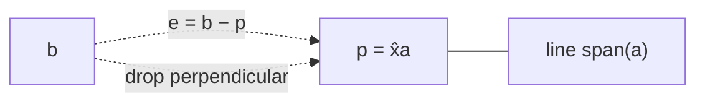
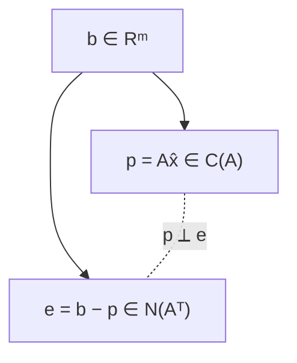

$Ax=b$ 无解时，不硬解，而是找列空间里离 $b$ 最近的点 $p$，再解 $A\hat x=p$。这个最近点就是 $b$ 在列空间上的**投影**；误差 $e=b-p$ 垂直于列空间，这一条几何事实推出整个最小二乘。

## 投影到一条直线

设直线方向为 $a$，$b$ 不在直线上。投影 $p$ 一定在直线上：

$$
p=xa.
$$

关键是误差 $e=b-p=b-xa$ 垂直于 $a$：

$$
a^{\mathsf T}(b-xa)=0.
$$

展开：

$$
a^{\mathsf T}b=x\,a^{\mathsf T}a
\Longrightarrow
x=\frac{a^{\mathsf T}b}{a^{\mathsf T}a}.
$$

于是

$$
p=ax=\frac{aa^{\mathsf T}}{a^{\mathsf T}a}b.
$$

括号位置不同，结果的含义完全不同：

- $a^{\mathsf T}b$ 是数；
- $aa^{\mathsf T}$ 是矩阵（列乘行，秩 $1$）。

投影矩阵：

$$
P=\frac{aa^{\mathsf T}}{a^{\mathsf T}a}.
$$

它把任意 $b$ 投到直线 $\operatorname{span}\{a\}$ 上。

### 数例

$a=(1,2)^{\mathsf T}$，$b=(3,1)^{\mathsf T}$。

$$
a^{\mathsf T}b=3+2=5,\qquad a^{\mathsf T}a=1+4=5,
$$

所以 $x=1$，$p=a=(1,2)^{\mathsf T}$，误差 $e=b-p=(2,-1)^{\mathsf T}$。

$$
a^{\mathsf T}e=2-2=0.
$$

投影矩阵：

$$
P=\frac15
\begin{bmatrix}1\\2\end{bmatrix}
\begin{bmatrix}1&2\end{bmatrix}
=\frac15
\begin{bmatrix}1&2\\2&4\end{bmatrix}
=
\begin{bmatrix}0.2&0.4\\0.4&0.8\end{bmatrix}.
$$

验证 $Pb=(0.2\cdot3+0.4\cdot1,\;0.4\cdot3+0.8\cdot1)=(1,2)=p$。

### 投影矩阵的三条性质

1. **对称**：$P^{\mathsf T}=P$。
2. **幂等**：$P^2=P$——投影一次已经在直线上，再投一次不动。
3. **秩 $1$**：$P$ 是列乘行，列空间就是直线 $\operatorname{span}\{a\}$。

几何上的两个极端：$b$ 在直线上时 $Pb=b$；$b\perp a$ 时 $Pb=0$。

**缩放规律**：$b\to2b$，$p\to2p$；$a\to2a$，直线不变，$p$ 不变。

## 投影到子空间

把直线换成 $A$ 的列空间。$A$ 是 $m\times n$，列 $a_1,\dots,a_n$ 线性无关，列空间是一个 $n$ 维子空间。

投影

$$
p=A\hat x
$$

是列空间里的某个组合。误差

$$
e=b-A\hat x
$$

必须垂直于**整个列空间**，也就是垂直于每一列：

$$
A^{\mathsf T}(b-A\hat x)=0.
$$

展开得到**正规方程**（normal equations）：

$$
\boxed{A^{\mathsf T}A\,\hat x=A^{\mathsf T}b.}
$$

若列线性无关，$A^{\mathsf T}A$ 可逆：

$$
\hat x=(A^{\mathsf T}A)^{-1}A^{\mathsf T}b.
$$

投影：

$$
p=A\hat x=A(A^{\mathsf T}A)^{-1}A^{\mathsf T}b.
$$

投影矩阵：

$$
\boxed{P=A(A^{\mathsf T}A)^{-1}A^{\mathsf T}.}
$$

和直线情形只差一个「逆」：一维时 $a^{\mathsf T}a$ 是数，可以直接除；高维时 $A^{\mathsf T}A$ 是矩阵，必须求逆。

### 为什么不能拆开

$$
A(A^{\mathsf T}A)^{-1}A^{\mathsf T}
\ne AA^{-1}(A^{\mathsf T})^{-1}A^{\mathsf T}=I
$$

因为 $A$ 不是方阵，$A^{-1}$ 根本不存在。只有当 $A$ 是方阵且可逆（列空间是整个 $\mathbb R^m$）时，投影才是恒等矩阵 $I$。

### 数例：投影到平面

$$
A=\begin{bmatrix}1&1\\1&0\\0&1\end{bmatrix},
\qquad
b=\begin{bmatrix}1\\2\\3\end{bmatrix}.
$$

两列 $a_1=(1,1,0)$、$a_2=(1,0,1)$ 张成平面 $x_1=x_2+x_3$。

$$
A^{\mathsf T}A=\begin{bmatrix}2&1\\1&2\end{bmatrix},
\qquad
A^{\mathsf T}b=\begin{bmatrix}3\\4\end{bmatrix}.
$$

解正规方程：

$$
\begin{bmatrix}2&1\\1&2\end{bmatrix}
\begin{bmatrix}x_1\\x_2\end{bmatrix}
=
\begin{bmatrix}3\\4\end{bmatrix}
\Longrightarrow
\hat x=
\begin{bmatrix}2/3\\5/3\end{bmatrix}.
$$

投影：

$$
p=A\hat x
=\frac23\begin{bmatrix}1\\1\\0\end{bmatrix}
+\frac53\begin{bmatrix}1\\0\\1\end{bmatrix}
=
\begin{bmatrix}7/3\\2/3\\5/3\end{bmatrix}.
$$

误差：

$$
e=b-p=
\begin{bmatrix}-4/3\\4/3\\4/3\end{bmatrix}.
$$

验证 $A^{\mathsf T}e=0$：

$$
a_1^{\mathsf T}e=-\frac43+\frac43=0,
\qquad
a_2^{\mathsf T}e=-\frac43+\frac43=0.
$$

投影矩阵：

$$
P=A(A^{\mathsf T}A)^{-1}A^{\mathsf T}
=\frac13
\begin{bmatrix}
2&1&1\\
1&2&-1\\
1&-1&2
\end{bmatrix}.
$$

直接算 $Pb=(7/3,2/3,5/3)$。$P$ 对称，$P^2=P$。

## 最小二乘：拟合一条直线

数据点 $(1,1)$、$(2,2)$、$(3,2)$。想找一条直线

$$
y=C+Dt
$$

尽量穿过三个点。三个方程：

$$
C+D=1,\qquad C+2D=2,\qquad C+3D=2.
$$

写成矩阵：

$$
\underbrace{
\begin{bmatrix}1&1\\1&2\\1&3\end{bmatrix}
}_{A}
\underbrace{\begin{bmatrix}C\\D\end{bmatrix}}_{x}
=
\underbrace{\begin{bmatrix}1\\2\\2\end{bmatrix}}_{b}.
$$

三个方程、两个未知数，无解。但可以最小化平方误差：

$$
E(C,D)=(C+D-1)^2+(C+2D-2)^2+(C+3D-2)^2.
$$

正规方程：

$$
A^{\mathsf T}A=
\begin{bmatrix}3&6\\6&14\end{bmatrix},
\qquad
A^{\mathsf T}b=
\begin{bmatrix}5\\11\end{bmatrix}.
$$

即

$$
3C+6D=5,\qquad 6C+14D=11.
$$

消元：第一式乘 $2$ 得 $6C+12D=10$，两式相减得 $2D=1$，所以

$$
D=\frac12,\qquad 3C+3=5\Longrightarrow C=\frac23.
$$

最佳直线：

$$
\boxed{y=\frac23+\frac12t.}
$$

三个拟合值：

$$
p=
\begin{bmatrix}7/6\\5/3\\13/6\end{bmatrix},
\qquad
e=b-p=
\begin{bmatrix}-1/6\\2/6\\-1/6\end{bmatrix}.
$$

平方误差：

$$
\|e\|^2=\frac{1}{36}+\frac{4}{36}+\frac{1}{36}
=\frac{6}{36}=\frac16.
$$

验证正交性：

$$
e^{\mathsf T}(1,1,1)^{\mathsf T}=0,
\qquad
e^{\mathsf T}(1,2,3)^{\mathsf T}=0.
$$

### 微积分同一件事

对 $E$ 分别求偏导并令零：

$$
\frac{\partial E}{\partial C}=2\sum_i(C+Dt_i-b_i)=0,
$$

$$
\frac{\partial E}{\partial D}=2\sum_i t_i(C+Dt_i-b_i)=0.
$$

写成矩阵正是

$$
A^{\mathsf T}A
\begin{bmatrix}C\\D\end{bmatrix}
=A^{\mathsf T}b.
$$

**线性代数给出的正规方程，就是微积分求极值的驻点条件。**

### 两个图景

- 数据图：纵轴是 $y$，横轴是 $t$；三个点不在一条直线上，最小二乘让**竖直方向**的误差平方和最小。
- 向量图：$b$ 是 $\mathbb R^3$ 中的向量，列空间是由 $(1,1,1)$ 和 $(1,2,3)$ 张成的平面；$p$ 是 $b$ 在该平面上的投影，$e$ 垂直于平面。

两幅图画的是同一件事：$C,D$ 是列的组合系数，$p$ 是最近的列组合。

> 统计里这叫**线性回归**。平方会放大异常值的影响：一个离群点可能把整条线拉偏。稳健回归会用绝对值或其他损失代替平方。

## 为什么 $A^{\mathsf T}A$ 可逆

正规方程要解出唯一的 $\hat x$，需要 $A^{\mathsf T}A$ 可逆。上一章已经证明：

$$
N(A^{\mathsf T}A)=N(A),\qquad
\operatorname{rank}(A^{\mathsf T}A)=\operatorname{rank}(A).
$$

证明再写一遍：

$$
A^{\mathsf T}Ax=0
\Longrightarrow x^{\mathsf T}A^{\mathsf T}Ax=0
\Longrightarrow \|Ax\|^2=0
\Longrightarrow Ax=0.
$$

所以列线性无关 $\iff N(A)=\{0\}\iff A^{\mathsf T}A$ 可逆。

**列相关时**：$A^{\mathsf T}A$ 奇异，正规方程仍可能有解，但 $\hat x$ 不唯一——不同的列组合给出同一个投影 $p$。实际计算用伪逆 $A^+$ 取长度最小的那个解。

## 几何图景

任意 $b$ 拆成两块：

$$
b=p+e,\qquad p\in C(A),\qquad e\in N(A^{\mathsf T}).
$$

而且 $p\perp e$。所以

$$
\|b\|^2=\|p\|^2+\|e\|^2.
$$

数例验证：$b=(1,2,2)$，$p=(7/6,5/3,13/6)$，$e=(-1/6,1/3,-1/6)$。

$$
\|b\|^2=1+4+4=9,
$$

$$
\|p\|^2=\frac{49+100+169}{36}=\frac{318}{36}=\frac{53}{6},
\qquad
\|e\|^2=\frac16,
$$

$$
\frac{53}{6}+\frac16=9.
$$

再验证 $p^{\mathsf T}e=0$：

$$
p^{\mathsf T}e=-\frac{7}{36}+\frac{10}{36}-\frac{13}{36}=0.
$$

$I-P$ 把 $b$ 投到 $e$ 所在的空间——左零空间 $N(A^{\mathsf T})$。它也是投影矩阵：

$$
(I-P)^{\mathsf T}=I-P,\qquad (I-P)^2=I-P.
$$

**最小性**：对列空间里任意别的点 $Ax$，

$$
\|b-Ax\|^2
=\|e+(p-Ax)\|^2
=\|e\|^2+\|p-Ax\|^2
\ge\|e\|^2,
$$

因为 $e\perp C(A)$，交叉项为零。所以 $p$ 确实是最近点。

## 预告：正交基让一切变简单

如果 $A$ 的列不仅线性无关，而且两两正交、长度为 $1$（**标准正交**，orthonormal），那么

$$
A^{\mathsf T}A=I,
$$

正规方程立刻变成

$$
\hat x=A^{\mathsf T}b,\qquad
p=AA^{\mathsf T}b,\qquad
P=AA^{\mathsf T}.
$$

不用求逆。下一章的 Gram-Schmidt 就是把任意一组线性无关列变成这种列。

## 直观理解

- 投影 $=$ 影子：太阳垂直照下来，$b$ 在列空间上的影子就是 $p$，$e$ 是光线方向，当然垂直于地面。
- 正规方程 $=$「误差和每一列都无关」：如果误差还带着某一列的方向，就还能沿那一列调整，让误差更短；调不动时，误差垂直于所有列。
- 最小二乘 $=$ 用所有测量：三条方程都有噪声，不丢任何一条，而是让总平方误差最小。
- $P$ 是过滤器：$Pb$ 保留列空间分量，$(I-P)b$ 滤掉它、留下垂直分量。
- 拟合直线：$C$ 是截距，$D$ 是斜率；正规方程的解让残差向量与 $(1,1,1)$（截距方向）和 $(1,2,3)$（斜率方向）都正交。
- 异常值：平方误差把大残差放大得厉害，一个坏点能拖动整条线；这是最小二乘的软肋。

## 拓展延伸

- **QR 分解**：$A=QR$，$Q$ 的列标准正交，$R$ 上三角；正规方程化为 $R\hat x=Q^{\mathsf T}b$，数值上比直接求 $(A^{\mathsf T}A)^{-1}$ 稳定得多。
- **伪逆**：列满秩时 $A^+=(A^{\mathsf T}A)^{-1}A^{\mathsf T}$，投影写成 $p=AA^+b$；列秩亏时用 SVD 定义伪逆。
- **岭回归**：$A^{\mathsf T}A+\lambda I$ 保证可逆，代价是引入偏差，换取方差更小。
- **加权最小二乘**：不同测量可信度不同，最小化 $(b-Ax)^{\mathsf T}W(b-Ax)$，正规方程变成 $A^{\mathsf T}WA\hat x=A^{\mathsf T}Wb$。
- **PCA**：数据中心化后，主方向是协方差矩阵 $X^{\mathsf T}X$ 的特征向量；投影到前几个主方向就是降维。
- **计算机视觉**：三角测量、Bundle Adjustment、SLAM 都在解大规模非线性最小二乘，每一步线性化后还是 $J^{\mathsf T}J\Delta=J^{\mathsf T}r$。
- **函数空间**：傅里叶系数是函数在正交基上的投影；最小二乘逼近多项式也是同一套几何。

直观视频：[[10. 线性回归：投影视角直观解读  数学不难：线性代数|线性回归的投影视角]]、[[12. 主成分分析：看见数据的主方向   Principal Component Analysis Seeing the Principal Directions  数学不难：线性代数|PCA 的主方向]]。

## 术语

| 英文 | 中文 | 含义 |
| ---- | ---- | ---- |
| projection | 投影 | 子空间里离目标最近的点 |
| projection matrix | 投影矩阵 | $P$，满足 $P^{\mathsf T}=P$、$P^2=P$ |
| error / residual | 误差 / 残差 | $e=b-p$ |
| normal equations | 正规方程 | $A^{\mathsf T}A\hat x=A^{\mathsf T}b$ |
| least squares | 最小二乘 | 最小化 $\|Ax-b\|^2$ |
| linear regression | 线性回归 | 用直线/超平面拟合数据 |
| orthogonal / orthonormal | 正交 / 标准正交 | 点积为零 / 正交且长度为 $1$ |
| idempotent | 幂等 | $P^2=P$ |
| pseudo-inverse | 伪逆 | $A^+$，秩亏时的广义逆 |
| outlier | 异常值 | 远离整体趋势的数据点 |

## 总结

无解时投影。直线：$x=a^{\mathsf T}b/a^{\mathsf T}a$，$P=aa^{\mathsf T}/a^{\mathsf T}a$。子空间：$\hat x=(A^{\mathsf T}A)^{-1}A^{\mathsf T}b$，$P=A(A^{\mathsf T}A)^{-1}A^{\mathsf T}$。$P$ 对称、幂等，$I-P$ 投到左零空间。误差 $e=b-p$ 同时垂直于 $p$ 和整个列空间，这给出正规方程，也保证 $p$ 是最近点。拟合直线就是解正规方程；$A^{\mathsf T}A$ 在列线性无关时可逆。列标准正交时 $A^{\mathsf T}A=I$，一切简化为 $A^{\mathsf T}b$。
