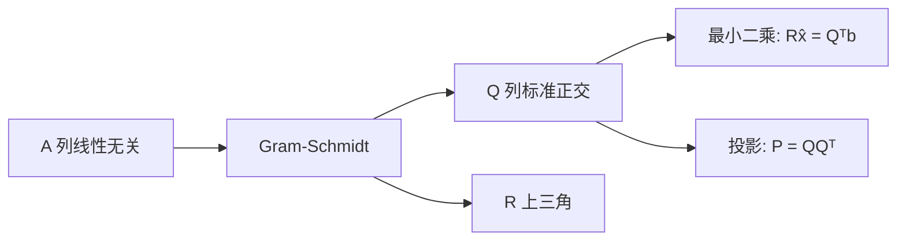

正交基是把子空间「摆正」的基：向量两两垂直、长度都为 1。有了它，投影不用求逆、解方程不用消元——系数就是点积。Gram-Schmidt 把任意一组无关向量改造成这样的基，它的矩阵语言是 $A=QR$。

## 标准正交基

向量 $q_1,\dots,q_n$ 称为**标准正交**（orthonormal），如果

$$
q_i^{\mathsf T}q_j=0\quad(i\ne j),\qquad q_i^{\mathsf T}q_i=1.
$$

把它们按列排成矩阵 $Q$，这两条性质合成一行：

$$
\boxed{Q^{\mathsf T}Q=I.}
$$

这里 $Q$ 不必是方阵。$Q^{\mathsf T}Q$ 的第 $(i,j)$ 项就是 $q_i^{\mathsf T}q_j$，所以「正交」对应非对角零，「单位长度」对应对角为一。

标准正交向量一定线性无关：若 $\sum c_iq_i=0$，两边点乘 $q_j$，其它项全消，只剩 $c_j=0$。

## 正交矩阵：$Q^{\mathsf T}=Q^{-1}$

约定：只有当 $Q$ 是**方阵**且列标准正交时，才叫**正交矩阵**（orthogonal matrix）。此时 $Q^{\mathsf T}Q=I$ 两边都是方阵，所以

$$
Q^{\mathsf T}=Q^{-1}.
$$

方阵情形下 $QQ^{\mathsf T}=I$ 也成立，即「转置就是逆」双向可用。

常见例子：

- **置换矩阵**：每列是某个单位向量，列两两正交。
- **旋转**：

$$
Q=\begin{bmatrix}\cos\theta&-\sin\theta\\ \sin\theta&\cos\theta\end{bmatrix}.
$$

- **反射**：

$$
Q=\frac{1}{\sqrt2}\begin{bmatrix}1&1\\1&-1\end{bmatrix}.
$$

  注意 $\begin{bmatrix}1&1\\1&-1\end{bmatrix}$ 的列已经正交，但长度是 $\sqrt2$，必须除以 $\sqrt2$ 才是正交矩阵。
- **矩形**：$Q=\dfrac13\begin{bmatrix}1&-2&2\\2&-1&-2\\2&2&1\end{bmatrix}$，三列两两正交、长度都是 $1$，但矩阵不是方阵，所以只叫「列标准正交」。
- **Hadamard 矩阵**：元素只有 $\pm1$。$\begin{bmatrix}1&1\\1&-1\end{bmatrix}$ 的列正交但长度是 $\sqrt2$，除以 $\sqrt2$ 即正交矩阵；$4\times4$ 由两层复制并给右下块取负得到。哪些阶数存在这种矩阵，至今没有完全解决。

正交矩阵是**保长度的**：

$$
\|Qx\|^2=x^{\mathsf T}Q^{\mathsf T}Qx=x^{\mathsf T}x=\|x\|^2.
$$

内积也保：$(Qx)^{\mathsf T}(Qy)=x^{\mathsf T}y$，角度不变。这正是数值计算偏爱它的原因——乘多少次都不会放大或缩小。

## 标准正交基让公式全部退化

### 投影矩阵：不用求逆

一般列空间的投影矩阵是 $P=A(A^{\mathsf T}A)^{-1}A^{\mathsf T}$。换成 $Q$：

$$
P=Q(Q^{\mathsf T}Q)^{-1}Q^{\mathsf T}=Q\,I\,Q^{\mathsf T}=\boxed{QQ^{\mathsf T}}.
$$

$Q$ 是方阵时列空间是整个空间，$P=QQ^{\mathsf T}=I$——全空间里的投影就是不动。

$QQ^{\mathsf T}$ 仍然是对称、幂等的：

$$
(QQ^{\mathsf T})^2=Q\,Q^{\mathsf T}Q\,Q^{\mathsf T}=QQ^{\mathsf T}.
$$

中间夹着的 $Q^{\mathsf T}Q=I$ 一起消掉了。

### 正规方程：直接读出系数

$$
Q^{\mathsf T}Q\hat x=Q^{\mathsf T}b
\Longrightarrow
\boxed{\hat x=Q^{\mathsf T}b.}
$$

逐分量就是

$$
\hat x_i=q_i^{\mathsf T}b.
$$

**每个坐标就是一个点积，不需要解方程组。** 这是整个正交章节最值钱的一条：在标准正交基下，投影系数等于基向量与目标的内积。

### 数例

$q_1=\frac13(1,2,2)^{\mathsf T}$、$q_2=\frac13(2,-2,1)^{\mathsf T}$ 正交且单位长，张成一个平面。$b=(3,3,0)^{\mathsf T}$。

$$
\hat x_1=q_1^{\mathsf T}b=\frac{3+6+0}{3}=3,\qquad
\hat x_2=q_2^{\mathsf T}b=\frac{6-6+0}{3}=0.
$$

投影 $p=3q_1=(1,2,2)^{\mathsf T}$，误差 $e=b-p=(2,1,-2)^{\mathsf T}$，与 $q_1$ 点乘 $2+2-4=0$，与 $q_2$ 点乘 $4-2-2=0$。

## Gram-Schmidt：把无关向量掰成标准正交

思路只有一句：**后一个向量减掉它在前面所有方向上的分量，剩下的必然垂直**。

设原始向量 $a,b,c$ 线性无关，已得到正交的 $A,B$（大写表示还没归一化）。

### 第一步

第一个向量方向没问题，直接留下：

$$
A=a.
$$

### 第二步

$b$ 在 $A$ 方向上有分量，减掉它，留下误差：

$$
B=b-\frac{A^{\mathsf T}b}{A^{\mathsf T}A}A.
$$

这就是 L14 里「投影的反面」：当时我们**要**投影 $p$，现在我们要的是误差 $e=b-p$。

验证垂直：

$$
A^{\mathsf T}B=A^{\mathsf T}b-\frac{A^{\mathsf T}b}{A^{\mathsf T}A}\,A^{\mathsf T}A=A^{\mathsf T}b-A^{\mathsf T}b=0.
$$

### 第三步

$c$ 在 $A$、$B$ 两个方向都有分量，逐个减掉：

$$
C=c-\frac{A^{\mathsf T}c}{A^{\mathsf T}A}A-\frac{B^{\mathsf T}c}{B^{\mathsf T}B}B.
$$

因为 $A\perp B$，两个减法互不干扰：减去 $A$ 方向的分量不会在 $B$ 方向产生残留。这正是一般投影公式在这里能省成两个独立项的原因。

### 最后归一化

$$
q_1=\frac{A}{\|A\|},\qquad q_2=\frac{B}{\|B\|},\qquad q_3=\frac{C}{\|C\|}.
$$

归一化放到最后做，只做一次除法，也把平方根集中到一处。

### 用投影矩阵一次减掉全部

第三步也可以写成矩阵形式。设 $Q_2=[q_1\ q_2]$，投影到 $\operatorname{span}\{q_1,q_2\}$ 的矩阵是 $P=Q_2Q_2^{\mathsf T}$，于是

$$
C=(I-P)c=c-Q_2Q_2^{\mathsf T}c.
$$

展开就是 $c-(q_1^{\mathsf T}c)q_1-(q_2^{\mathsf T}c)q_2$，与逐项相减完全一致。**能这么做的前提是前面的向量已经标准正交**，$Q_2^{\mathsf T}Q_2=I$ 才让 $P$ 化成 $Q_2Q_2^{\mathsf T}$。

若用未正交化的原始列 $A_0=[a\ b]$，投影是 $A_0(A_0^{\mathsf T}A_0)^{-1}A_0^{\mathsf T}$，得先解一个 $2\times2$ 方程组——这正是 Gram-Schmidt 想避开的求逆。逐次相减等价于把它「边算边正交化」，避免了解逆。

实际计算还偏好**修正 Gram-Schmidt**：每减完一项就用更新后的向量重算下一次点积，比一次性算完所有投影再减（经典 Gram-Schmidt）数值更稳。

### 数例（两个向量）

$$
a=(1,1,1)^{\mathsf T},\qquad b=(1,0,2)^{\mathsf T}.
$$

$$
A^{\mathsf T}b=1+0+2=3,\qquad A^{\mathsf T}A=1+1+1=3,
$$

$$
B=b-\frac{3}{3}A=(1,0,2)-(1,1,1)=(0,-1,1)^{\mathsf T}.
$$

验证 $A^{\mathsf T}B=0-1+1=0$。归一化：

$$
q_1=\frac{1}{\sqrt3}(1,1,1)^{\mathsf T},\qquad q_2=\frac{1}{\sqrt2}(0,-1,1)^{\mathsf T}.
$$

平方根躲不掉——这是 Gram-Schmidt 的代价，只有精心挑选的向量才能全程整数。

### 数例（三个向量，习题课版本）

$$
a=\begin{bmatrix}1\\0\\0\end{bmatrix},\quad
b=\begin{bmatrix}2\\0\\3\end{bmatrix},\quad
c=\begin{bmatrix}4\\5\\6\end{bmatrix}.
$$

第一步：$q_1=(1,0,0)^{\mathsf T}$（长度已经是 1）。

第二步：$q_1^{\mathsf T}b=2$，

$$
q_2'=b-2q_1=(0,0,3)^{\mathsf T},\qquad q_2=(0,0,1)^{\mathsf T}.
$$

第三步：$q_1^{\mathsf T}c=4$，$q_2^{\mathsf T}c=6$，

$$
q_3'=c-4q_1-6q_2=(0,5,0)^{\mathsf T},\qquad q_3=(0,1,0)^{\mathsf T}.
$$

所以

$$
Q=\begin{bmatrix}1&0&0\\0&0&1\\0&1&0\end{bmatrix}.
$$

碰巧是个置换矩阵，于是 $R=Q^{-1}A=Q^{\mathsf T}A$ 只需交换两行：

$$
R=\begin{bmatrix}1&2&4\\0&3&6\\0&0&5\end{bmatrix}.
$$

## $A=QR$：Gram-Schmidt 的矩阵语言

消元写成 $A=LU$；Gram-Schmidt 写成

$$
\boxed{A=QR,}
$$

其中 $Q$ 列标准正交、$R$ 上三角。两者**列空间相同**——只是换了一组更好的基。

按列写出来：

$$
a_j=\sum_{i}\,q_i\,r_{ij}.
$$

由于 $q_i$ 标准正交，两边点乘 $q_i$ 就把这一项挑了出来：

$$
r_{ij}=q_i^{\mathsf T}a_j.
$$

对角元 $r_{jj}=q_j^{\mathsf T}a_j=\|A_j\|$ 正是归一化时除掉的长度。

**为什么 $R$ 是上三角**：第 $j$ 个原始列 $a_j$ 只由 $q_1,\dots,q_j$ 组合而成（后面还没造出来），所以 $i>j$ 时 $r_{ij}=0$。具体地

$$
r_{12}=q_2^{\mathsf T}a_1=0,
$$

因为 $a_1$ 就是 $A$，而 $q_2$ 构造时被要求垂直于前面所有向量。这个零是「$R$ 上三角」的全部秘密。

### 数例（接上面的两个向量）

$a=(1,1,1)$、$b=(1,0,2)$，前面已得 $q_1,q_2$。

$$
r_{11}=q_1^{\mathsf T}a=\sqrt3,\qquad
r_{12}=q_1^{\mathsf T}b=\frac{3}{\sqrt3}=\sqrt3,
$$

$$
r_{22}=q_2^{\mathsf T}b=\frac{2}{\sqrt2}=\sqrt2.
$$

$$
R=\begin{bmatrix}\sqrt3&\sqrt3\\0&\sqrt2\end{bmatrix}.
$$

验证第一列：$q_1\sqrt3=(1,1,1)$ ✓；第二列：$q_1\sqrt3+q_2\sqrt2=(1,1,1)+(0,-1,1)=(1,0,2)$ ✓。

### $QR$ 解最小二乘

$$
A^{\mathsf T}A=(QR)^{\mathsf T}(QR)=R^{\mathsf T}Q^{\mathsf T}QR=R^{\mathsf T}R,
$$

正规方程 $R^{\mathsf T}R\hat x=R^{\mathsf T}Q^{\mathsf T}b$，两边左乘 $(R^{\mathsf T})^{-1}$：

$$
\boxed{R\hat x=Q^{\mathsf T}b.}
$$

$R$ 是上三角，回代即可。不构造 $A^{\mathsf T}A$，条件数从 $\kappa(A)^2$ 降到 $\kappa(A)$，所以实际软件（LAPACK 的 `gelsy` 等）都用 QR 而不是正规方程。

## 直观理解

- **正交基 = 直角坐标系**：三维空间里的 $x,y,z$ 轴就是最标准的一组；换成斜的基，求坐标就得解方程组，换成直的，求坐标就是量投影长度。
- **Gram-Schmidt = 掰直**：每来一个新向量，把它在已有方向上的「影子」剪掉，剩下的自然与前人垂直。和 L14 的误差向量是同一个东西。
- **$Q^{\mathsf T}Q=I$ = 完美的内积表**：$A^{\mathsf T}A$ 记录所有两两点积，一般是一堆杂乱数字；标准正交时它变成单位矩阵，所有交叉项为零。
- **$A=QR$ = 消元的正交版**：$A=LU$ 把矩阵变三角，$A=QR$ 把矩阵变正交；两种都是「换一组好算的基，并把变换记进一个三角矩阵」。
- **$R$ 上三角 = 先后顺序的账本**：$q_j$ 只和 $a_j$ 及其后有关（其实 $r_{ij}$ 的上三角），后面造出来的 $q$ 一定垂直于前面所有原始列，所以左下角全是零。
- **代价**：每步开方，手算出题时数字会很难看；但换来的是一劳永逸的 $Q^{\mathsf T}Q=I$。

## 拓展延伸

- **Householder QR**：用反射矩阵逐步把列打到零，得到精确的 $Q$ 和 $R$，比 Gram-Schmidt 数值更稳，是 LAPACK 的默认做法。
- **修正 Gram-Schmidt**：每次投影后立刻归一化并与之前的 $q$ 重新正交化，误差累积小一个数量级。
- **QR 迭代求特征值**：令 $A_k=Q_kR_k$，再令 $A_{k+1}=R_kQ_k$（两者相似，特征值相同），反复迭代 $A_k$ 收敛到上三角，对角即特征值。
- **SVD**：$A=U\Sigma V^{\mathsf T}$，两组标准正交基各管行空间和列空间，是 QR 的「双侧」版本。
- **正交多项式**：Legendre、Chebyshev 多项式在带权内积下正交，最小二乘拟合用它可让正规方程直接对角化。
- **傅里叶级数**：$\sin$、$\cos$ 在 $[0,2\pi]$ 上正交，系数就是内积 $\frac1\pi\int f\sin$，是连续版的 $\hat x=Q^{\mathsf T}b$。

直观视频：[[9. 三分钟，玩转，格拉姆-施密特正交化  数学不难：线性代数|数学不难 9 Gram-Schmidt]]。

## 术语

| 英文 | 中文 | 含义 |
| ---- | ---- | ---- |
| orthonormal | 标准正交 | 两两正交且长度都为 1 |
| orthogonal matrix | 正交矩阵 | 方阵且列标准正交，$Q^{\mathsf T}=Q^{-1}$ |
| Gram-Schmidt | 格拉姆-施密特 | 把无关向量逐次正交化并归一化 |
| projection matrix | 投影矩阵 | 标准正交基下为 $QQ^{\mathsf T}$ |
| QR decomposition | QR 分解 | $A=QR$，$Q$ 标准正交列、$R$ 上三角 |
| Hadamard matrix | Hadamard 矩阵 | 元素只取 $\pm1$ 的正交矩阵 |
| modified Gram-Schmidt | 修正 Gram-Schmidt | 每步重新正交化，数值更稳 |
| Householder reflection | Householder 反射 | 用反射矩阵做 QR 分解 |

## 总结

标准正交基满足 $Q^{\mathsf T}Q=I$；方阵时 $Q^{\mathsf T}=Q^{-1}$，且保持长度与内积。它把投影、正规方程全部化简：$P=QQ^{\mathsf T}$，$\hat x=Q^{\mathsf T}b$，每个系数就是一个点积。Gram-Schmidt 逐次减掉已得方向上的投影（$B=b-\frac{A^{\mathsf T}b}{A^{\mathsf T}A}A$，$C=c-\frac{A^{\mathsf T}c}{A^{\mathsf T}A}A-\frac{B^{\mathsf T}c}{B^{\mathsf T}B}B$），最后归一化，写成矩阵就是 $A=QR$。$R$ 上三角是因为第 $j$ 个原始列只由前 $j$ 个 $q$ 构成；用它解最小二乘只需回代 $R\hat x=Q^{\mathsf T}b$，比正规方程稳定。
