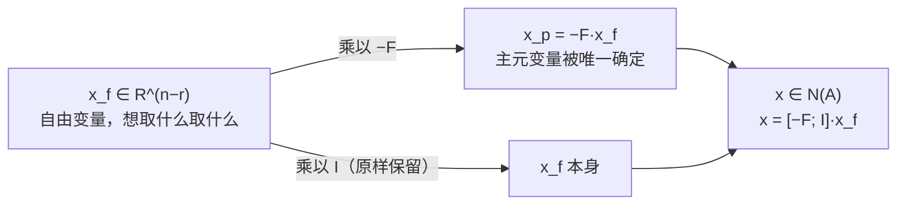

---
tags:
  - 线性代数LinearAlgebra
  - 零空间NullSpace
  - 主元Pivot
  - 自由变量FreeVariable
  - 秩Rank
  - 特解SpecialSolution
  - 行最简形RREF
---

# 求解 Ax=0:主变量与特解 Pivot Variables and Special Solutions · 18.06 L7

**时间:** 2026-10-23（2026-10-24 补 §6：`[-F; I]` 为什么就是零空间的基）
**标签:** #线性代数LinearAlgebra #零空间NullSpace #主元Pivot #自由变量FreeVariable #秩Rank #特解SpecialSolution #行最简形RREF
**关联:** [[L6 列空间与零空间]]（上一讲：零空间的定义）· [[L8 求解Ax=b]]（下一讲：非齐次方程组，通解 = 特解 + 零空间）· [[Nonsquare matrices as transformations between dimensions  Chapter 8, Essence of linear algebra]]（3b1b：维数不对等的变换）· [[Change of basis  Chapter 13, Essence of linear algebra]]（3b1b：换基，待 L9~L10 主课到再正式关联）

## 必要性（为什么要有这一章）

L6 只**定义**了零空间 $N(A)=\{x:Ax=0\}$，并且在一个小例子里「看」出它是一条直线。但真实矩阵不可能靠眼睛看。

这一讲把定义**变成算法**——Strang 的原话是「turning the definition into an algorithm」：

> 拿到任意 $m\times n$ 矩阵 $A$，怎样**算出** $N(A)$ 里的所有向量？零空间有多大（维数是多少）？

答案是一条流水线：**消元 → 行最简形 $R$ → 分清主元列 / 自由列 → 给自由变量取 $(1,0,\dots)$ 得特解 → 零空间 = 特解的全部线性组合**。

## 主要内容

### 1. 例子：一个 3×4 矩阵

$$
A=\begin{bmatrix}
1&2&2&2\\
2&4&6&8\\
3&6&8&10
\end{bmatrix}
$$

先肉眼观察（消元会把它们自动暴露出来）：

- **列**：第 2 列 $=(2,4,6)=2\times$ 第 1 列 → 第 2 列不独立。
- **行**：第 3 行 $=$ 第 1 行 $+$ 第 2 行 → 第 3 行不独立。

所以可以预感：秩不会是 3，会有一批「自由」的列。

### 2. 消元 → 行阶梯形 $U$（**不改变零空间**）

对 $Ax=0$ 做消元（行变换 = 方程之间相加减），**解集不变**，所以**零空间不变**。但要注意 Strang 强调的一点：**列空间会变**（列被换掉了），所以算零空间可以放心消元，算列空间不行。

$$
A \xrightarrow{\text{消元}} U=\begin{bmatrix}
1&2&2&2\\
0&0&2&4\\
0&0&0&0
\end{bmatrix}
$$

- 第 2 列在主元位置上是 0 → 这一列**没有主元**，继续用下一列找主元（矩形矩阵的消元允许「跳列」）。
- 主元只有 2 个 → **rank(A) = 2**。**秩 = 主元个数**，这是秩在算法里的第一个含义。

### 3. 主元变量 vs 自由变量

- **主元列（pivot columns）**：第 1、3 列（有主元的列）。对应的未知量 $x_1,x_3$ 叫**主元变量**。
- **自由列（free columns）**：第 2、4 列（没有主元的列）。对应的 $x_2,x_4$ 叫**自由变量**——**可以任意取值**。

为什么能任意取？因为 $x_2,x_4$ 的系数列能被主元列组合出来，取什么值都能靠主元变量补偿回去。

### 4. 特解（special solutions）：给自由变量取「单位值」

规则：**一个自由变量取 1、其余自由变量取 0**，回代求出主元变量，得到一个特解。每个自由变量对应一个特解。

- 取 $x_2=1,\ x_4=0$：由 $x_1+2x_2=0$、$x_3+2x_4=0$ 得 $x_1=-2,\ x_3=0$：

$$
s_1=\begin{bmatrix}-2\\1\\0\\0\end{bmatrix}
$$

- 取 $x_2=0,\ x_4=1$：得 $x_1=2,\ x_3=-2$：

$$
s_2=\begin{bmatrix}2\\0\\-2\\1\end{bmatrix}
$$

验算：$As_1=(-2+2,\ -4+4,\ -6+6)=0$；$As_2=(2-4+2,\ 4-12+8,\ 6-16+10)=0$。✅

### 5. 零空间 = 特解的**全部组合**

$$
N(A)=\Big\{c_1\begin{bmatrix}-2\\1\\0\\0\end{bmatrix}+c_2\begin{bmatrix}2\\0\\-2\\1\end{bmatrix}\ :\ c_1,c_2\in\mathbb R\Big\}
$$

- 特解是零空间的**基**（彼此线性无关，且张成整个零空间）。
- 特解个数 = 自由变量个数 = $n-r=4-2=2$ → **$\dim N(A)=n-r$**。

### 6. 行最简形 $R$ 与 $[I\ F;\ 0\ 0]$ 结构

继续消元到**行最简形（reduced row echelon form, rref）**：主元化为 1，且主元**上下都清零**。

$$
R=\begin{bmatrix}
1&2&0&-2\\
0&0&1&2\\
0&0&0&0
\end{bmatrix}
$$

把主元列挪到一起看，就是 Strang 的块结构：

$$
R=\begin{bmatrix}I&F\\0&0\end{bmatrix},\qquad
I=\begin{bmatrix}1&0\\0&1\end{bmatrix},\quad
F=\begin{bmatrix}2&-2\\0&2\end{bmatrix}
$$

此时特解可以直接读出来：**自由变量位置放单位阵，主元变量位置放 $-F$**（下面这个结果已经按原变量顺序写回，中间那次行交换见 §6.4）：

$$
\begin{bmatrix}-F\\I\end{bmatrix}=\begin{bmatrix}-2&2\\1&0\\0&-2\\0&1\end{bmatrix}
$$

两列正好是 $s_1,s_2$。这就是「零空间的系统求法」——不用每次回代，$R$ 一写出来答案就在里面。

**但这里藏了三个没讲透的点：为什么主元列能凑成 $I$？为什么答案恰好是 $[-F;I]$？为什么这两列能当基？** 下面拆开看。

#### 6.1 分块从哪来：把主元列挪到前面

rref 的定义就是「每个主元是 1，且该列其它位置全是 0」——**主元列天然就是单位列**。本例主元在第 1、3 列，把它们挪到前面，变量也随之重排为 $(x_p\mid x_f)=(x_1,x_3\mid x_2,x_4)$：

$$
R'=\begin{bmatrix}
1&0&2&-2\\
0&1&0&2\\
0&0&0&0
\end{bmatrix}
=\begin{bmatrix}I&F\\0&0\end{bmatrix},
\qquad
I=\begin{bmatrix}1&0\\0&1\end{bmatrix},\quad
F=\begin{bmatrix}2&-2\\0&2\end{bmatrix}
$$

挪列只是**排版**：等价于右乘一个置换矩阵 $P$，$R'=RP$，解满足 $x=Py$。方程本身没变，变的是「坐标的书写顺序」。

#### 6.2 解方程：两块各管一件事

$$
\begin{bmatrix}I&F\\0&0\end{bmatrix}
\begin{bmatrix}x_p\\x_f\end{bmatrix}=0
\;\Longleftrightarrow\;
\begin{cases}
I\,x_p+F\,x_f=0 & \text{有内容的 } r \text{ 行}\\
0=0 & \text{全零行，没有约束}
\end{cases}
$$

全零行的意思不是「没用」，而是**自由变量真的自由**：$x_f$ 可以取 $\mathbb R^{n-r}$ 里任何值。而对上半块，$I$ 可以直接求逆，移项立刻得

$$
x_p=-F\,x_f .
$$

这句话的角色分工很关键：

- $x_f$ 是**自变量**（你随便给）；
- $x_p$ 是**因变量**（被 $x_f$ 唯一确定）。

于是零空间里每个元素都长成

$$
x=\begin{bmatrix}x_p\\x_f\end{bmatrix}
=\begin{bmatrix}-F\,x_f\\x_f\end{bmatrix}
=\underbrace{\begin{bmatrix}-F\\I\end{bmatrix}}_{N}\,x_f .
$$

**$N=[-F;I]$ 不是凭空凑出来的，它就是「自由变量 → 解」这个线性映射的矩阵**；零空间 = $N$ 的像（列空间）。

*图：上面 I 和 F 各管一块坐标——F 负责把自由变量的取值「翻译」成主元变量必须取的值，I 负责把这组自由变量原样带下去。*

#### 6.3 为什么这两列一定是基

取参数空间的标准基 $e_1,e_2$，它们的像就是 $N$ 的各列：

$$
x_f=e_1\Rightarrow x=\begin{bmatrix}-F e_1\\e_1\end{bmatrix}
=\text{第 1 列}\quad(\text{自由变量 } x_2=1,\ x_4=0)
$$

要成为基，两条都成立：

1. **线性无关**：若 $Nc=0$，只看下半块得 $Ic=0\Rightarrow c=0$。下半块那个 $I$ 专门负责独立性——每个解在一个自由坐标上是 1、其余是 0，互相不可能抵消。
2. **张成且个数正好**：任何解都是 $N x_f$（6.2 已证），而解空间的维数是 $n-r$（秩-零化度 $\dim N(A)=n-r$）。$n-r$ 个线性无关向量 + 维数就是 $n-r$ ⇒ 基。

所以「给自由变量取单位值」不是一种随意的规定，而是**在参数空间里取标准基，再把标准基推过映射**。$I$ 出现在自由变量那一侧，正是「参数空间用标准基」的直接痕迹。

#### 6.4 回到本例：别忘了把行顺序换回去

按重排后的顺序 $(x_1,x_3,x_2,x_4)$，$N$ 是

$$
N=\begin{bmatrix}-2&2\\0&-2\\1&0\\0&1\end{bmatrix}
\quad\text{对应 }(x_1,x_3,x_2,x_4)
$$

但答案要按**原顺序** $(x_1,x_2,x_3,x_4)$ 写，所以把第 2、3 行换回来：

$$
\begin{bmatrix}-2&2\\1&0\\0&-2\\0&1\end{bmatrix}
=\big[\,s_1\ \ s_2\,\big]\quad ✅
$$

第 1 列读法：$x_2=1,x_4=0\Rightarrow x_1=-2,x_3=0$，代回 $x_1+2x_2-2x_4=-2+2=0$、$x_3+2x_4=0$。

> 如果主元恰好就在前 $r$ 列（教材里常见的情形），就不用换行，$[I\ F;0\ 0]$ 和 $[-F;I]$ 可以直接对齐看。**本例主元在第 1、3 列，所以中间隔了一次行交换——这是原文没写、最容易看漏的一步。**

#### 6.5 补充：$F$ 和原矩阵 $A$ 是什么关系

$F$ 描述的是**列之间的线性关系**：在 $R$ 里，自由列 $=$ 主元列 $\times F$ 的对应列。由于 $R=EA$（$E$ 可逆），**行变换保持列之间的这种线性关系不变**，所以同样的系数对 $A$ 也成立：

$$
\underbrace{\begin{bmatrix}2\\4\\6\end{bmatrix}}_{A\text{ 第 2 列}}
=2\cdot\underbrace{\begin{bmatrix}1\\2\\3\end{bmatrix}}_{A\text{ 第 1 列}},
\qquad
\underbrace{\begin{bmatrix}2\\8\\10\end{bmatrix}}_{A\text{ 第 4 列}}
=-2\cdot\begin{bmatrix}1\\2\\3\end{bmatrix}
+2\cdot\underbrace{\begin{bmatrix}2\\6\\8\end{bmatrix}}_{A\text{ 第 3 列}}
$$

数值完全对得上。所以「消元改了列、还能从 $R$ 读特解」并不矛盾：消元**改变列向量本身**（以及列空间），但**保留列与列之间的线性关系**——而零空间正是这些关系系数的集合。$R=EA$ 中 $E$ 可逆，$\sum c_j a_j=0\Leftrightarrow\sum c_j Ea_j=0$。

## 直观理解（3Blue1Brown 视角）

- 把 $A$ 看成变换 $\mathbb R^4\to\mathbb R^3$（3b1b 第 8 章：**非方阵 = 不同维数空间之间的变换**）。4 个列向量落在 3 维空间里，**必然线性相关**——至少有一个方向的信息被「压没」。
- **秩 = 变换后像（列空间）的维数**；**零空间维数 = 被压到原点的方向数** = $n-r$。本例：$4$ 个输入方向 → 只剩 $2$ 维的像，所以有 $4-2=2$ 个方向被压没，$N(A)$ 是 $\mathbb R^4$ 里的一个**二维平面**。
- 「列数 > 行数 ⇒ 必有非零零空间」：把高维塞进低维，一定挤掉一些方向。这也是为什么**宽矩阵（欠定方程组）总有非零解**。
- 3b1b 第 13 章（换基）暂时只是旁观：$N(A)$ 由矩阵决定，但「坐标怎么写」取决于基；同一变换换个基，矩阵变了，零空间（作为空间）不变。等主课讲到基与维数（L9~L10）再正式回来关联。

## 拓展延伸

- **秩-零化度定理**：$\dim C(A)+\dim N(A)=n$。本例 $2+2=4$；L6 的例子 $2+1=3$。这是同一个定理的两次验收。
- **下一讲 $Ax=b$**：$b\in C(A)$ 时，**通解 = 一个特解 + $N(A)$ 的任意组合**。零空间刻画的是「解的自由度」，本讲算出的 $s_1,s_2$ 下一讲直接拿来用。
- **与 AI 的联系**：
  - 神经网络的**线性层** $y=Wx$ 若 $W$ 列相关（秩亏），输入里就有一整个子空间「白送」——不影响输出，梯度里也藏着这个方向的不确定性。
  - **最小二乘 / 岭回归**：$A^\top A$ 奇异（秩亏）时正规方程有无穷多解；加 L2 惩罚 $\lambda\|w\|^2$ 正好**把零空间方向压住**，解唯一。参见 [[曲线拟合的概率视角 最小二乘与正则化]] 里「高斯先验 → L2 正则」的推导。
- **数值角度**：手算看主元是否精确为 0；实际计算里用秩揭示分解（QR with column pivoting / SVD）判断「数值秩」，浮点误差下 $10^{-16}$ 级的主元应视为 0。

## Note

承接 [[L6 列空间与零空间]] 的定义；「主元」概念最早出现在 [[L2 消元]]（消元找主元），这里把它升级成「主元列 / 自由列」的计数工具。特解 + 组合的结构会在 [[L8 求解Ax=b]] 复用到非齐次方程。

## 思考

（留白 —— 为什么「给自由变量取单位值」得到的特解一定构成基？如果换一种给自由变量赋值的方式（比如取 $(2,1)$），得到的还是零空间里的向量，但为什么不能直接当特解用？另外：$R$ 里的 $F$ 和原矩阵 $A$ 的哪部分对应？消元过程中列被换了，为什么特解还能用 $R$ 读出来？）

> 2026-10-24 补充：前两问见 §6.3，第三问见 §6.5。新的思考：取 $x_f=(2,1)$ 得到的向量是 $2s_1+s_2$——它确实是零空间里的合法向量，只是不能和 $s_1$ 一起当基。为什么「基」要求每个自由变量**恰好在一个解里为 1、其余解里为 0**？这和「参数空间取标准基」是什么关系？

## 总结

**本质：** 求 $N(A)$ 的算法 = 消元到 $R$ → 数主元得秩 $r$ → 主元列/自由列分开 → 每个自由变量配一个单位赋值，回代得**特解** → 零空间就是这些特解的**全部线性组合**，维数 $n-r$。消元**不改变零空间**（但改变列空间），所以这条流水线对任意矩阵都成立。

**标签:** #线性代数LinearAlgebra #零空间NullSpace #主元Pivot #自由变量FreeVariable #秩Rank #特解SpecialSolution #行最简形RREF

## 本讲新引入的专业术语

| 英文术语 | 中文 | 含义 |
| ---- | ---- | ---- |
| pivot column / pivot variable | 主元列 / 主元变量 | 有主元的列及对应未知量 |
| free column / free variable | 自由列 / 自由变量 | 无主元的列，可任意取值 |
| rank $r$ | 秩 | 主元个数 = 列空间的维数 |
| special solution | 特解 | 一个自由变量取 1、其余取 0 得到的解 |
| reduced row echelon form $R$ | 行最简形 | 主元为 1 且上下清零，形如 $[I\ F;0\ 0]$ |
| nullspace dimension | 零空间维数 | $n-r$，等于自由变量个数 |
| pivot / free split | 主元-自由划分 | 把未知量分成「被决定」和「可任取」两类 |
