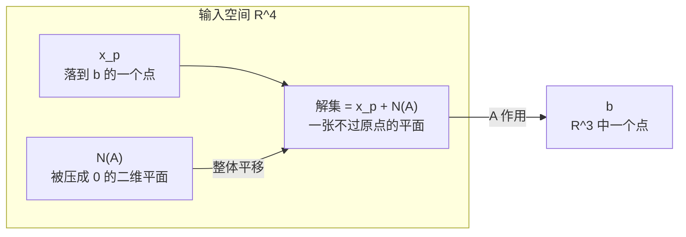

---
tags:
  - 线性代数LinearAlgebra
  - 增广矩阵AugmentedMatrix
  - 可解性Solvability
  - 特解ParticularSolution
  - 通解CompleteSolution
  - 行最简形RREF
  - 满秩FullRank
  - 秩Rank
---

# 求解 Ax=b:行最简形与完整解 Complete Solution · 18.06 L8

**时间:** 2026-10-25
**标签:** #线性代数LinearAlgebra #增广矩阵AugmentedMatrix #可解性Solvability #特解ParticularSolution #通解CompleteSolution #行最简形RREF #满秩FullRank #秩Rank
**关联:** [[L7 求解Ax=0主变量与特解]]（上一讲：零空间的算法）· [[L9 线性无关·基·维数]]（下一讲：给「自由变量个数」一个名字——维数）· [[L10 四个基本子空间]]（四个空间与秩的统一图景）· [[L4 A=LU 分解]]（方阵可逆时的特殊情形）

## 必要性（为什么要有这一章）

L7 解决了**齐次**方程 $Ax=0$：它的解集是一个子空间 $N(A)$。但真实问题几乎都是**非齐次**的 $Ax=b$——拟合、电路、求解线性层、最小二乘的前置。

非齐次方程有三个必须先回答的问题：

1. **有没有解？**（existence / consistency）——不是每个 $b$ 都能被 $A$ 的列组合出来；
2. **如果有，有几个？**——唯一，还是无穷多？
3. **怎么把所有的解写出来？**——给一个可执行的算法，而不是「存在即可」。

Strang 的原话：这是「completely solve linear equations」的一讲。答案是三句话：

> **消元（连 $b$ 一起）→ 检查有没有出现 $0=$ 非零的坏行 → 自由变量取 0 得一个特解 → 通解 = 特解 + 零空间。**

最后一条 $x=x_p+x_n$ 不只是线性代数的技巧，它是整个数学里「非齐次 = 一个特解 + 齐次通解」的模板（常微分方程、差分方程、偏微分方程全都长这样）。

## 主要内容

### 1. 增广矩阵（augmented matrix）：把 $b$ 拖进消元

沿用 L7 的 $3\times4$ 矩阵，右端取 $b=(1,5,6)$：

$$
[A\mid b]=\left[\begin{array}{cccc|c}
1&2&2&2&1\\
2&4&6&8&5\\
3&6&8&10&6
\end{array}\right]
$$

消元必须**同时对左边的行和右边的 $b$ 做同样的操作**，所以 $b$ 干脆作为一列挂在后面——这就是增广矩阵。对一般的 $b=(b_1,b_2,b_3)$ 做消元：

$$
\left[\begin{array}{cccc|c}
1&2&2&2&b_1\\
0&0&2&4&b_2-2b_1\\
0&0&0&0&b_3-b_2-b_1
\end{array}\right]
$$

最后一行左边全零，右边是 $b_3-b_2-b_1$。它对应方程

$$
0=b_3-b_2-b_1 .
$$

- 若 $b_3=b_1+b_2$（本例 $1+5=6$）→ 这一行是 $0=0$，**系统相容（consistent）**；
- 否则 → 出现 $0=$ 非零，**无解**。

> 为什么条件恰好是 $b_3=b_1+b_2$？因为 $A$ 的第三行 = 第一行 + 第二行。**左边行与行之间有什么线性关系，右边 $b$ 就必须满足同样的关系**——消元只是把这句话算出来。

### 2. 可解性的两种语言

| 语言 | 条件 | 直觉 |
| ---- | ---- | ---- |
| 列空间 | $b\in C(A)$ | $b$ 能写成 $A$ 各列的组合——这正是 $Ax=b$ 的含义 |
| 行关系（左零空间） | 若 $y^{\mathsf T}A=0$，则必须 $y^{\mathsf T}b=0$ | 左边行组合出零行 ⇒ 右边同样的组合必须为 0 |

本例中 $y=(-1,-1,1)^{\mathsf T}$ 满足

$$
y^{\mathsf T}A=-(\text{row}_1)-(\text{row}_2)+(\text{row}_3)=0,
\qquad
y^{\mathsf T}b=-1-5+6=0\ \ ✅
$$

两种说法等价，但角度不同：**列空间**说「$b$ 要落在 $A$ 能到达的地方」，**左零空间**说「$b$ 不能含有 $A$ 到不了的那个方向的分量」。后一种语言就是 L10 的 left null space，也是最小二乘里「残差与列空间正交」的源头。

### 3. 特解（particular solution）：自由变量全部取 0

既然有无穷多解，先随便造**一个**。最省事的造法：

> **令所有自由变量 $=0$，回代求主元变量。**

本例 $x_2,x_4$ 是自由变量，令 $x_2=x_4=0$，方程退化为

$$
\begin{cases}
x_1+2x_3=1\\
2x_3=3
\end{cases}
\Longrightarrow
x_3=\tfrac32,\quad x_1=1-2\cdot\tfrac32=-2 .
$$

$$
x_p=\begin{bmatrix}-2\\0\\3/2\\0\end{bmatrix},
\qquad
Ax_p=\begin{bmatrix}1\\5\\6\end{bmatrix}=b\ \ ✅
$$

**为什么这样造一定成功？** 自由列被置零后，剩下的主元列构成一个「列满秩的窄矩阵」，消元后是上三角、主元全非零，回代必有唯一解（前提是系统相容）。

### 4. 通解（complete solution）= 特解 + 零空间

$$
\boxed{\,x=x_p+x_n,\qquad x_n\in N(A)\,}
$$

证明一行：

$$
A(x_p+x_n)=Ax_p+Ax_n=b+0=b .
$$

反过来，若 $x$ 也是解，则 $A(x-x_p)=b-b=0$，所以 $x-x_p\in N(A)$——**所有解都长这样，一个不多一个不少**。

本例：

$$
x=\begin{bmatrix}-2\\0\\3/2\\0\end{bmatrix}
+c_1\begin{bmatrix}-2\\1\\0\\0\end{bmatrix}
+c_2\begin{bmatrix}2\\0\\-2\\1\end{bmatrix}
$$

（$s_1,s_2$ 是 L7 算出的零空间特解。）

### 5. 一个容易问错的问题：$x_p$ 能乘常数吗？

不能。

$$
A(3x_p)=3b\ne b .
$$

- $x_n$ 可以任意乘、任意加：$A(c\,x_n)=0$；
- $x_p$ 只是一个**代表点**，换一个特解只会把整个解集平移，集合本身不变。

所以解集**不是子空间**（不含原点，除非 $b=0$），而是「一个子空间被平移」——仿射子空间（affine subspace）/ 陪集（coset）。

### 6. 行最简形 $R$：通解可以一步写出来

把 L7 的 $R=[I\ F;\ 0\ 0]$ 直接拿来。$Rx=0$ 给出 $x_p=-Fx_f$，于是零空间是 $[-F;I]\,x_f$。对非齐次，消元后的增广矩阵是 $[R\mid d]$（$d$ 是变换后的右端），代入 $x=[x_p;x_f]$：

$$
\begin{bmatrix}I&F\\0&0\end{bmatrix}
\begin{bmatrix}x_p\\x_f\end{bmatrix}=d
\;\Longrightarrow\;
x_p=d-Fx_f .
$$

所以

$$
x=\underbrace{\begin{bmatrix}d\\0\end{bmatrix}}_{x_p}
+\underbrace{\begin{bmatrix}-F\\I\end{bmatrix}}_{N(A)}\,x_f ,
$$

其中「$d$ 补齐零」就是「自由变量取 0」的写法。**$R$ 一出来，特解和零空间基同时到手。**

本例 $R=\begin{bmatrix}1&2&0&-2\\0&0&1&2\\0&0&0&0\end{bmatrix}$，主元在第 1、3 列，$F=\begin{bmatrix}2&-2\\0&2\end{bmatrix}$；把列顺序按主元/自由重排后即得上式（L7 §6.4 有行交换的细节）。

### 7. 秩决定一切：$m\times n$、秩 $r$ 的四种情形

这是本讲真正的高潮。只看 $r$ 与 $m,n$ 的关系，就能预言解的有无与个数：

| 情形 | 形状 | $R$ 的样子 | 解的情况 |
| ---- | ---- | ---- | ---- |
| $r=m=n$ | 方阵、满秩 | $I$ | 对任意 $b$ **唯一解**（可逆矩阵） |
| $r=n<m$ | 高瘦、**列满秩**（full column rank） | $\begin{bmatrix}I\\0\end{bmatrix}$ | **0 或 1 个**；$N(A)=\{0\}$；只有 $b\in C(A)$ 才有解 |
| $r=m<n$ | 矮胖、**行满秩**（full row rank） | $\begin{bmatrix}I&F\end{bmatrix}$ | 对任意 $b$ 都有解，且**无穷多**（$n-m$ 个自由变量） |
| $r<m$ 且 $r<n$ | 一般 | $\begin{bmatrix}I&F\\0&0\end{bmatrix}$ | **0 或无穷多** |

几种情形的小例子：

- **列满秩（高瘦）**：$A=\begin{bmatrix}1&3\\2&1\\6&1\\5&1\end{bmatrix}$（$4\times2$，$r=2$）。没有零空间，解至多一个。取 $b=(4,3,7,6)$（正好是两列之和）→ 唯一解 $x=(1,1)$；取随机 $b$ → 无解。
- **行满秩（矮胖）**：上面的 $A^{\mathsf T}=\begin{bmatrix}1&2&6&5\\3&1&1&1\end{bmatrix}$（$2\times4$，$r=2$）。没有零行，对任意 $b$ 都可解；但有 $4-2=2$ 个自由变量 → 无穷多解。
- **满秩（方阵）**：$A=\begin{bmatrix}1&2\\3&1\end{bmatrix}$ → $R=I$，对任意 $b$ 唯一解（就是 L3 的逆矩阵）。

> **一句话总结：秩告诉你解的一切——除了具体数字。** 唯一性看 $r=n$（有没有自由变量），存在性看 $r=m$（有没有零行）。

## 直观理解（3Blue1Brown 视角）

**解集是零空间的一个平移。**

把 $A$ 看成 $\mathbb R^4\to\mathbb R^3$ 的线性变换，$N(A)$ 是被压到原点的二维平面。所有满足 $Ax=b$ 的 $x$ 是：

- 先找到**任意一个**落到 $b$ 的点 $x_p$；
- 再加上「落到 0 的方向」$N(A)$——这些方向不改变落点，只是把点沿着平面滑。

*图：解集 = 平面 + 一个偏移量。它不是子空间（原点不在里面），但和零空间「同尺寸」。*

- **维数守恒**：解集的自由度 = $\dim N(A)=n-r$。本例 2 个参数 → 二维。
- **三种落点**：$b$ 在 $C(A)$ 内且 $N(A)=\{0\}$ → 唯一原像；$b\in C(A)$ 且 $N(A)$ 有厚度 → 一族原像；$b\notin C(A)$ → 根本没有原像。
- 和 3b1b 第 7 章（Inverse matrices, column space and null space）连起来看：**列空间 = 能到达的点集，零空间 = 被压扁的方向集**，$Ax=b$ 就是在问「$b$ 在不在像里、原像长什么样」。

## 拓展延伸

- **秩判据**：$Ax=b$ 有解 $\iff \operatorname{rank}([A\mid b])=\operatorname{rank}(A)$。增广一列只会让秩增加 0 或 1；增加 1 就说明 $b$ 带来了新方向——正好是「$b\notin C(A)$」。
- **无解时怎么办：最小二乘**。不求 $Ax=b$，改求 $\min\|Ax-b\|^2$，正规方程 $A^{\mathsf T}Ax=A^{\mathsf T}b$ 总是相容（$A^{\mathsf T}b\in C(A^{\mathsf T})$）；几何上把 $b$ 正交投影到 $C(A)$。见 [[曲线拟合的概率视角 最小二乘与正则化]]。
- **无穷多解时选哪一个**：取**最小范数解** $x=A^{+}b$（Moore–Penrose 伪逆），它恰好落在行空间里、与零空间正交——这就是 L10 四个子空间正交分解的直接应用。
- **与 AI 的联系**：
  - 线性层 $y=Wx+b$：若 $W$ 行不满秩，某些 $y$ 永远取不到；若列不满秩，同一 $y$ 有无穷多 $x$ —— 网络对输入方向的「不敏感子空间」正是 $N(W)$。
  - **过参数化网络**（参数远多于数据）训练时，损失面有大量零方向，SGD 隐式地选出最小范数/最小范数附近的解，这是「隐式正则化」的一种解释。
  - 数值上判断「有没有解」不能看精确的 0：用 $\operatorname{rank}$ 的数值版本（SVD / QR with pivoting），并关注条件数 $\kappa(A)$。

## Note

承接 [[L7 求解Ax=0主变量与特解]] 的零空间算法；「特解 + 齐次解」的结构在 [[L2 消元]] 的回代里已经出现过雏形（那时是方阵唯一解）。本讲的「自由变量个数」下一讲升级为**维数**（[[L9 线性无关·基·维数]]），四种秩情形则汇总成 [[L10 四个基本子空间]] 的维数表。

## 思考

（留白 —— 为什么「自由变量取 0」得到的特解一定存在且唯一？如果系统相容，消元后主元列构成的窄矩阵为什么一定可逆？另外：解集不是子空间，那它和零空间「差」在哪里？如果把两个不同的特解相减，得到的是什么？最后：为什么 $r=m<n$ 时**一定**有无穷多解，而不是「可能唯一」？）

## 总结

**本质：** 解 $Ax=b$ 的完整流程 = 增广消元 → 看 $0=$ 非零判断相容 → 自由变量取 0 回代得 $x_p$ → 通解 $x=x_p+x_n$（$x_n\in N(A)$）。解的存在性由 $b\in C(A)$（等价地：左零空间向量与 $b$ 正交）决定；解的自由度是 $n-r$；唯一性只取决于 $r=n$。四个数 $(m,n,r,\text{相容性})$ 完全决定解集的形状。

**标签:** #线性代数LinearAlgebra #增广矩阵AugmentedMatrix #可解性Solvability #特解ParticularSolution #通解CompleteSolution #行最简形RREF #满秩FullRank #秩Rank

## 本讲新引入的专业术语

| 英文术语 | 中文 | 含义 |
| ---- | ---- | ---- |
| augmented matrix $[A\mid b]$ | 增广矩阵 | 把右端项作为额外一列，消元时同步变换 |
| consistent / solvable | 相容 / 可解 | 消元后不出现 $0=$ 非零行 |
| particular solution $x_p$ | 特解 | 自由变量全取 0 得到的那个解 |
| complete solution | 完整解 / 通解 | $x_p+N(A)$，即全部解的集合 |
| affine subspace / coset | 仿射子空间 / 陪集 | 子空间平移后的集合，一般不过原点 |
| full column rank | 列满秩 | $r=n$，零空间只有零向量，解至多一个 |
| full row rank | 行满秩 | $r=m$，消元无零行，对任意 $b$ 可解 |
| back substitution | 回代 | 从最下面的主元方程往上逐个解出未知量 |
