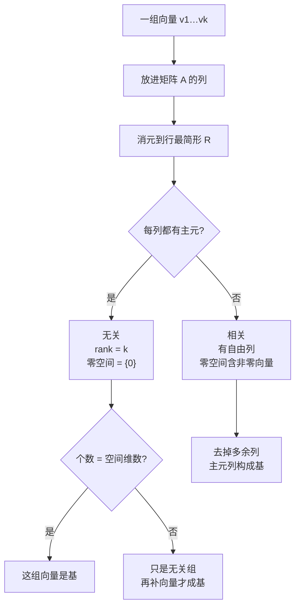

---
tags:
  - 线性代数LinearAlgebra
  - 线性无关Independence
  - 线性相关Dependence
  - 张成Span
  - 基Basis
  - 维数Dimension
  - 秩Rank
  - 标准基StandardBasis
---

# 线性无关、基与维数 Independence, Basis and Dimension · 18.06 L9

**时间:** 2026-10-25
**标签:** #线性代数LinearAlgebra #线性无关Independence #线性相关Dependence #张成Span #基Basis #维数Dimension #秩Rank #标准基StandardBasis
**关联:** [[L7 求解Ax=0主变量与特解]]（自由变量从哪来）· [[L8 求解Ax=b]]（自由变量个数 $n-r$ 决定解的自由度）· [[L10 四个基本子空间]]（用维数给四个空间排座次）· [[Linear combinations, span, and basis vectors  Chapter 2, Essence of linear algebra]]（3b1b：张成与基）· [[Change of basis  Chapter 13, Essence of linear algebra]]（3b1b：换基）

## 必要性（为什么要有这一章）

前面几讲一直在用几个词，却没有严格定义：**「自由变量」「秩」「维数」「张成」**。我们说过「零空间是二维平面」「列空间是二位的」——二维是什么意思？为什么不是三维？

这一讲把四个词一次性定义清楚，而且它们是一条链：

$$
\underbrace{\text{无关}}_{\text{没有冗余}}\;+\;\underbrace{\text{张成}}_{\text{够用}}\;\Longrightarrow\;
\underbrace{\text{基}}_{\text{不多不少}}\;\Longrightarrow\;
\underbrace{\text{维数}}_{\text{空间的「大小」}} .
$$

还有一句开场就给出的**关键事实**，它是后面所有定义的动机：

> **未知数比方程多（$n>m$）⇒ 零空间里必有非零向量。**

理由在 L7 已经算过：$n$ 个变量里最多 $m$ 个主元，**至少有 $n-m$ 个自由变量**，随便给它们非零值就能造出非零解。这一讲的「无关/相关」不过是给「有没有非零解」起了个名字。

## 主要内容

### 1. 线性无关（linear independence）

**定义**：向量 $v_1,\dots,v_k$ **线性无关**，当且仅当

$$
c_1v_1+c_2v_2+\cdots+c_kv_k=0
\quad\Longrightarrow\quad
c_1=c_2=\cdots=c_k=0 .
$$

也就是说：**唯一能组合出零向量的方式，是所有系数都取 0**。若存在不全为零的系数使组合为 0，则称它们**线性相关**（dependent）。

三个直观例子（都在平面里）：

- $v$ 与 $2v$：相关。取 $2v-1\cdot(2v)=0$，系数 $(2,-1)$ 不全为零。
- $v$ 与零向量：**一定相关**。零向量的系数取 6、其它取 0 就得到零——**一组向量里只要有零向量，无关性立刻死亡**。
- 平面上任意三个向量：**一定相关**。因为把它们放进 $2\times3$ 矩阵，$n>m$，关键事实保证有非零解。

具体算一例：$v_1=(2,1),v_2=(1,2),v_3=(3,0)$。令 $c_1v_1+c_2v_2+c_3v_3=0$：

$$
\begin{cases}2c_1+c_2+3c_3=0\\ c_1+2c_2=0\end{cases}
\Longrightarrow
c=(-2,1,1)\ \text{是一组非零解}
$$

验证：$-2(2,1)+(1,2)+(3,0)=(0,0)$ ✅。三个向量相关，而且我们**真的找到了那组系数**。

### 2. 矩阵语言：无关 ⟺ 零空间只有零

把 $v_1,\dots,v_k$ 放进矩阵的**列**，组合 $c_1v_1+\cdots+c_kv_k$ 就是 $Ac$。于是

$$
\boxed{\text{列向量无关}\iff N(A)=\{0\}\iff \text{每个列都是主元列}\iff \operatorname{rank}(A)=n}
$$

$$
\text{列向量相关}\iff N(A)\text{ 含非零向量}\iff \text{存在自由列}\iff \operatorname{rank}(A)<n .
$$

**「相关」的系数就是零空间里的向量**——这是本讲最重要的一次「翻译」：几何说法（有冗余方向）↔ 代数说法（零空间非平凡）↔ 算法说法（有自由变量）。

### 3. 张成（span）

**定义**：向量组 $v_1,\dots,v_k$ **张成**空间 $S$，指 $S$ 恰好由它们的所有线性组合组成。

- 「所有组合」自动构成一个子空间（对加法、数乘封闭），所以 $S$ 是**包含这些向量的最小子空间**：任何包含它们的子空间都必须包含全部组合。
- 列空间就是「列向量张成的空间」：$C(A)=\operatorname{span}\{a_1,\dots,a_n\}$。

**相关 ⟺ 有冗余**：若某列是其它列的组合，它就在别人张成的空间里，删掉它张成不变。所以

> 张成 = **够用**；无关 = **没有多余**。

### 4. 基（basis）：不多不少

**定义**：向量组是空间 $S$ 的一组**基**，当且仅当它**同时**满足

1. **线性无关**（没有冗余）；
2. **张成 $S$**（够用）。

例：$\mathbb R^3$ 的标准基 $e_1,e_2,e_3$（坐标轴方向）。检验无关：$c_1e_1+c_2e_2+c_3e_3=(c_1,c_2,c_3)=0\Rightarrow c=0$ ✅；检验张成：任意 $(x,y,z)$ 都是它们的组合 ✅。

**基不唯一**：$\{(1,1,2),(2,2,5),(v_3)\}$ 只要三列构成可逆矩阵，就是 $\mathbb R^3$ 的基。

- 只取 $v_1=(1,1,2),v_2=(2,2,5)$：无关 ✅，但只张成一个**平面**，不是 $\mathbb R^3$ → 不是 $\mathbb R^3$ 的基；它是那个平面的基。
- 补 $v_3=(3,3,7)$：$v_3=v_1+v_2$，三向量相关 → 仍然只是平面的基，**补了等于没补**。
- 补 $v_3=(3,3,8)$：看起来「凸出平面」，其实也不行——见下。

#### Strang 当年踩过的坑（L10 开场专门纠错）

$$
A=\begin{bmatrix}1&2&3\\1&2&3\\2&5&8\end{bmatrix}
\quad(\text{列 } v_1,v_2,v_3)
$$

第三列 $(3,3,8)$ 确实不在 $v_1,v_2$ 的平面上吗？算一下系数：解 $a v_1+b v_2=v_3$，得 $a=-1,\ b=2$：

$$
-(1,1,2)+2(2,2,5)=(3,3,8)\ \ ✅
$$

所以它**就在平面里**，三列相关。更快的判法是**看行**：矩阵第 1、2 行完全相同 $(1,2,3)$，方阵必然不可逆，列必然相关。

> 教训：**判列的无关性，可以借行来看**。这一招在 [[L10 四个基本子空间]] 被正式化为「行秩 = 列秩」。

### 5. 判定基的算法

把候选向量放进矩阵的**列**，做消元：

- **全是主元列**（无自由列）→ 无关，且秩 = 向量个数；
- 若它们又张成目标空间（个数正好等于空间的维数）→ 就是基。

特例：$n$ 个向量要成为 $\mathbb R^n$ 的基，$\iff$ 这 $n\times n$ 矩阵**可逆**。

### 6. 维数（dimension）

**伟大事实**：同一个空间的**所有基，向量个数相同**。

一句话证明（换出论证）：设两组基分别有 $k$ 和 $\ell$ 个，且 $k<\ell$。把 $\ell$ 个向量用前一组基表示，得到 $k\times\ell$ 的系数矩阵；$n>m$ ⇒ 它有非零零空间向量 ⇒ $\ell$ 个向量相关，矛盾。所以 $k\ge\ell$；对称地 $\ell\ge k$，故 $k=\ell$。

**定义**：这个共同个数就叫空间的**维数** $\dim S$。

- $\dim\mathbb R^n=n$；$\mathbb R^3$ 中过原点平面的维数是 2，直线是 1，$\{0\}$ 是 0。
- 空间的维数 = 其任意一组基的元素个数；**要算维数，就造一组基再数**。

### 7. 例：同一个矩阵的列空间与零空间

$$
A=\begin{bmatrix}1&2&3&1\\1&1&2&1\\1&2&3&1\end{bmatrix}
\quad(c_1,c_2,c_3,c_4)
$$

- 四列张成 $C(A)$；但 $c_3=c_1+c_2$，$c_4=c_1$ → **相关**，不是 $C(A)$ 的基。
- 消元后主元在第 1、2 列：

$$
R=\begin{bmatrix}1&0&1&1\\0&1&1&0\\0&0&0&0\end{bmatrix}
$$

**主元列（原矩阵的第 1、2 列）就是 $C(A)$ 的一组基**，$\operatorname{rank}A=2=\dim C(A)$。

- 别的基：$\{c_1,c_3\}$、$\{c_2,c_4\}$ 都行；甚至完全不在原列里的向量也行，比如 $(2,2,2)=2c_1$ 与 $(7,5,7)=c_1+c_2+c_3+c_4$——两者无关，而空间只有 2 维，所以自动是基。
- **零空间**：$Rx=0$ 给出 $x_1=-x_3-x_4,\ x_2=-x_3$，两个特解

$$
s_1=\begin{bmatrix}-1\\-1\\1\\0\end{bmatrix},\qquad
s_2=\begin{bmatrix}-1\\0\\0\\1\end{bmatrix}
$$

（若直接从列关系读，$c_1+c_2-c_3=0,\ c_1-c_4=0$ 给出 $(1,1,-1,0),(1,0,0,-1)$，与上面相差一个负号，张成同一个空间。）它们是 $N(A)$ 的基，$\dim N(A)=2=n-r$。

### 8. 「知道维数，无关就够了」

本例中 $(2,2,2)$ 与 $(7,5,7)$ 无关，我们**不用再验证它们张成 $C(A)$**——因为 $C(A)$ 只有 2 维，两个无关向量在 2 维空间里必须张成它。

一般地：设 $\dim S=d$，若 $d$ 个向量在 $S$ 中且无关，则它们自动是基；若它们张成 $S$ 且个数为 $d$，则自动无关。**个数对了，两个条件只需验一个。**

## 直观理解（3Blue1Brown 视角）

**基 = 坐标系。**

- 选定基 $v_1,\dots,v_d$ 后，空间中每个向量 $x$ 都能**唯一**地写成 $x=c_1v_1+\cdots+c_dv_d$。唯一性来自无关性：若有两种写法，相减得 $\sum(c_i-c_i')v_i=0$，全部系数必须相等。
- 所以基的作用是给空间装上一套「刻度」：$(c_1,\dots,c_d)$ 就是 $x$ 在这组基下的**坐标**。标准基只是最方便的一套刻度，不是唯一的，也不是「更正确」的——3b1b 第 13 章换基讲的就是这件事。
- **维数 = 刻度的个数**，也就是这个空间里互相独立的方向数。空间里最多只能有 $d$ 个无关方向；再多一个，必然落在已有方向的张成里。

*图：无关 / 张成 / 基 / 维数四个概念共用同一套消元流程。*

一句话记法：**基是「最小张成组」，也是「最大无关组」**；维数就是这个「刚好」的大小。

## 拓展延伸

- **坐标与换基矩阵**：给定 $\mathbb R^n$ 的两组基 $B,C$，同一个向量的坐标满足 $[x]_C=P_{C\leftarrow B}[x]_B$，其中 $P$ 的列是 $B$ 中向量在 $C$ 下的坐标。3b1b 第 13 章讲的「换基 = 换视角，变换本身不变」，矩阵语言就是相似变换 $P^{-1}AP$。
- **基的选择影响数值稳定性**：同一空间用「几乎平行」的向量作基，坐标对扰动极敏感（条件数大）；正交基/标准正交基把条件数压到 1。这就是 QR 分解、SVD 要造正交基的原因。
- **秩-零化度**：$\dim C(A)+\dim N(A)=n$——「列空间的维数」与「被压掉的方向数」加起来正好是输入维数。本讲把两半都定义了，下一讲 [[L10 四个基本子空间]] 把它和行空间、左零空间拼成完整图景。
- **与 AI 的联系**：
  - **特征共线（multicollinearity）**：输入特征相关 ⇔ 设计矩阵列不满秩 ⇔ 线性模型参数不唯一。岭回归加 $\lambda\|w\|^2$ 就是在这些冗余方向上挑一个最小范数的解。
  - **表示维数**：神经网络把数据映射到 $d$ 维表示空间；若表示向量的有效秩远小于 $d$，说明发生了「表示坍缩」（representation collapse），是自监督学习里要监控的现象。
  - **PCA / SVD**：在数据张成的空间里找一组「按方差排序的正交基」，用前 $k$ 个基向量给出低维近似——选基即降维。
  - **嵌入维度**：词/图嵌入的维数 = 表示空间的一个基的大小；维数不够则无法区分，维数过高则冗余、难训练。

## Note

「无关」的判定工具全部来自 [[L7 求解Ax=0主变量与特解]]（自由列 = 冗余）；「$n$ 个向量是 $\mathbb R^n$ 的基 ⟺ 矩阵可逆」回到 [[L3 矩阵乘法与逆]]；「行能判列」这一观察在 [[L10 四个基本子空间]] 变成行秩 = 列秩。3b1b 第 2 章给几何直觉，第 13 章给「基不唯一」的完整展开。

## 思考

（留白 —— 为什么「所有基的向量个数相同」？如果不用换出论证，能不能用「两组基互相表示」的矩阵乘积 $AB=I$、$BA=I$ 来证？另外：一组无关向量能否同时是**两个不同空间**的基？如果能，那两个空间是什么关系？最后：为什么「主元列」一定是列空间的一组基——它无关好理解（消元不改变列关系），但它凭什么张成整个列空间？）

## 总结

**本质：** 无关 = 没有非零组合给出零（零空间平凡）；张成 = 空间由所有组合填满；基 = 无关 + 张成 = 「不多不少」的最小张成组/最大无关组；维数 = 任意一组基的向量个数，是空间的内在不变量。判定全部落到矩阵上：放进列 → 消元 → 数主元。列空间的维数是秩，零空间的维数是自由变量个数 $n-r$。

**标签:** #线性代数LinearAlgebra #线性无关Independence #线性相关Dependence #张成Span #基Basis #维数Dimension #秩Rank #标准基StandardBasis

## 本讲新引入的专业术语

| 英文术语 | 中文 | 含义 |
| ---- | ---- | ---- |
| linearly independent | 线性无关 | 只有全零系数才能组合出零向量 |
| linearly dependent | 线性相关 | 存在不全为零的系数使组合为零 |
| span | 张成 | 一组向量的全部线性组合构成的（最小）子空间 |
| basis | 基 | 既无关又张成的向量组，「不多不少」 |
| dimension | 维数 | 任意一组基所含向量的个数 |
| standard basis | 标准基 | $e_1,\dots,e_n$，即坐标轴方向 |
| minimal spanning set | 最小张成组 | 去掉任何一个就不再张成的组 |
| maximal independent set | 极大无关组 | 再加任何一个就相关的无关组 |
| coordinates $[x]_B$ | 坐标 | 向量在基 $B$ 下的系数 |
