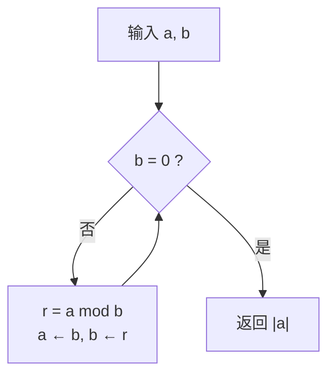

最大公因数（gcd）与最小公倍数（lcm）是整数世界里的「取交集 / 取并集」：分解成素因子后，gcd 每个指数取 min，lcm 取 max。辗转相除法不用分解质因数，只靠带余除法就能把 gcd 降到 $O(\log \min(a,b))$，再由 $ab=\gcd\cdot\operatorname{lcm}$ 得到 lcm。C++17 起 `<numeric>` 直接提供 `std::gcd` / `std::lcm`。

## 定义与基本性质

对不全为零的整数 $a,b$：

- $\gcd(a,b)$：同时整除 $a,b$ 的最大正整数。
- $\operatorname{lcm}(a,b)$：同时被 $a,b$ 整除的最小正整数。
- 若 $\gcd(a,b)=1$，称 $a,b$ **互素**（coprime）。

三条常用性质：

$$
\gcd(a,0)=|a|,\qquad \gcd(a,b)=\gcd(|a|,|b|),\qquad \gcd(a,b)\cdot\operatorname{lcm}(a,b)=|ab|.
$$

最后一条来自素因子分解。设

$$
a=\prod_p p^{\alpha_p},\qquad b=\prod_p p^{\beta_p},
$$

则

$$
\gcd(a,b)=\prod_p p^{\min(\alpha_p,\beta_p)},\qquad
\operatorname{lcm}(a,b)=\prod_p p^{\max(\alpha_p,\beta_p)}.
$$

因为 $\min+\max=\alpha+\beta$，两边指数相加正好还原 $ab$。

**多个数**可以折叠：$\gcd(a,b,c)=\gcd(\gcd(a,b),c)$，lcm 同理。

## 辗转相除法

核心恒等式：

$$
\boxed{\gcd(a,b)=\gcd(b,\ a\bmod b)}
$$

于是反复用余数替换前一个数，直到余数为 0：

$$
\gcd(1071,462):
\quad
\begin{aligned}
1071&=2\cdot 462+147\\
462&=3\cdot 147+21\\
147&=7\cdot 21+0
\end{aligned}
\quad\Longrightarrow\quad \gcd=21.
$$

**为什么成立**：设 $a=qb+r$。若 $d\mid a$ 且 $d\mid b$，则 $d\mid(a-qb)=r$；反过来若 $d\mid b$ 且 $d\mid r$，则 $d\mid(qb+r)=a$。两边**公约数集合完全相同**，最大者自然相同：

$$
\{d:d\mid a,\ d\mid b\}=\{d:d\mid b,\ d\mid r\}.
$$

**为什么终止**：$0\le r<|b|$，第二个参数严格变小，非负整数不可能无限下降。

**复杂度**：拉梅定理（Lamé）给出步数不超过较小数十进制位数的 5 倍，即 $O(\log\min(a,b))$。最坏情况是相邻的斐波那契数，每步余数只缩小一点点。

算法流程：



## 最小公倍数

由 $\gcd(a,b)\cdot\operatorname{lcm}(a,b)=|ab|$ 直接得到

$$
\operatorname{lcm}(a,b)=\frac{|ab|}{\gcd(a,b)}.
$$

计算时**先除后乘**，避免中间乘积溢出：

$$
\operatorname{lcm}(a,b)=\left|\frac{a}{\gcd(a,b)}\cdot b\right|.
$$

因为 $a/\gcd(a,b)$ 是整数，先除不丢精度。例：$\operatorname{lcm}(1071,462)=1071/21\cdot462=51\cdot462=23562$。

## C++ 程序设计

### 官方最短路径：`std::gcd` / `std::lcm`

C++17 起在 `<numeric>` 中，参数为整数类型，结果为非负：

```cpp
#include <iostream>
#include <numeric>

int main() {
    long long a = 1071, b = 462;
    std::cout << std::gcd(a, b) << '\n';   // 21
    std::cout << std::lcm(a, b) << '\n';   // 23562
}
```

编译需要 C++17：

```bash
g++ -std=c++17 gcd_demo.cpp -o gcd_demo
```

`std::gcd(0, 0)` 与 `std::lcm(0, 0)` 都返回 0；`std::lcm` 若结果无法用该类型表示，行为未定义。

### 手写迭代版

需要自己实现（老标准、嵌入式、或要加扩展功能）时，带余除法版最短：

```cpp
#include <cstdlib>   // std::abs(long long)

long long gcd(long long a, long long b) {
    while (b != 0) {
        long long r = a % b;
        a = b;
        b = r;
    }
    return a < 0 ? -a : a;
}

long long lcm(long long a, long long b) {
    return a == 0 || b == 0 ? 0 : std::abs(a / gcd(a, b) * b);
}
```

要点：

- **负数**：C++ 的 `%` 结果符号随被除数，但绝对值仍严格下降，循环照样收敛；最后统一取绝对值。`std::gcd` 则直接保证非负。
- **零**：`gcd(a, 0) = |a|`，`lcm(a, 0) = 0`。
- **溢出**：`lcm` 必须先除以 gcd 再乘；`a * b` 在 `long long` 上很容易越界。
- **类型**：竞赛/工程默认 `long long`；只处理非负整数时可用 `unsigned long long`。
- 函数无状态，可写成 `constexpr`，让编译器在编译期算常量。

### 扩展欧几里得

不只求 $g=\gcd(a,b)$，还求**贝祖系数** $x,y$ 使

$$
ax+by=g.
$$

```cpp
long long exgcd(long long a, long long b, long long& x, long long& y) {
    if (b == 0) {
        x = 1;
        y = 0;
        return a;
    }
    long long x1, y1;
    long long g = exgcd(b, a % b, x1, y1);
    x = y1;
    y = x1 - (a / b) * y1;
    return g;
}
```

推导就是把 $b x_1+(a\bmod b)y_1=g$ 中的 $a\bmod b=a-(a/b)b$ 整理回 $a$、$b$ 的系数。它是求**模逆元**（$ax\equiv1\pmod m$）、解一次同余方程和中国剩余定理的工具。

### 多个数的 gcd / lcm

利用结合律折叠，初值取单位元：

```cpp
long long g = 0;                       // gcd 的单位元
for (long long x : v) g = std::gcd(g, x);

long long l = 1;                       // lcm 的单位元
for (long long x : v) l = std::lcm(l, x);
```

`std::gcd(0, x) = |x|`，所以从 0 开始折叠不会污染结果。

## 直观理解

- **几何版**：$\gcd(a,b)$ 是用同样大小正方形铺满 $a\times b$ 矩形时，正方形的最大边长。辗转相除法就是不断从矩形上切掉最大的正方形：$1071\times462$ 先切 2 个 $462\times462$，剩 $147\times462$；再切 3 个 $147\times147$，剩 $147\times21$；最后正好 7 个 $21\times21$ 铺满。切的次数就是模运算的次数。
- **数轴版**：lcm 是两列等间距刻度第一次重合的位置；gcd 是能同时整除两段长度的最大刻度。
- **素因子版**：gcd 取每个素因子的「公共部分」，lcm 取「并集」，两者指数互补，所以乘积等于 $|ab|$。

## 拓展延伸

- **更相减损术**：$\gcd(a,b)=\gcd(a-b,b)$，只减不除；大数相差悬殊时很慢，是辗转相除法的前身。
- **二进制 GCD（Stein 算法）**：只用移位、减法，避免昂贵的整数除法，适合嵌入式；位复杂度 $O(\log^2 n)$。
- **`std::gcd` 的限制**：C++17 要求参数是整数类型（不能是 `bool`），返回 `std::common_type_t`；C++17 的 `std::lcm` 同样在 `<numeric>`。
- **模逆元**：当 $\gcd(a,m)=1$ 时，扩展欧几里得给出的 $x$ 就是 $a^{-1}\bmod m$，这是 RSA 与很多数论算法的零件。
- **复杂度直觉**：每两步至少让较小数减半，所以是 $O(\log\min(a,b))$；比试除法 $O(\sqrt{\min(a,b)})$ 快一个数量级。

## 术语

| 英文 | 中文 | 含义 |
| ---- | ---- | ---- |
| divisor / multiple | 因数 / 倍数 | 整除关系两侧 |
| common divisor | 公约数 | 同时整除两数 |
| greatest common divisor, gcd | 最大公因数 | 公约数中最大者 |
| least common multiple, lcm | 最小公倍数 | 公倍数中最小者 |
| Euclidean algorithm | 辗转相除法 / 欧几里得算法 | 用余数迭代求 gcd |
| remainder / modulo | 余数 / 取模 | $a\bmod b$ |
| coprime | 互素 | $\gcd(a,b)=1$ |
| Bézout coefficients | 贝祖系数 | $ax+by=\gcd(a,b)$ 中的 $x,y$ |
| extended Euclidean algorithm | 扩展欧几里得 | 同时求 gcd 与贝祖系数 |

## 总结

$\gcd$ 靠恒等式 $\gcd(a,b)=\gcd(b,a\bmod b)$ 迭代到零，复杂度 $O(\log\min(a,b))$；$\operatorname{lcm}$ 由 $|ab|/\gcd$ 得到，计算时先除后乘防溢出。C++ 中优先用 `<numeric>` 的 `std::gcd` / `std::lcm`，需要贝祖系数或模逆元时再手写扩展欧几里得。
