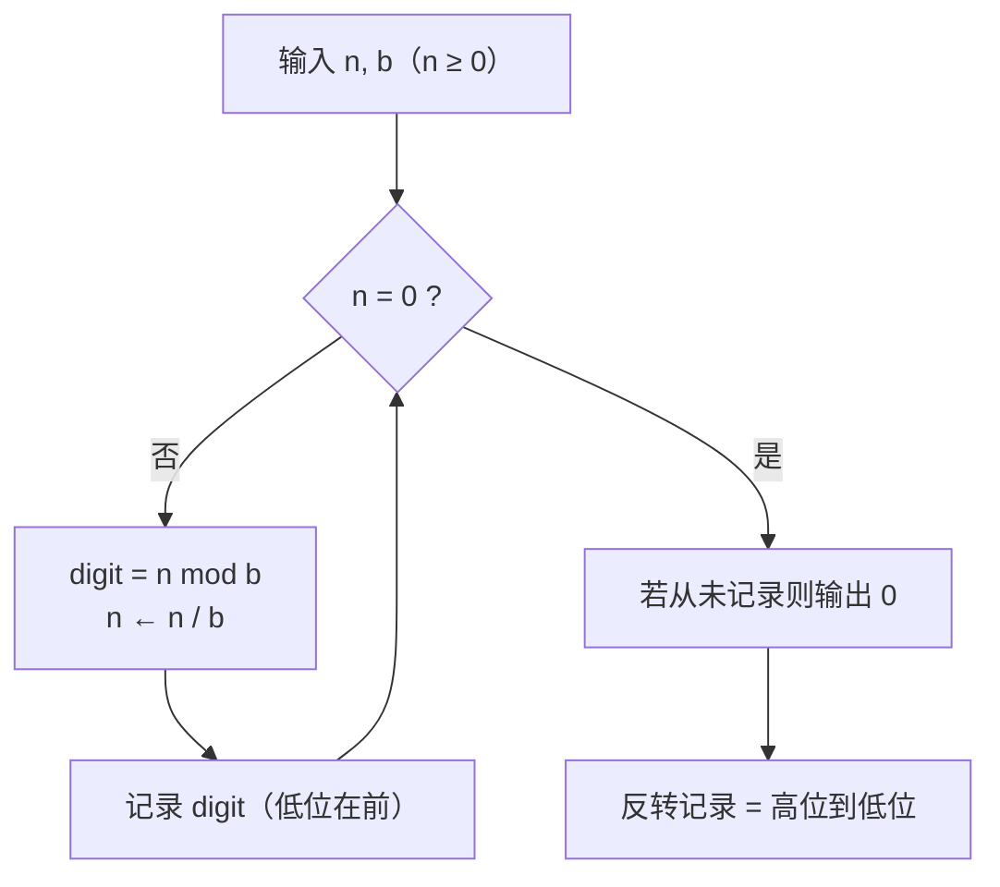

把整数写成 $b$ 进制，本质是把 $n$ 拆成「各位数字 × 权的和」。求各位数字最直接的办法是**除基取余**：不断除以 $b$，余数从低到高给出每一位；反过来，已知各位数字就用**乘基累加**（Horner）还原数值。C++17 的 `<charconv>` 已直接支持 2~36 进制。

## 位置记数法

$b$ 进制下，$n$ 的表示是一串数字 $d_{k-1}\cdots d_1d_0$，满足

$$
n=d_{k-1}b^{k-1}+d_{k-2}b^{k-2}+\cdots+d_1b+d_0,
\qquad 0\le d_i<b.
$$

- $d_0$ 是**最低位**（least significant digit），$d_{k-1}$ 是**最高位**（most significant digit）。
- 第 $i$ 位（从 0 开始）由「先右移、再取最低位」得到：

$$
\boxed{d_i=\left\lfloor\frac{n}{b^i}\right\rfloor\bmod b}
$$

- 位数（$n>0$）为

$$
k=\lfloor\log_b n\rfloor+1.
$$

例：

| 进制 $b$ | $1071$ | $462$ |
| ---- | ---- | ---- |
| 2 | `10000101111` | `111001110` |
| 8 | `2057` | `716` |
| 10 | `1071` | `462` |
| 16 | `42F` | `1CE` |

## 除基取余：十进制转 $b$ 进制

写出带余除法：

$$
n=bq_0+r_0,\qquad q_0=bq_1+r_1,\qquad\cdots
$$

因为 $0\le r_i<b$，$r_0$ 就是最低位 $d_0$，$r_1$ 就是 $d_1$，依此类推。所以：

1. 反复做 $n\gets n/b$，记录余数 $n\bmod b$；
2. 商为 0 时停止；
3. 把余数**倒序**读出，就是高位到低位。

$1071$ 转十六进制：

| 步骤 | 商 | 余数 |
| ---- | ---- | ---- |
| $1071\div16$ | 66 | 15 → `F` |
| $66\div16$ | 4 | 2 |
| $4\div16$ | 0 | 4 |

余数低位在前是 `F, 2, 4`，倒序得到 `42F`。

二进制、八进制、十六进制之间还可以直接**按位分组**：$1071=\texttt{0x42F}=\texttt{0100 0010 1111}$，去掉前导零就是 `10000101111`；八进制按 3 位分组，`10 000 101 111` → `2057`。

## 取某一位的数字

两种等价写法：

- **定位法**：$d_i=\lfloor n/b^i\rfloor\bmod b$。例：$1071$ 的百位是 $\lfloor1071/100\rfloor\bmod10=10\bmod10=0$。
- **剥位法**：连续做 $i$ 次 `n /= b`，再 `n % b`。不需要预先算 $b^i$，也不会碰到 `pow` 的浮点误差。

若要把所有位都取出来，就从低位到高位循环 `% b`、`/= b`，需要高位在前时再反转（或压栈）。

## 反向：各位数字还原数值

按 Horner 形式从最高位往低扫：

$$
n=(\cdots((d_{k-1})\,b+d_{k-2})\,b+\cdots)\,b+d_0.
$$

例：`42F` 按十六进制读，

$$
((4)\cdot16+2)\cdot16+15=66\cdot16+15=1071.
$$

每一位的权是 $b^{k-1-i}$；Horner 只是把「乘权再求和」整理成 $k$ 次乘加。

## C++ 程序设计

### 官方最短路径：`std::to_chars` / `std::from_chars`

C++17 的 `<charconv>` 支持 **2~36 进制**，无动态内存、无 locale：

```cpp
#include <charconv>
#include <iostream>
#include <string_view>

int main() {
    char buf[64];
    auto res = std::to_chars(buf, buf + sizeof buf, 1071, 16);
    std::cout << std::string_view(buf, res.ptr - buf) << '\n';  // 42f

    int n = 0;
    std::from_chars("42F", "42F" + 3, n, 16);
    std::cout << n << '\n';                                     // 1071
}
```

- `std::to_chars` 的 10 以上数字用**小写**字母（`42f`）；`std::from_chars` 大小写都接受。
- 不写进制参数时默认十进制。
- 需要 `if (res.ec != std::errc{})` 判断缓冲区是否够大；解析失败时 `from_chars` 返回的指针不指向末尾。

### 手写：除基取余

```cpp
#include <algorithm>
#include <string>

std::string to_base(long long n, int base) {
    static constexpr char DIGITS[] = "0123456789ABCDEFGHIJKLMNOPQRSTUVWXYZ";
    if (n == 0) return "0";

    bool negative = n < 0;
    unsigned long long u = negative ? -static_cast<unsigned long long>(n)
                                    : static_cast<unsigned long long>(n);

    std::string s;
    while (u != 0) {
        s += DIGITS[u % base];
        u /= base;
    }
    if (negative) s += '-';
    std::reverse(s.begin(), s.end());
    return s;
}
```

要点：

- 余数天然是**低位在前**，所以要反转。
- 负数先取幅值；先转 `unsigned long long` 再取负，对 `LLONG_MIN` 也安全。
- `base` 限定在 $[2,36]$；超过 36 需要自定义字符表。
- 大整数（几百位）每次除法 $O(k)$，总复杂度 $O(k^2)$；机器整数则是 $O(\log_b n)$。

### 各位数字与位数

```cpp
#include <vector>

std::vector<int> digits_low_to_high(long long n, int base) {
    std::vector<int> digits;
    do {
        digits.push_back(static_cast<int>(n % base));
        n /= base;
    } while (n != 0);
    return digits;                       // digits[0] 是个位
}

int digit_at(long long n, int base, int pos) {
    while (pos-- > 0) n /= base;         // 剥掉右边 pos 位
    return static_cast<int>(n % base);   // 再取最低位
}

int digit_count(long long n, int base) {
    int k = 1;
    while (n >= base) {                  // n = 0 也算 1 位
        n /= base;
        ++k;
    }
    return k;
}
```

`digit_at` 只适用于非负 $n$；负数请先取绝对值。`digits_low_to_high` 用 `do-while` 保证 $n=0$ 时也返回一位 `0`。

### 手写：从字符串读回数值

```cpp
#include <cctype>
#include <string_view>

long long from_base(std::string_view s, int base) {
    long long n = 0;
    for (char c : s) {
        int d = (c >= '0' && c <= '9')
                    ? c - '0'
                    : std::toupper(static_cast<unsigned char>(c)) - 'A' + 10;
        n = n * base + d;                // Horner
    }
    return n;
}
```

不处理正负号与前缀（`0x`、`0b`）；`std::from_chars` 也不接受 `0x`。工程里优先用它，自己写通常是为了加校验或支持更大进制。

## 直观理解

- **除基取余 = 剥最低位**：$n\bmod b$ 是剥下来的那一位，$n/b$ 是剩下的部分；剥到 0 就结束。
- **定位法 = 先右移再取最低位**：$\lfloor n/b^i\rfloor$ 把目标位挪到个位，`% b` 把它取出来。
- **按位分组**：二进制三位一组就是八进制，四位一组就是十六进制，因为 $8=2^3$、$16=2^4$。
- 算法流程：



## 拓展延伸

- **小数部分**：乘基取整。$0.625\times2=1.25$ 取 1，$0.25\times2=0.5$ 取 0，$0.5\times2=1.0$ 取 1，得 $0.101_2$。小数可能无限循环，只能截断到指定精度（十进制的 $0.1$ 在二进制中是无限循环）。
- **反求进制**：若 $(\texttt{101})_b=26$，即 $b^2+1=26$，解得 $b=5$。一般把表示按 $b$ 展开成多项式解方程；同时所有数字必须满足 $d_i<b$。
- **补码视角**：C++ 有符号负数以补码存储，转成 `unsigned` 后 `-1` 会变成全 1；想看补码位型，先转无符号再调 `to_base`。
- **C++20 `std::format`**：`"{:b}"`、`"{:o}"`、`"{:x}"` 只能做二/八/十六进制，任意进制仍要用 `to_chars` 或手写。
- **Base62 / URL 短链**：字符表扩到 `0-9A-Za-z`，本质仍是除基取余。
- **大整数**：Python 的 `int` 自动处理任意精度；C++ 需自己写高精度除法，复杂度从 $O(\log n)$ 升到 $O(k^2)$。

## 术语

| 英文 | 中文 | 含义 |
| ---- | ---- | ---- |
| radix / base | 基数 / 进制 | 每一位的进位单位 $b$ |
| positional notation | 位置记数法 | 数字的权随位置变化 |
| digit | 数位 / 数字 | 某一位上的值，$0\le d<b$ |
| least significant digit | 最低位 | $d_0$，个位 |
| most significant digit | 最高位 | $d_{k-1}$ |
| quotient / remainder | 商 / 余数 | 带余除法 $n=bq+r$ |
| base conversion | 进制转换 | 在不同 $b$ 之间改写表示 |
| Horner's method | 秦九韶 / 霍纳法 | 从高位乘基累加还原数值 |
| two's complement | 补码 | 有符号整数的存储方式 |

## 总结

$b$ 进制的每一位满足 $d_i=\lfloor n/b^i\rfloor\bmod b$。转换用除基取余，余数低位在前、倒序读出；反向用 Horner 乘基累加。C++17 优先 `std::to_chars` / `std::from_chars`（2~36 进制），需要自定义字符表或补码位型时再手写循环。
