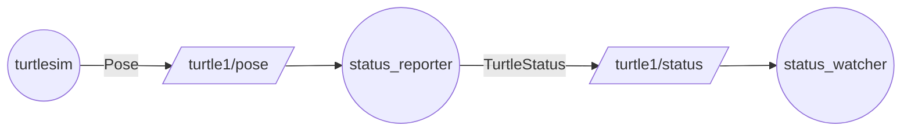

内置消息只覆盖通用最小集；要传「名字 + 坐标 + 朝向 + 速度 + 死活」这种项目自己的结构，就写 `.msg`，交给 rosidl 生成 C++/Python 类，之后和内置消息一样发布/订阅。

## 定义与生成

`.msg` 每行「类型 字段名」，类型可以是内置类型，也可以是另一个消息（嵌套）：

```msg
string  name
float32 x
float32 y
float32 theta
float32 linear_vel
bool    alive
```

```cmake
rosidl_generate_interfaces(${PROJECT_NAME}
  "msg/TurtleStatus.msg"
)
```

生成头文件 `turtle_status/msg/turtle_status.hpp`，类型 `turtle_status::msg::TurtleStatus`：

```cpp
m_pub = this->create_publisher<turtle_status::msg::TurtleStatus>("/turtle1/status", 10);
auto status = turtle_status::msg::TurtleStatus();
status.x = msg->x;
```

## 命名规则

| 层面 | 规则 | 例子 |
|---|---|---|
| `.msg` 文件名 | PascalCase | `TurtleStatus.msg` |
| 生成的头文件 | snake_case | `turtle_status.hpp` |
| C++ 类名 | PascalCase | `TurtleStatus` |
| C++ 命名空间 | `包名::类型目录::类名` | `turtle_status::msg::TurtleStatus` |

字段名是 snake_case。头文件路径里会出现两个同名包名：

```text
install/turtle_status/include/turtle_status/turtle_status/msg/turtle_status.hpp
                         └──────┬──────┘└──────┬──────┘└─┬─┘
                           第①层包名     第②层包名   类型目录
```

第①层是 ament 的安装/导出布局（`include/<包名>/` 是 include 根），第②层是命名空间 `namespace turtle_status` 的目录映射，撞名是巧合。所以 `#include` 只写一个包名：编译器在 `include/turtle_status/` 这个根下拼 `turtle_status/msg/...` 才命中。

生成的 `.hpp` 是汇总头，只 include detail 里的 `__struct` / `__builder` / `__traits` / `__type_support`。真正的结构体在 `detail/turtle_status__struct.hpp`：

```cpp
namespace turtle_status { namespace msg {
struct TurtleStatus_ {          // 内部名带下划线
  std::string name;
  float x, y, theta, linear_vel;
  bool alive;
};
using TurtleStatus = TurtleStatus_;   // 公开名是别名
}}
```

## 接口放哪：同包 vs 独立接口包

| | 独立接口包 | 接口在业务包内 |
|---|---|---|
| 接口位置 | `turtle_demo_interfaces` | 业务包 `turtle_status` |
| 使用方式 | `find_package` + 链接 `${..._TARGETS}` | 同包取 typesupport 再链接 |
| 生成类 | `turtle_demo_interfaces::msg::...` | `turtle_status::msg::...` |

同包时要多一步取 typesupport 目标：

```cmake
rosidl_get_typesupport_target(cpp_typesupport_target ${PROJECT_NAME} "rosidl_typesupport_cpp")
target_link_libraries(status_reporter ... ${cpp_typesupport_target})
```

## 发布/订阅闭环

```text
(turtlesim) ──Pose──▶ [/turtle1/pose] ──▶ (status_reporter) ──TurtleStatus──▶ [/turtle1/status] ──▶ (status_watcher)
```



发布端订原生 Pose，回调里把位姿「翻译」成自定义消息——这是自定义消息最典型的用法：

```cpp
void pose_callback(const turtlesim_msgs::msg::Pose::SharedPtr msg) {
  auto status = turtle_status::msg::TurtleStatus();
  status.name = m_turtle_name;
  status.x = msg->x;
  status.linear_vel = msg->linear_velocity;
  status.alive = true;
  m_pub->publish(status);
}
```

订阅端就是普通订阅，见 [[N001 节点基础书写骨架]]。

## 三种接口对比

| 接口 | 文件 | 段数 | 方向 | 生成类 |
|---|---|---|---|---|
| 消息 `.msg` | `TurtleStatus.msg` | 1 段 | 单向 pub→sub | `msg::TurtleStatus` |
| 服务 `.srv` | `TeleportTurtle.srv` | 2 段（`---`） | 一问一答 | `srv::TeleportTurtle` |
| 动作 `.action` | `Patrol.action` | 3 段（`---` ×2） | 带反馈长任务 | `action::Patrol` |

## 类型名自查

命名规则再熟也可能随发行版变化，直接问系统：

| 目的 | 命令 |
|---|---|
| 列出接口 | `ros2 interface list` |
| 看定义 | `ros2 interface show <包>/msg/<名>` |
| 看运行中的真实类型 | `ros2 topic echo --once <话题>` |
| 找头文件 | `find /opt/ros/lyrical/include -name 'pose.hpp'` |

ROS 2 类型永远带中间层 `::msg::` / `::srv::` / `::action::`；ROS 1 没有。

## 坑

- **Lyrical 把 turtlesim 接口拆到了 `turtlesim_msgs`**：`turtlesim_msgs::msg::Pose` 才对，`ros2 interface show turtlesim/msg/Pose` 会报找不到资源。旧教程（Humble 等）会记错。
- `.msg` 里嵌套自定义消息时，CMake 要声明依赖。
- 同包接口忘了 `rosidl_get_typesupport_target`，链接阶段会缺符号。
- 改了 `.msg` 要重新 colcon build，生成类才会更新。

> PS：接口一旦发布就尽量只加字段不改语义；独立接口包更适合多包共用。

自定义消息 = 写 `.msg` → rosidl 生成类 → 像内置消息一样收发；命名空间与头文件路径由「包名 / 类型目录 / 类名」三层决定，类型名拿不准就用 `ros2 interface` 自查。