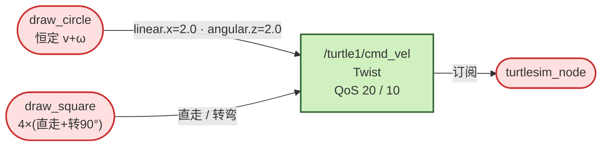
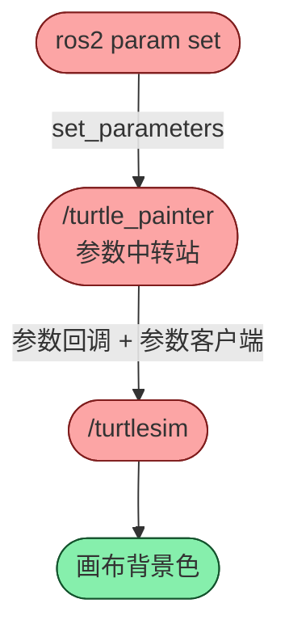

课程设计基础任务的两个小项目：`turtle_draw` 画方画圆（纯发布、无 spin、开环），以及 `turtle_painter` 参数中转（参数客户端 + 多线程 executor）。两者合起来覆盖「只发」和「参数」两条基础链路。工作空间 `~/ros2_course_ws/src/`，ROS 2 Lyrical。

## 一、turtle_draw：画圆与画方

### 结构

```
turtle_draw/
├── package.xml           # rclcpp、geometry_msgs
├── CMakeLists.txt        # 编 2 个可执行文件
├── README.md
└── src/
    ├── draw_circle.cpp   # 恒定 v + ω
    └── draw_square.cpp   # 4 × (直走 + 转 90°)
```

Lyrical 用 `find_package` + `${rclcpp_TARGETS}`，不用已移除的 `ament_target_dependencies`。

### 节点交互



两个节点都只发布，无订阅、服务、动作、参数。**不能同时跑**：会变成两个发布者抢同一话题，海龟被两股命令拉扯。

### draw_circle

| 成员 | 类型 | 作用 |
|---|---|---|
| `m_pub_cmd_vel` | `Publisher<Twist>::SharedPtr` | 发 `/turtle1/cmd_vel`，队列 20 |
| `m_v` | `constexpr double = 2.0` | 线速度 |
| `m_w` | `constexpr double = 2.0` | 角速度 |

```cpp
void draw_circle() {
  rclcpp::Rate rate(10.0);
  while (rclcpp::ok()) {
    auto msg = geometry_msgs::msg::Twist();
    msg.linear.x  = m_v;
    msg.angular.z = m_w;             // 半径 R = v/ω = 1.0
    m_pub_cmd_vel->publish(msg);
    rate.sleep();
  }
}
```

### draw_square

```cpp
constexpr double kPi = 3.1415926;

void publish_cmd_vel(rclcpp::Rate & rate, double duration,
                     double linear, double angular) {   // Rate 不可拷贝，传引用
  auto start = this->now();
  while (rclcpp::ok() && (this->now() - start).seconds() < duration) {
    auto msg = geometry_msgs::msg::Twist();
    msg.linear.x  = linear;
    msg.angular.z = angular;
    m_pub_cmd_vel->publish(msg);
    rate.sleep();
  }
}

void draw_square() {
  rclcpp::Rate rate(10.0);
  const double turn_time = (kPi / 2) / m_w;     // ≈ 0.785s
  for (int i = 0; i < 4; ++i) {
    publish_cmd_vel(rate, m_run_time, m_v, 0.0);      // 直走 2s
    publish_cmd_vel(rate, turn_time, 0.0, m_w);       // 转 90°
  }
  publish_cmd_vel(rate, 0.1, 0.0, 0.0);               // 停车
}
```

总时长约 11.1s。每段内部 10Hz 持续重发；turtlesim 约 1s 收不到命令就自停。

### 没有 spin 是正确的

两个节点只有发布、没有任何回调，不需要事件循环，业务直接在 main 线程串行跑完：

```cpp
int main(int argc, char ** argv) {
  rclcpp::init(argc, argv);
  auto node = std::make_shared<TurtleCircle>();
  node->draw_circle();          // 阻塞在 while + rate.sleep
  rclcpp::shutdown();
  return 0;
}
```

对比进阶任务：一有订阅 / 服务 / 动作 / 定时器回调，就必须 spin。

## 二、turtle_painter：参数中转

### 角色

自己声明 `background_r/g/b`，被 `ros2 param set` 改时，把新颜色转发给 turtlesim，改变画布背景。

```
ros2 param set /turtle_painter background_r 255
  → /turtle_painter/set_parameters（触发参数回调）
  → on_param_change → apply_color()
  → AsyncParametersClient.set_parameters(r,g,b)
  → /turtlesim/set_parameters
  → 画布背景色改变
```



核心思想：一个节点可以既是「参数提供者」（被别人改），又是「参数客户端」（改别人）。

### 构造函数四件事

1. 声明三个参数（默认蓝 `30 / 144 / 255`）。
2. 注册参数回调（被改时转发）。
3. 建 `AsyncParametersClient(this, "/turtlesim")` 改别人。
4. 一次性定时器（2s → `apply_color()` + `cancel`），等 turtlesim 上线后再应用。

### AsyncParametersClient

```cpp
m_param_client = std::make_shared<rclcpp::AsyncParametersClient>(this, "/turtlesim");
m_param_client->wait_for_service(1s);       // 等上线
m_param_client->set_parameters(
  {rclcpp::Parameter("background_r", r)},   // 初始化列表 → vector<Parameter>
  [this](std::shared_future<...> fut) {     // 异步回调
    fut.get();
  });
```

必须用 Async 而非 Sync：`SyncParametersClient` 内部会 `spin_until_future_complete()`，把已在 executor 里的节点再加一次，抛 `Node has already been added to an executor`。详见 [[ROS2/Errors/Errors]] E004。

### MultiThreadedExecutor

```cpp
auto node = std::make_shared<TurtlePainter>();       // 具名，防临时对象销毁
rclcpp::executors::MultiThreadedExecutor executor(rclcpp::ExecutorOptions(), 2);
executor.add_node(node);
executor.spin();
```

参数回调、定时器回调、异步结果回调需要并发；单线程会串行排队。开 2 个线程让异步结果及时处理。

### 回调链

```
on_param_change（自己被改）
  → apply_color()
    → get_parameter 读 r/g/b
    → set_parameters 异步发给 turtlesim
      → 回调里 fut.get() 确认结果
```

## 坑

- **两个画图节点不能同时跑**：都发 `/turtle1/cmd_vel`，海龟被两股速度拉扯。
- **发布间隔超过 1 秒**：turtlesim 认为节点失联，自动停车；`Rate(10.0)` 留足余量。
- **`SyncParametersClient` 不能在 spin 后构造**：内部会再次 spin，抛 `Node has already been added to an executor`。
- **多线程 executor 线程数不足**：并发回调仍排队，异步结果回调可能迟迟不执行。

## 面试要点

**1. CMakeLists 怎么理解**
`find_package(rclcpp)` 加载配置并提供 `${rclcpp_TARGETS}`（展开为 `rclcpp::rclcpp`，自带头文件路径与库）；`add_executable` 声明目标；`target_link_libraries` 链接；`install(... DESTINATION lib/${PROJECT_NAME})` 装进 install，`ros2 run` 才找得到。

**2. `&` 的作用**
`rclcpp::Rate &` 是引用传递，形参是调用方 rate 的别名。`Rate` 内部有节拍/时钟状态，不可拷贝，拷贝会编译失败且失准。`double` 按值传即可。

**3. `#define` vs `constexpr`**
宏是预处理文本替换，无类型无作用域；`constexpr double kPi` 有类型、有作用域、可调试，是更规范的写法。

**4. 构造函数初始化列表**
`TurtleCircle() : Node("draw_circle")`：基类 `Node` 必须先于派生类成员构造，且没有无参构造，所以放初始化列表。顺序是基类 → 成员（按声明序）→ 函数体。

**5. 智能指针 / make_shared**
`make_shared` 一次分配对象 + 控制块，异常安全；Publisher 用 shared_ptr 让 Node 统一管理生命周期，引用计数归零自动释放。

**6. Rate / sleep**
`Rate(10.0)` 是 10Hz 节拍器；`rate.sleep()` 睡到下一拍，自动补偿循环体耗时，不是死睡固定时长。

**7. 为什么 linear.x / angular.z**
海龟在 2D 平面：前进沿自身 x 轴 → `linear.x`；转向绕 z 轴 → `angular.z`。其余分量保持 0。

**8. 开环 vs 闭环**
开环只发命令不读反馈，按速度 × 时间估算位置；简单但速度不准会累积误差。闭环订阅 pose 校正。turtle_draw 刻意选开环。

**9. 为什么没有 spin**
spin / executor 驱动回调；这两个节点只有发布、没有回调，直接在 main 里跑业务循环即可。

**10. QoS 队列深度**
`create_publisher` 第二参数是发布者侧队列深度；两个画图节点同时跑会抢同一话题，所以 README 要求各跑各的。

**11. 参数中转为什么用 AsyncParametersClient**
它是改别人参数的正道；Sync 内部会再 spin，和已有 executor 冲突。异步返回 shared_future，配合多线程 executor 才真正并发。

**12. 为什么用一次性定时器**
构造期 turtlesim 可能还没上线，延迟到启动后再 apply；直接在构造函数里阻塞等待会拖住初始化。

## 总结

turtle_draw 是「最小发布节点」：无回调、无 spin、开环，靠 `Rate` 每拍重发。turtle_painter 是「参数中转站」：声明参数 + 被改回调 + 异步参数客户端转发，因异步需要并发而换 MultiThreadedExecutor。两者分别对应「只出不进」和「参数链路」两种基础形态。