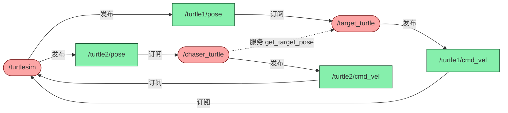

---
tags:
  - 项目学习
  - Service服务
  - Topic话题
  - turtlesim
  - 架构Architecture
---

# turtle_chase 小海龟追击项目 · 项目学习 · N020

**时间:** 2026-10-05 14:32
**标签:** #项目学习 #Service服务 #Topic话题 #turtlesim #架构Architecture
**关联:** [[N017 Service概念与srv接口]] [[N018 服务端实现 create_service]] [[N019 客户端实现 create_client]] [[N015 话题通信的端到端延迟]] [[E003 构建依赖-turtlesim消息拆到turtlesim_msgs]] [[E004 运行时-Service客户端等响应的死锁与executor冲突]]

## 项目目标

两只海龟：`turtle1`（目标）随机游走，`turtle2`（追击者）通过 Service 查询 turtle1 位置并慢慢追击。

## 架构（谁负责什么）

turtlesim 里的海龟是「哑」的——不会自己动，也不会说话；动要靠发 `cmd_vel`，位置靠订阅 `pose`。

```
turtlesim（仿真器，现成）
  ├─ 持续广播 /turtle1/pose、/turtle2/pose
  └─ 持续监听 /turtle1/cmd_vel、/turtle2/cmd_vel

target_turtle（服务端）—— 订阅 + 发布 + 服务端，三合一
  ├─ 订阅 /turtle1/pose    → 记住自己在哪
  ├─ 发布 /turtle1/cmd_vel → 让自己随机游走
  └─ 提供 get_target_pose  → 回答「我在哪」

chaser_turtle（客户端）—— 订阅 + 发布 + 客户端
  ├─ 订阅 /turtle2/pose    → 记住自己在哪
  ├─ 发布 /turtle2/cmd_vel → 让自己追过去
  └─ 调 get_target_pose    → 问「目标在哪」
```

**核心架构思想：一个节点可以同时订阅、发布、提供服务、调服务**——节点是「一组通信能力的集合」。

## 服务端 target_turtle 拆解

- **四个角色**（构造函数里装好）：`pose_sub_` 订阅位置、`vel_pub_` 发速度、`timer_` 每 500ms 触发、`service_` 提供服务。
- **服务回调两个参数**：`request`（读）+ `response`（写）；写 response 返回即自动回复。
- **`create_service` 的 bind 有两个占位符 `_1, _2`**（服务回调两个参数），而订阅回调只有一个 `_1`。
- **状态缓存**：`pose_callback` 把位置写进 `current_x_/current_y_`，`handle_get_pose` 再读出来，跨回调共享。
- **随机游走**：`std::mt19937` + 均匀分布，实现细节见 [[N021 控制海龟运动]]。

## 客户端 chaser_turtle 拆解

- **`create_client` 没有回调参数**（和 `create_service` 不同）——客户端是「主动调」，不是「被动响应」。
- **`chase()` 三步**：`wait_for_service(1s)` 等服务上线 → 构造空请求 → `async_send_request(request, 回调)`。
- **为什么异步回调**（见 [[E004 运行时-Service客户端等响应的死锁与executor冲突]]）：`future.wait_for` 死锁、`spin_until_future_complete` 抢 executor，节点在 spin 时只能异步回调。
- **lambda 捕获 `[this]`**：因为要调 `this->move_towards(...)`，把对象指针带进去。

## 追击几何（详见 [[N021 控制海龟运动]]）

追击靠 `atan2` 求方向 + 距离判断 + 比例转向，完整代码与拆解见 [[N021 控制海龟运动]]。

## 整体架构树状图 + 实现伪代码

> 用「文件级 → 通信关系 → 节点内部 → 伪代码 → 时序」五层，把整个项目串起来。

### ① 文件级架构（包内有什么）

```
turtle_chase/  (位于 dev_ws/src/)
├─ package.xml            → 声明依赖 rclcpp / turtlesim_msgs / geometry_msgs
├─ CMakeLists.txt         → rosidl 生成 srv 类型 + 编译两个可执行文件
├─ srv/
│  └─ GetTargetPose.srv   → 自定义服务接口（请求空 / 响应 x,y）
└─ src/
   ├─ target_turtle.cpp   → 节点「target_turtle」= 目标海龟 · 服务端
   └─ chaser_turtle.cpp   → 节点「chaser_turtle」= 追击海龟 · 客户端
```

### ② 通信关系树（画布上三块如何连）

```
turtlesim（仿真器，现成）
├─ 广播 /turtle1/pose ──► target_turtle 订阅（记住自己的位置）
├─ 广播 /turtle2/pose ──► chaser_turtle 订阅（记住自己的位置）
├─ 监听 /turtle1/cmd_vel ◄── target_turtle 发布（随机游走）
└─ 监听 /turtle2/cmd_vel ◄── chaser_turtle 发布（追击）

target_turtle ──提供 get_target_pose──► ◄──调用── chaser_turtle
              （服务端）                        （客户端）
```

### ②-2 节点图（rqt_graph 风格）

> 同一份通信关系，换成 rqt_graph 的视角：胶囊 `( )` = 节点，矩形 `[ ]` = 话题，实线 = Topic 数据流，虚线 = Service 调用。

```
【Topic 两条闭环】  (  ) = 节点   [  ] = 话题

  turtle1 回路（目标海龟随机游走）
  (/turtlesim) ──发布──► [/turtle1/pose] ──订阅──► (/target_turtle)
       ▲                                                      │
       └────────────订阅── [/turtle1/cmd_vel] ◄──发布──────────┘

  turtle2 回路（追击海龟追击）
  (/turtlesim) ──发布──► [/turtle2/pose] ──订阅──► (/chaser_turtle)
       ▲                                                      │
       └────────────订阅── [/turtle2/cmd_vel] ◄──发布──────────┘

【Service】
  (/chaser_turtle) ═══ get_target_pose ═══► (/target_turtle)
                      客户端·调用              服务端·提供
```



### ③ 节点内部结构树（构造函数装了哪些「角色」）

```
target_turtle 节点                          chaser_turtle 节点
├─ pose_sub_  订阅 /turtle1/pose            ├─ client_   调 get_target_pose（客户端句柄）
├─ vel_pub_   发布 /turtle1/cmd_vel         ├─ pose_sub_ 订阅 /turtle2/pose
├─ timer_     每 500ms → move_callback      ├─ vel_pub_  发布 /turtle2/cmd_vel
├─ service_   提供 get_target_pose          └─ timer_    每 500ms → chase
├─ gen_ / dist_  随机数引擎 + 均匀分布        └─ 状态 self_x_ / self_y_ / self_theta_
└─ 状态 current_x_ / current_y_
```

### ④ 实现伪代码

**target_turtle（服务端 · 目标海龟）**

```
构造 TargetTurtle():
  gen_ = random_device 种子            // 随机数引擎(梅森旋转 mt19937)
  pose_sub_ = 订阅 "/turtle1/pose" → pose_callback   // 记住自己在哪
  vel_pub_  = 发布 "/turtle1/cmd_vel"                 // 让自己动
  timer_    = 定时器 每 500ms → move_callback         // 周期随机游走
  service_  = 提供 "get_target_pose" → handle_get_pose // 回答「我在哪」

pose_callback(pose):
  current_x_ = pose.x
  current_y_ = pose.y                  // 只缓存位置，不主动做任何事

move_callback():                       // 随机游走（被动，靠定时器驱动）
  twist.linear.x  = 1.0                // 一直前进
  twist.angular.z = dist_(gen_)        // 均匀分布 [-2, 2] rad/s 随机转向
  vel_pub_.publish(twist)

handle_get_pose(request, response):    // 服务回调，两个参数
  response.x = current_x_              // 把缓存的位置填进响应
  response.y = current_y_
  // 函数返回 = 自动回复响应
```

**chaser_turtle（客户端 · 追击海龟）**

```
构造 ChaserTurtle():
  client_   = create_client("get_target_pose")      // 客户端句柄（主动调，无回调参数）
  pose_sub_ = 订阅 "/turtle2/pose" → pose_callback  // 记住自己在哪
  vel_pub_  = 发布 "/turtle2/cmd_vel"               // 让自己追
  timer_    = 定时器 每 500ms → chase                // 周期追击

pose_callback(pose):
  self_x_ = pose.x
  self_y_ = pose.y
  self_theta_ = pose.theta              // 多记一个朝向，追击要用

chase():                               // 每个周期跑一次
  if not client_.wait_for_service(1s): // 等服务上线，最多等 1s
    return                             // 没等到就跳过本轮
  request = 空请求                      // 本项目请求体为空
  client_.async_send_request(request, 回调)  // 异步发请求，不阻塞 spin

回调(future):                          // 响应回来后自动被调用
  response = future.get()              // 取出响应里的 x, y
  move_towards(response.x, response.y)

move_towards(target_x, target_y):      // 追击几何
  dx = target_x - self_x_
  dy = target_y - self_y_
  distance = sqrt(dx² + dy²)
  angle_to_target = atan2(dy, dx)      // 目标在哪个方向（弧度）
  angle_diff = angle_to_target - self_theta_   // 我朝向 vs 目标方向的夹角
  if distance < 0.5:
    twist = (0, 0)                     // 追到了，停下
  else:
    twist.linear.x  = 1.0              // 前进
    twist.angular.z = 4.0 * angle_diff // 按夹角比例转向
  vel_pub_.publish(twist)
```

**GetTargetPose.srv（自定义接口）**

```
请求:  (空)
---
响应:  float64 x
       float64 y
```

### ⑤ 一次追击的完整时序（500ms 一轮，循环往复）

```
t0     chaser: timer 触发 → chase()
         ├─ wait_for_service 通过
         ├─ 发空请求 ──────────────► target: handle_get_pose
         │                            └─ 返回 (current_x, current_y)
         ◄────────────────────────── 响应 (x, y)
         └─ move_towards(x, y) → 发布 /turtle2/cmd_vel → turtlesim 让 turtle2 动
t0+500ms  chaser: timer 再次触发 → 重复上一轮
```

> **一句话串起整体逻辑：**
> 两个节点各自「订阅 pose 记住位置 + 发 cmd_vel 让自己动 + 定时器周期触发」；区别只在于目标海龟多了一个**提供服务**（随机游走、等人来问），追击海龟多了一个**调服务**（每 500ms 问一次「你在哪」，拿到答案算方向再追）。**Topic 负责持续流，Service 负责一次查询，定时器负责「周期」这个节拍器。**

## 核心「为什么」

| 问题 | 答案 |
|---|---|
| 服务端为何订阅 pose | 要「回答自己在哪」却不知道，得订阅广播来记住 |
| 服务端为何发 cmd_vel | 「自由移动」不会自己发生，得有人持续发速度 |
| 为何用定时器驱动 | 游走 / 追击是周期性动作，定时器是周期触发的标准机制 |
| 客户端为何也订阅 + 发布 | 追击需要「自己位置」（订阅）+「让自己动」（发布） |

> **Note（连接 / 深化）：**
> - 本项目是 Topic + Service **并存**的实例：`cmd_vel`/`pose` 是持续流用 Topic，`get_target_pose` 是一次查询用 Service，正好印证 [[N017 Service概念与srv接口]] 里「推 vs 拉」。
> - 追击是「周期调服务」的轮询模式，端到端延迟会直接影响追击的滞后，见 [[N015 话题通信的端到端延迟]]。
> - 自定义 .srv 的编译配置见 [[N014 从cpp到可执行文件]]；turtlesim 消息拆包见 [[E003 构建依赖-turtlesim消息拆到turtlesim_msgs]]。

## 思考

（留白 —— 若把「查位置」从 Service 换成 Topic（目标海龟主动广播位置），追击会有什么不同？实时性和机制上对比）

## 总结

**本质：** 一个 ROS 2 项目 = 若干「多角色节点」的集合；本项目用 Topic 做持续流（pose/cmd_vel）、用 Service 做一次性查询（get_target_pose），客户端通过周期调服务实现追击。
**标签:** #项目学习 #Service服务 #Topic话题 #架构Architecture
