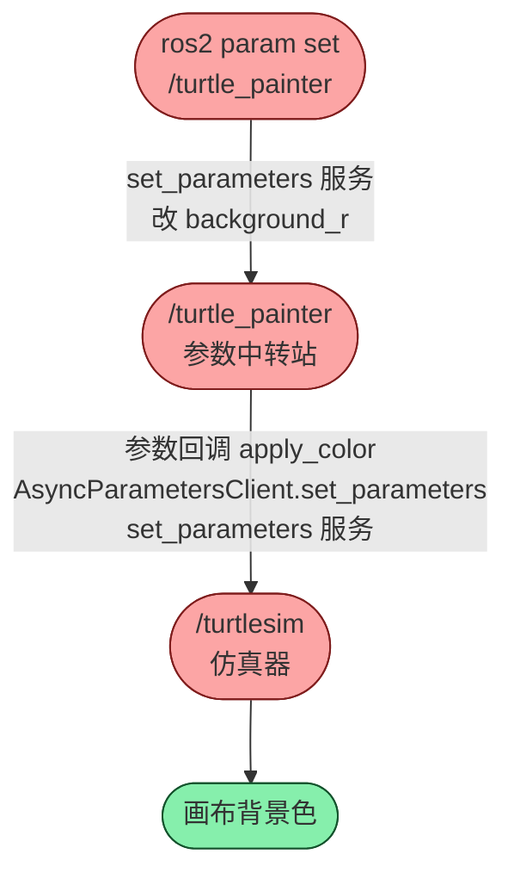

---
tags:
  - 项目学习
  - Parameter参数
  - 参数客户端ParameterClient
  - 多线程Executor
  - turtlesim
---

# turtle_painter 参数中转节点拆解 · 项目学习 · N029

**时间:** 2026-10-06 20:48
**标签:** #项目学习 #Parameter参数 #参数客户端ParameterClient #多线程Executor #turtlesim
**关联:** [[N024 参数概念与四大通信机制全景]] [[N025 参数的声明读写与命令行工具]] [[N026 参数存在哪-节点内的键值对容器]] [[N028 参数服务与参数回调]] [[N023 main函数变厚 executor演进]] [[E004 运行时-Service客户端等响应的死锁与executor冲突]]

## 项目目标

`turtle_painter` 是一个**参数中转**节点：它自己声明 `r/g/b` 三个参数，当别人（`ros2 param set`）改它的参数时，它把新颜色**转发**给 turtlesim，从而改变画布背景色。

> 一句话：改 `turtle_painter` 的参数 = 改 turtlesim 的背景色。

## 架构（这个节点扮演什么角色）

```
外部: ros2 param set /turtle_painter background_r 255
        │ 走 /turtle_painter/set_parameters 服务（触发参数回调）
        ▼
  /turtle_painter   参数容器 background_r/g/b  ← 自己声明的参数
        │ on_param_change → apply_color()
        │ 读自己的 r/g/b
        │ AsyncParametersClient.set_parameters(r,g,b)
        ▼ 走 /turtlesim/set_parameters 服务
  /turtlesim        参数容器 background_r/g/b  ← 别人的参数
        │
        ▼
   画布背景色改变
```

**核心思想：一个节点可以既当「参数提供者」（被别人改），又当「参数客户端」（改别人）——参数中转站。**

### 节点图（rqt_graph 风格）



## 构造函数拆解（装了 4 样东西）

1. **声明 3 个参数**（默认蓝 `30 / 144 / 255`）—— 见 [[N025 参数的声明读写与命令行工具]]
2. **参数回调** `add_on_set_parameters_callback` → `on_param_change` —— 监听自己被改（见 [[N028 参数服务与参数回调]]）
3. **AsyncParametersClient(`"/turtlesim"`)** —— 改**别人**的参数（新知识点 1）
4. **一次性定时器**（2s → `apply_color()` + `cancel`）—— 等启动后再应用，避免构造期阻塞

## 新知识点 1：AsyncParametersClient（改别人的参数）

```cpp
param_client_ = std::make_shared<rclcpp::AsyncParametersClient>(this, "/turtlesim");
```

- **参数客户端**：用来读写**别的节点**的参数，和自己 `declare / get / set` 是两码事；
- 构造传两个东西：本节点 + 目标节点名；
- 使用三步：`wait_for_service` 等上线 → `set_parameters({...}, 回调)` → 回调里 `fut.get()` 确认结果。

**`set_parameters` 的两个参数**（为什么「衔接」一个 lambda）：

```cpp
param_client_->set_parameters(
  { rclcpp::Parameter("background_r", r), ... },   // ① 参数列表：要设到 turtlesim 的键值对
  [this](std::shared_future<...> fut) { ... });    // ② 回调：结果回来时调它处理
```

- ① 是「要设置哪些参数」——花括号是**初始化列表**，直接构造出一个 `vector<Parameter>`；
- ② 是「回调函数」——因为 `set_parameters` 是**异步**的：发完请求不傻等，结果回来时调这个 lambda。C++ 里函数（lambda）能当参数传，这就是「回调」（同 [[N007 lambda表达式]]）。

**为什么必须 Async 而非 Sync？**（呼应 [[E004 运行时-Service客户端等响应的死锁与executor冲突]]）

- `SyncParametersClient` 内部 `wait_for_service / set_parameters` 会调 `spin_until_future_complete()` → **新建 executor 并把节点加进去** → 但节点已在 main 的 executor 里 → 抛 `"Node has already been added to an executor"`；
- `AsyncParametersClient` 返回 `shared_future`、内部不 spin，配合多线程 executor 才能真正并发。

## 新知识点 2：MultiThreadedExecutor

```cpp
auto node = std::make_shared<TurtlePainter>();   // 具名 shared_ptr，防临时对象被销毁
rclcpp::executors::MultiThreadedExecutor executor(rclcpp::ExecutorOptions(), 2);
executor.add_node(node);
executor.spin();
```

- 对比 [[N023 main函数变厚 executor演进]]：`spin()` 是单节点单线程的快捷方式；这里**显式建 executor + add_node + spin**，开 **2 个线程**；
- 为什么多线程：参数回调、定时器回调、AsyncParametersClient 的异步回调要能并发，单线程会串行排队。

## 核心回调链（数据怎么流）

```
on_param_change(自己被改)
  → apply_color()
    → get_parameter 读 r/g/b
    → param_client_.set_parameters(...)   // 异步发给 turtlesim
      → 回调里 fut.get() 确认成功/失败
```

## 核心「为什么」

| 问题 | 答案 |
|---|---|
| 为什么声明 r/g/b | 要「被人改」得先有参数 |
| 为什么加参数回调 | 被改时立刻转发，否则改了自己的参数、背景色却不变 |
| 为什么用 AsyncParametersClient | 改别人参数的正道；Sync 会死锁（见 E004） |
| 为什么用 MultiThreadedExecutor | 让多个回调并发，异步结果能及时处理 |
| 为什么用一次性定时器 | 构造期 turtlesim 可能还没上线，延迟到启动后再应用 |

> **Note（连接 / 深化）：**
> - 本项目是参数的完整实践：声明 / 存储 / 回调（均见 N024）+ 客户端（本条），外加 executor（N023）。
> - 深化：「参数中转」模式很常见——一个节点**接收外部配置 → 翻译 → 下发到别的节点**，是配置管理 / 设备驱动的雏形。

## 思考

（留白 —— 如果不加一次性定时器、直接在构造函数里调 `apply_color()`，会发生什么？为什么「构造期不能阻塞」？）

## 总结

**本质：** turtle_painter 是「参数中转站」：自己声明参数 + 被改时回调 + 用 AsyncParametersClient 转发给 turtlesim；因异步客户端需要并发，main 换成 MultiThreadedExecutor。
**标签:** #项目学习 #Parameter参数 #参数客户端ParameterClient #多线程Executor
