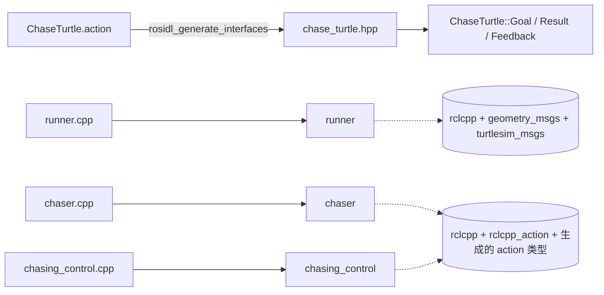
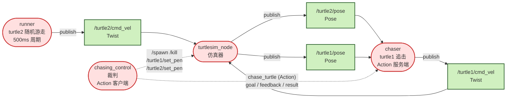
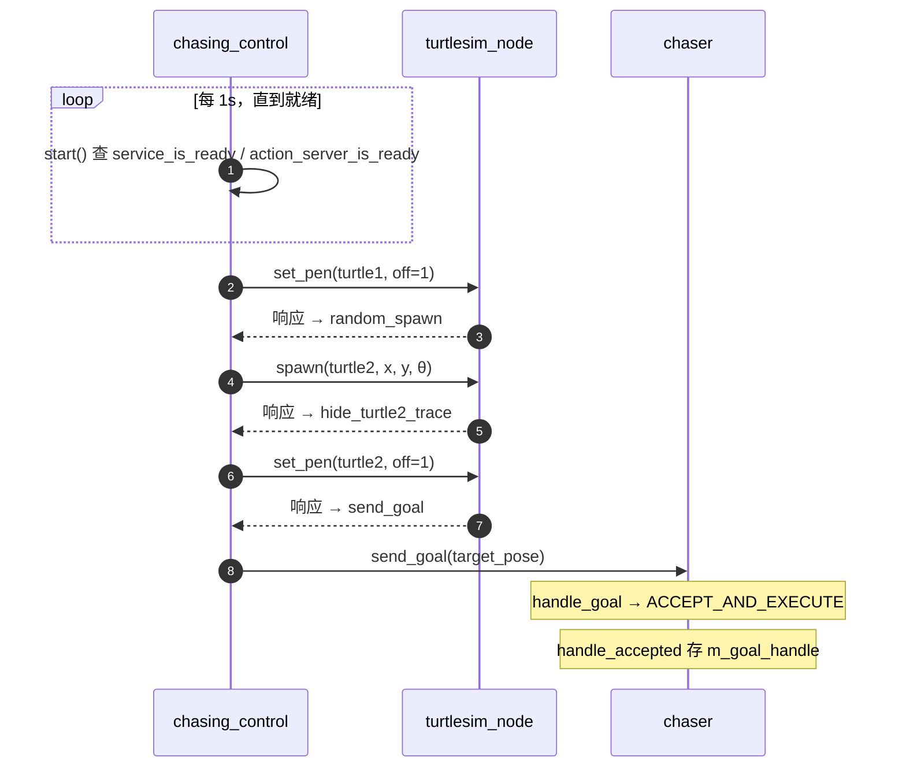
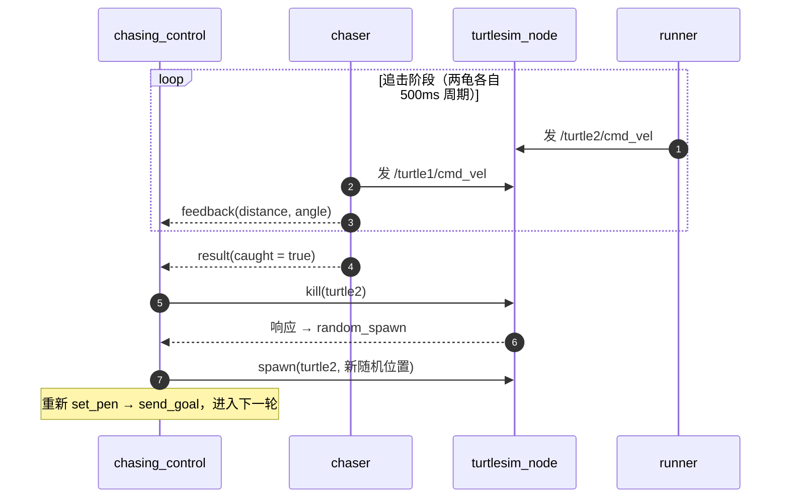

课程设计进阶任务：双龟追逐（A 追 B，追到后 B 重生）。最终形态是三节点 + Action：`runner` 随机游走、`chaser` 做 Action 服务端、`chasing_control` 做裁判兼 Action 客户端。工作空间 `~/ros2_course_ws/src/turtle_chase_game`，ROS 2 Lyrical。

## 需求与架构演进

任务要求：B 随机出生并持续随机运动；A 追 B，距离足够近判「追到」；追到后 B 原位消失、随机位置重生；隐藏两者轨迹；碰墙不贴墙、不卡住。

架构经历了两版：

| | 两节点 Service 版（原型） | 三节点 Action 版（最终） |
|---|---|---|
| 节点 | `target_turtle` + `chaser_turtle` | `runner` + `chaser` + `chasing_control` |
| 目标位置 | chaser 每 500ms 调 `get_target_pose` 服务 | chaser 直接订阅 `/turtle2/pose` |
| 追击语义 | 无「开始/结束」，一直追 | Action：goal / feedback / result |
| 编排 | 无 | 裁判统一 spawn / kill / 发 goal |

原型验证了核心追击算法（角度差比例控制）；最终版把它放进 Action 三节点里，因为追击是「长时间运行 + 有中间进度 + 有最终结果」的长任务，正好用 Action 展示第四大机制。Service 版的价值是证明「Topic 持续流 + Service 一次查询」可以并存，但它没有结束语义，不适合做整场游戏的骨架。

## 工程结构

```
turtle_chase_game/
├── package.xml                   # rclcpp、rclcpp_action、turtlesim_msgs、geometry_msgs
├── CMakeLists.txt                # rosidl 生成 action + 编 3 个可执行文件
├── action/ChaseTurtle.action     # goal=Pose，result=caught+final_pose，feedback=distance+angle_error
├── launch/turtle_chase_game.launch.py
└── src/
    ├── runner.cpp                # B 龟 turtle2：随机游走，只发 /turtle2/cmd_vel
    ├── chaser.cpp                # A 龟 turtle1：Action 服务端，追击
    └── chasing_control.cpp       # 裁判：Action 客户端，编排 spawn/kill/重生
```

编译链路：



goal 里引用 `geometry_msgs/Pose`，所以 `rosidl_generate_interfaces` 必须写 `DEPENDENCIES geometry_msgs`；`chaser` / `chasing_control` 要链接 `cpp_typesupport_target`，`runner` 不用。

## 节点交互全景



| 交互 | 类型 | 方向 | 说明 |
|---|---|---|---|
| `/turtle2/cmd_vel` | Topic | runner → turtlesim | 每 500ms 随机 Twist |
| `/turtle1/cmd_vel` | Topic | chaser → turtlesim | 每 500ms 追击 Twist |
| `/turtle1/pose`、`/turtle2/pose` | Topic | turtlesim → chaser | 刷新自己 / 目标位置 |
| `/spawn`、`/kill` | Service | 裁判 → turtlesim | 全局服务，name 在请求里 |
| `/turtle1/set_pen`、`/turtle2/set_pen` | Service | 裁判 → turtlesim | 每龟一个，关画笔 |
| `chase_turtle` | Action | 裁判 → chaser | 发 goal、收 feedback/result |

四大机制全覆盖：Topic（位置/速度）、Service（spawn/kill/set_pen）、Action（追击）、Parameter（阈值/速度可配置）。

## 三个节点

### runner（B 龟 · 随机游走）

| 成员 | 类型 | 作用 |
|---|---|---|
| `m_v` | `double = 1.0` | 恒定线速度 |
| `m_w` | `double = 2.0` | 随机角速度边界 |
| `m_period` | `milliseconds = 500ms` | 定时周期 |
| `m_pub_cmd_vel` | `Publisher<Twist>::SharedPtr` | 发 `/turtle2/cmd_vel` |
| `m_timer` | `TimerBase::SharedPtr` | 周期触发 `wander` |
| `m_gen` / `m_dist` | `mt19937` / `uniform_real_distribution` | 随机引擎 + 分布 |

```cpp
void wander() {
  auto msg = geometry_msgs::msg::Twist();
  msg.linear.x  = m_v;
  msg.angular.z = m_dist(m_gen);      // [-2, 2]
  m_pub_cmd_vel->publish(msg);
}
```

`m_gen` 用 `std::random_device{}()` 播种；`mt19937` 同种子同序列，不播种每次路径一样。

### chaser（A 龟 · Action 服务端）

| 成员 | 类型 | 作用 |
|---|---|---|
| `m_v` / `m_angular_k` / `m_catch_threshold` | `constexpr double` | 追击速度 / 转向增益 / 判定阈值 |
| `m_x` / `m_y` / `m_theta` | `double` | 自己位置，订阅 `/turtle1/pose` 更新 |
| `m_target_x` / `m_target_y` | `double` | 目标位置，订阅 `/turtle2/pose` 更新 |
| `m_sub_target_pose` / `m_sub_my_pose` | `Subscription<Pose>::SharedPtr` | 两路 pose |
| `m_pub_cmd_vel` | `Publisher<Twist>::SharedPtr` | 发 `/turtle1/cmd_vel` |
| `m_timer` | `TimerBase::SharedPtr` | 周期触发 `chase` |
| `m_server` | `rclcpp_action::Server<ChaseTurtle>::SharedPtr` | Action 服务端 |
| `m_goal_handle` | `shared_ptr<ServerGoalHandle>` | 当前目标，空 = 空闲 |

```cpp
void chase() {
  if (!m_goal_handle) return;
  double dx = m_target_x - m_x, dy = m_target_y - m_y;
  double distance = std::sqrt(dx*dx + dy*dy);
  double angle_to_target = std::atan2(dy, dx);
  double angle_error = std::atan2(std::sin(angle_to_target - m_theta),
                                  std::cos(angle_to_target - m_theta));

  auto feedback = std::make_shared<ChaseTurtle::Feedback>();
  feedback->distance = distance;
  m_goal_handle->publish_feedback(feedback);

  auto msg = geometry_msgs::msg::Twist();
  if (distance < m_catch_threshold) {
    m_pub_cmd_vel->publish(msg);        // 全零停车
    auto result = std::make_shared<ChaseTurtle::Result>();
    result->caught = true;
    m_goal_handle->succeed(result);
    m_goal_handle.reset();
  } else {
    msg.linear.x  = m_v;
    msg.angular.z = m_angular_k * angle_error;
    m_pub_cmd_vel->publish(msg);
  }
}
```

`handle_goal` 返回 `ACCEPT_AND_EXECUTE`，`handle_cancel` 返回 `ACCEPT`，`handle_accepted` 保存 `m_goal_handle`。句柄是「入口句柄」，不存就没法回报结果。

```cpp
rclcpp_action::GoalResponse handle_goal(
    const rclcpp_action::GoalUUID &, std::shared_ptr<const ChaseTurtle::Goal>) {
  return rclcpp_action::GoalResponse::ACCEPT_AND_EXECUTE;
}
rclcpp_action::CancelResponse handle_cancel(const std::shared_ptr<ServerGoalHandle>) {
  return rclcpp_action::CancelResponse::ACCEPT;
}
void handle_accepted(const std::shared_ptr<ServerGoalHandle> gh) {
  m_goal_handle = gh;                  // 后续 publish_feedback / succeed 都靠它
}

m_server = rclcpp_action::create_server<ChaseTurtle>(
  this, "chase_turtle",
  std::bind(&Chaser::handle_goal, this, _1, _2),
  std::bind(&Chaser::handle_cancel, this, _1),
  std::bind(&Chaser::handle_accepted, this, _1));
```

### chasing_control（裁判 · Action 客户端 + 服务编排）

| 成员 | 类型 | 作用 |
|---|---|---|
| `m_client_spawn` / `m_client_kill` | `Client<Spawn/Kill>::SharedPtr` | `/spawn`、`/kill`（全局） |
| `m_client_set_pen_1` / `_2` | `Client<SetPen>::SharedPtr` | 每龟一个 |
| `m_client_action` | `rclcpp_action::Client<ChaseTurtle>::SharedPtr` | 发 goal |
| `m_start_timer` | `TimerBase::SharedPtr` | 1s 轮询启动 |
| `m_gen` / `m_dist_x` / `m_dist_y` / `m_dist_theta` | 随机 | 出生坐标与朝向 |
| `m_target_x` / `m_target_y` | `double` | 当前 spawn 坐标，作为 goal |

流程是一个状态机：

```
start() 查 service/action 就绪
  → hide_turtle1_trace()     set_pen(turtle1, off=1)
  → random_spawn()           spawn(turtle2, 随机坐标)
  → hide_turtle2_trace()     set_pen(turtle2, off=1)
  → send_goal()              goal = spawn 坐标
  → result 回调 respawn()    kill(turtle2) → 新一轮
```

为什么要异步回调链：每个节点是单线程 executor，所有回调串行。若在回调里同步等服务响应，executor 被堵死，响应永远回不来。链式写法每一步「上一步响应回来 → 触发下一步回调」，全程不阻塞。

启动用 1s 定时器轮询 `service_is_ready()` / `action_server_is_ready()`，就绪后 `cancel` 定时器。相比 `wait_for_service()` 阻塞等，轮询不阻塞、随时可退出。

```cpp
void start() {
  if (!m_client_spawn->service_is_ready() ||
      !m_client_action->action_server_is_ready()) return;
  m_start_timer->cancel();
  hide_turtle1_trace();
}

void hide_turtle1_trace() {
  auto req = std::make_shared<turtlesim::srv::SetPen::Request>();
  req->off = 1;
  m_client_set_pen_1->async_send_request(req,
    [this](rclcpp::Client<turtlesim::srv::SetPen>::SharedFuture) { random_spawn(); });
}

void random_spawn() {
  auto req = std::make_shared<turtlesim::srv::Spawn::Request>();
  req->name = "turtle2";
  req->x = m_dist_x(m_gen);
  req->y = m_dist_y(m_gen);
  req->theta = m_dist_theta(m_gen);
  m_target_x = req->x;
  m_target_y = req->y;
  m_client_spawn->async_send_request(req,
    [this](rclcpp::Client<turtlesim::srv::Spawn>::SharedFuture) { hide_turtle2_trace(); });
}

void hide_turtle2_trace() {
  auto req = std::make_shared<turtlesim::srv::SetPen::Request>();
  req->off = 1;
  m_client_set_pen_2->async_send_request(req,
    [this](rclcpp::Client<turtlesim::srv::SetPen>::SharedFuture) { send_goal(); });
}

void send_goal() {
  auto goal = ChaseTurtle::Goal();
  goal.target_pose.x = m_target_x;
  goal.target_pose.y = m_target_y;
  rclcpp_action::Client<ChaseTurtle>::SendGoalOptions opts;
  opts.feedback_callback =
    [](auto, const std::shared_ptr<const ChaseTurtle::Feedback> fb) {
      RCLCPP_INFO(rclcpp::get_logger("control"), "distance=%.2f", fb->distance);
    };
  opts.result_callback = [this](const auto & result) {
    if (result.code == rclcpp_action::ResultCode::SUCCEEDED) respawn();
  };
  m_client_action->async_send_goal(goal, opts);
}

void respawn() {
  auto req = std::make_shared<turtlesim::srv::Kill::Request>();
  req->name = "turtle2";
  m_client_kill->async_send_request(req,
    [this](rclcpp::Client<turtlesim::srv::Kill>::SharedFuture) { random_spawn(); });
}
```

每一环都只做「发请求 + 注册下一环」，真正的等待交给 executor。

## 线程与时间

四个进程各自独立，每个节点 `main` 都是 `init → spin → shutdown`，内部是单线程 Executor：

```cpp
rclcpp::init(argc, argv);
rclcpp::spin(std::make_shared<X>());
rclcpp::shutdown();
```

单线程意味着：所有回调串行；任一回调阻塞，整条 executor 线程停摆。这正是用异步回调链而不是同步 call 的原因，详见 [[N009 Executor事件循环]] 与 [[错误记录]] E004。

启动链路：



追击与重生循环：



关键对象生命周期：

| 元素 | 节点 | 存活区间 |
|---|---|---|
| `m_timer` | runner / chaser | 全程 |
| `m_server` | chaser | 全程 |
| `m_goal_handle` | chaser | 一次追击周期，succeed 后 reset |
| `m_start_timer` | 裁判 | 只到服务就绪 |
| `m_client_*` | 裁判 | 全程 |
| 回调链方法 | 裁判 | 每次一瞬 |

## 追击算法

- `dx, dy` 是目标相对自己的位移；`distance = sqrt(dx² + dy²)`。
- `atan2(dy, dx)` 求目标方位角，减 `m_theta` 得角度差。
- 角度差归一化：`atan2(sin d, cos d)` 把任意角压回 `(-π, π]`，否则会转大圈。见 [[N053 角度归一化atan2-sin-cos]]。
- 控制律：`angular.z = k × angle_error`（k = 1.5），`linear.x = 1.0`；`distance < 0.5` 判定追上，停车 + succeed。

这是闭环追击（订阅目标 pose 实时刷新），但速度命令仍是开环（不读执行结果，只按当前 pose 算下一拍）。

## 重生与命名

「消失 + 新位置重生」= 两次服务调用：

```bash
/kill(name="turtle2")
/spawn(name="turtle2", x=随机, y=随机)
```

spawn / kill 是全局服务；set_pen 是每龟一个（`/turtle2/set_pen`）。kill + spawn 后画笔状态重置，要重新 `set_pen(off=1)` 藏轨迹。

乌龟名是自由字符串 = 命名空间前缀 + spawn 入参 + kill 定位键；`turtle1` 是 turtlesim 启动自动 spawn 的默认龟，`turtle2` 是 spawn 时留空 name 自动生成（或自己指定）。节点名和乌龟名是两回事，详见 [[N050 海龟命名与spawn-kill关系]]。

## 可选扩展：躲墙梯度斥力场

进阶要求「碰墙不贴墙、不卡住」。B 无目标、随机游走，躲墙只是缩小随机朝向；A 有目标，躲墙与追击两股力会打架。关键简化是**只处理 B**：B 远离墙，A 追 B 的轨迹自然也远离墙，A 不用改。

turtlesim 没有传感器，只能读自己的 `/pose` 判断离墙距离。画布约 11×11，龟有半径，判断时往里收 margin。

一维斥力（左墙 x=0）：

```
F(d) = k · (d0 − d)     d ∈ [0, d0]
```

`d` 是离墙距离，`d0` 是作用半径，超过 `d0` 斥力为 0。四堵墙按坐标分量叠加；墙角两面墙的斥力天然合成对角线方向，不需要单独 if。

叠加到运动：把斥力方向当作转向目标，用和追击同一个角度差比例控制：

```
ω = ω_rand + K_wall · angle_diff(F_wall 方向, 当前朝向)
```

远离墙时 `F_wall = 0`，退化为纯随机游走。B 只有斥力、没有引力，随机项持续扰动，不会形成稳定平衡点，所以不会卡死——这是它和 A 的本质区别。`kill+spawn` 只做「贴墙超时」兜底，不当作主规避。

待定参数：`d0` 取「乌龟半径 + 余量」，`k`、`K_wall` 需实测；太小仍贴墙，太大 B 不敢靠近墙。

## 启动与参数

launch 一键拉起仿真器和三节点：

```python
from launch import LaunchDescription
from launch_ros.actions import Node

def generate_launch_description():
    return LaunchDescription([
        Node(package='turtlesim', executable='turtlesim_node', name='turtlesim'),
        Node(package='turtle_chase_game', executable='runner', name='runner'),
        Node(package='turtle_chase_game', executable='chaser', name='chaser'),
        Node(package='turtle_chase_game', executable='chasing_control', name='chasing_control'),
    ])
```

阈值和增益做成参数，改行为不用重编译：

```cpp
m_catch_threshold = this->declare_parameter("catch_threshold", 0.5);
m_angular_k       = this->declare_parameter("angular_k", 1.5);
```

```bash
ros2 launch turtle_chase_game turtle_chase_game.launch.py \
  --ros-args -p catch_threshold:=0.4
```

参数只对已 `declare` 的键生效，拼写错误会被忽略；launch 里也可用 `parameters=['config/chase.yaml']` 加载文件。

## 项目坑

- **feedback 回调不触发**：`.action` 的 feedback 段不能为空；有字段后还要在 execute 里 `publish_feedback`，只写接口不会自动发。
- **goal handle 不 reset**：`succeed` 后仍留着旧句柄，下一轮会重复回报；成功后立即 `reset()` 回空闲。
- **顺序错**：先 `kill` 再 `spawn`；`spawn` 会重置画笔，所以 `set_pen(off=1)` 必须放在 spawn 之后。
- **名字对不上**：launch 里的节点名、YAML 顶层键、`/spawn` 请求里的 `name` 是三个独立字符串，任何一个对不上都静默失效。
- **周期太长**：turtlesim 约 1 秒收不到 `cmd_vel` 就自动停，发布周期要明显小于 1 秒。
- **回调里同步等服务**：`wait_for_service` / `future.get()` 会堵死单线程 executor，服务响应永远回不来。
- **Action 名不一致**：服务端 `create_server` 与客户端 `create_client` 的字符串必须完全一致。

## 面试要点

**1. 三节点为什么这么分**
`runner` 只负责被追（随机游走）；`chaser` 是追击动作的执行方，所以做 Action 服务端；`chasing_control` 是裁判，做 Action 客户端 + spawn/kill 编排。Action 必须服务端与客户端成对，执行方在 chaser。

**2. 为什么用 Action 而不是 Topic / Service**
追击是长任务：有目标、有中间进度（距离）、有最终结果（追上没追上）。Topic 无结果无结束语义；Service 一次问答、无进度、无长任务状态。Action 三者都有。

**3. 为什么用异步回调链**
单线程 executor 下，同步 call 会阻塞当前回调，executor 停摆，响应也回不来 → 死锁。`async_send_request` + 回调把等待交给 executor 调度，永不阻塞。

**4. 为什么轮询启动而不是 wait_for_service**
`wait_for_service` 阻塞等，服务没上线就一直卡；1s 定时器轮询不阻塞、随时可退出，还能同时等 Action 服务端。

**5. spin 做了什么**
创建 SingleThreadedExecutor → 加节点 → 单线程循环：取就绪回调（定时器/消息/服务/action 事件）→ 执行 → 再取下一个。没有回调的节点（纯发布）不需要 spin。

**6. 为什么回调不能阻塞**
回调 A 阻塞 → executor 卡在 A → B/C/D 全得不到执行。长任务要么异步回调，要么丢独立线程。

**7. std::bind + placeholders**
`bind(&Chaser::update_target_position, this, _1)` 把成员函数和 this 绑成 callable，`_1` 表示调用时把第一个参数（消息）填进来。成员函数指针隐含 this，不能直接当回调。

**8. 随机数三件套**
`random_device` 播种 → `mt19937` 引擎 → `uniform_real_distribution` 映射区间。比 `rand()%n` 质量高、无偏、不可预测。

**9. 自定义接口生成**
`.action` 经 rosidl 生成 C++ 类型；goal 引用 `geometry_msgs/Pose` 要 `DEPENDENCIES geometry_msgs`；链接 `cpp_typesupport_target` 才能用生成类型。

**10. 追击算法与角度归一化**
距离用勾股，方向用 `atan2`，角速度 = 增益 × 角度差（比例控制）。角度差必须 `atan2(sin d, cos d)` 归一化，否则本应转 20° 却转 340°。

**11. goal_handle 生命周期**
`handle_accepted` 存入成员，定时器才能 publish_feedback / succeed；追上后 succeed 再 reset 回空闲。没存句柄就无法回报。

**12. spawn/kill 全局、set_pen 每龟**
`/spawn`、`/kill` 不带龟名前缀，name 在请求字段里；`/turtle1/set_pen` 带前缀。所以创建客户端时路径不同。

**13. 为什么持续重发 cmd_vel**
turtlesim 约 1s 收不到命令就自动停，必须按周期持续发。

**14. 开环 vs 闭环**
chaser 订阅目标 pose，是闭环追击；但发速度不读执行结果，速度层是开环。turtle_draw 连 pose 都不订阅，完全开环。

**15. constexpr vs #define**
`constexpr double kPi` 有类型、有作用域、可调试；`#define PI` 是文本替换。固定阈值、速度用 constexpr。

## 总结

三节点 Action 版的本质：runner 负责「B 的生命周期与随机运动」，chaser 把「追」封装成 Action 服务端，裁判用 Action 客户端 + spawn/kill 服务把整场游戏串成不阻塞的异步回调链。追击算法本身只有「距离 + atan2 + 比例转向」三件事；复杂度都在编排与生命周期管理上。