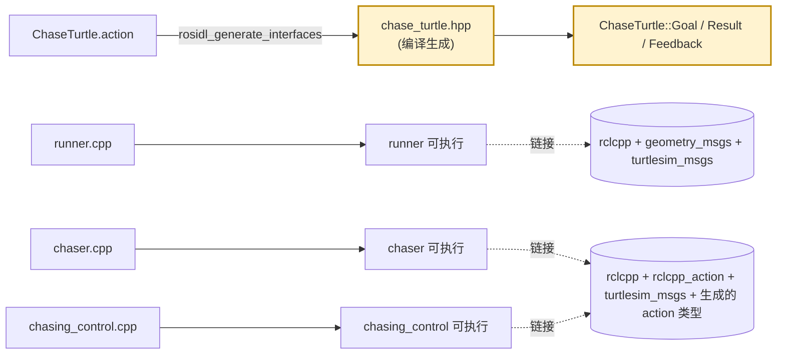
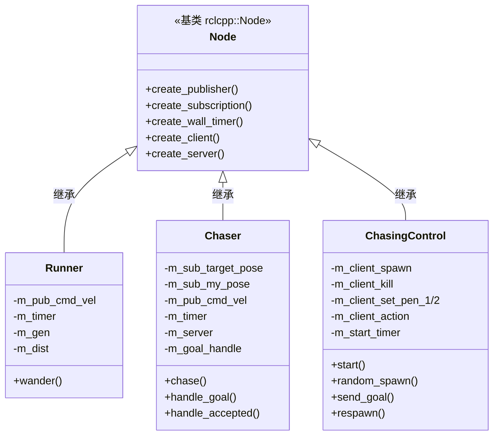
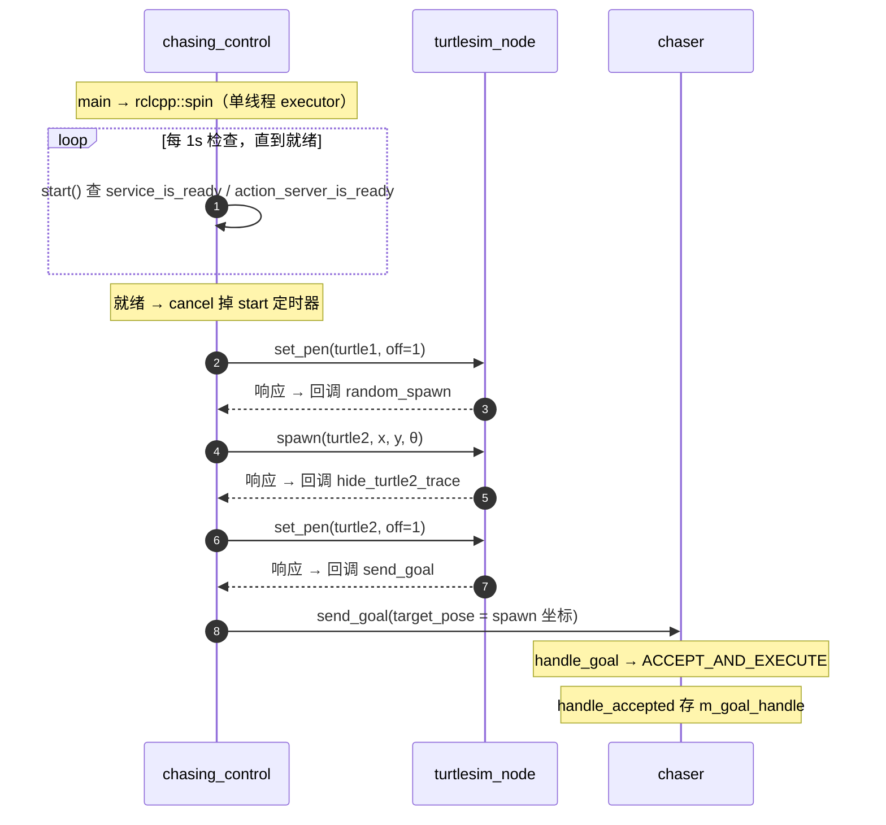
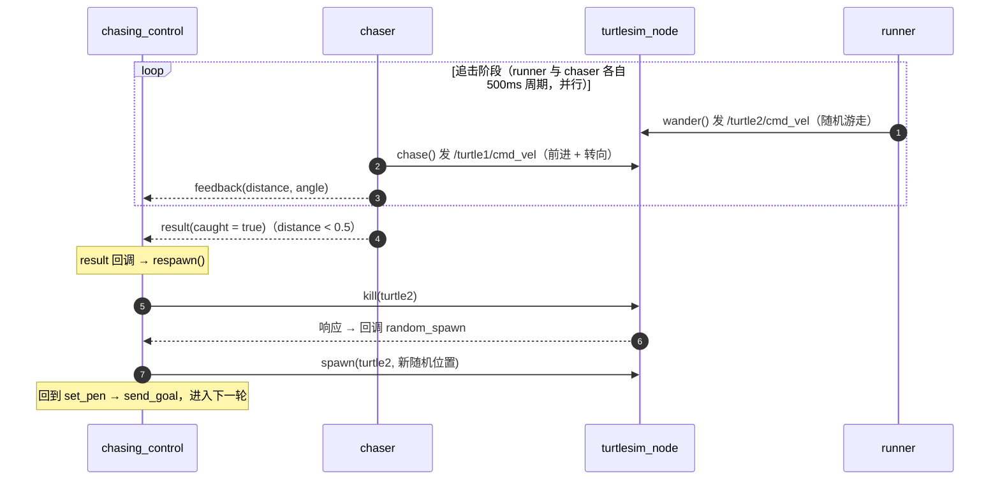

# turtle_chase_game 项目收官总结

> 课程设计「乌龟追逐游戏」进阶任务：双龟追逐（A 追 B）。三节点 + Action，含自定义接口、服务编排、异步回调链。
> 工作空间：`~/ros2_course_ws/src/turtle_chase_game`，环境 ROS 2 **Lyrical**。

---

## 一、工程架构

### 1.1 目录结构

```
turtle_chase_game/
├── package.xml                   # 依赖：rclcpp、rclcpp_action、turtlesim_msgs、geometry_msgs、rosidl
├── CMakeLists.txt                # rosidl 生成 action + 编 3 个可执行文件
├── action/
│   └── ChaseTurtle.action        # 自定义接口：goal=Pose，result=caught，feedback=distance+angle
├── launch/
│   └── turtle_chase_game.launch.py   # 一键拉起 turtlesim + 3 节点
└── src/
    ├── runner.cpp                # B 龟 turtle2：随机游走（只发 /turtle2/cmd_vel）
    ├── chaser.cpp                # A 龟 turtle1：Action 服务端，追击 turtle2
    └── chasing_control.cpp       # 裁判：Action 客户端，编排 spawn/kill 重生
```

### 1.2 编译链路（含 rosidl 接口生成）



> **关键**：`ChaseTurtle.action` 由 rosidl 在编译期生成 C++ 类型（头文件 `turtle_chase_game/action/chase_turtle.hpp`），因为 goal 里引用了 `geometry_msgs/Pose`，`rosidl_generate_interfaces` 必须写 `DEPENDENCIES geometry_msgs`。`runner` 不用 action，所以不链接生成的类型；`chaser`/`chasing_control` 要链 `cpp_typesupport_target`。

---

## 二、节点交互全景图（rqt_graph 风格）

四进程：`runner`（被追）、`chaser`（追击 + Action 服务端）、`chasing_control`（裁判 + Action 客户端）、`turtlesim_node`（仿真器）。实线 = Topic 数据流，虚线 = Service / Action 调用。


**交互明细**：

| 交互 | 类型 | 方向 | 说明 |
|---|---|---|---|
| `/turtle2/cmd_vel` | Topic | runner → turtlesim | runner 每 500ms 发随机 Twist 驱动 turtle2 |
| `/turtle1/cmd_vel` | Topic | chaser → turtlesim | chaser 每 500ms 发追击 Twist 驱动 turtle1 |
| `/turtle1/pose`、`/turtle2/pose` | Topic | turtlesim → chaser | chaser 订阅，实时刷新自己 / 目标位置 |
| `/spawn` | Service | chasing_control → turtlesim | 生成 turtle2（全局服务，带 name 参数） |
| `/kill` | Service | chasing_control → turtlesim | 杀死 turtle2（全局服务） |
| `/turtle1/set_pen`、`/turtle2/set_pen` | Service | chasing_control → turtlesim | 关画笔藏轨迹（每龟一个，带名字前缀） |
| `chase_turtle` | Action | chasing_control → chaser | 追击动作：发 goal，收 feedback/result |

---

## 三、逐文件对象拆解

### 3.1 runner.cpp（B 龟 turtle2 · 随机游走）

| 分类 | 名称 | 类型 | 来源 | 作用 |
|---|---|---|---|---|
| 依赖 | `std::chrono` / `std::memory` / `std::random` | 标准库 | `#include` | 时间 / 智能指针 / 随机数 |
| 依赖 | `geometry_msgs::msg::Twist` | 消息 | `#include` | 速度消息 |
| 类 | `Runner` | 继承 `rclcpp::Node` | 本文件 | 随机游走节点 |
| 成员 | `m_v` | `double = 1.0` | 成员初始化 | 恒定线速度 |
| 成员 | `m_w` | `double = 2.0` | 成员初始化 | 角速度范围边界（±2.0） |
| 成员 | `m_period` | `std::chrono::milliseconds = 500ms` | 成员初始化 | 定时周期 |
| 成员 | `m_pub_cmd_vel` | `Publisher<Twist>::SharedPtr` | `create_publisher` | 发 `/turtle2/cmd_vel` |
| 成员 | `m_timer` | `TimerBase::SharedPtr` | `create_wall_timer` | 周期触发 wander |
| 成员 | `m_gen` | `std::mt19937` | `std::random_device{}()` 播种 | 梅森旋转随机引擎 |
| 成员 | `m_dist` | `uniform_real_distribution<double>{-m_w, m_w}` | 成员初始化 | 均匀分布 [-2,2] |
| 方法 | `Runner()` | 构造函数 | 本类 | 初始化列表 `Node("runner")` + `m_gen`；函数体建 publisher + timer |
| 方法 | `wander()` | `void` | 本类 | 定时器回调：发 `linear.x=m_v, angular.z=m_dist(m_gen)` |
| 函数 | `main` | — | 本文件 | `init` → `spin` → `shutdown` |

### 3.2 chaser.cpp（A 龟 turtle1 · Action 服务端 · 追击）

| 分类 | 名称 | 类型 | 来源 | 作用 |
|---|---|---|---|---|
| 依赖 | `rclcpp_action` | 库 | `#include` | Action 服务端 |
| 依赖 | `turtlesim_msgs::msg::Pose` | 消息 | `#include` | 位置消息 |
| 依赖 | `turtle_chase_game/action/chase_turtle.hpp` | 生成头文件 | `#include` | 自定义 action 类型 |
| 别名 | `ChaseTurtle` | `turtle_chase_game::action::ChaseTurtle` | `using` | 简化 action 类型名 |
| 别名 | `GoalHandleChaseTurtle` | `rclcpp_action::ServerGoalHandle<ChaseTurtle>` | `using` | goal 句柄类型 |
| 成员 | `m_v` | `double = 1.0` | | 追击线速度 |
| 成员 | `m_angular_k` | `double = 1.5` | | 转向比例系数（角速度 = k×角度差） |
| 成员 | `m_catch_threshold` | `double = 0.5` | | 距离阈值，小于判定追上 |
| 成员 | `m_period` | `milliseconds = 500ms` | | 定时周期 |
| 成员 | `m_x / m_y / m_theta` | `double` | 订阅 `/turtle1/pose` 更新 | 自己位置 |
| 成员 | `m_target_x / m_target_y` | `double` | 订阅 `/turtle2/pose` 更新 | 目标位置 |
| 成员 | `m_sub_target_pose` | `Subscription<Pose>::SharedPtr` | `create_subscription` | 订 `/turtle2/pose` |
| 成员 | `m_sub_my_pose` | `Subscription<Pose>::SharedPtr` | `create_subscription` | 订 `/turtle1/pose` |
| 成员 | `m_pub_cmd_vel` | `Publisher<Twist>::SharedPtr` | `create_publisher` | 发 `/turtle1/cmd_vel` |
| 成员 | `m_timer` | `TimerBase::SharedPtr` | `create_wall_timer` | 周期触发 chase |
| 成员 | `m_server` | `rclcpp_action::Server<ChaseTurtle>::SharedPtr` | `create_server` | Action 服务端 |
| 成员 | `m_goal_handle` | `shared_ptr<GoalHandleChaseTurtle>` | `handle_accepted` 存入 | 当前 goal 句柄（空=空闲） |
| 方法 | `update_target_position()` | `void` | 订阅回调 | 刷新 m_target_x/y |
| 方法 | `update_my_position()` | `void` | 订阅回调 | 刷新 m_x/y/theta |
| 方法 | `handle_goal()` | `GoalResponse` | Action 回调 | 返回 `ACCEPT_AND_EXECUTE` |
| 方法 | `handle_cancel()` | `CancelResponse` | Action 回调 | 返回 `ACCEPT` |
| 方法 | `handle_accepted()` | `void` | Action 回调 | 存 goal_handle + 取 goal 初始锚点 |
| 方法 | `chase()` | `void` | 定时器回调 | 追击核心：算距离/角度差 → 停车 succeed 或前进 + feedback |

### 3.3 chasing_control.cpp（裁判 · Action 客户端 · 编排）

| 分类 | 名称 | 类型 | 来源 | 作用 |
|---|---|---|---|---|
| 依赖 | `turtlesim_msgs/srv/{spawn,kill,set_pen}.hpp` | 服务 | `#include` | turtlesim 服务 |
| 别名 | `Spawn` / `Kill` / `SetPen` | `turtlesim_msgs::srv::*` | `using` | 服务类型 |
| 别名 | `ChaseTurtle` / `GoalHandleChaseTurtle` | — | `using` | action 类型（客户端版） |
| 常量 | `kPi` | `constexpr double = 3.14159265` | 文件顶 | 角度范围 |
| 成员 | `m_gen` | `std::mt19937` | `random_device{}()` | 随机引擎 |
| 成员 | `m_dist_x / m_dist_y` | `uniform_real_distribution{1.0, 10.0}` | | 出生坐标（留墙边距） |
| 成员 | `m_dist_theta` | `uniform_real_distribution{-kPi, kPi}` | | 出生朝向 |
| 成员 | `m_start_timer` | `TimerBase::SharedPtr` | `create_wall_timer(1s)` | 轮询启动 |
| 成员 | `m_client_spawn` / `m_client_kill` | `Client<Spawn/Kill>::SharedPtr` | `create_client` | `/spawn`、`/kill`（全局） |
| 成员 | `m_client_set_pen_2` / `m_client_set_pen_1` | `Client<SetPen>::SharedPtr` | `create_client` | `/turtle2/set_pen`、`/turtle1/set_pen` |
| 成员 | `m_client_action` | `rclcpp_action::Client<ChaseTurtle>::SharedPtr` | `create_client` | action 客户端 |
| 成员 | `m_spawn_x / m_spawn_y` | `double` | random_spawn 存 | 本次出生坐标（goal 初始锚点） |
| 方法 | `start()` | `void` | 定时器回调 | 查 service/action 就绪，就绪后 cancel + 进回调链 |
| 方法 | `hide_turtle1_trace()` | `void` | 链 | set_pen(turtle1) → random_spawn |
| 方法 | `random_spawn()` | `void` | 链 | spawn(turtle2) → hide_turtle2_trace |
| 方法 | `hide_turtle2_trace()` | `void` | 链 | set_pen(turtle2) → send_goal |
| 方法 | `send_goal()` | `void` | 链 | 发 goal → result 回调 respawn |
| 方法 | `respawn()` | `void` | 链 | kill(turtle2) → random_spawn |

### 3.4 对象关系图（classDiagram）



---

## 四、线程 / 时间图

### 4.1 线程模型（先说结论）

四个进程（turtlesim + runner + chaser + chasing_control）**各自独立**，每个 ROS 节点的 `main` 都是：

```cpp
rclcpp::init(argc, argv);
rclcpp::spin(std::make_shared<X>());   // 内部创建 SingleThreadedExecutor
rclcpp::shutdown();
```

`rclcpp::spin()` 会在内部创建一个**单线程 Executor**，把节点加进去，然后**在一个线程里循环调度该节点的所有回调**（定时器 / 订阅 / 服务 / action 回调）。所以：

- 每个节点是**单线程事件循环**：所有回调在同一个线程串行执行。
- **回调不能阻塞**——一旦某个回调阻塞（比如同步等服务响应），整条 executor 线程卡死，其他回调全部停摆（就是 [[E004]] 的死锁）。
- 这正是 `chasing_control` 用**异步回调链**（`async_send_request` + 回调）而不是同步 `call` 的原因。

> 对比基础任务 `turtle_draw`（无回调所以无 spin），本包因为有定时器 / 订阅 / 服务 / action 回调，**必须 spin**。

### 4.2 启动 + 异步回调链（sequence，体现「谁在何时调谁」）



> 回调链的每一步都是「上一步的响应回来 → 触发下一步回调」，全程不阻塞 executor 线程。

### 4.3 追击 + 重生循环（sequence）



### 4.4 关键对象生命周期（精确表）

| 元素 | 节点 | 出生 / 进入 | 死亡 / 退出 | 存活区间 | 说明 |
|---|---|---|---|---|---|
| `m_timer`(runner) | runner | 构造时 `create_wall_timer` | 节点析构 | 全程 | 每 500ms 触发 wander |
| `m_timer`(chaser) | chaser | 构造时 | 节点析构 | 全程 | 每 500ms 触发 chase |
| `m_server` | chaser | 构造时 `create_server` | 节点析构 | 全程 | Action 服务端 |
| `m_goal_handle` | chaser | `handle_accepted` 存 | `succeed` 后 `reset` | 一次追击周期 | 非空时 chase 才追 |
| `m_start_timer` | chasing_control | 构造时 | `start()` 就绪后 `cancel` | 启动阶段 | 只活到服务就绪 |
| `m_client_action` 等 5 个 client | chasing_control | 构造时 | 节点析构 | 全程 | 服务/action 客户端 |
| 回调链（6 个方法） | chasing_control | 服务响应触发 | 每次调用结束 | 每次一瞬 | 链式流转，不常驻 |
| 3 个节点对象 | 各自 | `make_shared` | main 结束 | 全程 | shared_ptr 管理 |

---

## 五、面试要点（附答案）

**1. 三节点为什么这么分**
`runner`（被追，只负责随机游走）、`chaser`（追击者，把「追」这个动作做成 Action **服务端**）、`chasing_control`（裁判，做 Action **客户端** + spawn/kill 编排）。核心认知：**Action 是服务端 + 客户端成对**，追击动作的执行方是 chaser，所以服务端放 chaser；裁判只负责「发 goal、等 result、重生」，所以是客户端。

**2. 追击为什么用 Action，而不是话题 / 服务**
追击是「长时间运行 + 有中间反馈（距离）+ 有最终结果（追上没追上）」。话题只能单向发数据、无结果无结束语义；服务是一次请求-响应、无进度反馈、无长任务状态。Action = **goal（目标）+ feedback（进度）+ result（结果）** 三者都有，正好匹配。`.action` 三段 `goal/result/feedback`（两个 `---`）就是为此设计。

**3. 为什么用异步回调链，不用同步 call**
每个节点是 `spin` 的单线程 executor，所有回调在同一线程。如果同步 `call`（阻塞等响应），当前回调卡住，整个 executor 线程停摆，其他回调（包括还没来的响应）全部处理不了 → 死锁。`async_send_request` + 回调把「等响应」交给 executor 异步调度，永不阻塞。

**4. `service_is_ready` / `action_server_is_ready` 轮询启动**
`chasing_control` 启动时 turtlesim 和 chaser 可能还没上线。用一个 1s 定时器 `start()` 反复查两个服务/action 是否 ready，就绪后 `cancel` 定时器再正式开跑。对比 `wait_for_service()`（阻塞等、没上线就一直卡死），轮询不阻塞、随时可退出。

**5. `rclcpp::spin` 到底做了什么**
`spin(node)` = 创建一个默认的 **SingleThreadedExecutor** → 把 node 加进去 → 单线程循环：取就绪的回调（定时器到期 / 消息到达 / 服务请求 / action 事件）→ 执行 → 再取下一个。它只驱动「回调」，没有回调的节点（如 turtle_draw）就不需要 spin。

**6. 为什么回调不能阻塞（延伸）**
单线程 executor 里，回调 A 阻塞 → executor 卡在 A 里 → 回调 B/C/D 全得不到执行。这是 ROS2 最常见的运行时死锁根源。解法：长任务用异步 + 回调，或 `async_send_request`，或丢到单独线程。

**7. `std::bind` + `std::placeholders`**
`std::bind(&Chaser::update_target_position, this, std::placeholders::_1)` 把「成员函数 + 对象 this」绑成一个可调用对象，`_1` 是占位符，表示「调用时把第一个参数（消息）传进来」。成员函数指针本身不能直接当回调，因为隐含 `this`，bind 就是补上 this 并留出参数槽。

**8. `std::mt19937` + `uniform_real_distribution` + `random_device`**
现代 C++ 随机数三件套：`random_device`（真随机种子）→ 播种 `mt19937`（梅森旋转引擎，质量高）→ `uniform_real_distribution{-2, 2}`（把引擎输出映射成 [a,b] 均匀分布）。对比 `rand()%n`（质量差、有偏差、可预测），这是标准做法。`m_dist(m_gen)` 每次调用产一个随机数。

**9. `using` 类型别名**
`using ChaseTurtle = turtle_chase_game::action::ChaseTurtle;` 给长类型起短名，后面写 `ChaseTurtle::Goal` 而不是一长串。`GoalHandleChaseTurtle = rclcpp_action::ServerGoalHandle<ChaseTurtle>` 同理。作用是让代码可读，编译期完全等价（C++11 的 `using` 比 `typedef` 更直观）。

**10. `rosidl_generate_interfaces` 生成自定义接口**
`.action` 文件 → rosidl 编译期生成 C++/Python 类型和头文件 `chase_turtle.hpp`。因为 goal 里用了 `geometry_msgs/Pose`，必须 `DEPENDENCIES geometry_msgs`，否则生成器找不到。链接侧用 `rosidl_get_typesupport_target` 拿到 `cpp_typesupport_target`，链接它才能用生成类型。

**11. 追击算法（比例控制）**
`dx,dy` 目标相对自己的位移 → `distance = sqrt(dx²+dy²)`；朝向目标角 `atan2(dy,dx)`；角度差归一化到 `[-π,π]`（`atan2(sin d, cos d)`）。控制律：`angular.z = k × angle_diff`（差越多转越快，k=1.5）；`linear.x = 1.0` 恒定前进。`distance < 0.5` 判追上 → 停车 + `succeed`。

**12. 角度归一化 `atan2(sin, cos)`**
`angle_diff` 可能超出 `[-π,π]`（如 -340°），直接乘 k 会让乌龟转大圈。`atan2(sin(d), cos(d))` 丢整圈、还原主值，把任意角度差压回 `(-π,π]`。追击转向、航向差通用。

**13. goal_handle 的生命周期**
`handle_accepted` 里把 `goal_handle` 存进 `m_goal_handle`（这是「入口句柄」），之后定时器 `chase()` 才能靠它 `publish_feedback` / `succeed`。追上后 `succeed(result)` 通知客户端，然后 `m_goal_handle.reset()` 清空回到空闲，等下一个 goal。没存句柄就没法回报结果。

**14. Action 服务端三个回调**
`handle_goal`（决定接不接，返回 `ACCEPT_AND_EXECUTE`）、`handle_cancel`（决定准不准取消，返回 `ACCEPT`）、`handle_accepted`（goal 被接受后，把句柄存起来开始执行）。三者分工：接受判定 → 取消判定 → 实际执行入口。

**15. 客户端 `SendGoalOptions` 的两个回调**
`feedback_callback`（每次 feedback 触发，这里刻意留空不打印——「静默但保留机制」）、`result_callback`（结束触发，判断 `result.code == SUCCEEDED && result.result->caught` 才 `respawn`）。`WrappedResult` 包了状态码 + 结果。

**16. spawn/kill 是全局服务，set_pen 是每龟服务**
`/spawn`、`/kill` 不带龟名（全局，通过 request 里的 name 字段指定龟）；`/turtle1/set_pen`、`/turtle2/set_pen` 带名字前缀（每只龟一个）。所以 `create_client` 时 spawn/kill 用 `/spawn`、`/kill`，set_pen 用 `/turtle1/set_pen` 这种带前缀名。

**17. `constexpr kPi` 对比 `#define PI`**
本包用 `constexpr double kPi = 3.14159265;`（编译期常量，有类型有作用域），而基础任务 turtle_draw 用了 `#define PI 3.1415926`（宏文本替换）。两者都能算常数，但 constexpr 更安全规范，面试可主动提这个改进。

**18. `using namespace std::chrono_literals`**
引入 `500ms`、`1s` 这种时间字面量。没有它就得写 `std::chrono::milliseconds(500)`。`m_period = 500ms` 里的 `500ms` 就是靠它。

**19. `create_wall_timer` 是什么**
「墙钟定时器」，按真实时间周期触发（对比 `create_timer` 用节点内部时钟，可被仿真时间加速）。`create_wall_timer(500ms, 回调)` 每 500ms 调一次回调，返回值存成 `TimerBase::SharedPtr`，`cancel()` 可停掉。

**20. 为什么要持续重发 cmd_vel**
turtlesim 的乌龟约 1s 收不到 `cmd_vel` 就自动停下。所以 runner 和 chaser 都用定时器周期重发，不能「发一次就干等」。这是开环控制的一个实际约束。

**21. 开环追击 vs 闭环**
chaser 通过订阅 `/turtle2/pose` 实时刷新目标位置，是**闭环**（有反馈、目标动了能追上）；但它发 cmd_vel 还是开环（不读自己的实际执行结果，只按当前 pose 算下一拍速度）。基础任务 turtle_draw 是完全开环（连 pose 都不订阅）。

**22. 编译标准（cxx_std_17 / cxx_std_20）**
`target_compile_features(... cxx_std_17 cxx_std_20)` 声明 C++17 + C++20 两个编译特性。其实代码用到的特性（智能指针、随机数、lambda、chrono 字面量）C++14 就够了，设 C++20 并无必要；面试若被追问「为什么 C++20」，诚实说「工具链默认、写高一点兼容性好，实际没用到 C++20 独有特性」反而显得诚实、看得细。
