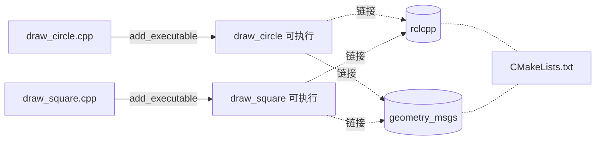
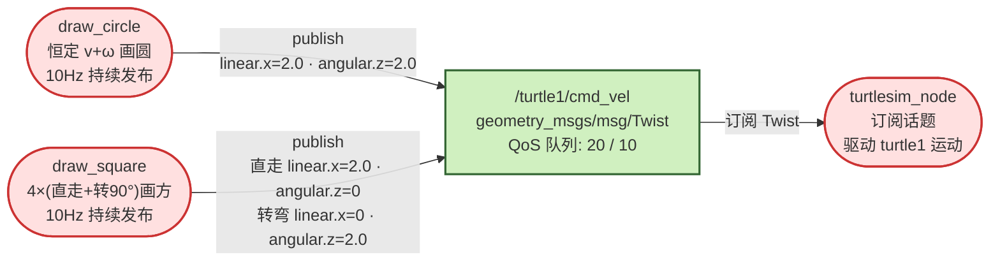
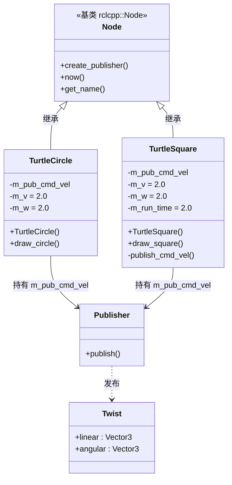
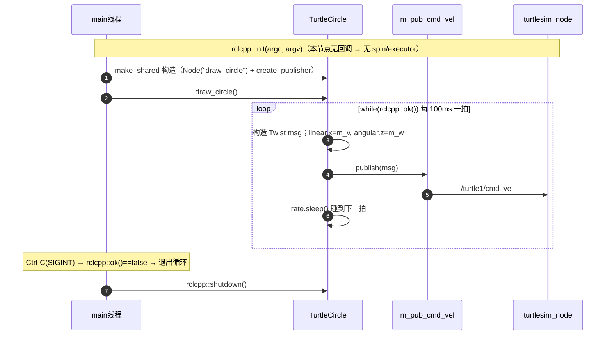
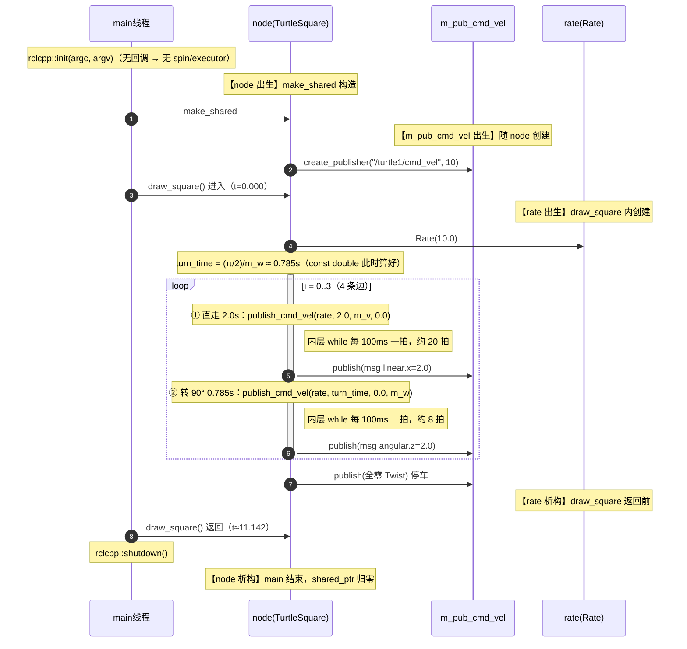

# turtle_draw 项目收官总结

> 课程设计「乌龟追逐游戏」基础任务：画方 + 画圆。两个独立节点，只发话题，无服务 / 动作 / 参数。
> 工作空间：`~/ros2_course_ws/src/turtle_draw`，环境 ROS 2 **Lyrical**。

---

## 一、工程架构

### 1.1 目录结构

```
ros2_course_ws/
└── src/
    └── turtle_draw/              # 基础任务包
        ├── package.xml           # 包清单：依赖 rclcpp、geometry_msgs
        ├── CMakeLists.txt        # 构建：编出 2 个可执行文件
        ├── README.md             # 构建 / 运行说明
        └── src/
            ├── draw_circle.cpp   # 节点①：画圆（恒定 v+ω）
            └── draw_square.cpp   # 节点②：画方（4×直走 + 转 90°）
```

### 1.2 编译链路



> **Lyrical 差异**：用 `find_package` + `${xxx_TARGETS}`，不用 `ament_target_dependencies`。产物 `install/turtle_draw/lib/turtle_draw/` 下两个可执行文件，`colcon build` 后 `ros2 run` 可查。

---

## 二、节点交互全景图（rqt_graph 风格）

两个节点各自独立，都往 `/turtle1/cmd_vel` 发 `Twist`，由 `turtlesim_node` 订阅。**无服务、无动作、无参数、无订阅**（基础任务刻意做的减法）。



**交互明细**：

| 交互 | 消息字段 | QoS | 说明 |
|---|---|---|---|
| draw_circle → `/turtle1/cmd_vel` | `linear.x=2.0`、`angular.z=2.0` | 队列 20 | 恒定速度画圆，半径 R=v/ω=1.0，10Hz 持续发布 |
| draw_square → `/turtle1/cmd_vel` | 直走 `linear.x=2.0`；转弯 `angular.z=2.0` | 队列 10 | 4 段直走 + 4 段原地转 90°，10Hz 持续发布 |
| `/turtle1/cmd_vel` → turtlesim_node | `Twist` | — | turtlesim 订阅并驱动 turtle1；约 1s 收不到命令海龟自动停，故必须持续重发 |

> **注意**：两个节点**不能同时跑**——会变成两个发布者抢同一话题，海龟被两股命令拉扯。所以 README 要求各跑各的。

---

## 三、逐文件对象拆解

### 3.1 draw_circle.cpp 全量对象

| 分类 | 名称 | 类型 | 来源 | 所在位置 | 作用 |
|---|---|---|---|---|---|
| 依赖 | `rclcpp` | 命名空间 | `#include <rclcpp/rclcpp.hpp>` | 文件头 | ROS2 客户端库：Node / Publisher / Rate / init / ok / shutdown |
| 依赖 | `geometry_msgs::msg::Twist` | 消息类型 | `#include <geometry_msgs/msg/twist.hpp>` | 文件头 | 速度消息，字段 `linear`(Vector3) + `angular`(Vector3) |
| 基类 | `rclcpp::Node` | 类 | 继承 | 类声明 | 节点能力：名字、`create_publisher()`、`now()` |
| 成员 | `m_pub_cmd_vel` | `Publisher<Twist>::SharedPtr` | `create_publisher()` 返回 | private | 发布器，队列 20，发 `/turtle1/cmd_vel` |
| 成员 | `m_v` | `double = 2.0` | 成员初始化 | private | 线速度（前进，沿 x 轴） |
| 成员 | `m_w` | `double = 2.0` | 成员初始化 | private | 角速度（绕 z 轴转向） |
| 方法 | `TurtleCircle()` | 构造函数 | 本类 | public | 初始化列表 `Node("draw_circle")`，函数体建 publisher |
| 方法 | `draw_circle()` | `void` | 本类 | public | 10Hz 死循环持续发恒定 v/ω |
| 局部 | `rate` | `rclcpp::Rate` | `Rate(10.0)` 构造 | `draw_circle()` 内 | 10Hz 节拍器 |
| 局部 | `msg` | `Twist` | 每拍构造 | 循环内 | 赋 `linear.x` / `angular.z` 后发布 |
| 局部 | `node` | `shared_ptr<TurtleCircle>` | `make_shared`（auto 推导） | `main` 内 | 节点实例 |
| 参数 | `argc` / `argv` | `int` / `char**` | main 形参 | `main` | 命令行参数个数 / 数组 |

### 3.2 draw_square.cpp 额外对象

| 分类 | 名称 | 类型 | 来源 | 所在位置 | 作用 |
|---|---|---|---|---|---|
| 宏 | `PI` | `3.1415926` | `#define` | 文件顶 | 算转 90° 时长 |
| 成员 | `m_run_time` | `double = 2.0` | 成员初始化 | private | 每条边直走时长 |
| 局部 | `turn_time` | `const double` | `(PI/2)/m_w` | `draw_square()` | 转 90° 时长 ≈ 0.785s |
| 局部 | `i` | `int` | for 循环 | `draw_square()` | 循环计数 0..3 |
| 局部 | `start` | `rclcpp::Time` | `this->now()` | `publish_cmd_vel()` | 计时起点 |
| 方法 | `publish_cmd_vel()` | `void` | 本类 | private | 持续发指定速度 `duration` 秒 |
| 形参 | `rate` | `Rate&` | 调用方传入 | 形参 | 引用复用调用方节拍器（避免拷贝） |
| 形参 | `duration` / `linear` / `angular` | `double` | 调用方传入 | 形参 | 时长 / 线速度 / 角速度 |

> 其余 `m_pub_cmd_vel` / `m_v` / `m_w` / 构造函数 / `rate` / `msg` 同 3.1，不再重复。

### 3.3 对象关系图（classDiagram）



---

## 四、生命周期 / 线程时间图

### 4.1 线程模型（先说结论）

两个节点都是**单线程**，而且**没有 `spin()`、没有 executor**——因为它们只有发布、没有任何订阅 / 定时器 / 服务 / 动作回调，没有需要事件循环驱动的「回调」，业务直接在 main 线程里串行跑完。

> 所以这里**没有 spin 是正确结论，不是漏画**。对比后续的 `turtle_chase_game`（进阶任务）就有 `spin` + `SingleThreadedExecutor` + 异步回调链，那时线程时间图会是另一种画法。

### 4.2 draw_circle 生命周期（sequence，持续到 Ctrl-C）



**对象存活区间**：`node` 全程（shared_ptr，main 返回才析构）→ `m_pub_cmd_vel` 随 node 建 / 析构 → `rate` 在 `draw_circle()` 内 → `msg` 每拍新建、每拍销毁。

### 4.3 draw_square 线程时间图（函数排布 + 对象生命周期）

> 一张图同时看三件事：**① main 线程的串行时间线**（生命线 M）、**② 关键函数的调用 / 执行排布**（loop + activate）、**③ 关键对象的出生 → 存活 → 析构**（用 `【出生】` / `【析构】` 注释标出，`msg` 这类循环内短命对象也标出）。



### 4.4 函数 / 对象 / 参数的时间排布与生命周期（精确表）

`turn_time = (π/2)/ω = 1.5708/2.0 ≈ 0.785s`，每条边直走 `m_run_time = 2.0s`，`for i=0..3` 循环 4 次。

| 元素 | 类型 | 出生 / 进入 | 死亡 / 退出 | 时间区间 | 作用 |
|---|---|---|---|---|---|
| main 线程 | 线程 | 程序启动 | 程序退出 | 全程 | 单线程，串行跑完全部业务 |
| `node`(TurtleSquare) | 对象 | `make_shared`（t=0） | main 结束析构 | 全程 | 节点实例（shared_ptr） |
| `m_pub_cmd_vel` | 对象 | node 构造时 | node 析构时 | 全程 | 发布器，随 node 建 / 析 |
| `rate`(Rate) | 对象 | `draw_square()` 开头 | `draw_square()` 返回前 | 0 ~ 11.14s | 10Hz 节拍器，贯穿画方全程 |
| `turn_time` | 常量 | `draw_square()` 开头算好 | 函数结束 | 0 ~ 11.14s | `const double`，转 90° 时长 |
| `msg`(Twist) | 对象 | 每拍构造 | 每拍析构 | 循环内（~100ms） | 短命，每拍 publish 一个 |
| `start`(Time) | 对象 | `publish_cmd_vel()` 开头 | 该次调用结束 | 每次调用内 | `now()` 计时起点 |
| `draw_square()` | 函数 | t=0 进入 | t≈11.142 返回 | 0 ~ 11.14s | 主流程：4 条边循环 |
| `publish_cmd_vel()` | 函数 | 8 次调用 | 每次 2.0 / 0.785s | 见下表 | 持续发布指定速度 |

**`publish_cmd_vel()` 8 次调用时间排布**：

| 第几次 | 时间（s） | 内容 | 持续 |
|---|---|---|---|
| 1 | 0.000 ~ 2.000 | 边1 直走 `linear.x=2.0` | 2.0s |
| 2 | 2.000 ~ 2.785 | 边1 转 90° `angular.z=2.0` | 0.785s |
| 3 | 2.785 ~ 4.785 | 边2 直走 | 2.0s |
| 4 | 4.785 ~ 5.571 | 边2 转 90° | 0.785s |
| 5 | 5.571 ~ 7.571 | 边3 直走 | 2.0s |
| 6 | 7.571 ~ 8.356 | 边3 转 90° | 0.785s |
| 7 | 8.356 ~ 10.356 | 边4 直走 | 2.0s |
| 8 | 10.356 ~ 11.142 | 边4 转 90° | 0.785s |

> 每个阶段内部以 10Hz 持续发布（约 1s 收不到命令海龟自停，故必须持续重发）。总时长 ≈ 11.1s。

---

## 五、面试要点（附答案）

**1. CMakeLists 的理解**
`find_package(rclcpp)` 加载 rclcpp 的 CMake 配置，之后可用 `${rclcpp_TARGETS}` 等变量；`${rclcpp_TARGETS}` 展开成 `rclcpp::rclcpp` 这个 target，链接它自带头文件路径和库（Lyrical 移除了 `ament_target_dependencies`，用它替代）；`add_executable(名字 源文件)` 声明可执行目标；`target_link_libraries` 把库接上；`install(... DESTINATION lib/${PROJECT_NAME})` 把产物装到 `install/`，`colcon build` 后 `ros2 run` 才找得到；`target_compile_features(... cxx_std_17)` 指定 C++17。

**2. `&` 的作用**
`publish_cmd_vel(rclcpp::Rate & rate, …)` 是**引用传递**：形参 `rate` 是调用方那个 `rate` 的别名，不拷贝。因为 `Rate` 内部封装了节拍 / 时钟状态，拷贝会失准且浪费；其他 `duration/linear/angular` 是 `double`，按值传即可。

**3. `#define` 的作用**
宏是**预处理器的纯文本替换**，编译前把 `PI` 换成 `3.1415926`，无类型、无作用域、不做类型检查。更规范是 `constexpr double PI = 3.1415926;`（编译期常量，有类型有作用域、可调试）——若问「为什么不 constexpr」，就这么答。

**4. 构造函数 / 析构函数**
`TurtleCircle() : Node("draw_circle")` 把基类构造放进**初始化列表**，因为基类 `Node` 构造必须先于派生类成员、且需要节点名参数（Node 没有无参构造，函数体里补构造会编译错）。顺序：基类 → 成员（按声明序）→ 函数体。本类没写析构，成员都是 shared_ptr / double，默认析构函数足够。

**5. `::` 和指针基础**
`::` 是作用域限定符：`rclcpp::` 是客户端库命名空间，`geometry_msgs::msg::` 是消息包里的 msg 命名空间（消息类型永远带中间 `::msg::`）。`argv` 是 `char**`，指向字符串指针数组，`argv[0]` 是程序名。`Publisher<Twist>::SharedPtr` 是类型别名 = `std::shared_ptr<Publisher<Twist>>`。

**6. 智能指针 / make_shared**
`std::make_shared<TurtleCircle>()` 一次性分配对象 + 控制块、异常安全、返回 `shared_ptr`；Publisher 用 shared_ptr 是让 Node 统一管理发布器生命周期（引用计数归零自动释放），裸指针要手动 delete、易悬垂。

**7. rclcpp::Rate / sleep**
`Rate(10.0)` 造一个 10Hz 节拍器；`rate.sleep()` 计算「下一拍」时间点睡过去，自动补偿循环体耗时抖动——不是 `sleep_for` 死睡固定时长。

**8. 为什么是 linear.x 和 angular.z**
海龟在二维平面运动：前进沿乌龟的 x 轴 → `linear.x`；转向是绕 z 轴旋转 → `angular.z`。其余分量（横向、绕 x/y 转）这个场景用不到，保持 0。

**9. 开环 vs 闭环**
开环 = 只发命令、不读反馈，按「速度 × 时间」估算位置。优点：代码简单、无订阅、无延迟；缺点：无反馈，速度不准就累积误差画不圆。闭环要订阅 `/pose` 校正，更准但更复杂——基础任务刻意选开环。

**10. 为什么没有 spin**
`spin` / executor 是驱动**回调**（订阅 / 定时器 / 服务 / 动作）的事件循环。这两个节点只发布、无任何回调，没有需要驱动的事件，直接在 main 里跑业务循环即可；有订阅才需要 spin。

**11. QoS 队列深度**
`create_publisher` 第二参数 `20` / `10` 是发布者侧队列深度（最多缓存多少条待发消息）；两个节点同时跑会都往 `/turtle1/cmd_vel` 发命令，海龟被两股命令拉扯、运动紊乱——所以 README 要求各跑各的。
