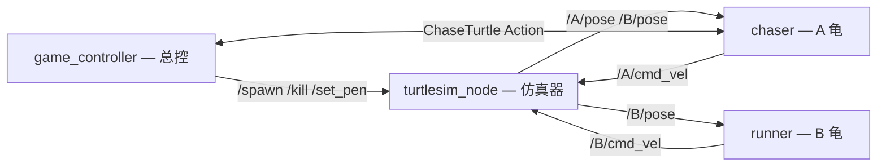

# ROS2 课程设计 · 乌龟追逐游戏 —— 整体架构

> 进阶任务(双龟追逐,70 分)架构设计稿。基础任务(画方画圆)已在 `turtle_draw` 包完成。
> 时间:2026-10-13 · 状态:待评审,未动代码。

---

## 0. 需求提炼(来自 PDF)

**4.1 基本功能**

| # | 要求 |
|---|---|
| 1 | B(被追逐)位置随机生成;A 位置不限 |
| 2 | A 追 B,不要求路径规划,追到即可 |
| 3 | 判定「追到」时两龟距离必须肉眼可见地近(需要一个阈值) |
| 4 | 追到后 B 在原位消失,在新随机位置重生,A 做下一次追逐 |
| 5 | 隐藏 A、B 的运动轨迹 |

**4.2 进阶功能**

| # | 要求 |
|---|---|
| 1 | B 自生成起一直运动,运动状态随机 |
| 2 | A/B 碰墙不能贴墙走、不能卡住(可做撞墙规避) |

课程提示的相关知识(加分方向):四大通讯、坐标变换广播与监听(tf)、launch、自定义消息类型、`/spawn` `/kill` 等服务。

---

## 1. 总体结构(节点图)

三个自研节点 + 一个仿真器节点:



文字版数据流:

- **位置流**:`turtlesim_node` 发布 `/A/pose` `/B/pose`(Pose),chaser 和 runner 订阅。
- **运动流**:chaser 发 `/A/cmd_vel`、runner 发 `/B/cmd_vel`(都是 Twist),turtlesim 订阅。
- **任务流**:`game_controller` 作为 Action 客户端,向 chaser 发 `ChaseTurtle` 的 goal,收 feedback(距离)和 result(追到)。
- **管理流**:`game_controller` 调 turtlesim 的 `/spawn` `/kill` `/set_pen` 服务,负责生成、重生、隐藏轨迹。

---

## 2. 节点职责

### game_controller(总控)
- **启动时**:`/spawn` 生成 A(任意位置)和 B(随机位置);`/set_pen(off=1)` 隐藏 A、B 轨迹。
- **动作客户端**:发 `ChaseTurtle` goal「追 B」→ 收 feedback(距离,可打日志)→ 收 result(追到)。
- **收到「追到」**:`/kill` 杀掉 B → `/spawn` 在随机新位置重生 B → 重新 `/set_pen` 隐藏新 B 轨迹 → 再发新 goal。
- 本质是一个「**追 → 追到 → 重生 → 再追**」的循环状态机。

### chaser(A 龟)
- **动作服务端**:收到 goal 后进入追击闭环。
- 订阅 `/B/pose`(目标)和 `/A/pose`(自身),算绝对距离。
- 发布 `/A/cmd_vel`,比例控制朝 B 走(复用画方画圆那套减速防过冲 + 持续重发 cmd_vel)。
- 周期发 feedback(当前距离);距离 < 阈值 → 停车、返回 result「追到」。

### runner(B 龟)
- **随机游走**:发布 `/B/cmd_vel`(随机朝向 + 安全半平面躲墙)。
- 订阅 `/B/pose`(自身位置,用于躲墙判断)。
- **不感知「被追到」**——重生由 game_controller 用 `/kill + /spawn` 完成(或改 `/teleport_absolute` 瞬移)。

---

## 3. 通信机制清单(四大通讯全覆盖)

| 机制 | 接口 | 方向 | 说明 |
|---|---|---|---|
| Topic | `/A/pose` `/B/pose`(Pose) | sim → chaser/runner | 位置数据 |
| Topic | `/A/cmd_vel`(Twist) | chaser → sim | A 的运动控制 |
| Topic | `/B/cmd_vel`(Twist) | runner → sim | B 的随机运动 |
| Service | `/spawn`(Spawn) | controller → sim | 生成 A/B |
| Service | `/kill`(Kill) | controller → sim | 追到后移除 B |
| Service | `/A/set_pen` `/B/set_pen`(SetPen, off=1) | controller → sim | 隐藏轨迹 |
| Action | `ChaseTurtle` | controller(client) ↔ chaser(server) | 追击任务(goal/feedback/result) |
| Parameter | catch_threshold、速度、边距等 | launch → 各节点 | 可调参数 |

---

## 4. 核心流程(追到 → 重生 → 再追)

```
1. controller: /spawn A、B(随机) + /set_pen 隐藏轨迹
2. controller: 发 ChaseTurtle goal「追 B」
3. chaser(A): 闭环追击 —— B pose → 算距离 → A cmd_vel(比例控制)→ 周期 feedback 距离
4. 距离 < catch_threshold → chaser 返回 result「追到」
5. controller: 收 result → /kill B → /spawn B(新随机位)→ /set_pen 隐藏 → 发新 goal
6. 回到 3,无限循环
```

---

## 5. 关键设计决策(已讨论)

1. **追击用 Action** — 追击是长任务(有目标/进度/终点),用 Action 展示第四大机制;「追到」作为 result 由客户端(controller)接收。这比「B 当 client 求追」或「另开 /caught 话题」都更干净:controller 本来就是 spawner,由它统一编排最自然。
2. **躲墙** — B 用「安全半平面采样」:靠近某墙时,新朝向限制在「背离墙」的半平面内随机取,持续约束直到远离,天然不折返、不贴墙、不卡。
3. **重生机制** — 用 `/kill + /spawn`(贴合「消失 + 生成」字面,且演示 `/kill`);嫌麻烦可换 `/teleport_absolute`(瞬移,无空窗、无需重设 pen)。
4. **隐藏轨迹** — `/set_pen(off=1)`;若用 kill+spawn,重生后要对新 B 重设一次。

---

## 6. 可选加分项(tf / 自定义消息)

- **tf(坐标变换广播与监听)** — 课程列了,但本任务只需世界系里的绝对距离,tf 非必需。若要演示:chaser/runner 各自 broadcast `map→A`、`map→B`,chaser 改监听 B 的 tf 拿位置。加分,但略为装饰。
- **自定义消息** — `.action` 的 feedback/result 本身已是自定义类型,可覆盖课程要求;若想更明显,可把「追到」事件做成独立 `CatchEvent.msg` 替代 Action result。

---

## 7. 包结构与目录(建议)

```
~/ros2_course_ws/src/turtle_chase_game/
├── package.xml
├── CMakeLists.txt
├── action/
│   └── ChaseTurtle.action      # goal=target_name, feedback=distance, result=caught+distance
├── src/
│   ├── game_controller.cpp
│   ├── turtle_chaser.cpp
│   └── turtle_runner.cpp
├── launch/
│   └── chase_game.launch.py
├── config/
│   └── chase_game.yaml         # 阈值/速度/边距等参数
└── README.md                   # 启动说明(提交要求之一)
```

---

## 8. 待定 / 开放问题

- [ ] `catch_threshold` 具体取值(需实测:速度、海龟尺寸、过冲量)
- [ ] B 随机游走方式:定速直走一段再换向 vs 持续小幅转向(影响观感)
- [ ] A 是否也要躲墙(4.2 说「A 或 B」;A 追 B 时若 B 靠墙,A 会跟过去,可能也需要简单规避)
- [ ] 重生用 kill+spawn 还是 teleport_absolute(推荐前者,更贴字面)
- [ ] tf / 自定义消息 要不要加(加分项,酌情)
