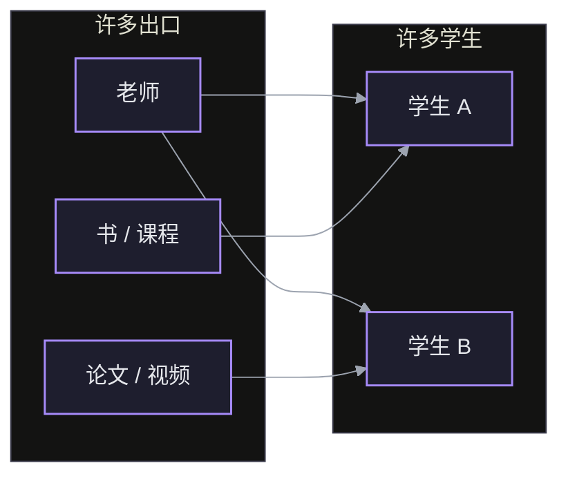
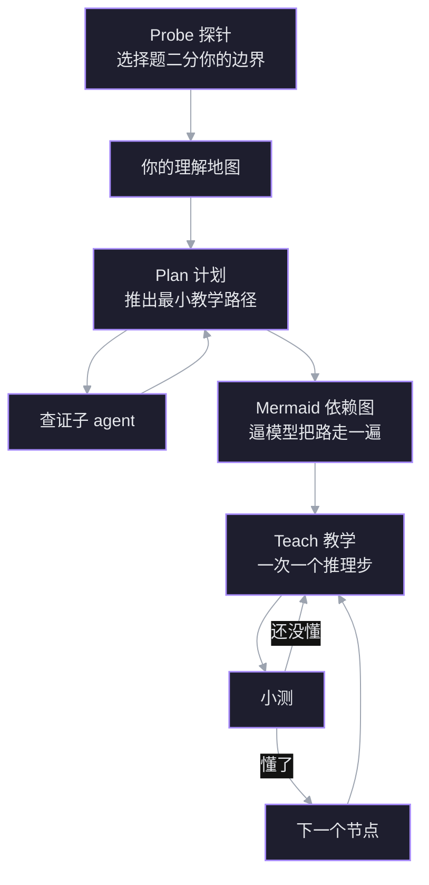

来源：Amos Blomqvist 的视频 *How I Use AI to Learn Things*（[[Raw/How I Use AI to Learn Things]]，YouTube；配套仓库 `github.com/amosblomqvist/learn`）。核心：把“一对一教学”做成系统——先用选择题探测你理解的边界，再画出依赖图规划，然后一次只走一个推理步；把找资料、排顺序、查证这些杂活全部收走，让挣扎只发生在材料里。

## 我们习惯的学习是一个多对多网络

标准模式里，一个出口（老师、书、课程）面向许多学生；同时一个学生又从许多出口学习：

两个方向各自产生一种低效。

## 一个出口教许多人

为许多人设计的出口，不可能对其中任何一个人最优。因为“最优”的教学完全取决于学习者当前的理解——既包括从当前理解到目标理解的整条教学弧，也包括途中的每一次解释。

最优路径要同时最小化两种内容：

- 你已经掌握的东西：重复，浪费时间；
- 你还接不住的东西：没有落点，听完也挂不上去。

所以它恰好工作在**理解的边缘**上：比你已经持有的多一个推理步。理想情况是一个老师只教一个学生。

![[S17_learning_edge.png]]
*左：教学的三个区间——已掌握、边缘、还够不着；为许多人写的课只能挑一个边缘给所有人。右：探针在每条线索上二分，七道题就把边界夹到 0.01 以内。*

## 一个学生向许多出口学

反方向的成本更隐蔽。每个出口有自己的风格、记号、可靠程度和界面，切换本身要消耗心智努力，而这些努力没有花在材料上。

更深的一层成本是**信任**。面对不熟悉的出口，大脑会留一手：在它证明自己、变得足够熟悉之前，不会完全接受一个事实。用一个例子说明：同一个关于毛球定理（hairy ball theorem）的解释，一个出自 3Blue1Brown 的视频，一个出自 X 上陌生人的帖子。解释逐字相同，但从熟悉的来源学得更好——大脑更容易内化它信任的出口给出的信息。

于是理想情况变成：一个学生也只有一个老师。

## 一对一：换掉接口，不是减少来源

对“只有一个老师”的常见反对是：那你只得到一种视角。Blomqvist 认为这个反对混淆了**来源**和**接口**。老师并不减少来源，他把许多来源聚合起来，通过一个界面交付；丢掉的只是切换成本，不是多样性。

当老师是 AI 时，信任不靠时间积累，而是被**设计进系统**：可靠的核验与事实检查。它有两个作用：

1. 信息正确——不能让模型编造；
2. 让学习更省力——知道系统可靠时，大脑不必一边学一边防备。

一句话：**一个接口，贴合一个大脑，覆盖所有来源。**

## 两条原则

两个低效对应两条设计原则：

- **最优教学**：教学路径和每一步解释，都按你当前的理解来定；
- **最优心智资源分配**：把认知资源集中到材料本身。

第二条不等于“降低难度”。恰恰相反，目标是**最大化挣扎**——但要挣扎在材料里，而不是挣扎在后勤上：规划、找资源、验证事实、决定学什么、按什么顺序学。这些都应该由系统吸收。

可以这样记账：同样一小时，如果大半花在找资料、判断该信谁、排学习顺序，真正用于思考的时间就被挤掉了；系统的任务是把比例倒过来。

## 流程：probe → plan → teach

### probe：把边界找出来

系统先用一个 quiz 工具出**可评分的选择题**：从很宽的范围开始，然后沿着这节课依赖的每一条线索（strand）做二分搜索，直到你的对错开始交替。得到的是“你在这条线索上的边界在哪里”的细粒度地图，而不是一个总分。

探针本身也是热身：你不必操心流程，只负责回答，系统负责全部调度。反过来，开场给它的背景越少，探针就越长——演示时 Blomqvist 几乎没给背景，于是被问了一长串问题。

### plan：先把路推一遍

规划阶段做两件事：

- 把“怎么教这个具体的大脑这个东西”完整推理出来；
- 启动核查事实的子 agent。

然后把计划画成 Mermaid 依赖图。展示图有两个理由，第二个才是真正的原因：

1. 学习者能提前看到将要走的路；
2. **逼模型把整条路真正推一遍**——有了一张要给人看的图，它就不能含糊其辞、临场发挥。

### teach：一次只走一个推理步

教学阶段取决于你自己的学习哲学。但有一个细节与具体方法无关：**反馈**。AI 会周期性地测验你，理由有三个：

1. 人很容易骗自己“我懂了”，用 AI 学时尤其如此——测验是对自己的反馈；
2. 系统需要持续的反馈才能保持校准；
3. 做题、应用本身就在加固理解，新知识是在使用中锁定的。

具体做法上，Blomqvist 让教学一次只走一个推理步，而不是像聊天机器人那样一口气讲完整章。每一步都小到能当场消化，随时可以插问；系统沿着依赖树一格一格往下走。

## 演示：学微分形式

环境是 Pi agent harness 的学习目录。`.pi` 下装了 teach 技能、可视化配置、quiz 扩展、MD log 扩展，以及两个负责画图的子 agent。界面用 Obsidian：MD log 扩展把一个 Markdown 文件绑定到会话，输出实时写进去，LaTeX 正常渲染，还留下每次学习的持久产物。模型本身的智力很关键——教学指令很细，弱模型执行不到位。

目标是微分形式，最终想看懂“麦克斯韦方程组如何用两个方程写出”。

### 探针：从线积分问到狭义相对论

题目都是选择题，例如：

- 力场 $F$ 沿曲线 $C$ 作用，线积分算的是什么？他排除了“只对保守场成立”的选项，选“场对粒子做的功”。
- 散度是什么？“单位体积的净外通量”。
- Stokes 定理、Faraday 定律依次确认。
- 狭义相对论里换到运动参考系，电场和磁场怎么变？他直接答“不知道”；正确答案是“两者混合”——一个参考系里纯电性的场，在另一个参考系里会同时有电和磁的成分。

答“不知道”也是有效信息：它比猜对更能说明边界在哪里。

### 计划：得到什么，先画出来

核查子 agent 在后台工作（数学通常不需要核查，但保持习惯）。计划以 Mermaid 图出现在 Obsidian 里。他看到路径会在到达目标之前先经过广义 Stokes 定理——这正符合“先把依赖补齐”的逻辑。

### 教学：余向量、一形式、楔积

可视化技能会调子 agent 画 SVG：子 agent 写完先自己看图、改、再看，确认无误才交付。放进子 agent 有两个原因：省主上下文，以及它能真的“检查自己的图”。演示中途画图子 agent 报过一次过载错误，重试后继续。

第一个节点是余向量（covector）：一台吃进向量、吐出数字的机器。新视角是：它数的是“穿过多少条等值线”。

取 $\alpha = 3\,dx - 2\,dy$，$v = (2, 5)$：

$$
\alpha(v) = 3v_x - 2v_y = 3\cdot 2 - 2\cdot 5 = -4 .
$$

![[S17_covector.png]]
*左：余向量的等值线族 $3x-2y=c$；从 $c=0$ 走到 $c=-4$，箭头穿过四条线，方向为负。右：$dx$ 数竖线、$dy$ 数横线，$\alpha$ 按 3 和 −2 加权。*

几何上，$\alpha$ 的等值线是 $3x-2y=c$。从原点（$c=0$）走到 $(2,5)$（$c=-4$），箭头穿过四条等值线，方向为负，所以读数是 $-4$。沿着这条路，教学把概念一层层搭上去：

- 把余向量扩展成**余向量场**，线积分就有了新解释：沿曲线累加“穿过等值线的次数”；
- 所有一维对象上的积分，都是一次形式（one-form）的积分；
- **k-形式**就是能被 k 维曲面“吃掉”的东西：1-形式吃曲线，2-形式吃曲面，3-形式吃体积；
- **楔积**（wedge product）：双线性且反对称的机器。最省事的造法是“最古老的技巧”——把两种顺序相乘再相减：

$$
\alpha\wedge\beta=\alpha\otimes\beta-\beta\otimes\alpha .
$$

数值检查：$dx\wedge dy\,(e_1,e_2)=1\cdot 1-0\cdot 0=1$；交换两个输入得 $-1$；两个平行向量给出 $0$。

![[S17_wedge.png]]
*楔积测的是带符号的面积：换序翻号，平行则归零。减掉两种顺序的差，就只剩下反对称部分。*

演示在接近广义 Stokes 定理时结束：

$$
\int_{\partial\Omega}\omega=\int_{\Omega}d\omega .
$$

它把边界上的积分和内部的“导数”积分统一起来，散度定理、Stokes 定理、微积分基本定理都是它的特例。用二维散度定理验一下：$F=(x^2,y^2)$ 在单位正方形上，$\nabla\cdot F=2x+2y$，内部积分是 $1+1=2$；四条边上的外通量相加也是 $2$。

## 收尾：起作用的是教学风格，不是管线

Blomqvist 自己说，这套东西对他有效的首要原因不是上面这些工程，而是上一支视频里讲的教学风格。它只影响两件事：

1. **学习弧**：从当前理解到目标理解走哪条路；
2. **途中的每一步解释**：怎么把这一步说成“显然”。

管线只是把这两件事稳定地执行下来。

## 关联

- [[Sight/Agent Harness 学习闭环]]：另一套把 Probe–Plan–Teach 做成产品的系统，同样强调先探边界、再一步一教。
- [[Sight/如何避免 AI 脑腐 用 AI 学习而不替代自己]]：为什么必须保留挣扎，以及“让 AI 只给提示”的实验证据。
- [[Sight/LLM Wiki 持久知识库模式]]：MD log 让单次会话留下产物；把同样的思路放大到整个知识库，就是 wiki 模式。

## 词汇

- **allocation** 分配
- **antisymmetric** 反对称的
- **bilinear** 双线性的
- **calibrate** 校准
- **conflate** 把……混为一谈
- **covector** 余向量
- **digest** 消化；理解
- **gaslight** 使人怀疑自己的判断
- **hallucinate** 编造；产生幻觉
- **hedge** 留一手；不轻易接受
- **inefficiency** 低效；效率损失
- **internalize** 内化
- **optimal** 最优的
- **outlet** 出口；渠道（内容来源）
- **overloaded** 过载的
- **periodically** 周期性地
- **strand** 分支；线索
- **wedge** 楔积
