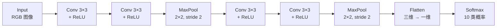

来源：CNN Explainer 交互式可视化项目（[[Raw/CNN Explainer]]）。目标：用 Tiny VGG 这个小型 CNN，把卷积、激活、池化、展平、Softmax 每一层到底在做什么拆开看清楚。

## CNN 是什么

- **分类器（classifier）**：给一个数据点分配类别标签。图像分类器输入一张图，输出“鸟/飞机/……”这样的标签。
- **神经网络**：由一层层神经元组成，每个神经元有自己的可学习权重和偏置。
- **CNN**：一种特别适合图像和类图像数据的分类器，核心是**卷积层**。

几个基本对象：

| 对象 | 含义 |
| --- | --- |
| Tensor | 可看成 n 维矩阵；CNN 里通常是三维（高 × 宽 × 通道） |
| Neuron | 接收多个输入、产生一个输出的函数；输出可视化成 activation map |
| Layer | 一组执行相同操作、共享超参数的神经元 |
| Kernel weights / bias | 每个神经元独有，训练时学习 |
| Score function | 可微的评分函数；输出层给出每个类别的分数 |

## Tiny VGG 的整体流水线

Tiny VGG 比现代 CNN 小得多，但保留了同样的基本层和操作，适合用来理解结构。

## 卷积层：特征提取的核心

卷积层的每个神经元拿一个**卷积核（kernel）**，在上一层输出的局部窗口上做**逐元素点积**，再把所有通道的结果相加，最后加上学习到的偏置，得到一个输出值。

以第一层为例：

- 输入有 3 个通道（RGB）；
- 这一层有 10 个神经元；
- 每个神经元都要看前一层全部 3 个通道；
- 所以需要 \(3\times10=30\) 个 unique kernel；
- 每个 kernel 大小是 \(3\times3\)。

$$
\text{activation}=\sum_{c=1}^{3}\sum_{i=1}^{3}\sum_{j=1}^{3}
X_{c,i,j}\,K_{c,i,j}+b.
$$

kernel 在输入上按 stride 滑动，每滑一次得到一个输出值；所有位置的结果拼成一张 **activation map**。

![[S03_convolution.png]]
*左：\(3\times3\) kernel 在输入的一个局部窗口上做逐元素乘加；右：滑动完整个输入后得到一张 activation map。每个卷积神经元输出一张 map。*

### 三个关键超参数

- **Padding**：kernel 超出边界时在边缘补零。作用是保留边界信息、维持空间尺寸，让网络可以堆得更深。最常用的是 zero-padding。
- **Kernel size**：滑动窗口大小。小 kernel 提取更局部的特征，输出尺寸缩小得慢，能堆更多层；大 kernel 感受野更大，但输出缩小快，参数和计算也更贵。
- **Stride**：每次滑动多少像素。stride 小 → 提取更密、输出更大；stride 大 → 降采样更猛、输出更小。

![[S03_pooling.png]]
*MaxPool 用 \(2\times2\) 窗口、stride 2，只保留每个窗口的最大值；空间尺寸减半，约 \(75\%\) 的激活被丢弃。*

## ReLU：引入非线性

$$
\mathrm{ReLU}(x)=\max(0,x).
$$

它逐元素作用：负数变 0，正数不变。例如 \(\mathrm{ReLU}(2.24)=2.24\)，\(\mathrm{ReLU}(-1.3)=0\)。

为什么必须要有非线性？

- 如果所有层都是线性的，多层卷积叠加仍然等价于**一层**卷积；
- 一层线性变换无法产生非线性的决策边界；
- ReLU 让深层网络真正具备表达复杂函数的能力。

ReLU 比 Sigmoid 更常用，因为训练通常更快。

## Softmax：把分数变成概率

$$
\mathrm{Softmax}(x_i)=\frac{e^{x_i}}{\sum_j e^{x_j}}.
$$

展平后的 logits 是未归一化的分数，可能为负、也可能大于 1。Softmax 做了两件事：

1. 把所有输出变成正数；
2. 让它们加起来等于 1，可以解释为类别概率。

它和普通归一化的区别：Softmax 会**放大最大值**，相当于一个“可微的 argmax”。普通归一化只是缩放，不会特别偏向最大项；Softmax 既保留可微性，又让正确类别的信号更突出。

![[S03_relu_softmax.png]]
*左：ReLU 把所有负激活压成 0；右：Softmax 把 logits 变成和为 1 的概率分布，最大值被明显放大。*

## 池化与展平

### Max Pooling

- 在窗口内只取最大值；
- \(2\times2\) 窗口、stride 2 → 空间尺寸减半；
- 减少参数和计算量；
- 丢弃约 \(75\%\) 的激活，降低过拟合风险。

### Flatten

卷积层提取的是三维特征图；分类器需要一维输入。Flatten 把

$$
5\times5\times2=50
$$

的三维张量拉成 50 维向量，再送入全连接层/Softmax。

## 一个完整的 forward 过程

1. 输入 RGB 图像 → 三维张量。
2. 卷积层用多个 kernel 提取局部特征 → 多张 activation map。
3. ReLU 把负值清零 → 非线性。
4. 池化降低空间尺寸 → 更抽象、更省算力。
5. 重复卷积/激活/池化 → 从边缘、纹理到部件、物体。
6. Flatten → 一维特征向量。
7. Softmax → 每个类别的概率。
8. 取概率最大的类别作为预测。

## 这个项目本身

CNN Explainer 用 TensorFlow.js 在浏览器里加载预训练模型，前端用 Svelte，可视化用 D3.js；不需要后端，打开网页就能逐层查看激活值、卷积核和公式。

## 关联

已有 AI 笔记：[[Artificial_Intelligence/MIT 6.S191/L3 卷积神经网络|L3 卷积神经网络]]。

## 词汇

> 只收 CET6 及以上词汇；人名、地名不收。已与 `English/` 及前面 Sight 笔记的词表比对，重复项不再列出。

- **tensor** 张量
- **neuron** 神经元
- **activation map** 激活图
- **kernel** 卷积核；核
- **hyperparameter** 超参数
- **padding** 填充；补零
- **stride** 步幅；步长
- **pooling** 池化
- **flatten** 展平
- **logit** 逻辑值；未归一化分数
- **softmax** 软最大化
- **differentiable** 可微的
- **nonlinearity** 非线性
- **convolution** 卷积
- **classifier** 分类器
- **architecture** 架构
- **visualization** 可视化
- **interactive** 交互式的
