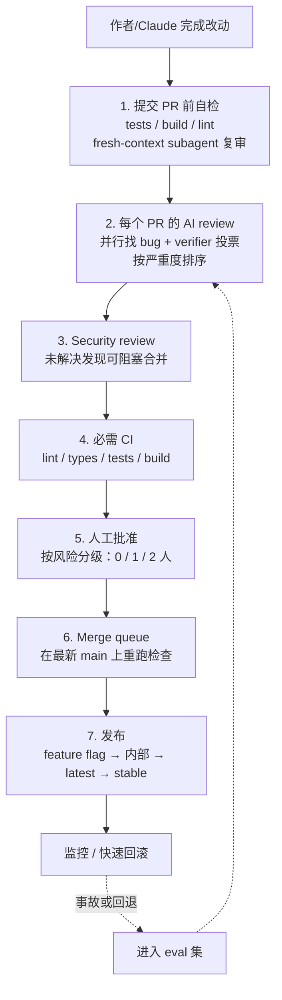
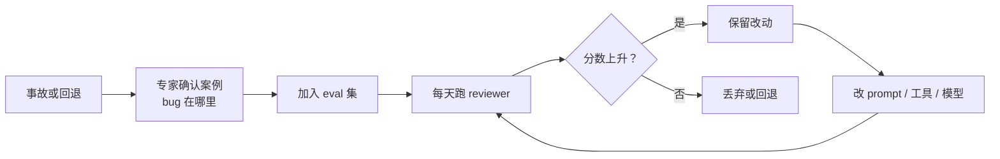

来源：Anthropic 工程博客 *How the Claude Code team does code review*（[[Raw/How the Claude Code team does code review]]）。核心：当 agent 承担大部分写码工作后，评审不再问“人有没有逐行读”，而是问“这个改动可能出什么问题，哪种检查最适合抓住它”。

## 背景：代码量上来了，评审方式必须变

- Claude 写了 Claude Code 自身约 **90%** 的代码。
- 2026 年 6 月到 9 月，合并的 PR 数量翻倍以上，被回退的比例下降 **40%** 以上。
- Anthropic monorepo 每天落地的改动，从 5 月的约 2,500 个涨到 9 月的 30,000 多个。

结论不是“取消评审”，而是：

1. 把大部分**阅读**交给机器；
2. 把人的时间留给只有人能判断的问题；
3. 把“快速撤销错误”做成基础设施。

## 重新定义 code review 的目的

评审做两件事：

1. **在发布前发现并修复问题**；
2. **在团队中建立共享上下文和代码库理解**。

“有没有人读过代码”是一个不精确的代理指标。更好的问题是：**这个改动可能怎么坏？应该由自动检查还是人来抓？**

这改变了评审发生的**时间**：过去是写完代码、开 PR、等同事看；现在评审更像写代码时的拼写检查，大多数问题在人类看到之前已经被 Claude 审过并修过至少一轮。

## 稀缺资源：人的时间和注意力

目标不是“减少评审动作”，而是减少**总人工时间**——包括评审时间和修复坏代码的时间。只看前者，时间会从评审转移到救火。

衡量方式：

- 每个 PR 的人工批准数（中位数和 95 分位）；
- 人工评论数量；
- PR 等待人的时间；
- 护栏：回退率和事故率。

如果回退/事故率上升，说明人工时间并没有省掉，只是挪到了后面。

## 一个改动的生命周期

### 1. 提交 PR 前：先自己验证

- 给 Claude 能运行的东西：测试、构建、截图对比，而不是让它说“做完了”；
- 用一个**全新上下文**的 subagent 复审 diff；
- 内部 skills：找 bug、简化 diff、端到端检查行为；
- UI 改动对照设计规范检查。

反复出现的评审意见要修在源头：

- `CLAUDE.md`：项目是什么、技术栈、约定、目标与非目标；
- `REVIEW.md`：代码所有者写“这部分代码什么最重要”，说明失败长什么样、限制 nits、列出可跳过路径、要求给出文件和行号证据。

### 2. 每个 PR 都有 AI review

- 读 diff，同时对照整个仓库和 PR 声明的意图；
- 问：这个改动解决了它的问题吗？符合系统吗？会不会破坏别的东西？
- 多个 agent 并行找 bug，另一组 verifier 对每个 finding 投票；只有足够多 verifier 认为是真问题才发布；
- 风格、诊断、清理类 finding 直接丢弃；
- 结果按严重度排序，并标记为 Important / Nit / Pre-existing；
- 每个 finding 都必须被回应：修掉，或用理由关闭线程。

内部数据：研究预览阶段，拿到实质性评审评论的 PR 比例从 **16%** 升到 **54%**。

### 3. 安全 review 可以阻塞合并

安全有独立的自动评审。bug review 或 security review 中只要有未关闭的 finding，PR 就不能合并；修掉或给出简短理由关闭（用于清除误报）。后续 commit 修好后，finding 会自动消失。

### 4. 自动检查可以阻塞合并

常规的 lint、类型检查、各平台测试、构建。一个典型 CLI PR 在任何人看之前可能已经跑了几十项检查。PR 模板要求填写：怎么测试的、怎么撤销。

### 5. 人工批准按风险分级

| 风险 | 例子 | 人工批准 |
| --- | --- | --- |
| 低 | 文档、文案、内部功能、flag 后面的增量改动 | 自动评审和安全检查通过后，不需要人 |
| 中 | 普通产品改动；缓存、自动更新、系统提示等敏感区域 | 1 人 |
| 高 | 最高风险代码；始终需要两人的路径 | 2 人 |

- **由改动决定等级，而不是作者**：分类器读 diff 定级；第二个分类器再判断这个具体改动是否额外需要人。
- 只有仓库可信列表里的作者能走轻量路径；其他人需要第二个人批准。
- agent 的批准永远不能算作人的批准。
- 谁发起改动，谁就承担评审责任；agent 写的 PR，指挥 agent 的人算一个评审人。
- **批准只对某个 commit 有效**；新 commit 进来后，无法担保的批准要重新给。

### 6. Merge queue、flag 和渐进发布

- Merge queue 在最新 main 上重跑所有检查，避免两个各自通过的 PR 合并后把 main 弄坏；
- 新行为先放在 flag 后面，给 Anthropic 内部员工用；
- 公共发布先走 `latest` 渠道，`stable` 渠道随后；
- 出问题可以关 flag、回滚、或 staged release 撤销。

### 7. 快速发现、快速回滚

最后一道防线是“错了也能很快发现并修”。flags 不用重新部署就能关；有每周 on-call；事故复盘会问：哪一层本应该抓住这个问题？

## 如何让 reviewer 变好

### 事故就是 eval

团队把历史上导致事故的 PR（包括 fix-forward 和 revert）收集起来，让熟悉那段代码的工程师确认 bug 和位置，组成 eval 集。reviewer 每天对它跑分；任何对 reviewer 的改动都要在这个集合上重新评分。

### 用人的行为衡量噪声

reviewer 多报 bug 很容易，难的是少报非 bug。团队按人的反应给评论分类：

- 修了；
- 说评论是错的；
- 说这是有意行为；
- 决定不重要。

还会在已知干净的 PR 上跑 reviewer，统计它多常报出会让人做出有害改动的问题。优先级写死为：**先抓真 bug，再减少评审轮数**。

### 评审必须收敛

agent 作者 + agent reviewer 可能无限互相忙碌：有一个 CLI PR 一夜之间跑了 50 多轮评审和修复。团队用 git blame 发现，reviewer 反复标记的代码中约 **59%** 是它第一轮就已经存在的旧代码——它并没有发现多少新 bug，只是每轮多找几个旧 bug。

改进措施：

- **轮数上限**：3 轮后，reviewer 要求作者停下来重新考虑方案；
- 前几轮之后只复审 **diff**；
- 标记 **bug 类别**，让作者一次修掉所有同类实例，而不是只修一行；
- 不重复发布已经提过的 finding；
- 夜间对现有代码跑 review agent，提前发现旧 bug。

![[S05_convergence_metrics.png]]
*收敛改进前后的内部 PR 指标：一轮评审+修复后通过率从 65% 升到 78%；需要 5 轮以上的比例从 8.9% 降到 1.5%；平均评审轮数从 2.08 降到 1.32。*

## 人留在哪些环节

自动化不等于人消失。人仍然负责：

- **决定要不要做**：方向、品味、范围；
- **评审高风险代码**：计费、自动更新、CI 工作流；
- **评审架构**：会被人模仿的模式；
- **读证据**：测试输出、运行的命令、截图、reviewer 的 finding；
- **拥有结果**：每个上线的改动都要有人负责，不管是谁敲的代码。

## 知识共享：机器读代码，人怎么学习

团队没有正式流程，也没人能在脑子里装下整个 Claude Code。需要理解某块代码时，直接让 Claude 针对那个 slice 写一篇 explainer：

- 几分钟就能生成；
- 反映当前代码状态；
- 对某些人，还可以生成一个小型可视化 artifact，按自己的学习方式讲解。

读一行文案改动的 diff 几乎学不到东西；读一个你即将修改的模块的 explainer，学到的多得多。

## “You land it, you own it”

小/中等改动落地后出问题，通常由落地的人修。几个前提让这件事不糟糕：

- 改动小，容易评审、调试、回滚；
- 一切可逆：flags、revert、staged release；
- 爆炸半径决定检查强度；
- 回归通过遥测和内部使用快速暴露；
- 不是追责：拥有 fix 的人最了解上下文，事故复盘看系统。

## 如何采用这套流程

**PR 之前：**

- 在简短的 `CLAUDE.md` 里列出 agent 能运行的检查；
- 本地跑 `/code-review`、`/security-review`，或用 fresh-context subagent 复审；
- 加 `REVIEW.md`，把重复的评审意见写进去。

**每个 PR：**

- 必需 CI；PR 模板加 Testing / Risk / How to revert；
- 在一个仓库接入 AI reviewer，调几周 `REVIEW.md`，再扩大；
- 接入自动安全 review；合并前要求所有线程 resolved；
- 评审强度匹配风险（Quick / Standard / Deep）；
- 限制评审轮数，前几轮后只复审新 diff。

**批准：**

- 写清风险等级，由改动决定，不由作者决定；先严后松；
- 可信作者才走轻量路径；
- 用 CODEOWNERS 和分支保护，让 auth、billing、CI、发布流程、安装器始终需要人；
- bot 批准不能替代必需的人；新 commit 进来要撤销旧批准。

**合并之后：**

- merge queue、feature flag、内部先用、staged release、一键回滚；
- 把事故和回退变成 eval 集；
- 用人工时间做目标，用回退/事故率做护栏。

## 关联

已有 AI 笔记：[[Artificial_Intelligence/Unlimited/AI 代码评审 Claude Code 团队实践|AI 代码评审 Claude Code 团队实践]]。

## 词汇

> 只收 CET6 及以上词汇；人名、地名不收。已与 `English/` 及前面 Sight 笔记的词表比对，重复项不再列出。

- **revert** 回退；恢复原状
- **incident** 事故；事件
- **proxy** 代理；替代指标
- **monorepo** 单一代码仓库
- **guardrail** 护栏；防护措施
- **verification** 验证
- **lint** 静态检查
- **severity** 严重程度
- **inline** 行内的
- **pre-existing** 先前存在的
- **classifier** 分类器
- **rollback** 回滚
- **telemetry** 遥测
- **regression** 回归；退化
- **accountable** 负有责任的
- **explainer** 解释性文章
- **artifact** 工件；人工制品
- **converge** 收敛；趋于一致
- **noise** 噪声；干扰信息
- **eval** 评估
- **blast radius** 爆炸半径；影响范围
- **staged** 分阶段的
