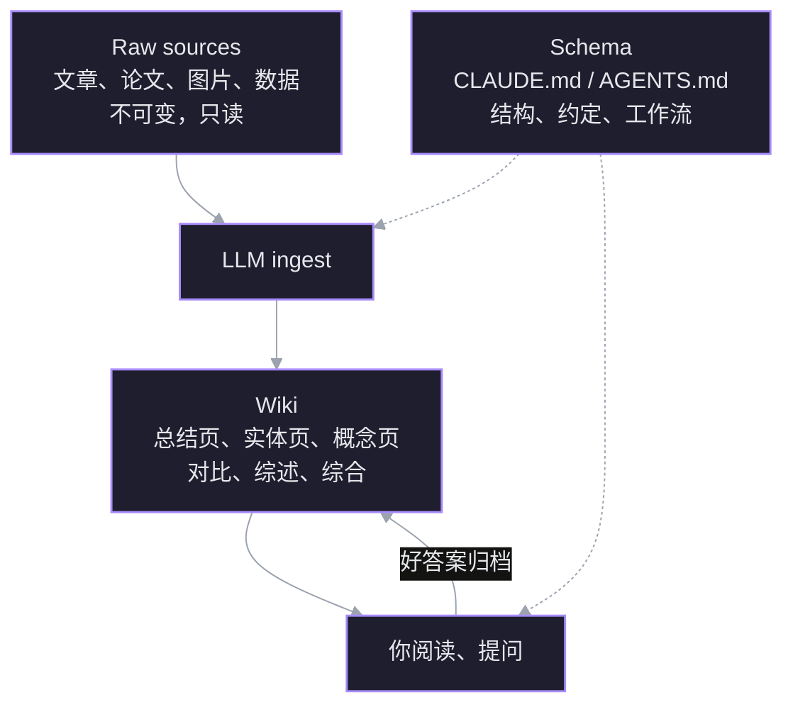

来源：Andrej Karpathy 的 gist *LLM Wiki*（[[Raw/llm-wiki]]）。核心：不要让 LLM 每次提问都从原始文档里重新检索、重新拼接；让它**增量维护一座持久的 Markdown wiki**，知识编译一次，之后一直保持最新。

## 先看 RAG 的问题

大多数人用 LLM 处理文档的方式是 RAG：

1. 上传一堆文件；
2. 提问时检索相关 chunk；
3. LLM 基于这些碎片生成答案。

它能用，但每次提问，LLM 都在**从零重新发现知识**。没有一个“积累”的地方。问一个需要综合五份文档的细微问题，它每次都要重新找到并拼起那些片段。NotebookLM、ChatGPT 文件上传、大多数 RAG 系统都是这个模式。

![[S06_rag_vs_wiki.png]]
*左：RAG 在每次查询时重新检索原始文本；右：LLM Wiki 在摄入时把知识编译进互相链接的页面，查询直接读已整理好的结果。*

## 核心差异：一个复利式的持久工件

LLM Wiki 在原始资料和你之间放了一层**结构化、互相链接的 Markdown 文件**。

- 加入新资料时，LLM 不只是“建索引”，而是读它、抽出关键信息、整合进已有 wiki；
- 更新实体页、改写主题总结；
- 标记新数据与旧结论的**矛盾**；
- 强化或挑战正在形成的综合判断。

关键区别：**wiki 是一个持久、会复利增长的工件**。交叉引用已经建好，矛盾已经标出，综合已经反映了你读过的全部内容。每加一份资料、每问一个问题，它都变得更厚。

你自己几乎不写 wiki——LLM 写并维护全部。你负责选资料、探索、提出好问题；LLM 负责总结、交叉引用、归档、记账这些“苦力活”。

实际操作像这样：一边开着 LLM agent，一边开着 Obsidian。agent 根据对话改文件，你实时浏览结果——点链接、看图谱、读更新后的页面。

> Obsidian 是 IDE，LLM 是程序员，wiki 是代码库。

## 三层架构



### 1. Raw sources（原始资料）

你精选的源文档集合：文章、论文、图片、数据文件。

- **不可变**：LLM 只读，不修改；
- 这是你的**事实来源（source of truth）**。

### 2. The wiki（wiki 层）

LLM 生成的 Markdown 文件目录：

- 摘要、实体页、概念页、对比、总览、综合；
- LLM 完全拥有这一层：创建页面、随新资料更新、维护交叉引用、保持一致性；
- **你读，LLM 写**。

### 3. The schema（模式）

一份文档（Claude Code 用 `CLAUDE.md`，Codex 用 `AGENTS.md`），告诉 LLM：

- wiki 怎么组织；
- 命名和写作约定；
- 摄入、回答、维护时按什么工作流走。

这是关键配置文件：它让 LLM 成为**有纪律的 wiki 维护者**，而不是普通聊天机器人。你和 LLM 随着实践共同演化这份 schema。

## 三个操作

### Ingest（摄入）

把新资料放进 raw 集合，让 LLM 处理。一个典型流程：

1. 读原文；
2. 和你讨论关键要点；
3. 在 wiki 写一个摘要页；
4. 更新 `index.md`；
5. 更新相关的实体页和概念页；
6. 在 `log.md` 追加一条记录。

**一份资料可能触及 10–15 个 wiki 页面。**

作者偏好一次摄入一份，并保持参与：读摘要、检查更新、指导 LLM 该强调什么。也可以批量摄入、减少监督。关键是把适合你的工作流写进 schema，供之后的会话使用。

### Query（查询）

你针对 wiki 提问。LLM：

1. 搜索相关页面；
2. 读这些页面；
3. 综合出带引用的答案。

答案形式可以不同：Markdown 页、对比表、幻灯片（Marp）、图表（matplotlib）、canvas。

最重要的洞察：**好答案可以归档回 wiki，变成新页面。** 你要的对比、一次分析、发现的一个连接，都很有价值，不该消失在聊天记录里。这样，探索本身也像摄入资料一样在知识库里复利。

```mermaid
%%{init: {'theme':'base','themeCSS':'.nodeLabel{color:#E5E7EB!important;fill:#E5E7EB!important}.edgeLabel p{background-color:#131312!important}.edgeLabel{color:#E5E7EB!important}svg{background:transparent!important}','themeVariables':{'primaryColor':'#1E1E2E','primaryTextColor':'#E5E7EB','primaryBorderColor':'#A78BFA','secondaryColor':'#1E1E2E','tertiaryColor':'#1E1E2E','lineColor':'#9CA3AF','textColor':'#E5E7EB','mainBkg':'#1E1E2E','nodeBorder':'#A78BFA','clusterBkg':'#131312','clusterBorder':'#3A3A4A','edgeLabelBackground':'#131312','actorBkg':'#1E1E2E','actorBorder':'#A78BFA','actorTextColor':'#E5E7EB','actorLineColor':'#9CA3AF','signalColor':'#9CA3AF','signalTextColor':'#E5E7EB','labelBoxBkgColor':'#1E1E2E','labelBoxBorderColor':'#A78BFA','labelTextColor':'#E5E7EB','loopTextColor':'#E5E7EB','noteBkgColor':'#1E1E2E','noteBorderColor':'#A78BFA','noteTextColor':'#E5E7EB','stateBkg':'#1E1E2E','stateBorder':'#A78BFA','stateTextColor':'#E5E7EB','transitionColor':'#9CA3AF','transitionLabelColor':'#E5E7EB','fontFamily':'Noto Sans CJK SC, sans-serif','fontSize':'16px'}}}%%
flowchart LR
    Q["问题"] --> S["搜索相关页面"]
    S --> R["阅读并综合"]
    R --> A["答案 + 引用"]
    A -->|"值得保留"| W["归档为新 wiki 页"]
    W --> S
classDef default fill:#1E1E2E,stroke:#A78BFA,stroke-width:1.5px,color:#E5E7EB
linkStyle default stroke:#9CA3AF
```



### Lint（体检）

定期让 LLM 做健康检查，找：

- 页面之间的矛盾；
- 被新资料取代的过时结论；
- 没有入链的**孤儿页**；
- 被提到但还没有自己页面的重要概念；
- 缺失的交叉引用；
- 可以用网络搜索补上的数据空白。

LLM 很擅长提出“接下来该查什么、该找什么资料”。这保证 wiki 长大后仍然健康。

## 两个特殊文件

### index.md：内容导向

- wiki 里所有页面的目录；
- 每项包含链接、一行摘要，可选日期/来源数等元数据；
- 按类别组织（实体、概念、来源……）；
- 每次摄入都更新。

回答问题时，LLM **先读 index，找到相关页面，再深入**。在约 100 份资料、数百个页面的中等规模下，这已经很好用，不需要 embedding 检索基础设施。

### log.md：时间导向

- 只追加（append-only）的事件记录：摄入、查询、lint；
- 每条用统一前缀，例如：

```text
## [2026-04-02] ingest | Article Title
```

这样日志可以用简单 Unix 工具解析：

```bash
grep "^## \[" log.md | tail -5
```

它给出 wiki 演化时间线，也帮 LLM 理解“最近做了什么”。

## 可选：CLI 工具

规模变大后，可以给 LLM 建小工具。最自然的是**wiki 页面搜索引擎**：

- 小规模时 `index.md` 就够；
- 长大后需要真正的搜索；
- qmd 是本地 Markdown 搜索引擎，混合 BM25/向量检索 + LLM 重排，完全在设备上运行；
- 同时提供 CLI（LLM 可以 shell 调用）和 MCP server（LLM 当原生工具用）。

也可以让 LLM 现场写一个朴素搜索脚本，够用就行。

## 为什么这套东西有效

维护知识库最烦的不是阅读或思考，而是**记账（bookkeeping）**：

- 更新交叉引用；
- 让摘要保持最新；
- 记录新数据何时推翻旧结论；
- 在几十个页面之间保持一致。

人类放弃 wiki，是因为维护负担增长得比价值快。LLM 不会厌烦，不会忘记更新引用，一次能改 15 个文件。**维护成本接近零，wiki 才活得下去。**

分工因此变成：

- 人：筛选资料、指导分析、提出好问题、思考意义；
- LLM：其余全部。

## 与 Memex 的关系

这个想法在精神上接近 Vannevar Bush 1945 年提出的 **Memex**：一个私人的、经过策展的知识库，文档之间有**联想路径（associative trails）**。

Bush 的设想其实更接近这个模式，而不是后来的万维网：

- 私有；
- 主动策展；
- 文档之间的连接和文档本身一样有价值。

他没解决的部分是：**谁来维护？** LLM 正好接手这件事。

## 适用场景

- **个人**：目标、健康、心理、自我改进——归档日记、文章、播客笔记，逐步建立对自己的结构化认识。
- **研究**：几周到几个月深挖一个主题，读论文、报告，增量构建带演化论点的 wiki。
- **读书**：每章归档，建人物页、主题页、情节线及其连接；读完就有一份丰富的伴读 wiki。
- **商业/团队**：由 Slack 线程、会议记录、项目文档、客户电话喂养的内部 wiki，人可以审核更新。
- **竞品分析、尽职调查、旅行规划、课程笔记、爱好深挖**——任何“知识随时间累积、希望被组织而不是散落”的场景。

## 实践技巧

- **Obsidian Web Clipper**：浏览器扩展，把网页文章转成 Markdown，快速放进 raw 集合。
- **图片下载到本地**：在 Obsidian 设置里把附件目录固定（如 `raw/assets/`），给 “Download attachments for current file” 绑快捷键。LLM 可以查看和引用本地图片，而不是依赖可能失效的 URL。注意 LLM 不能一次读“带内联图片的 Markdown”，通常先读文字，再单独看图片。
- **Graph view**：看 wiki 的形状——谁连着谁、哪些是枢纽、哪些是孤儿。
- **Marp**：Markdown 幻灯片格式，Obsidian 有插件，可以直接从 wiki 内容生成演示。
- **Dataview**：查询页面 frontmatter，生成动态表格和列表。
- **Git**：wiki 就是一堆 Markdown 文件的仓库，版本历史、分支、协作都免费得到。

## 与本 vault 的关系

这套结构与当前 Obsidian 库几乎同构：`Raw/`、`Captures/`、`Ref/`、`OfficialDocuments/` 是不可变来源层；各栏目笔记是 wiki 层；笔记规范（记忆 + 各栏目 Overview）就是 schema。差别是本库还多了「主页/索引/进度」和人工确定的目录结构。

## 这份文档本身是“想法文件”

它有意保持抽象：讲模式，不讲具体实现。目录结构、schema 约定、页面格式、工具链，都取决于你的领域、偏好和所用 LLM。所有东西都是可选、模块化的——挑有用的，忽略没用的。

正确用法是把它交给你的 LLM agent，一起实例化一个适合你的版本。文档只负责传达模式，剩下的 LLM 能自己补。

## 词汇


- **contradiction** 矛盾
- **supersede** 取代；淘汰
- **catalog** 目录；编目
- **chronological** 按时间顺序的
- **append** 追加；附加
- **parseable** 可解析的
- **infrastructure** 基础设施
- **curate** 策展；精心挑选
- **associative** 联想的；关联的
- **bookkeeping** 记账；日常记录工作
- **burden** 负担
- **instantiate** 实例化
- **modular** 模块化的
- **entity** 实体
- **thesis** 论点；论文
- **due diligence** 尽职调查
- **consistency** 一致性
- **convention** 约定；惯例
