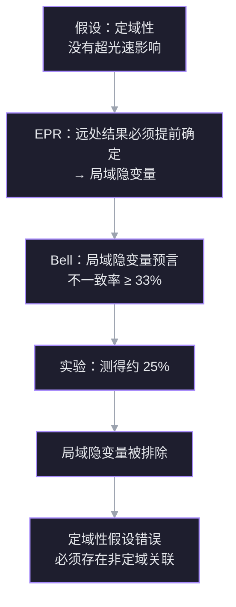

来源：Veritasium *The Scariest Chart in Electrical Engineering*（[[Raw/Vertasium/The Scariest Chart in Electrical Engineering]]）。一句话：史密斯圆图是阻抗平面经过保角映射后的反射系数平面，它把 $0$ 到 $\infty$ 的阻抗全部塞进一个单位圆，让射频工程师能“看图”做阻抗匹配。

整条逻辑链：

## 1. 工程学里最吓人的图

这张图看上去像科幻电影里的虫洞，很多版本甚至直接印着“Black Magic”。但它解决的是射频工程里一个很实际、又有点反直觉的问题：

- 信号从源出发，沿传输线送往天线；
- 一部分能量在末端反射回来；
- 反射波和入射波叠加，形成驻波，可能烧坏线路；
- 工程师要在**不额外消耗功率**的前提下，让反射消失。

1928 年，Philip H. Smith 在贝尔实验室测试跨大西洋无线电天线阵列：20 多副天线、两公里多的传输线。他的任务就是让尽可能多的功率到达天线，而不是在线上来回反弹。

## 2. 驻波与反射

### 直流与交流

- **直流（DC）**：电池提供恒定电压，驱动稳定电流，灯泡亮。
- **交流（AC）**：电压、电流按正弦规律振荡；电子来回加速，产生变化的电磁场，向外辐射电磁波。

无线电信号就是高频交流。设电压、电流都是正弦波，波在传输线上以速度 $v$ 前进，满足

$$
v=\lambda f,
$$

其中 $\lambda$ 是波长，$f$ 是频率。真空中电磁波速度 $c\approx 3\times10^8\ \mathrm{m/s}$；在传输线中速度略慢，但对同一条线是固定的。

Smith 处理的是约 $10\ \mathrm{MHz}$ 的无线电波，波长约 $30\ \mathrm{m}$；而他的传输线长 $2\ \mathrm{km}$，是波长的几十倍。线路越长、频率越高，反射越不能忽略。

### 反射波与驻波

波传到传输线与天线的交界处，如果两边“性质”不同，一部分能量继续前进，一部分反射回来。反射波与入射波叠加：

$$
V(x,t)=V^+\cos(\omega t-\beta x)+V^-\cos(\omega t+\beta x).
$$

设负载处的反射系数为 $\Gamma=V^-/V^+$，则沿线电压的幅值为

$$
|V(x)|=|V^+|\,\left|1+\Gamma e^{-2j\beta x}\right|.
$$

- 匹配时 $\Gamma=0$，沿线电压幅值恒定，没有驻波。
- 全反射时 $|\Gamma|=1$，电压在 $0$ 与 $2|V^+|$ 之间振荡，**峰值是入射波的两倍**。
- 部分反射时，电压在 $|V^+|(1-|\Gamma|)$ 与 $|V^+|(1+|\Gamma|)$ 之间起伏。

这就是驻波（standing wave）。最坏情况下，峰值电压翻倍，超过线路耐压就会烧毁。

实验复现：按输入功率和距离预期接收信号约 $-55\ \mathrm{dB}$，实测约 $-59\ \mathrm{dB}$。信号用对数刻度，$4\ \mathrm{dB}$ 的落差意味着损失超过一半功率。

![[S1_reflection_standing_wave.png]]
*(a) 传输线上的入射波与反射波；(b) 不同反射系数下的驻波包络，全反射时峰值达到 $2|V^+|$。*

## 3. 波为什么会反弹

### 弹簧类比

把两根弹簧（slinky）接在一起，一根单位长度质量大，一根小。波从一根传到另一根时：

- 一部分透射过去；
- 一部分在交界处反射；
- 两根弹簧的“单位长度质量”差得越多，反射越强；
- 两根完全相同时，反射为零。

电学里的对应量是**阻抗**。传输线有固定的**特征阻抗** $Z_0$（常见 $50\ \Omega$），天线有负载阻抗 $Z_L$。交界处的反射系数为

$$
\boxed{\Gamma=\frac{Z_L-Z_0}{Z_L+Z_0}}.
$$

- $Z_L=Z_0$：$\Gamma=0$，完全匹配，没有反射。
- $Z_L=0$（短路）：$\Gamma=-1$，全反射，反射波反相。
- $Z_L\to\infty$（开路）：$\Gamma=1$，全反射，反射波同相。

### 只匹配电阻为什么不够

实验里天线阵列约 $12.5\ \Omega$，传输线 $50\ \Omega$。直觉上串一个 $37.5\ \Omega$ 的电阻就能“补齐”，但实测功率仍然损失一半。原因有两个：

1. **电阻是有损的**：它把功率变成热，正好违背“把功率送到天线”的目标。
2. **真实系统不只有电阻**：电容、电感会改变电压和电流的**相位**，只对齐幅值不够。

### 电容与电感的相位

- **电容**：极板积累电荷。电压上升时电荷流入，电流最大；电压达到峰值时电荷停止流动，电流为零。所以**电流超前电压 $90^\circ$**。
- **电感**：电流变化会产生反向感应电压。电流变化最快时感应电压最大；电流达到峰值、暂时不变化时，感应电压为零。所以**电压超前电流 $90^\circ$**。

用复数表示：

$$
Z_R=R,\qquad Z_C=\frac{1}{j\omega C}=-\frac{j}{\omega C},\qquad Z_L=j\omega L.
$$

总阻抗写成

$$
Z=R+jX,
$$

其中 $R$ 是电阻，$X$ 是电抗（reactance）。$|Z|$ 决定电压与电流的幅值比，$\angle Z$ 决定相位差。

![[S2_phase_relation.png]]
*纯电阻：电压与电流同相；纯电容：电流超前电压 $90^\circ$；纯电感：电压超前电流 $90^\circ$。*

## 4. 如何阻止波反弹

### 先看一个具体失配

设天线阻抗

$$
Z_L=10-j30\ \Omega,\qquad Z_0=50\ \Omega.
$$

目标是让总阻抗变成 $50+j0$。

1. 串一个 $+j30\ \Omega$ 的电感，把虚部抵消，剩下 $10\ \Omega$。
2. 还差 $40\ \Omega$ 的实部；但不能串电阻，因为电阻会把功率烧掉。
3. 无源系统里也没有“负电阻”可以抵消多余的实部。

所以只靠集总元件（电阻、电容、电感）并不能优雅地解决匹配。

![[S3_complex_impedance.png]]
*复数阻抗平面：实轴是电阻 $R$，虚轴是电抗 $X$；串电感可以把 $-j30$ 抵消，但实部仍与 $50\ \Omega$ 不匹配，而串电阻只会损耗功率。*

### 利用传输线本身

关键观察：一旦线上同时存在入射波和反射波，**沿线各点的电压与电流之比不再等于负载阻抗**，而是随位置变化。也就是说，传输线本身就是一个“阻抗变换器”。

设 $d$ 为从负载向源方向走的距离，$\beta=2\pi/\lambda$ 为相位常数，则

$$
Z(d)=Z_0\frac{Z_L+jZ_0\tan\beta d}{Z_0+jZ_L\tan\beta d}.
$$

归一化 $z=Z/Z_0$、$z_L=Z_L/Z_0$ 后：

$$
z(d)=\frac{z_L+j\tan\beta d}{1+jz_L\tan\beta d}.
$$

于是策略变成：

1. 沿传输线走到某个位置，使电阻部分恰好等于 $Z_0$；
2. 再用一个**无损**的串联电感或电容，把剩下的电抗抵消。

问题只剩一个：怎么快速找到这个位置？Heaviside 的传输线方程能算，但用计算尺逐点算是灾难。Smith 的答案是把整个阻抗平面画成一张图。

## 5. 史密斯圆图

### 第一步：归一化

把所有阻抗除以 $Z_0$：

$$
z=\frac{Z}{Z_0}=r+jx.
$$

这样“完美匹配”永远对应 $z=1$，不用为每条 $50\ \Omega$、$75\ \Omega$ 的线各画一张图。

但归一化后，阻抗范围仍是

$$
0\le r<\infty,\qquad -\infty<x<\infty,
$$

短路在 $0$，开路在 $\infty$，画不进一张有限大小的纸。

### 第二步：换到反射系数平面

改用反射系数

$$
\Gamma=\frac{Z-Z_0}{Z+Z_0}=\frac{z-1}{z+1},
\qquad
z=\frac{1+\Gamma}{1-\Gamma}.
$$

无源负载满足 $|\Gamma|\le 1$。于是**无限的阻抗右半平面被压进了单位圆**。

这个映射是莫比乌斯变换（Möbius transformation），也是一种**保角映射（conformal map）**：它把直线变成圆，但局部保持角度不变。

### 第三步：两族圆

令 $\Gamma=u+jv$，代入 $z=(1+\Gamma)/(1-\Gamma)$，可以得到：

- **等电阻圆**：

$$
\left(u-\frac{r}{1+r}\right)^2+v^2=\left(\frac{1}{1+r}\right)^2.
$$

- **等电抗圆**：

$$
(u-1)^2+\left(v-\frac{1}{x}\right)^2=\left(\frac{1}{x}\right)^2.
$$

这两族圆就是史密斯圆图的全部骨架：

- $r=0$：最外圈，对应短路；
- $r=1$：经过圆心的圆，对应“电阻已经匹配”；
- $r\to\infty$：缩成最右侧的点 $(1,0)$，对应开路；
- $x>0$：上半平面，感性；$x<0$：下半平面，容性；$x=0$：水平实轴。

![[S4_smith_construction.png]]
*(a) 归一化阻抗平面：等 $r$ 线是竖线，等 $x$ 线是横线，范围从 $0$ 到 $\infty$；(b) 经 $\Gamma=(z-1)/(z+1)$ 映射后，右半平面被装进单位圆，等 $r$、等 $x$ 线分别变成两族圆。*

### 圆图上每个点同时表示两件事

- **阻抗**：看它落在哪条等 $r$ 圆和哪条等 $x$ 圆的交点上。
- **反射系数**：圆心到该点的距离就是 $|\Gamma|$，角度就是反射系数的相位。

沿传输线移动时，$|\Gamma|$ 不变，只有相位旋转：

$$
\Gamma(d)=\Gamma_L e^{-2j\beta d}.
$$

所以在圆图上**绕圆心转一圈，等价于沿线移动半个波长**。这是读图、做匹配的核心。

## 6. 如何读史密斯圆图

实验测得的负载为

$$
Z_L\approx 36+j74\ \Omega.
$$

### 定位

归一化：

$$
z=\frac{36}{50}+j\frac{74}{50}\approx 0.7+1.5j.
$$

在圆图上找等 $r=0.7$ 圆与等 $x=1.5$ 圆的交点。该点到圆心的距离

$$
|\Gamma|\approx 0.68,
$$

说明反射波约是入射波的 $0.68$ 倍。对应的电压驻波比为

$$
\mathrm{VSWR}=\frac{1+|\Gamma|}{1-|\Gamma|}\approx 5.25.
$$

### 旋转到 $r=1$

目标是圆心（$z=1+j0$）。沿等 $|\Gamma|$ 圆旋转，直到落在 $r=1$ 的圆上：

- 最近的交点在 $12^\circ$ 处，对应线长 $3.1\ \mathrm{mm}$；
- 但 $3.1\ \mathrm{mm}$ 太短，不方便加工；
- 继续转到下一个交点，旋转约 $107^\circ$，对应线长 $28\ \mathrm{mm}$。

这里 $360^\circ$ 对应半个波长；在该同轴电缆中，半个导波波长约 $92\ \mathrm{mm}$。所以

$$
l=\frac{\Delta\theta}{360^\circ}\cdot\frac{\lambda_g}{2}.
$$

### 抵消剩余电抗

在 $28\ \mathrm{mm}$ 处，归一化阻抗约为

$$
z=1-1.8j.
$$

只剩容性电抗。串一个 $+j1.8$ 的电感：

$$
x_L=\frac{\omega L}{Z_0}=1.8
\quad\Longrightarrow\quad
L=\frac{1.8Z_0}{\omega}
=\frac{1.8\times50}{2\pi\times1.085\times10^9}
\approx 13.2\ \mathrm{nH}.
$$

加上后，阻抗回到圆心，反射消失，功率传输最大。

![[S5_smith_reading.png]]
*(a) 先由 $z=0.7+1.5j$ 定位，再沿等 $|\Gamma|$ 圆旋转到 $r=1$；(b) 在 $z=1-1.8j$ 处串 $+j1.8$ 的电感，沿 $r=1$ 圆走到圆心完成匹配。*

## 7. 这个电路“断开”后反而更好

匹配不一定非要焊电感。还有更优雅的办法：**短截线（stub）**。

一段终端开路或短路的传输线，输入端看进去是纯电抗。以开路短截线为例：

$$
z_{\text{in}}=-j\cot(\beta l).
$$

改变长度 $l$，就能得到任意电抗。圆图上的解释更直接：

- 开路点在最右端 $(1,0)$，短路点在最左端 $(-1,0)$；
- 两者都在 $|\Gamma|=1$ 的外圈上；
- 沿外圈走，经过所有可能的纯电抗；
- 走一圈仍然是半个波长。

例：需要 $+j1.8$ 的电抗。从开路点出发，沿外圈顺时针转 $302^\circ$ 到 $z=j1.8$：

$$
l=\frac{302^\circ}{360^\circ}\times\frac{\lambda_g}{2}
\approx 77\ \mathrm{mm}.
$$

也可以再加一整圈（$92\ \mathrm{mm}$），得到 $169\ \mathrm{mm}$ 的等效长度；实际制作时先留长，再一边剪一边测，直到匹配。

![[S6_stub_matching.png]]
*(a) 主线上接一段末端开路的短截线；(b) 短截线长度让输入电抗沿圆图外圈移动，转 $302^\circ$ 得到 $+j1.8$。*

实际电路里更常用**并联短截线**，因为不用切断主线。但并联时阻抗不能直接相加，要用导纳

$$
Y=\frac{1}{Z}.
$$

并联导纳相加，对应的是**导纳史密斯圆图（Admittance Smith Chart）**，它相当于把阻抗圆图旋转 $180^\circ$。

## 8. 为什么我们这么晚才用上它

- 1937 年，Smith 完成圆图；几乎同时，日本的水桥东作也独立得到类似表示；1939 年，苏联的 Amiel Volpert 也独立完成。
- Smith 的版本最初投稿被技术杂志拒绝，约两年后才发表。
- 二战改变了一切：德国 U 型潜艇在大西洋击沉盟军船只，MIT 辐射实验室急需快速可靠的微波雷达调试工具。圆图从“可选技巧”变成“战时刚需”。
- 战后，这批工程师把圆图带进工业界、大学和教科书，Smith 的版本因此流传最广。

这件事的意义不只是一张图：**新的表示法本身就能推动科学**。门捷列夫的周期表、费曼图，都是把复杂关系重新组织后，让问题变得可操作的例子。

## 9. 今天还有用吗

- 圆图只对**单一频率**精确。真实信号有带宽，在圆图上是一条曲线，而不是一个点；匹配的目标变成让整条曲线尽量靠近圆心。
- 计算机能直接算出最佳匹配，但算不出“往哪个方向调”的直觉。圆图仍然广泛出现在射频软件、网络分析仪和工程课堂上。
- 它更像一张地图：告诉你从当前位置往哪个方向走，而不是只给一个终点坐标。

## 核心公式速查

| 量 | 公式 |
| --- | --- |
| 反射系数 | $\Gamma=\dfrac{Z_L-Z_0}{Z_L+Z_0}=\dfrac{z-1}{z+1}$ |
| 阻抗反解 | $z=\dfrac{1+\Gamma}{1-\Gamma}$ |
| 沿线阻抗 | $z(d)=\dfrac{z_L+j\tan\beta d}{1+jz_L\tan\beta d}$ |
| 沿线反射系数 | $\Gamma(d)=\Gamma_L e^{-2j\beta d}$ |
| 电压驻波比 | $\mathrm{VSWR}=\dfrac{1+|\Gamma|}{1-|\Gamma|}$ |
| 等电阻圆 | $\left(u-\dfrac{r}{1+r}\right)^2+v^2=\left(\dfrac{1}{1+r}\right)^2$ |
| 等电抗圆 | $(u-1)^2+\left(v-\dfrac{1}{x}\right)^2=\left(\dfrac{1}{x}\right)^2$ |
| 串联电感 | $X_L=\omega L$ |
| 开路短截线 | $z_{\text{in}}=-j\cot(\beta l)$ |
| 圆图旋转 | $360^\circ \leftrightarrow \lambda_g/2$ |

## 词汇

> 只收 CET6 及以上词汇；人名、地名、单位名、品牌名不收。已与 `English/` 现有词表比对，重复项不再列出。

- **impedance** 阻抗
- **reflection coefficient** 反射系数
- **transmission line** 传输线
- **antenna array** 天线阵列
- **anechoic chamber** 微波暗室；消声室
- **standing wave** 驻波
- **interference** 干涉；干扰
- **wavelength** 波长
- **amplitude** 振幅
- **oscillate** 振荡；摆动
- **sinusoidal** 正弦的
- **alternating current** 交流电
- **direct current** 直流电
- **electromagnetic** 电磁的
- **propagate** 传播；繁衍
- **reinforce** 加强；加固
- **capacitor** 电容器
- **capacitance** 电容
- **inductor** 电感器
- **inductance** 电感
- **reactance** 电抗
- **resistor** 电阻器
- **admittance** 导纳
- **stub** 短截线；支节
- **coaxial** 同轴的
- **dimensionless** 无量纲的
- **conformal map** 保角映射
- **complex plane** 复平面
- **imaginary** 虚数的；想象的
- **magnitude** 大小；幅度
- **logarithmic scale** 对数刻度
- **decibel** 分贝
- **microwave** 微波
- **radar** 雷达
- **frequency modulation** 调频
- **characteristic impedance** 特征阻抗
- **normalize** 归一化；使标准化
- **open circuit** 开路
- **short circuit** 短路
- **lossless** 无耗的
- **inversely proportional** 成反比的
- **mismatch** 不匹配
- **discontinuity** 不连续性
- **tuning** 调谐
- **splice** 拼接；接合
- **solder** 焊接
- **trim** 修剪；调整
- **cumbersome** 笨重的；繁琐的
- **concerted** 协同的；齐心协力的
- **trial and error** 反复试验
- **intuition** 直觉
- **representation** 表示；表征
- **converge** 汇聚；趋同
- **simultaneously** 同时地
- **paradoxical** 悖论的；自相矛盾的
- **wormhole** 虫洞
- **submarine** 潜艇
- **predator** 捕食者；掠夺者
