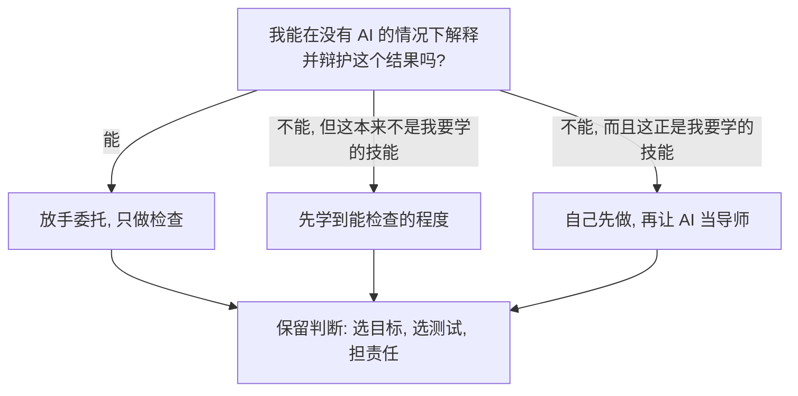

来源：Miles Cranmer 的演讲 *How to Avoid AI Brain Rot*（[[Raw/How to Avoid AI Brain Rot - Miles Cranmer]]，YouTube）。核心：AI 把所有人的产出拉向均值；要保住学习，必须保留“挣扎”、用 AI 提问和测验自己，而不是直接要答案。

## 默认使用 AI 会把人拉向均值

现在人人都有 AI，它不再是少数人的作弊码。Cranmer 用一个钟形曲线描述：

- 默认用法会把低分端整体抬高；
- 高分端因为省力，优势被压缩；
- 最后大家向均值收拢，分布变窄。

![[S14_ai_brain_rot.png]]
*AI 提高下限，同时压缩上限；真正稀缺的是仍愿意往上尾走的人。*

几个具体实验：

- 让 25 个语言模型各写 50 次“时间是什么”的比喻，答案基本落到两个簇：时间是河流、时间是织布机。Pareto 最优，但没有真正的多样性。
- 短篇故事实验中，用 AI 给创意，故事平均新颖度提高约 **8%**，但故事之间的相似度也明显上升：平均更好，却越来越像。
- 客服培训里，能力最低的一组从 AI 获益最大，最强的一组提升最小；AI 把分布压扁。
- 750 名顾问的实验里，AI 擅长的任务质量提高；任务难度超过 AI 时，使用 AI 反而略微拉低表现。

原因很直接：常规任务上 AI 替人做了大部分工作；大家都用同样的默认方式，就会得到同样的平均结果。

## 判断力仍然是人的工作

主观判断是 AI 的弱项。一个软件任务里，专家用 AI 达到 **33%**，新手只有 **15%**；遇到麻烦时新手更容易放弃，专家能给 AI 提供整体方向和轨迹。

Cranmer 自己让 agent 自主跑了 **14 小时**做符号回归研究。Agent 汇报“所有目标都完成、所有测试都通过”，但他作为领域专家一看，结果是垃圾：测试和子目标本身选错了。

这引出两条原则：

1. **AI 写得了测试，但选不对该测什么。** 目标、子目标、什么算“好”，是主观判断。
2. **AI 不能坐牢。** 它不承担责任的最终后果，所以你对 AI 输出 **100% 负责**。

> 用 AI 加速自己，而不是替代自己。用它替代自己，你就会被替代。

可以用一个简单检查决定是否放手：

## 挣扎才是学习发生的地方

土耳其一项约 **1000 名高中生**的数学实验：

- 纯自己做题：练习成绩约 **28%**；
- 直接用 ChatGPT 拿答案：练习成绩约 **42%**；
- 只用 ChatGPT 给提示、不给答案：介于两者之间。

但考试时，纯做题组和“只给提示”组表现接近；**直接用 AI 拿答案的组最差**。学生主观上却觉得自己学得更多——练习时更顺，不等于考试时会。

类似结果反复出现：

- 学 Python 库 Trio 的学生，关掉 AI 做测验时，不用 AI 学习的一组更好。
- 大学 Python 课程记录显示：每向 ChatGPT 要一次**答案**，考试成绩下降；每要一次**解释**，成绩上升。
- 学习策略实验：一组读四遍，另一组读一遍、自测三遍。5 分钟后读四遍组约 **83%**，更高；一周后自测组反超。

心理学把这叫 **desirable difficulties**（合意困难）：卡住、回忆、犯错的过程本身在加固记忆。像举铁，机器替你把重量举起来，肌肉不会变强。

## 把 AI 变成苏格拉底式导师

Cranmer 学新主题时常用一个固定开场：

> Don't tell me the answer. Ask me one question at a time. Give me a hint only when I'm stuck.

流程是循环的：

1. AI 问一个问题；
2. 你用自己的话解释；
3. 它发现你卡在哪，给一点提示；
4. 你回去读材料，再解释；
5. 直到讲清楚，再进入下一个问题。

他用“L2 正则化对应高斯先验”的 MAP 估计做演示：AI 先问“MAP 在最大化什么”，再问“高斯先验的 log 长什么样”，只在符号方向卡住时提示。这样学到的是一条可复述的推理链，而不是一个答案。

注意：AI 也会讲错，尤其是冷门材料。把它当成多种学习方式之一；最好把论文或书喂给它，要求它基于给定材料提问。

## 让 AI 画图，而不是写长解释

人对图的理解速度远高于长文。Cranmer 的常用指令：

- “我不理解梯度下降里的学习率，做一个单文件网页让我拖滑块看。”
- “别给我看代码，画一张图，假装你是我的学生，在组会上给我讲这张图。”
- “先复现 bug，再修；用最少的代码；最后给我一张图。”

图能让人一眼看出拟合曲线“掉到地板下面”这类错误，比逐行读代码快得多。但图也可能是错的，只能当学习工具箱里的一件工具。

对编码 agent，他还强调：

- **写能通过测试的最少代码**；
- **先理解 bug 的病因，再打补丁**，不要只消除症状；
- 源码仍要读，测试可以快速扫；
- “关灯软件工厂”（只有 agent 互相迭代、没有人类）通常能撑 3–6 个月，之后技术债累积、代码质量恶化，仍需要人类架构监督。

## 建立自己的 AI 使用标准

把这些要求写进全局系统指令，而不是每次临场想：

- 教我时：不要直接给答案，先测验我，确保我能解释；
- 写代码时：从公开示例开始，最少代码，先复现 bug，再修；
- 给结果时：优先给图，不要写长文。

Cranmer 认为，**50% 熟悉最新工具，胜过 90% 熟悉两年前的工具**。AI 工具变化太快，唯一不变的是适应能力；快速学习本身就是当前最重要的技能。

最后是乐观的部分：AI 自动化掉大量工作后，应该把目标抬高，去解更难的问题。但前提是——你还保留判断、品味和提出好问题的能力。

## 可操作清单

- 要答案之前，先让 AI 只给提示。
- 每学一个概念，合上资料，用自己的话讲一遍。
- 每次让 AI 代写，先问自己能不能检查、能不能辩护。
- 用“自测三遍”替代“重读四遍”。
- 让 AI 生成可视化或流程图，但自己读关键源码。
- 把“教我时先测验我”写进系统提示词。

## 关联

- [[Sight/Agent Harness 学习闭环]]：用 Probe–Plan–Teach 把“挣扎”拆成可执行的闭环。
- [[Sight/LLM Wiki 持久知识库模式]]：让 AI 维护持久知识，而不是每次从零检索。

## 词汇

> 只收 CET6 及以上词汇；人名、地名不收。已与 `English/` 及前面 Sight 笔记的词表比对，重复项不再列出。

- **atrophy** 萎缩；衰退
- **delegate** 委托；授权
- **novelty** 新颖性
- **subjective** 主观的
- **novice** 新手
- **trajectory** 轨迹；发展路径
- **autonomous** 自主的
- **verified** 已验证的
- **desirable difficulty** 合意困难（学习中适度的阻碍反而促进记忆）
- **crossover** 交叉；反超
- **Socratic** 苏格拉底式的
- **oversight** 监督
- **adaptation** 适应
- **ambition** 抱负；野心
- **deteriorate** 恶化
- **patch** 打补丁
- **symptom** 症状；表象
- **rote** 死记硬背
- **integrity** 完整性；正直
- **liability** 责任；法律责任
- **judgment** 判断力
